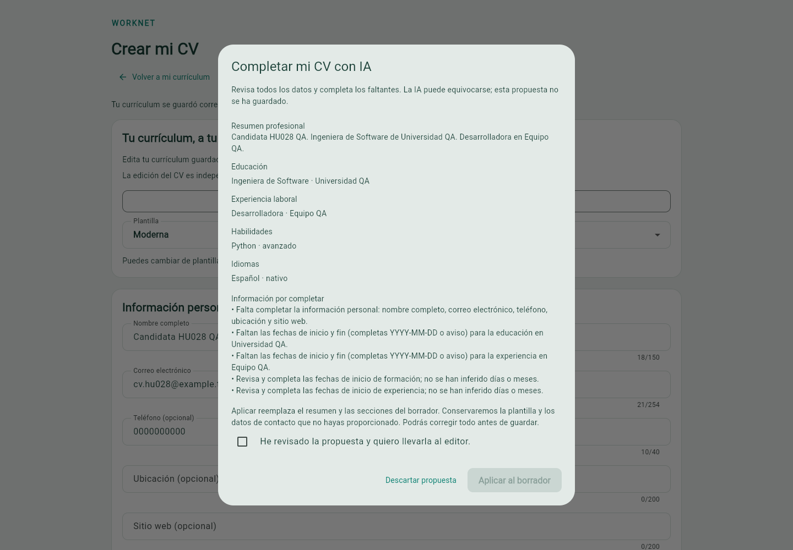

# WorkNet · Bolsa de empleo con asistencia de IA

WorkNet conecta candidatos y empresas: perfiles profesionales, currículums, ofertas, postulaciones y comunicación en una misma aplicación. Su asistente Gemini organiza la información del candidato en una propuesta de CV que se revisa antes de guardar.

**Entrega académica cerrada el 09/11/2026:** HU001–HU026 y HU028, **27 historias y 112 subtareas completadas**. [HU027 · LinkedIn](https://github.com/Danilo2334/Work_net/issues/28) queda abierta para una segunda versión, con sus cinco tareas pendientes.

[Presentación y cierre](docs/ENTREGA.md) · [Guía y evidencias](frontend/docs/REVISION.md) · [Plan de despliegue](docs/DESPLIEGUE.md) · [Historias](https://github.com/Danilo2334/Work_net/issues)

## Qué permite hacer

| Participante | Funciones entregadas |
| --- | --- |
| Candidato | Registro y verificación, perfil, CV subido o generado con tres plantillas, ayuda opcional de IA, búsqueda y favoritos, postulación con copia del CV, historial, mensajes, avisos y estadísticas. |
| Empresa | Validación de cuenta, publicación/edición/cierre de ofertas, filtros de postulantes, revisión del CV enviado, cambios de estado, mensajes, estadísticas y exportación CSV/PDF. |
| Administración | Revisión de empresas, dashboard, cuentas administrativas, permisos, eventos y autenticación TOTP con recuperación de un solo uso. |

### Asistente de currículum

Texto propio → consentimiento → propuesta Gemini → revisión → aplicar o descartar → edición → guardado explícito → PDF. Incluir el perfil propio es opcional. Generar y descartar no modifican el perfil ni el CV guardado. La clave se utiliza únicamente en Django; el editor manual sigue disponible si el proveedor falla.



Captura original de aceptación con datos ficticios. La [guía](frontend/docs/REVISION.md#hu028--asistente-de-creación-de-currículum-con-ia--resultado-vigente-09112026) explica la acción, el resultado y sus límites.

## Arquitectura

| Componente | Implementación |
| --- | --- |
| Interfaz | Flutter; capas de dominio, datos y presentación por funcionalidad. |
| API | Django REST Framework; permisos y propiedad comprobados en servidor. |
| Autenticación | Token revocable; segundo factor obligatorio para administración. |
| Datos locales | SQLite para desarrollo y QA; migraciones versionadas. |
| Documentos | CV, copia enviada, fotografía y logo como bytes privados en la base de datos. |
| IA | Gemini desde backend, con consentimiento, contrato estructurado y límite por usuario. |

## Ejecutar en Windows / PowerShell

Versiones de aceptación: Python 3.12.10, Django 6.1.1, Flutter 3.47.5 y Dart 3.13.4. Dependencias en [requirements.txt](backend/requirements.txt), [pubspec.yaml](frontend/pubspec.yaml) y [pubspec.lock](frontend/pubspec.lock).

Trabajar en un checkout limpio separado de los entornos anteriores. Desde la raíz:

```powershell
py -3.12 -m venv backend/.venv
./backend/.venv/Scripts/Activate.ps1
python -m pip install -r backend/requirements.txt
Copy-Item backend/.env.example backend/.env
```

La copia corresponde a una instalación nueva. Si ya existe configuración privada, conservarla. Completar localmente GMAIL_USER y GMAIL_APP_PASSWORD para el correo. Mantener PASSWORD_RESET_FRONTEND_URL=http://localhost:55000/reset-password.

Para el asistente, configurar GEMINI_API_KEY y GEMINI_MODEL solo en el entorno privado del backend. Usar un modelo autorizado en la cuenta; no incluir credenciales en Flutter, Git ni capturas. La aceptación utilizó gemini-3.5-flash-lite; su disponibilidad y cuota dependen del proveedor.

```powershell
cd backend
python manage.py migrate
python manage.py check
python manage.py runserver 127.0.0.1:8000
```

En otra terminal, desde frontend:

```powershell
flutter pub get
flutter run -d chrome --web-port 55000 --dart-define=API_BASE_URL=http://127.0.0.1:8000/api/
```

El principal se aprovisiona con `python manage.py createsuperuser`; al entrar configura y confirma su autenticador. No existe registro público de administradores. [Preparar la demostración](docs/ENTREGA.md).

## Validación publicada

| Comprobación | Resultado acreditado |
| --- | --- |
| Regresión Django / Flutter | **301 / 237 pruebas aprobadas**. |
| Análisis, compilación y migraciones | Correctos según los informes de aceptación. |
| HU028 API / navegador | **8/8 / 14/14** casos; cuatro generaciones Gemini aceptadas entre API, navegador y Desktop. |
| HU028 Postman Desktop | **18 peticiones / 52 comprobaciones aprobadas**, sin fallos. |
| CV | PDF comprobado en Clásica, Moderna y Minimalista. |

Resultados de la aceptación de [main 66d9f15](https://github.com/Danilo2334/Work_net/commit/66d9f154068aa3e33cbef0bb5a751ff6c35df6ae), [PR #236](https://github.com/Danilo2334/Work_net/pull/236). La limpieza posterior cambia documentación y referencias de ramas; no constituye otra ejecución funcional. Los [informes originales](backend/docs/evidencias/hu028-real-20261109/aceptacion.json) distinguen llamadas reales, dobles e inyección de errores.

Para repetir la regresión, desde backend:

```powershell
python manage.py test
python manage.py check
python manage.py makemigrations --check --dry-run
```

Desde frontend:

```powershell
flutter test
flutter analyze
flutter build web --release --no-web-resources-cdn
```

Utilizar una base QA nueva para aceptación y conservar las anteriores. [Contrato de perfil](backend/candidate_dashboard/PROFILE_API.md) · [Postman](backend/postman/README.md) · [Arquitectura Flutter](frontend/README.md).

La aceptación cubre Windows/SQLite, escritorio, móvil web emulado y recorridos específicos Android emulado. No acredita PostgreSQL, carga, iOS ni todos los flujos en un teléfono físico. La [página informativa](https://danilo2334.github.io/Work_net/) presenta el proyecto; la aplicación completa requiere [preparación y despliegue](docs/DESPLIEGUE.md).

## Ramas y continuidad

`main` conserva la entrega integrada; `develop`, `frontend` y `feature/backend-sprint-3` conservan las bases compartidas del flujo usado. Se retiraron **45 ramas temporales** cuyos commits eran antecesores de main. `feature/hu008-selection-profile` se conserva porque contiene un commit de evidencias no fusionado; no forma parte de la entrega estable. El [inventario de cierre](docs/auditoria-cierre-20261109.json) conserva nombres y SHA. Los checkouts locales del equipo no se eliminaron desde esta sesión.

HU027 permanece en el backlog de la segunda versión. Las nuevas funciones deben partir de la entrega estable y acreditar su propia aceptación.

## Equipo

Danilo2334: Django y pruebas propias. francisco3788: Flutter, integración, QA y documentación. El historial conserva las contribuciones y autorías anteriores. Los informes identifican cuándo la revisión fue técnica de un agente; no se atribuye aprobación humana inexistente.
