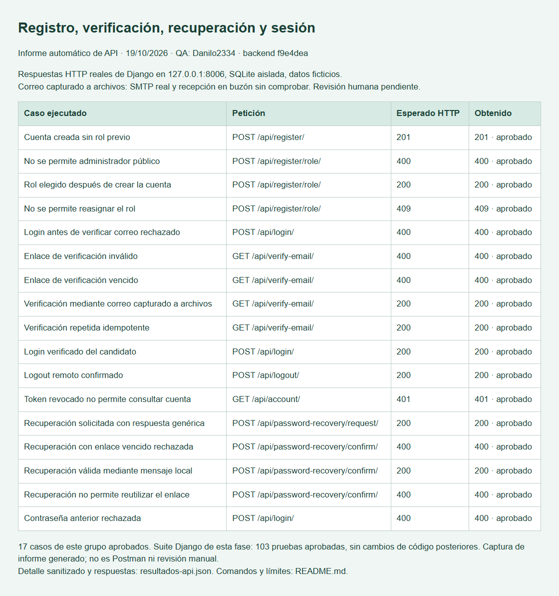
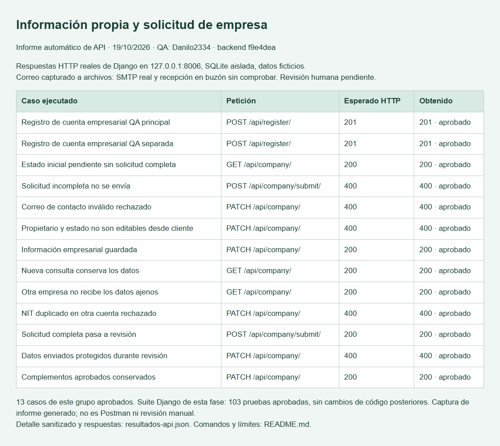
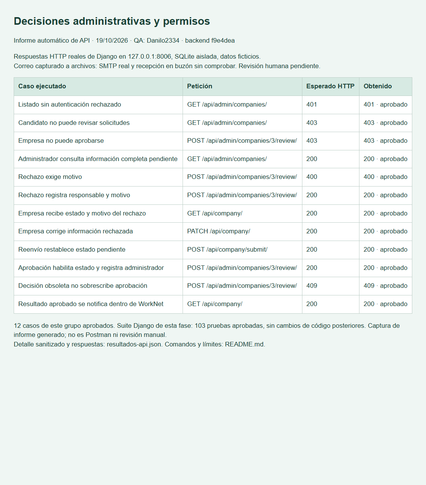
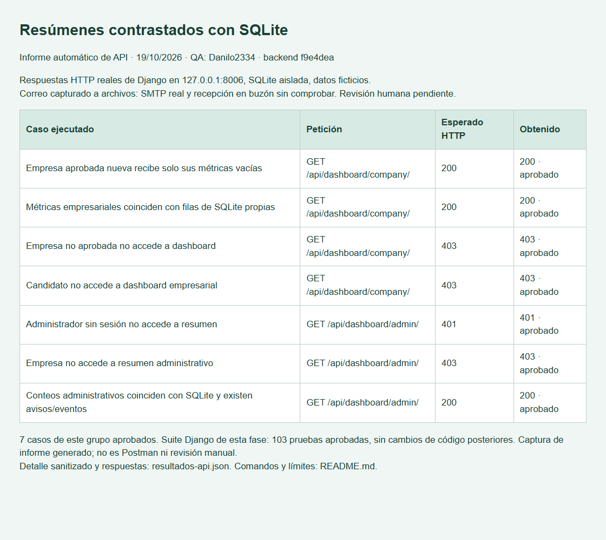

# Evidencia API — preparación de revisión

19/10/2026, America/Bogota. QA registrado por **Danilo2334**, ejecución automática; revisión por otro integrante pendiente.

Código comprobado: `f9e4dea`. Se ejecutó `python manage.py test accounts candidate_dashboard --noinput`: **103 pruebas aprobadas**. `python manage.py check` sin incidencias y `python manage.py makemigrations --check --dry-run` sin cambios. Las migraciones aditivas se aplicaron al arrancar la base aislada del navegador. No se modificó la base habitual.

## Peticiones y persistencia

[`resultados-api.json`](resultados-api.json) registra **49 casos HTTP adicionales** aprobados: registro/selección posterior de rol, enlaces inválidos/vencidos/reutilizados, recuperación, logout con rechazo 401 del token, datos empresariales propios, revisión administrativa y dashboards. Incluye contraste independiente de métricas con consultas SQLite. Son casos compartidos por varias tareas: no deben sumarse como ejecuciones separadas por issue.

La verificación repetida es idempotente (200); el enlace de recuperación reutilizado se rechaza (400). Los errores SMTP se simulan en `accounts.test_company_access`: se comprueba 503 y ausencia de cuenta huérfana. Esto no demuestra entrega real ni fallo real de Gmail.

Las siguientes imágenes son capturas en Chrome de informes automáticos con resultados reales; el JSON conserva los extractos sanitizados. No contienen tokens ni contraseñas y no se presentan como capturas de Postman.

### Registro, verificación, recuperación y sesión

[Informe HTML](api-registro-sesion.html).

### Información propia y solicitud de empresa

[Informe HTML](api-informacion-empresa.html).

### Decisiones administrativas y permisos

[Informe HTML](api-validacion-empresa.html).

### Resúmenes contrastados con SQLite

[Informe HTML](api-dashboards.html).

## Reproducción y límites

1. En la raíz del repositorio con Django instalado, ejecutar `python frontend/tool/qa_backend.py --port 8006 --frontend-origin http://localhost:55006`. Crea SQLite y buzón de archivos privados en `frontend/.dart_tool/worknet_qa/`.
2. Mantener ese proceso y ejecutar `python backend/docs/evidencias/revision-sprint/comprobar_api.py . backend/docs/evidencias/revision-sprint`. El comprobador rechaza un entorno cuyo origen o ruta de base no sean los aislados esperados; cada ejecución genera otras cuentas ficticias.
3. Las pruebas Django ordinarias usan su propia base temporal, sin requerir el servidor anterior.

MAILERS de Django 6.1.1 y SMTP Gmail se conservan. Falta `backend/.env` con remitente y contraseña de aplicación; tampoco se acreditó recepción en el buzón. No publicar `.env`, `latest.json`, bases, archivos de correo ni enlaces firmados.

No se pudieron leer los campos Sprint del Project por falta de `read:project`. Se comprobaron criterios de las issues; ninguna rama ni este informe acredita por sí solo la pertenencia al Sprint 2. Se conservaron Sprint, fechas, responsables y criterios.

Dependencias abiertas: módulos futuros del dashboard, gestión de administradores/permisos y autorización de consulta del perfil por empresas dentro de selección. El 403 mantiene protegido ese perfil y no satisface el acceso empresarial positivo. Mantener PR #146 en borrador y revisión humana pendiente.
