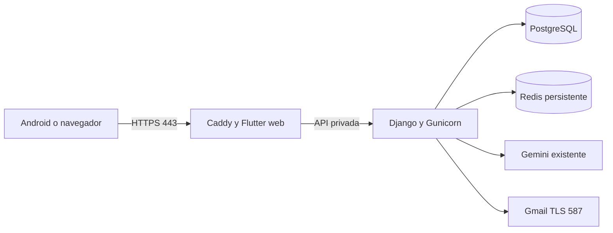

# WorkNet en AWS — preparación de presentación

10/11/2026. **Instancia creada, plan FREE conservado y acceso SSH diagnosticado y corregido; instalación de la aplicación y HTTPS en curso.** El usuario autorizó expresamente el servidor de US$12/mes contra créditos. La entrega funcional sigue siendo HU001–HU026 y HU028. HU027 permanece pendiente para una versión futura.

CloudFormation `worknet-presentacion` administra la instancia y su IPv4 estática `3.136.118.169`. El nombre previsto `worknet.3.136.118.169.sslip.io` ya resuelve a esa dirección. **Todavía no es una aplicación publicada ni un certificado emitido.** Los PR de preparación son [Django #245](https://github.com/Danilo2334/Work_net/pull/245), hacia `develop`, e [integración/QA #246](https://github.com/Danilo2334/Work_net/pull/246), hacia `frontend`; ambos continúan en borrador.

[Registro sanitizado de activación](../../docs/aws-despliegue-20261110.json). La reconciliación de red terminó en `UPDATE_COMPLETE`, sin recursos añadidos ni reemplazados y sin cambiar el plan. Guard aprobó la plantilla y rechazó cuatro variantes inseguras: SSH público, alias del navegador en el puerto alternativo, bundle superior y puerto adicional.

## Recursos aprobados y presupuesto

| Recurso | Configuración | Referencia mensual |
|---|---|---|
| Lightsail Linux | `small_3_0`, Ubuntu 24.04, 2 vCPU, 2 GB RAM, 60 GB, 3072 GB de transferencia incluidos; `us-east-2` | US$12 contra créditos |
| IPv4 estática | Asociada a esa instancia | Incluida mientras permanezca asociada |
| PostgreSQL 17, Redis y Caddy | Contenedores privados en esa misma máquina | Incluidos en el cómputo anterior |
| Nombre para presentación | `worknet.<IP-estática>.sslip.io`, certificado automático de Caddy | Sin compra de dominio; sujeto al servicio DNS y a la emisión del certificado |
| Respaldo | Dump privado y copia fuera del servidor, al PC | Sin recurso AWS adicional en esta propuesta |

Precio y disponibilidad consultados mediante AWS CLI. [Lightsail está admitido en el plan gratuito](https://docs.aws.amazon.com/accounts/latest/reference/supported-services-sign-up-new.html). [Lightsail utiliza créditos Free Tier](https://docs.aws.amazon.com/lightsail/latest/userguide/amazon-lightsail-frequently-asked-questions-faq-billing-and-account-management.html). El uso consume saldo: el servicio no es gratuito indefinidamente. El plan FREE termina al agotarse los créditos o al vencer su período; la consulta del proyecto indica **09/05/2027, 19:27, Bogotá**. No cambiarlo a Paid. [Reglas del plan gratuito](https://docs.aws.amazon.com/awsaccountbilling/latest/aboutv2/free-tier.html).

Los US$100 mostrados previamente por el usuario no se presentan como un saldo actual comprobado mediante API. La autorización del usuario permitió activar esta instancia; el saldo restante se consulta en AWS Settings. Seis meses a US$12 equivalen a US$72 solo de instancia. Excesos de transferencia, snapshots y una IP desasociada pueden consumir saldo adicional. No se habilitan snapshots ni servicios gestionados adicionales automáticamente.

Es una arquitectura para presentación y tráfico pequeño, con un único servidor. La capacidad real, el rendimiento de red desde AWS y la recuperación ante pérdida del servidor requieren la aceptación publicada. Apagar Lightsail **no detiene su coste**; retirar el servicio implica respaldo y eliminación explícita.

## Arquitectura preparada



Solo Caddy publicará 80/443; SSH 22 y el puerto alternativo 2222 se limitan a la IPv4 `/32` del operador en Lightsail. El 22 admite además exclusivamente el alias administrado `lightsail-connect` para la terminal del navegador de AWS. [Propiedad oficial de los puertos](https://docs.aws.amazon.com/AWSCloudFormation/latest/TemplateReference/aws-properties-lightsail-instance-port.html). El firewall no inicia por sí mismo un listener SSH en 2222. Django, PostgreSQL y Redis no publican puertos del host. Caddy sustituye las cabeceras de proxy. Flutter y API compartirán origen HTTPS. [HTTPS automático](https://caddyserver.com/docs/automatic-https) y [DNS temporal](https://sslip.io/) requieren confirmar certificado y aplicación reales después de instalar.

Django usa `config.production`: DEBUG desactivado, clave privada obligatoria, host y origen HTTPS concretos, CORS limitado, cookies seguras, estáticos WhiteNoise y comprobación de PostgreSQL/Redis. La configuración de desarrollo y la demostración por USB conservan su módulo anterior. Las imágenes están fijadas por digest y las dependencias Python por versión y hash.

La cuenta SQL de la aplicación es propietaria de su base, sin superusuario, creación de bases ni creación de roles. El secreto del propietario de PostgreSQL se mantiene en **otro archivo que no recibe Django**. Redis usa AOF y `noeviction`; no descarta claves de límites de IA por presión de memoria. Se conservan datos de CV, fotos, logos y documentos de postulación en PostgreSQL, según el dominio existente.

## Activación realizada y acceso verificado

1. El preflight comprobó identidad, plan FREE, Ubuntu 24.04 y bundle de US$12. `python deploy/aws/plan.py --profile worknet` sigue siendo exclusivamente de lectura: no crea recursos ni cambia el plan.
2. Se creó una clave SSH de Lightsail conservando su parte privada fuera de Git y con permisos restringidos. No se incluyeron claves privadas, correo, Gemini ni contraseñas en CloudFormation o UserData.
3. Se validaron la plantilla con `cfn-lint`, cinco reglas Guard y la validación de servicio previa al despliegue. Un change set con exactamente dos recursos nuevos, instancia e IP, terminó en `CREATE_COMPLETE`; la protección de terminación permanece habilitada. Los ajustes posteriores de red no reemplazan la instancia.
4. Se diagnosticó el timeout del puerto alternativo: la regla autorizaba una IP distinta de la observada en la conexión TCP real. Consultas HTTPS/DNS desde el PC devolvieron salidas diferentes. Se probaron únicamente IP observadas, una a una como `/32`; la sesión autenticada confirmó el origen correcto mediante `SSH_CONNECTION`. El 2222 conserva solo ese `/32`; el 22 y el alias del navegador permanecieron idénticos. No se abrió SSH al público ni se desactivaron firewalls. Esto no identifica qué equipo o servicio de red produce las distintas salidas.

No repetir la creación del stack ni generar otras credenciales al retomar. El usuario completó el siguiente paso en **Lightsail → Instancias → worknet-presentacion → Conectar mediante SSH**; se conserva como procedimiento de recuperación, no como una intervención pendiente:

```sh
sudo sh -c "printf 'Port 22\nPort 2222\n' > /etc/ssh/sshd_config.d/99-worknet-ports.conf && /usr/sbin/sshd -t && systemctl daemon-reload && systemctl restart ssh.socket ssh.service"
```

Se verificaron las claves del host contra las huellas devueltas por la API autenticada de Lightsail; OpenSSH exige esas mismas claves. La sesión remota confirmó ambos listeners, `cloud-init` terminado, Docker 29.1.3, Compose 2.40.3 y UFW inactivo. En Windows se corrigió también el entrecomillado de la ruta privada `known_hosts`, que contiene espacios; no se desactivó la validación del host. Los parámetros `AdminCidr` y `AlternateAdminCidr` son independientes para conservar el acceso estándar cuando la salida TCP alternativa es distinta. Antes de actualizar un `/32`, comprobar la fuente real; una consulta HTTPS aislada no basta en esta red.

La configuración privada del backend ya está preparada localmente conservando Gemini y Gmail existentes. Los archivos no se han transferido al servidor. El artefacto Flutter compilado usa el origen público previsto; el paquete de fuentes contiene solo runtime rastreado, sin bases ni evidencias históricas. Se comprobaron hashes y ausencia de los secretos privados en ambos paquetes. Esto no acredita ejecución remota.

## Publicación de la aplicación — en curso

1. Publicar y revisar las aportaciones con el flujo del repositorio: Django de Danilo2334 hacia `develop`; integración/QA/documentación de francisco3788 hacia `frontend`; incorporación del backend revisado y entrega conjunta a `main`. Mantener tres ramas permanentes y usar ramas temporales durante la revisión. La preparación local no acredita fusiones remotas ni aprobaciones humanas.
2. Obtener la IPv4 estática y fijar el nombre público. Verificar su resolución y acceso a 80/443. El nombre temporal puede sustituirse por un dominio propio; no se compra ninguno en esta fase.
3. Compilar en el PC, usando el origen HTTPS **real**:

   ```powershell
   .\deploy\aws\build-web.ps1 -Origin https://NOMBRE_PUBLICO_REAL
   ```

   El build de ensayo usa `https://localhost:18443/api/`; no subirlo como build público. Conservar el SHA y empaquetar únicamente archivos rastreados de `backend`/`deploy` mediante `git archive`, más `frontend/build/web` como artefacto separado. Transferir por SSH a `/opt/worknet/releases/<SHA>` y `/opt/worknet/web`, comprobando previamente la identidad del servidor y los hashes de los artefactos. No compilar Flutter en la máquina pequeña.
4. En el servidor, crear `/etc/worknet` con permisos 700. Copiar las dos plantillas de entorno fuera del checkout y dejarlas con permisos 600. `worknet.env` contiene el origen, las rutas, la clave Django nueva, credenciales SQL de aplicación, correo y Gemini. `database.env` contiene únicamente `POSTGRES_PASSWORD` del propietario SQL, diferente de la contraseña de aplicación. Generar secretos nuevos; las plantillas vacías no sirven para iniciar producción.
5. Reutilizar Gemini y correo ya autorizados mediante transferencia privada al backend. No pegarlos en comandos visibles, chat, Dart, colecciones ni documentación. Confirmar que el modelo y proyecto de Gemini conservan su modalidad gratuita. No migrar a Bedrock ni activar facturación. Los secretos existentes del PC se conservan.
6. Desde el directorio de la versión del servidor:

   ```sh
   export WORKNET_ENV_FILE=/etc/worknet/worknet.env
   docker compose --env-file "$WORKNET_ENV_FILE" -f deploy/aws/compose.yaml build api
   docker compose --env-file "$WORKNET_ENV_FILE" -f deploy/aws/compose.yaml up -d db cache
   docker compose --env-file "$WORKNET_ENV_FILE" -f deploy/aws/compose.yaml run --rm api python manage.py migrate --noinput
   docker compose --env-file "$WORKNET_ENV_FILE" -f deploy/aws/compose.yaml run --rm api python manage.py collectstatic --noinput
   docker compose --env-file "$WORKNET_ENV_FILE" -f deploy/aws/compose.yaml run --rm api python manage.py check --deploy
   docker compose --env-file "$WORKNET_ENV_FILE" -f deploy/aws/compose.yaml up -d api web
   ```

   Las migraciones son un paso de publicación explícito, no una tarea de cada worker. No usar `down -v` para actualizar. Cambiar variables PostgreSQL después de inicializar un volumen no rota por sí mismo las contraseñas almacenadas en SQL.
7. Crear el primer administrador mediante `createsuperuser` interactivo en el contenedor y completar TOTP desde la interfaz protegida HU026. No incluir una cuenta principal o su contraseña en la imagen o en el build. Iniciar la aceptación con datos ficticios nuevos; no copiar las bases anteriores de presentación.
8. Probar certificado público sin excepciones TLS, redirección HTTP, rutas y sesión; después correo real, recuperación, TOTP, Gemini real, las tres plantillas PDF, postulación, estados, mensajes y exportaciones. Obtener evidencias nuevas de navegador y Postman Desktop. El ensayo local de esta preparación no sustituye esa aceptación externa.
9. Para Android, generar otra APK con `--dart-define=API_BASE_URL=https://NOMBRE_PUBLICO_REAL/api/`, conservando la firma privada apropiada. La APK de presentación que apunta al PC no cambia automáticamente de servidor. Verificar actualización/instalación, descarga y apertura de PDF sin USB antes de presentar la variante AWS.

## Respaldo, restauración y retirada

Con el entorno privado anterior, `WORKNET_BACKUP_DIR=/var/backups/worknet sh deploy/aws/backup.sh` genera un dump con permisos privados y evita anunciar éxito antes de terminar. Copiarlo fuera del servidor y proteger también los entornos privados. La propuesta no activa almacenamiento o snapshots adicionales de AWS. Se ensayó `pg_dump -Fc` y restauración en **otra base QA** con un registro ficticio conservado; comprobar periódicamente un respaldo reciente.

Para restaurar, crear otra base propiedad del usuario de aplicación y ejecutar `pg_restore --no-owner --role worknet` como propietario SQL. Contrastar tablas, registros, documentos y migraciones antes de cambiar la aplicación a esa base. No sobrescribir una base activa como paso de prueba. La reversión de código usa la imagen/artefacto del SHA anterior; no revierte automáticamente las migraciones ni restaura datos.

La plantilla protege instancia/IP con `Retain`. **Eliminar el stack o detener la instancia no retira automáticamente los recursos retenidos ni su consumo.** Para cerrar la presentación: respaldar y comprobar la copia fuera de AWS; identificar exactamente la instancia, IP y cualquier snapshot; autorizar la eliminación de esos recursos, desactivar protección del stack y retirarlos explícitamente. Confirmar después el inventario vacío y el consumo en AWS Settings. Conservar los artefactos y el historial Git.

## Procedencia de esta validación

Windows y Docker Desktop, Python 3.12.10, Django 6.1.1, Flutter 3.47.5; servidor Linux local con PostgreSQL 17, Redis, Gunicorn y Caddy. Ver el [registro sanitizado](../../docs/aws-preparacion-20261109.json) y la [guía vigente](../../frontend/docs/REVISION.md).

Los ensayos nuevos mantienen proveedor/correo sin credenciales y no consumen Gemini. La excepción TLS de Playwright es exclusiva del certificado local de `localhost`; nunca forma parte del despliegue público. Se corrigieron fixtures de exportación fuera del límite de 150 caracteres y se separaron dos fallos simulados exclusivos de SQLite; la reversión transaccional sigue probándose en ambos motores. No cambió el dominio funcional de HU001–HU026/HU028.
