# Guía para revisar WorkNet

<!-- alcance-vigente-inicio -->
## Alcance vigente — 09/11/2026

HU001–HU026 conservan su entrega estable en main `c49d0f7fe658aa8641dba52070a2c83172f69f83`. **HU027 #28 y #137–#141 quedan abiertas y pendientes de desarrollo**, por instrucción expresa del usuario. Su retorno estático y los pasos/configuración preparatorios se retiraron de la versión actual; los antecedentes de #196/#197 permanecen en Git. Se conservaron el sitio, logo y política generales de WorkNet. No existe integración LinkedIn operativa ni aceptación OAuth.

El barrido de este checkout no encontró servicios, rutas o dependencias funcionales LinkedIn en `backend/` ni `frontend/lib/`; el elemento específico publicado era `docs/linkedin/callback.html`. En la continuación Windows se inspeccionó el checkout preparatorio LinkedIn: limpio y ya contenido en el historial remoto. La entrega actual no contiene archivos exclusivos LinkedIn; se conservan la preparación histórica, los componentes generales y los entornos privados anteriores, sin reactivar la integración.

**HU028 #224 — Asistente de creación de currículum con IA**, tareas #225–#228, dispone de aceptación real Windows con Gemini, navegador y Postman Desktop. Las cuatro relaciones nativas están asociadas y WORK_NET actualizado preservando la planificación. Los resultados nuevos y los antecedentes con dobles se distinguen en la sección vigente siguiente.

<!-- hu028-avance-inicio -->
## HU028 — Asistente de creación de currículum con IA — resultado vigente 09/11/2026

**Aceptación funcional real completada.** [HU028 #224](https://github.com/Danilo2334/Work_net/issues/224), subtareas nativas #225–#228, conserva sus criterios originales. La entrega utiliza [API #231](https://github.com/Danilo2334/Work_net/pull/231) → `feature/backend-sprint-3` → `develop`, y [Flutter/QA #232](https://github.com/Danilo2334/Work_net/pull/232) → `frontend`; incorporación del backend revisado y entrega conjunta a `main`. Los enlaces de la historia registran las fusiones y SHA finales verificados. HU027 permanece pendiente.

### Qué se hizo

API privada GET/POST con candidato verificado, consentimiento explícito y perfil propio opcional. Validación de contrato y hechos, transporte Gemini estructurado, límites y errores saneados. Generar nunca persiste CV, perfil ni postulaciones. Danilo2334 conserva implementación y pruebas Django; Francisco conserva QA transversal.

Opción «Completar mi CV con IA», texto y perfil optativo, consentimiento informado, revisión obligatoria, faltantes, aplicar o descartar. Sesión, errores y cancelación conservan la edición. Aplicar conserva plantilla/contactos no aportados y exige guardado posterior. Flutter y sus pruebas: francisco3788.

**Preparación**

09/11/2026, Windows. Python 3.12.10, Django 6.1.1, DRF 3.18.3, SQLite 3.49.1; Flutter 3.47.5 / Dart 3.13.4; Chromium 158.0.8127.18, Playwright 1.65.0 y Postman Desktop 12.35.5. Escritorio 1440×1000, móvil web 390×844, Postman 1536×864.

Fuente conjunta de aceptación [`169115f`](https://github.com/Danilo2334/Work_net/commit/169115f58199d582d7f0a431316c2f2bd928bcaf), backend [`6c76159`](https://github.com/Danilo2334/Work_net/commit/6c76159ecdc90183cc12f3da43fcf10ccf6d0500) y herramientas QA [`bf74181`](https://github.com/Danilo2334/Work_net/commit/bf74181a280af28d6f5225d203766b8eac3b1548). No hubo cambios funcionales Dart después del análisis/build. Originales permanentes en [`625839f`](https://github.com/Danilo2334/Work_net/commit/625839ff6cad5fee62418b95d95fdf1671c37f40), [manifest](https://github.com/Danilo2334/Work_net/blob/625839ff6cad5fee62418b95d95fdf1671c37f40/backend/docs/evidencias/hu028-real-20261109/manifest.json) con SHA256 y blobsGit.

Tres bases nuevas, SQLite y correo a archivos: API `run-20261109T184303Z-4eb93e57`, navegador `run-20261109T185051Z-13e75b29`, Postman `run-20261109T184717Z-0165b8da`. Cuatro usuarios ficticios por QA; el control Postman añade2 perfiles, 1 oferta y 1 postulación histórica. No se reutilizaron bases anteriores. La clave autorizada permanece fuera del repositorio, solo en backend; el usuario confirmó Free Tier. Modelo `gemini-3.5-flash-lite` listado para esa clave y probado con JSON estructurado. No se activaron facturación ni servicios de pago.

**Resultados y procedencia**

- **301 Django**,16 pruebas HU028,19,418s; **237 Flutter**,52 s; analyze sin incidencias y web release correcto. Check, makemigrations en seco y plan de migraciones de la QA correctos. Dobles en las pruebas unitarias, no llamadasGemini.
- **API real 8/8**,1 generación Gemini,2129,56 ms y 3 PDF. [Informe](https://github.com/Danilo2334/Work_net/blob/625839ff6cad5fee62418b95d95fdf1671c37f40/backend/docs/evidencias/hu028-real-20261109/api-real-resultados.json).
- **Navegador 14/14**,20 PNG originales,2 generaciones Gemini y3 descargas PDF. [Informe](https://github.com/Danilo2334/Work_net/blob/625839ff6cad5fee62418b95d95fdf1671c37f40/frontend/docs/evidencias/hu028-real-20261109/browser-resultados.json).503/429 y respuesta tardía se inyectan localmente y no cuentan como fallos reales del proveedor.
- **Postman Desktop 18 peticiones, 52 PASS**,0 fallos:9 negativas / 20 PASS sin proveedor y9 positivas / 32 PASS con1 generación real. [Resultados nativos](https://github.com/Danilo2334/Work_net/blob/625839ff6cad5fee62418b95d95fdf1671c37f40/backend/docs/evidencias/hu028-real-20261109/postman/resultados.json).
- **6 PDF**(3 API + 3 navegador) leídos,renderizados e inspeccionados; [revisión](https://github.com/Danilo2334/Work_net/blob/625839ff6cad5fee62418b95d95fdf1671c37f40/backend/docs/evidencias/hu028-real-20261109/pdf-review.json). [Filas de negocio intactas](https://github.com/Danilo2334/Work_net/blob/625839ff6cad5fee62418b95d95fdf1671c37f40/backend/docs/evidencias/hu028-real-20261109/business-contrast.json).
- **4 generaciones reales en la aceptación vigente**. El antecedente parcial de navegador generó 2 más; el primer intento de transporte fue rechazado 400 y se corrigió. Total del bloque:7 intentos, 6 generaciones satisfactorias, sin reintentos automáticos. [Auditoría vigente](https://github.com/Danilo2334/Work_net/blob/625839ff6cad5fee62418b95d95fdf1671c37f40/backend/docs/evidencias/hu028-real-20261109/provider-calls-accepted.json), [procedencia y límites](https://github.com/Danilo2334/Work_net/blob/625839ff6cad5fee62418b95d95fdf1671c37f40/backend/docs/evidencias/hu028-real-20261109/aceptacion.json).

### Verificación conjunta antes de main

Tras fusionar [#231](https://github.com/Danilo2334/Work_net/pull/231) a backend y [#233](https://github.com/Danilo2334/Work_net/pull/233) a develop, se integró [#232](https://github.com/Danilo2334/Work_net/pull/232) en frontend y se incorporó el backend revisado mediante [#234](https://github.com/Danilo2334/Work_net/pull/234). Frontend quedó en `f4cecc2ac21b83f3da9647d35dab3a0552c68cdb`; la combinación publicada `3cd731ba4b4d097227fdb2d17767f672fbf29aaa` tiene el mismo árbol. Su código funcional Django/Dart y dependencias coincide byte por byte con el usado en la aceptación real `169115f`.

Sobre esa combinación se repitieron **301 Django aprobadas en 16,485 s** y **19/19 peticiones HTTP con doble** en otra QA nueva `run-20261109T192617Z-be33b9fd`, sin llamadas adicionales a Gemini. Flutter, análisis y build previos conservan validez al mantenerse idénticas sus fuentes y dependencias. Se verificaron los 44 blobs de evidencias remotos y la cuenta, autor y committer de las once aportaciones HU028. [Informe conjunto](../../backend/docs/evidencias/hu028-real-20261109/verificacion-conjunta.json). No hay reglas de protección, comprobaciones CI ni revisiones obligatorias configuradas en estas ramas; no se alteró ninguna protección ni se atribuyó aprobación humana.

### Evidencias específicas

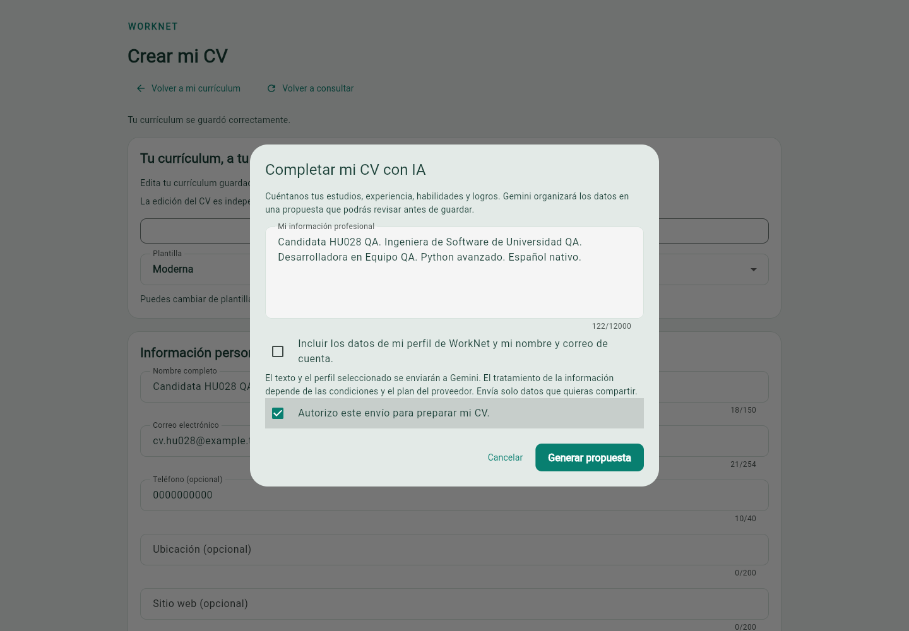

**Caso: V03 — consentimiento. Acción:** Introducir el texto ficticio y autorizar el envío manteniendo el perfil desmarcado. **Esperado:** Consentimiento informado independiente del perfil opcional. **Obtenido:** Texto, destinatario Gemini, perfil desmarcado y consentimiento visibles; antes de consentir Generar estaba deshabilitado. **Alcance demostrado:** Captura real Chromium de escritorio; la llamada posterior se acredita por V04 y auditoría del backend.

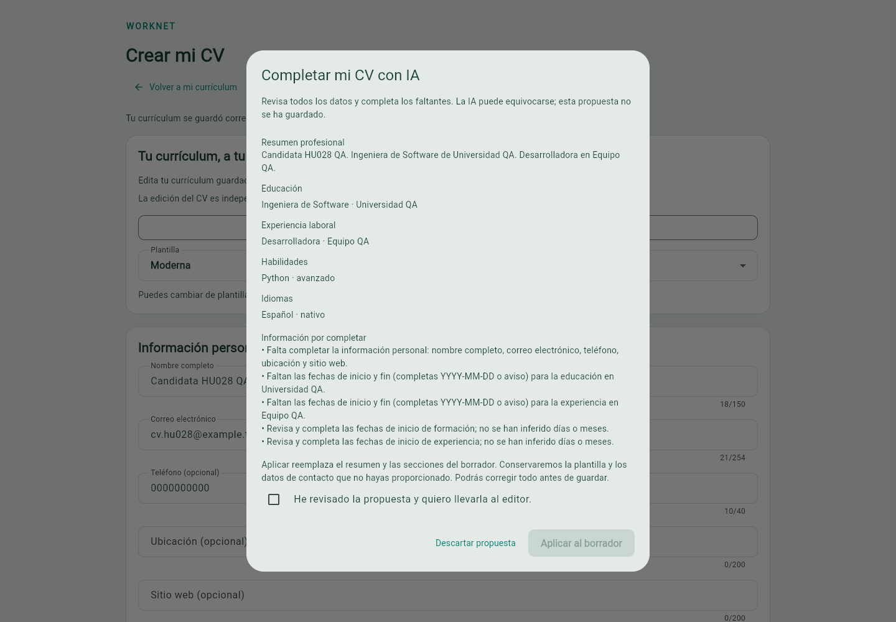

**Caso: V04 — generación real y revisión. Acción:** Generar contra Gemini y recibir la propuesta. **Esperado:** Secciones fieles, faltantes y Aplicar deshabilitado hasta revisar; ningún guardado. **Obtenido:** Formación Universidad QA, experiencia Equipo QA, Python y Español; fechas pendientes, revisión desmarcada y Aplicar deshabilitado. **Alcance demostrado:** Propuesta real del proveedor en navegador; el contraste API comprueba CV persistido intacto, no se deduce solo de la imagen.

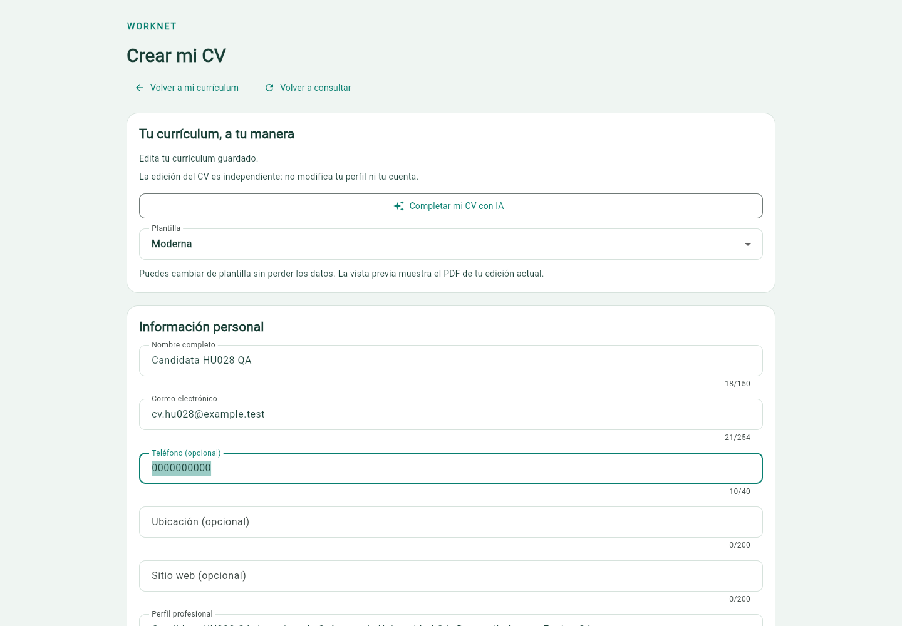

**Caso: V04 — aplicar al borrador. Acción:** Revisar y aplicar la propuesta. **Esperado:** Conservar Moderna y los contactos ausentes de la propuesta, sin PUT. **Obtenido:** Moderna, cv.hu028@example.test y 0000000000 permanecen; el ejecutor confirma datos anteriores persistidos. **Alcance demostrado:** Captura del editor real y contraste API; aplicar modifica solo el borrador.

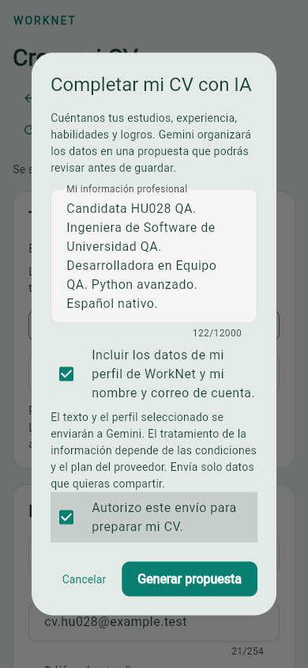

**Caso: V06 — perfil propio en móvil web. Acción:** Abrir a 390×844 y seleccionar perfil propio y consentimiento. **Esperado:** Controles alcanzables y envío únicamente del perfil autorizado. **Obtenido:** Formulario legible con las dos opciones explícitas; segunda generación real con profile_included=true. **Alcance demostrado:** Móvil web emulado Chromium, sin afirmar dispositivo físico.

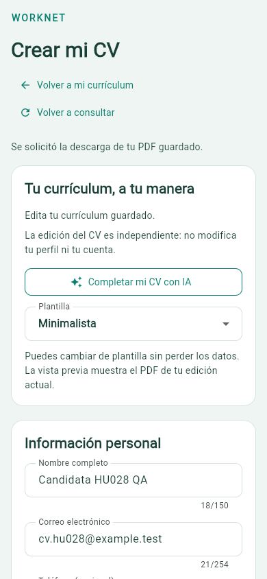

**Caso: V06 — descarte. Acción:** Descartar la propuesta real obtenida con perfil propio. **Esperado:** Recuperar el CV guardado sin sustituir contactos ni plantilla. **Obtenido:** Editor Minimalista con correo del CV conservado; comparación API antes/después idéntica. **Alcance demostrado:** Captura móvil real más contraste de persistencia; no se guardó la propuesta descartada.

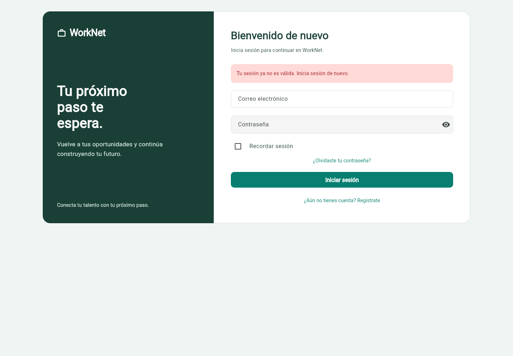

**Caso: V09 — sesión vencida. Acción:** Revocar el token QA mediante logout real y volver a consultar el asistente. **Esperado:** HTTP 401 y retorno a acceso sin propuesta privada. **Obtenido:** Aviso de sesión inválida y campos de acceso vacíos. **Alcance demostrado:** Sesión revocada realmente; ninguna credencial fotografiada.

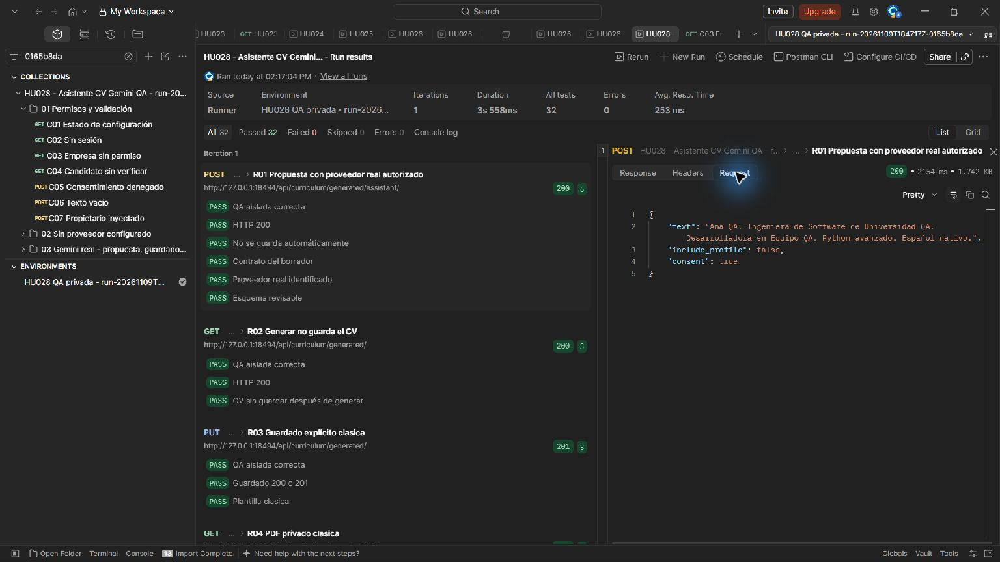

**Caso: Postman R01 — petición real. Acción:** Enviar texto ficticio Ana QA con consent=true e include_profile=false. **Esperado:** HTTP 200 y propuesta no persistida de Gemini. **Obtenido:** Cuerpo enviado visible,HTTP 200 y6 pruebas R01 PASS; R02 confirma CV sin guardar. **Alcance demostrado:** Petición/estado/Test Results auténticos, sin mostrar Authorization ni valores del entorno.

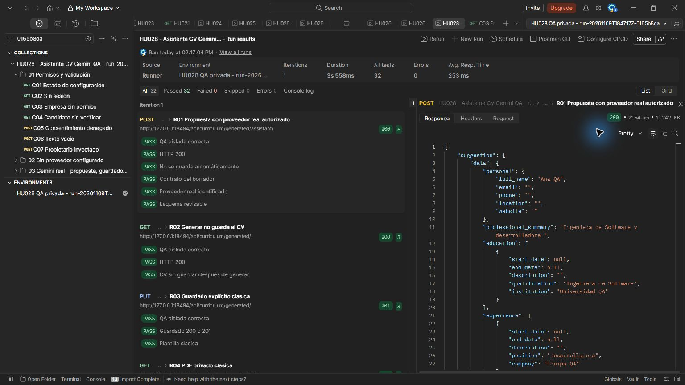

**Caso: Postman R01 — respuesta real. Acción:** Inspeccionar la respuesta de la corrida positiva. **Esperado:** JSON compatible, datos aportados y fechas desconocidas nulas. **Obtenido:** Respuesta200 con Ana QA, Universidad QA y Equipo QA, contactos vacíos y fechas null;32 PASS globales. **Alcance demostrado:** Respuesta HTTP real; auditoría backend acredita exactamente1 generación Gemini en esta base.

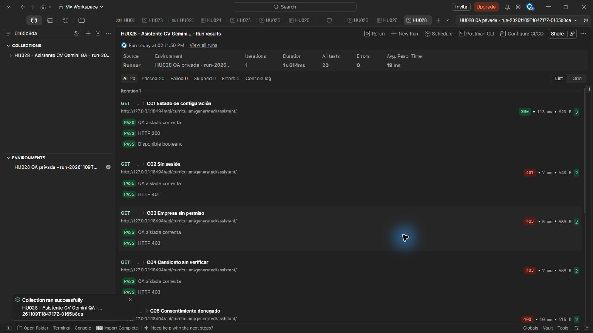

**Caso: Postman — permisos y validación. Acción:** Ejecutar C01–C07 y M01–M02 en Functional/Local, una iteración, sin proveedor configurado. **Esperado:** 401/403/400 y fallback503, sin llamada al proveedor. **Obtenido:** 9 peticiones,20 PASS, 0 fallos/errores/omitidas;1 s 614 ms, media HTTP 19 ms. **Alcance demostrado:** Corrida auténtica de Postman Desktop; no es Newman ni una imagen reconstruida.

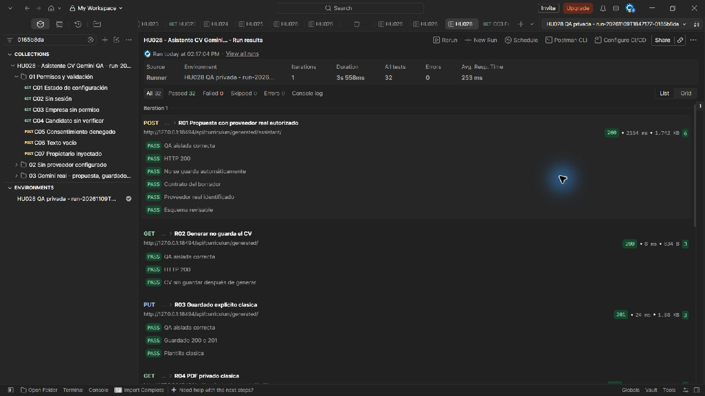

**Caso: Postman — aceptación positiva. Acción:** Ejecutar solo R01–R09 con el backend real habilitado. **Esperado:** Generar sin guardar, tres guardados/PDF y404ajeno. **Obtenido:** 9 peticiones,32 PASS,0 fallos/errores/omitidas;3 s 558 ms, media 253 ms. **Alcance demostrado:** Runner Desktop auténtico; exactamente 1 llamada Gemini, 2133,40 ms en backend.

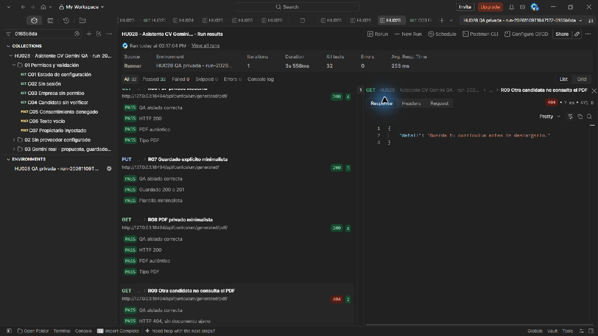

**Caso: Postman R07–R09 — PDF e aislamiento. Acción:** Guardar Minimalista, descargar y consultar PDF con otro candidato. **Esperado:** Guardado200,PDF200,otrocandidato404. **Obtenido:** Todas las comprobaciones aprobadas;respuesta 404 sin documento ajeno visible. **Alcance demostrado:** HTTP real y Test Results; la conservación de4usuarios,2 perfiles, 1 oferta y 1 postulación se acredita además por hash de filas antes/después.

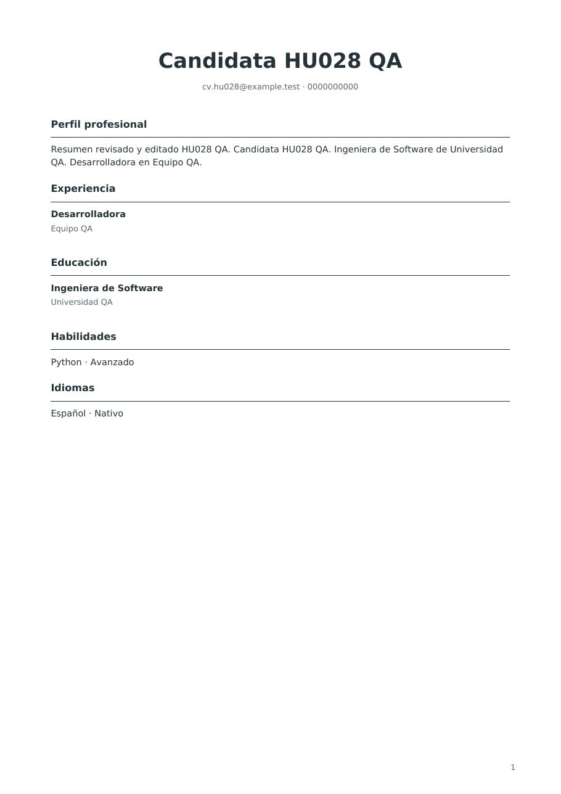

**Caso: PDF clasica — descarga real. Acción:** Guardar expresamente y descargar desde el navegador tras generación, revisión y edición. **Esperado:** PDF legible con los datos y contactos del CV, sin inventar fechas. **Obtenido:** Una página; 8 campos esperados presentes; plantilla y contenido revisados visualmente. [PDF original](https://github.com/Danilo2334/Work_net/blob/625839ff6cad5fee62418b95d95fdf1671c37f40/frontend/docs/evidencias/hu028-real-20261109/pdf-browser/HU028-CV-clasica-generacion-real.pdf). **Alcance demostrado:** Render Poppler 110 dpi de los bytes descargados, no captura de interfaz ni imagen de Postman. Los tres PDF de API son otra sesión ficticia y se conservan en pdf-api/.

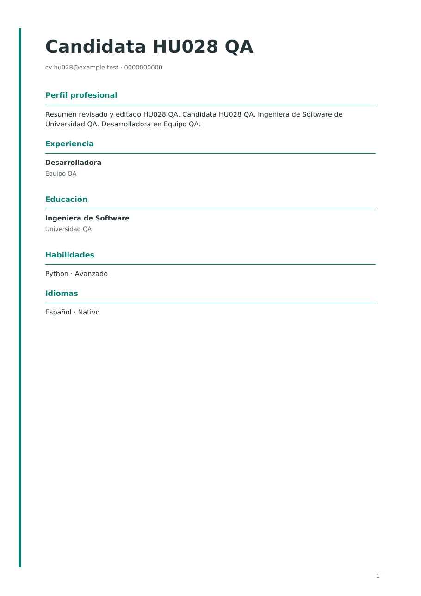

**Caso: PDF moderna — descarga real. Acción:** Guardar expresamente y descargar desde el navegador tras generación, revisión y edición. **Esperado:** PDF legible con los datos y contactos del CV, sin inventar fechas. **Obtenido:** Una página; 8 campos esperados presentes; plantilla y contenido revisados visualmente. [PDF original](https://github.com/Danilo2334/Work_net/blob/625839ff6cad5fee62418b95d95fdf1671c37f40/frontend/docs/evidencias/hu028-real-20261109/pdf-browser/HU028-CV-moderna-generacion-real.pdf). **Alcance demostrado:** Render Poppler 110 dpi de los bytes descargados, no captura de interfaz ni imagen de Postman. Los tres PDF de API son otra sesión ficticia y se conservan en pdf-api/.

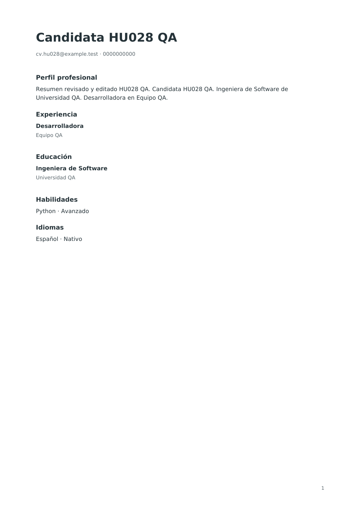

**Caso: PDF minimalista — descarga real. Acción:** Guardar expresamente y descargar desde el navegador tras generación, revisión y edición. **Esperado:** PDF legible con los datos y contactos del CV, sin inventar fechas. **Obtenido:** Una página; 8 campos esperados presentes; plantilla y contenido revisados visualmente. [PDF original](https://github.com/Danilo2334/Work_net/blob/625839ff6cad5fee62418b95d95fdf1671c37f40/frontend/docs/evidencias/hu028-real-20261109/pdf-browser/HU028-CV-minimalista-generacion-real.pdf). **Alcance demostrado:** Render Poppler 110 dpi de los bytes descargados, no captura de interfaz ni imagen de Postman. Los tres PDF de API son otra sesión ficticia y se conservan en pdf-api/.

**Revisión y límites**

Revisión técnica del agente principal sobre API, permisos, transporte, contrato Dart, sesión, aplicación al borrador y herramientas QA. Se corrigieron dos defectos reales: las claves de metadatos JSON ya no cuentan como hechos aportados (`16131ce`), y GenerateContent usa el enum documentado `APPLICATION_JSON` (`6c76159`). Se verificó fidelidad de las propuestas ficticias; no se observaron empresas, títulos o fechas añadidos. La comprobación textual de hechos no sustituye la revisión humana de resúmenes/descripciones. Fechas parciales permanecen nulas; se aceptan fechas completas aportadas en ISO. No se atribuye aprobación humana ni revisión delegada.

Es una aceptación funcional pequeña en SQLite/loopback, no carga ni PostgreSQL ni teléfono físico. Cancelar descarta localmente respuestas tardías; no se afirma abortar una petición ya enviada a Gemini. Límite de producción 5/h por usuario; la QA usa 1000/h solo en su proceso. Para límite global entre procesos se requiere caché compartida. La indisponibilidad/cuota futuras del proveedor dependen de su cuenta. HU027 y sus seis issues permanecen abiertas y Backlog.

### Preparar otra QA sin afectar las anteriores

Revisar primero `backend/postman/hu028_qa.py`. Por defecto usa un doble y crea otra base privada bajo el Git común; los resultados nuevos quedan en el run, sin sobrescribir los originales publicados. Los puertos deben estar libres. El archivo privado existente es `C:\Users\Danilo Carlosama\.codex\worknet-private\gemini.env`, con `GEMINI_API_KEY` y `GEMINI_MODEL=gemini-3.5-flash-lite`; no copiarlo al frontend, colecciones, capturas ni Git. No imprimir sus valores. Para preparar otra QA real sin generar todavía:

```powershell
python backend/postman/hu028_qa.py --provider-real --private-env "C:\Users\Danilo Carlosama\.codex\worknet-private\gemini.env" --prepare-only --serve --api-port 18494 --web-port 18495
```

Para la aceptación API8/8, omitir `--prepare-only`; realiza una generación real y puede consumir la cuota gratuita. Nunca repetir sobre una base consumida. El ejecutor navegador `frontend/tool/browser_qa/hu028_acceptance.cjs <repo> <nuevo-run> --real` exige build web compilado con el origen API de esa QA y realiza dos generaciones reales. Usa contexto Chromium nuevo, orígenes QA verificados y no exporta HAR/trazas/sesiones.

En Postman importar solo colección y entorno privado del run nuevo. La colección canónica de 18 peticiones está en [`backend/postman/hu028.postman_collection.json`](https://github.com/Danilo2334/Work_net/blob/625839ff6cad5fee62418b95d95fdf1671c37f40/backend/postman/hu028.postman_collection.json). El entorno contiene únicamente credenciales ficticias QA, nunca la claveGemini. Ejecutar C01–C07/M01–M02 con `mode.json` en `unconfigured`; cambiar solo ese modo QA a `real` y ejecutar R01–R09 una vez. No ejecutar todas las carpetas mezclando los modos. La propuesta se transfiere mediante variables locales de la corrida, sin persistir en el entorno.

Modelo y protocolo contrastados con documentación oficial: [modelo y salida estructurada](https://aistudio.google.com/docs/models/gemini-3.5-flash-lite), [FreeTier](https://aistudio.google.com/docs/pricing#gemini-3.5-flash-lite), [API GenerateContent](https://ai.google.dev/api/generate-content?hl=en), [esquema REST oficial](https://generativelanguage.googleapis.com/$discovery/rest?version=v1beta). El enum de TextResponseFormat es `APPLICATION_JSON`; no confundirlo con los ejemplos MIME de otra API.

### Seguimientos únicos y responsabilidades

| Tarea | Responsable | Seguimiento existente |
|---|---|---|
| #225 API privada y adaptación del borrador | Danilo2334 | [Comentario conservado](https://github.com/Danilo2334/Work_net/issues/225#issuecomment-6740954009) |
| #226 Interfaz y revisión de propuestas | francisco3788 | [Comentario conservado](https://github.com/Danilo2334/Work_net/issues/226#issuecomment-6740954415) |
| #227 Integración con editor, plantillas y PDF | francisco3788 | [Comentario conservado](https://github.com/Danilo2334/Work_net/issues/227#issuecomment-6740954688) |
| #228 QA, Postman y evidencias auténticas | francisco3788 | [Comentario conservado](https://github.com/Danilo2334/Work_net/issues/228#issuecomment-6740954963) |

Las cuatro relaciones nativas con #224 y los cinco ítems WORK_NET se verifican aparte del cierre de issues. Se conserva Sprint, fechas y asignaciones. Cuenta de publicación, autor y committer se comprueban por aportación. Los checkouts/entornos anteriores se conservan; solo se detuvieron los servidores QA creados en este bloque.

<details>
<summary>Antecedentes cloud — 300 Django,237 Flutter,19 HTTP con dobles; sin aceptación real en aquel corte</summary>

## HU028 — Asistente de creación de currículum con IA — avance del 09/11/2026

**Estado: en desarrollo, sin cierre ni aceptación del proveedor real.** Historia [#224](https://github.com/Danilo2334/Work_net/issues/224), tareas #225–#228 abiertas. La implementación se conserva en ramas de trabajo y PR en borrador; no modifica el producto estable de main. HU027 permanece pendiente de desarrollo.

### Qué se hizo

El generador conserva sus tres plantillas y permite «Completar mi CV con IA». El candidato escribe información, elige si incluye su perfil propio y autoriza su envío a Gemini. Revisa una propuesta estructurada, ve faltantes y decide aplicar al borrador o descartar. Aplicar conserva la plantilla y los contactos que no se hayan proporcionado; sustituye el resumen y las secciones, con aviso previo. El guardado y el PDF requieren la acción habitual del candidato.

La API GET/POST `/api/curriculum/generated/assistant/` exige candidato autenticado y verificado. Comprueba consentimiento, texto, perfil propio y contrato del CV; generar nunca persiste un CV ni altera postulaciones. La clave y el modelo se configuran solo en backend. Se limita el uso por usuario, el tamaño de entrada/respuesta y el tiempo de espera; no se siguen redirecciones ni se reintentan llamadas automáticamente. Se rechazan hechos estructurados ausentes del texto/perfil autorizado. Esta comparación textual no garantiza la veracidad del resumen o de las descripciones: la revisión humana sigue siendo obligatoria. Las fechas incompletas permanecen sin día/mes inventados; las fechas completas deben coincidir con el formato ISO suministrado.

### Preparación y procedencia

- Fecha: **09/11/2026**. Clon cloud aislado Linux; Python 3.12.14, Django 6.1.1, Flutter 3.47.9 y Dart 3.13.7.
- Base estable original `c49d0f7fe658aa8641dba52070a2c83172f69f83`; limpieza HU027 ya integrada en main `1da868605d117b3375edaed10af839a51d3c6bf5`. API de Danilo: [`6675613`](https://github.com/Danilo2334/Work_net/commit/6675613655748fbbba964c80493533b8e5d69659), PR #231. Flutter, QA y originales de Francisco: [`606ce39`](https://github.com/Danilo2334/Work_net/commit/606ce394290562db22a402ce1d56f50be1acb36f).
- Fuentes y originales comprobables en [manifest.json](https://github.com/Danilo2334/Work_net/blob/606ce394290562db22a402ce1d56f50be1acb36f/backend/docs/evidencias/hu028-20261109/manifest.json), con SHA-256 y SHA de blob Git. No contiene credenciales.
- **UI:** renderizaciones auténticas del componente Flutter en pruebas de widgets, repositorio ficticio y datos «Candidata QA / Universidad QA / Django». Vistas lógicas 1280×1000 y 390×844, factor de captura 1.5. Roboto y MaterialIcons cargados; el arnés de capturas fija Roboto en botones para evitar la fuente Ahem de pruebas. No son capturas de navegador, dispositivo ni Postman.
- **API/PDF:** servidor Django HTTP real en loopback, otra SQLite por ejecución, correo a archivos y proveedor sustituido por un doble controlado. Datos separados: «Ana QA / Equipo QA / Universidad QA / Python». Estos PDF no pertenecen a la sesión de las imágenes Flutter. No se llamó a Gemini.
- La ejecución HTTP final fue `run-20261109T130456Z-f9bc3f60`: [19 peticiones comprobadas](https://github.com/Danilo2334/Work_net/blob/606ce394290562db22a402ce1d56f50be1acb36f/backend/docs/evidencias/hu028-20261109/http-resultados.json). Los tokens y contraseñas quedaron únicamente en el directorio privado de esa QA, fuera de los archivos publicados.

### Evidencias de interfaz, visibles y específicas

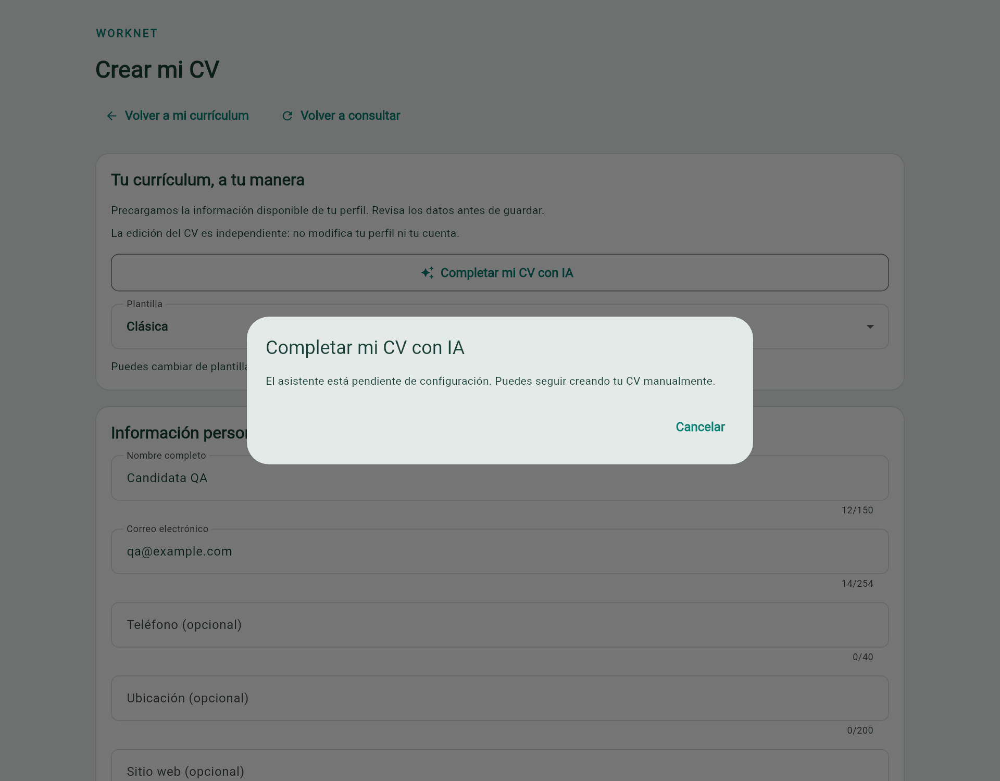

**V01.** Abrir el asistente sin clave/modelo. Se esperaba un mensaje claro y la posibilidad de cancelar; se obtuvo el estado «pendiente de configuración». Acredita la presentación del componente. El HTTP 503 se comprueba por separado en A08; la imagen no prueba permisos.

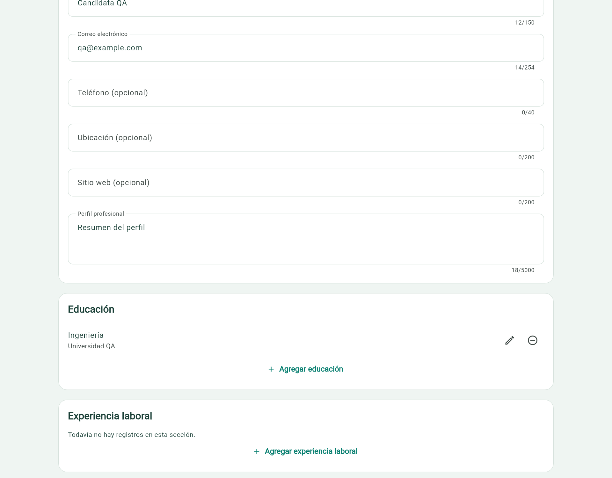

**V02.** Cancelar el estado anterior. Se esperaba recuperar el resumen existente «Resumen del perfil» y no guardar; se ve el editor con ese contenido. El test comprueba además cero guardados en el repositorio ficticio. La persistencia de base de datos se comprueba en pruebas Django, no mediante esta imagen.

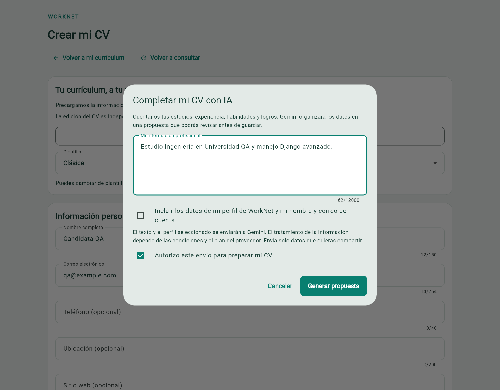

**V03.** Introducir formación y habilidad propias y autorizar el envío manteniendo el perfil desmarcado. Se esperaba explicar el destinatario y el alcance antes de generar; se obtuvo texto, opción independiente de perfil y consentimiento explícito.

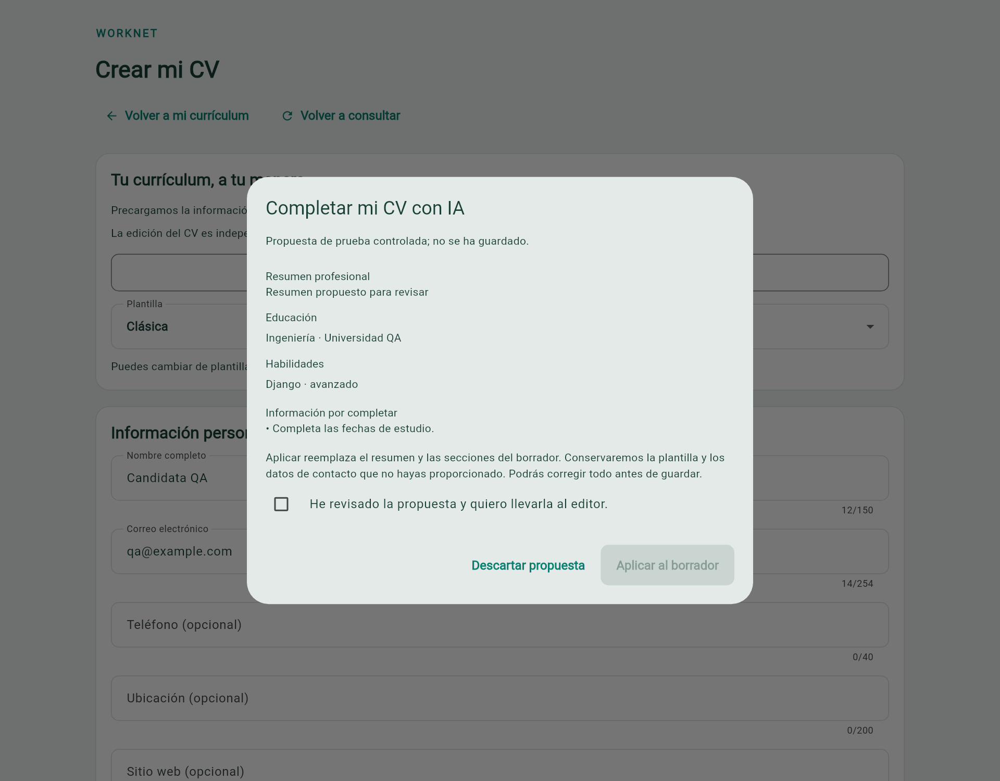

**V04.** Recibir la respuesta del repositorio ficticio. Se esperaba mostrar resumen, formación, habilidad y fecha pendiente, con «Aplicar» desactivado hasta revisar; así aparece. El aviso identifica la propuesta como prueba controlada. No acredita respuesta de Gemini.

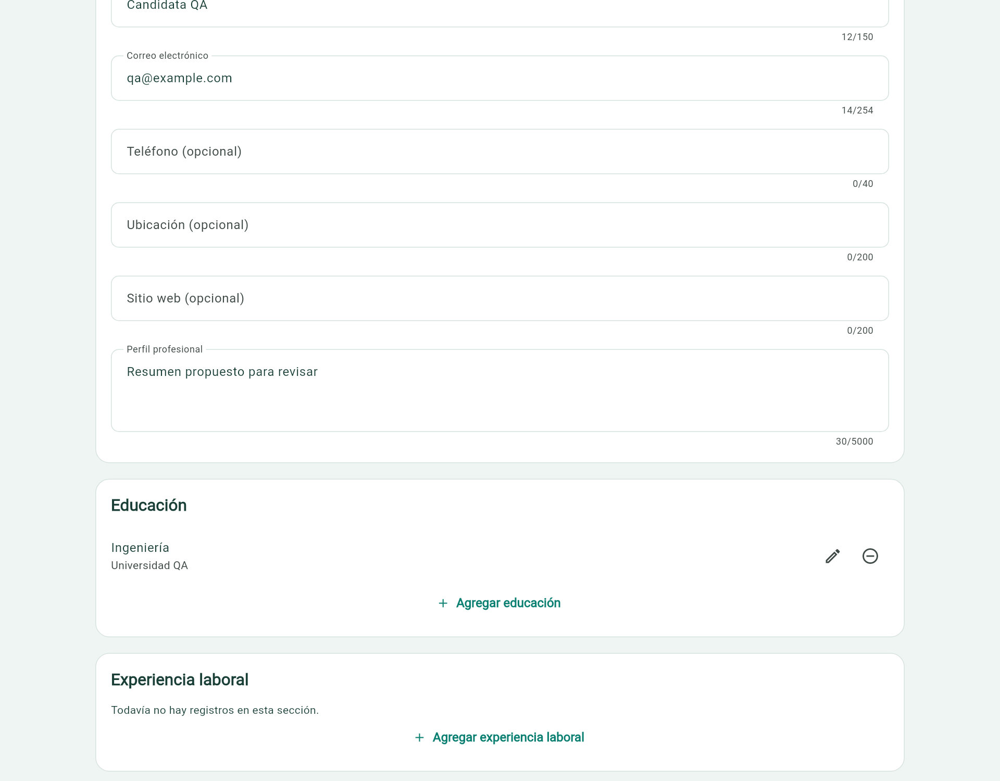

**V05.** Confirmar revisión y aplicar. Se esperaba trasladar «Resumen propuesto para revisar» y formación al editor; ambos están visibles. El test comprueba que no se invocó guardar y que la plantilla se conserva. El candidato debe decidir el guardado definitivo.

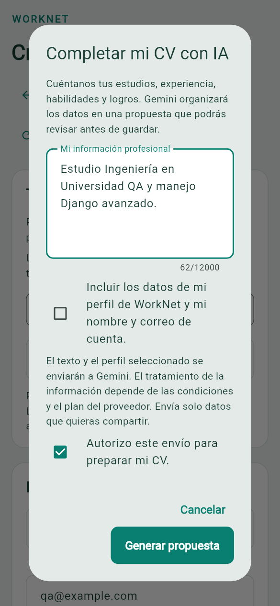

**V06.** Repetir el formulario a 390×844. Se esperaba poder leer el aviso, marcar consentimiento y alcanzar el botón; los controles caben y son legibles. Es una prueba de layout Flutter, no un teléfono físico.

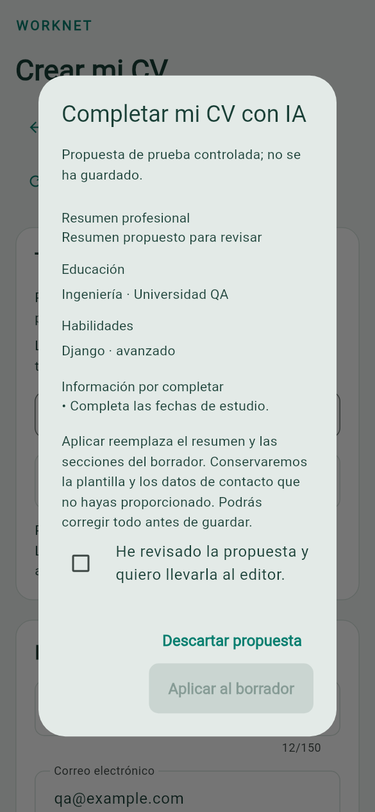

**V07.** Revisar la propuesta en ancho móvil. Se esperaba contenido legible, faltantes, revisión obligatoria y opción de descartar; se obtuvo sin desbordamiento. Tras descartar, el test confirma resumen previo y cero guardados. Sigue pendiente el recorrido en navegador real.

### Integración con las tres plantillas y PDF

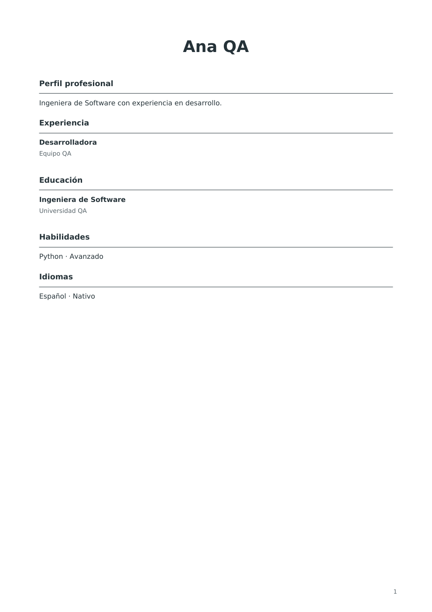

**PDF Clásica.** Guardar expresamente la propuesta ficticia mediante PUT y consultar el PDF propio por HTTP. Se esperaba 200/201 para guardar y 200 con PDF legible; se obtuvo el documento de Ana QA con formación, experiencia y habilidades conservadas. [PDF original](https://github.com/Danilo2334/Work_net/blob/606ce394290562db22a402ce1d56f50be1acb36f/backend/docs/evidencias/hu028-20261109/HU028-PDF-clasica-doble-controlado.pdf). La imagen es la primera página renderizada por `pdftoppm`; no es una captura de Postman ni acredita IA real.

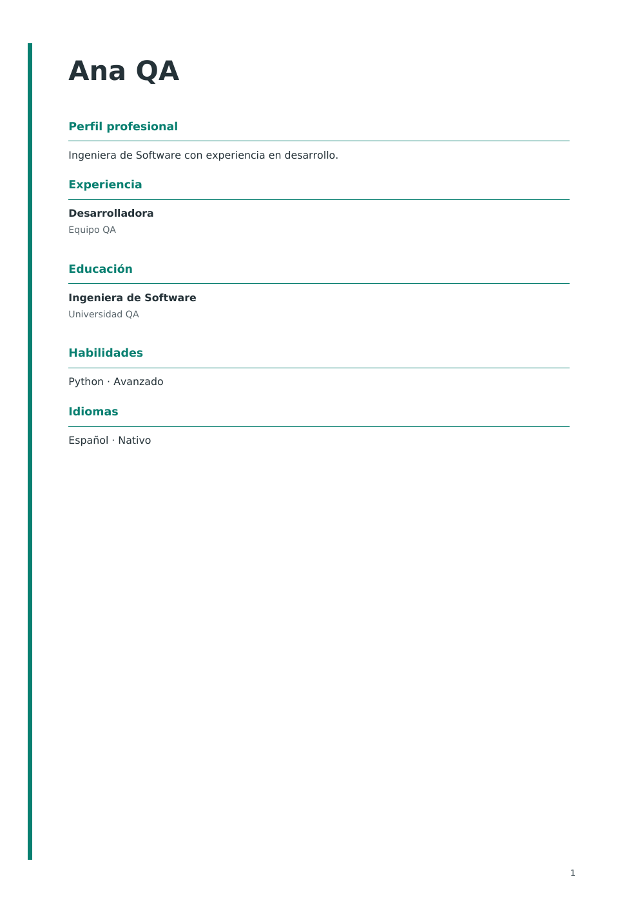

**PDF Moderna.** Guardar expresamente la propuesta ficticia mediante PUT y consultar el PDF propio por HTTP. Se esperaba 200/201 para guardar y 200 con PDF legible; se obtuvo el documento de Ana QA con formación, experiencia y habilidades conservadas. [PDF original](https://github.com/Danilo2334/Work_net/blob/606ce394290562db22a402ce1d56f50be1acb36f/backend/docs/evidencias/hu028-20261109/HU028-PDF-moderna-doble-controlado.pdf). La imagen es la primera página renderizada por `pdftoppm`; no es una captura de Postman ni acredita IA real.

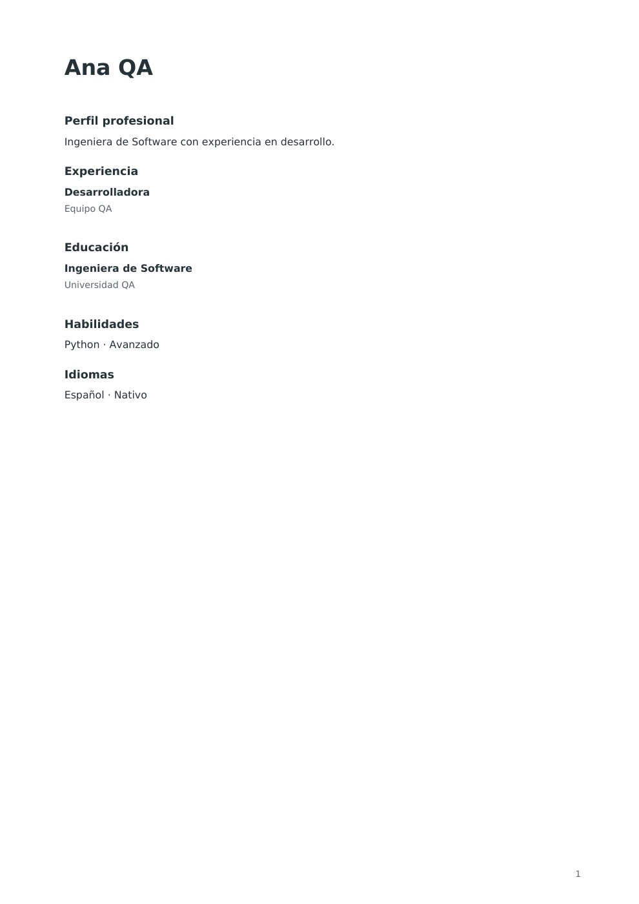

**PDF Minimalista.** Guardar expresamente la propuesta ficticia mediante PUT y consultar el PDF propio por HTTP. Se esperaba 200/201 para guardar y 200 con PDF legible; se obtuvo el documento de Ana QA con formación, experiencia y habilidades conservadas. [PDF original](https://github.com/Danilo2334/Work_net/blob/606ce394290562db22a402ce1d56f50be1acb36f/backend/docs/evidencias/hu028-20261109/HU028-PDF-minimalista-doble-controlado.pdf). La imagen es la primera página renderizada por `pdftoppm`; no es una captura de Postman ni acredita IA real.

### Comprobaciones realizadas

| Comprobación | Resultado y alcance |
|---|---|
| Django | 300 aprobadas; 15 nuevas de HU028. Permisos, consentimiento, límites, perfil propio, datos inválidos, transporte, fallos y ausencia de persistencia. Proveedor simulado. |
| Flutter | 237 aprobadas; 7 nuevas de contrato/interfaz y 3 de recorrido/render. Revisión, descartar, errores, cancelación y borrador sin guardado. |
| Análisis y compilación | `flutter analyze` sin incidencias; build web release correcto. Se conservan avisos conocidos de soporte Wasm de secure storage y fuente Cupertino. |
| Django check / migraciones | Correctos; sin nuevas migraciones. |
| HTTP aislado | 19/19 peticiones con resultados esperados. 401/403/400, configuración 503, propuesta, cuota 429, respuesta inválida 502, guardado/PDF de tres plantillas y PDF ajeno 404. |
| Gemini real | Pendiente; ninguna petición al proveedor realizada. |
| Navegador / Postman Desktop | Pendientes. Los renders de widgets y las peticiones Python no sustituyen esta aceptación. |

### Cómo reproducir y completar

Usar una copia aislada de `codex/hu028-curriculum-ai-integracion`, que reúne API y Flutter. No ejecutar la colección completa contra una QA histórica consumida ni contra datos reales. Instalar las dependencias del backend y ejecutar desde la raíz:

```bash
python backend/postman/hu028_qa.py
```

Cada ejecución crea otra SQLite y correo a archivos bajo el directorio Git común `hu028-qa/run-...`. Usa solo loopback, puertos 18488/18489 libres, y sobrescribe únicamente los resultados HU028 del checkout actual. No toca bases anteriores. Por defecto usa un doble **sin consumo del proveedor** y termina sus servidores. `--serve` mantiene solo esa nueva QA para inspección, inicialmente sin configuración. Sus archivos privados `private.json` y `private.postman_environment.json` no se publican.

Para generar capturas de widgets desde `frontend/`, con Flutter instalado:

```bash
CI=true FLUTTER_SUPPRESS_ANALYTICS=true flutter test test/curriculum_assistant_evidence_test.dart --dart-define=HU028_QA_SCREENSHOTS=true --dart-define=HU028_QA_FONT=/ruta/flutter/bin/cache/artifacts/material_fonts/Roboto-Regular.ttf
```

Para completar el proveedor real, guardar **GEMINI_API_KEY** y **GEMINI_MODEL** únicamente en variables privadas del backend o su `backend/.env` ignorado por Git. No pegarlos en issues, chats, Dart, capturas o colecciones. Elegir un modelo Gemini habilitado en la cuenta que admita salida estructurada; no hay un modelo ni facturación autorizados asumidos. Reiniciar backend. La vista GET indica configuración, no garantiza cuota ni funcionamiento.

Una vez disponible la credencial autorizada, ejecutar explícitamente con datos ficticios:

```bash
python backend/postman/hu028_qa.py --provider-real --serve
```

Este modo sí realiza una generación contra Gemini y puede consumir cuota. Comprueba que generar no guarda, guarda expresamente en las tres plantillas y deja un informe `http-proveedor-real.json` separado. Mantiene un servidor QA nuevo para completar navegador y Postman. Si falta clave/modelo, falla antes de llamar al proveedor.

La colección [hu028.postman_collection.json](https://github.com/Danilo2334/Work_net/blob/606ce394290562db22a402ce1d56f50be1acb36f/backend/postman/hu028.postman_collection.json) no contiene credenciales. Importar únicamente el entorno privado del nuevo run. Separar carpetas de permisos/validación, falta de configuración y proveedor real; no ejecutar la carpeta real sin autorización/configuración. La QA eleva su límite a 1000/h únicamente en el proceso aislado para permitir casos negativos; producción mantiene 5/h por usuario. En despliegues con varios procesos se necesita un caché compartido para un límite global.

### Seguimientos de HU028 y continuación

| Tarea | Seguimiento único | Evidencia y estado |
|---|---|---|
| #225 API — Danilo | [Comentario](https://github.com/Danilo2334/Work_net/issues/225#issuecomment-6740954009) | 15 pruebas propias y 19 peticiones HTTP documentadas; capturas Postman Desktop pendientes. |
| #226 Flutter — Francisco | [Comentario](https://github.com/Danilo2334/Work_net/issues/226#issuecomment-6740954415) | Cuatro renders explicados de consentimiento, revisión, aplicación y móvil; navegador real pendiente. |
| #227 Integración — Francisco | [Comentario](https://github.com/Danilo2334/Work_net/issues/227#issuecomment-6740954688) | Tres PDF y primeras páginas, guardado explícito por HTTP; recorrido conjunto con Gemini real pendiente. |
| #228 QA — Francisco | [Comentario](https://github.com/Danilo2334/Work_net/issues/228#issuecomment-6740954963) | Dos renders de casos específicos reutilizados, manifiesto y resultados; aceptación externa pendiente. |

[PR #231](https://github.com/Danilo2334/Work_net/pull/231) contiene API de Danilo; [PR #232](https://github.com/Danilo2334/Work_net/pull/232) contiene Flutter/QA/guía de Francisco. Ambos permanecen en borrador. La [rama combinada](https://github.com/Danilo2334/Work_net/tree/codex/hu028-curriculum-ai-integracion) conserva ambos historiales para continuar; el corte de implementación comprobado es [`ebd3f0f`](https://github.com/Danilo2334/Work_net/commit/ebd3f0fe1413ae7401dc91d4b6398ba15b74ec7a). Cada archivo funcional y original se contrastó con el árbol remoto; no se fusionó HU028 en main.

### Pendientes concretos de aceptación y publicación

1. Configurar clave y modelo autorizados y comprobar Gemini real, incluida utilidad/fidelidad de las propuestas.
2. Completar el recorrido navegador: texto/perfil/consentimiento → propuesta → revisar/aplicar o descartar → editar → guardar → vista previa/descarga, escritorio y móvil web.
3. Publicar capturas auténticas de Postman Desktop con petición, respuesta HTTP y Test Results para #225/#228, sin encabezados ni valores secretos.
4. Asociar #225–#228 como subtareas nativas de #224 y verificar sus campos de Project. En esta sesión solo se pudieron crear referencias Markdown; no se declara ese contador ni un cambio de estado en WORK_NET.
5. Revisar y entregar las ramas por el flujo habitual después de la aceptación. Danilo publica API; Francisco publica Flutter/integración/QA. No hay aprobación humana atribuida ni historias cerradas.

El instalador de Chromium de Playwright devolvió HTML `Site Unavailable` con HTTP 200 en lugar del ZIP; el navegador cloud tampoco alcanzó el servidor loopback del ejecutor (`ERR_CONNECTION_REFUSED`). No se ocultaron esas limitaciones ni se inventaron capturas. Esta sesión no controla el Windows del usuario ni inspeccionó posibles cambios LinkedIn locales sin publicar.

</details>
<!-- hu028-avance-fin -->

<details>
<summary>Antecedente de alcance del cierre HU001–HU026; sustituido por la decisión del 09/11/2026</summary>

<!-- alcance-hu001-hu026-inicio -->
## Alcance vigente — HU001–HU026 — 09/11/2026

**Cambio de alcance solicitado por el usuario.** La entrega final comprende HU001–HU026. **HU027 #28 y #137–#141 están canceladas, fuera de alcance y cerradas con motivo `not_planned`**, con estado **Cancelada** en WORK_NET, separado de Done. No se presentan como implementadas, probadas o completadas; no se requiere aplicación, permiso, credencial ni consentimiento de LinkedIn. El contador automático de subtareas cerradas no acredita cumplimiento de sus criterios.

Se detuvo la configuración y cualquier implementación adicional de LinkedIn. La preparación de sitio, logo, propuesta de privacidad y retorno estático de [#196](https://github.com/Danilo2334/Work_net/pull/196)/[#197](https://github.com/Danilo2334/Work_net/pull/197), publicada en main `a9bbf324c8deeec45b462cba84eb620b0dbf0f18`, se conserva como antecedente. Nunca ejecutó OAuth ni importó datos reales. [Versión preparatoria conservada](https://github.com/Danilo2334/Work_net/blob/a9bbf324c8deeec45b462cba84eb620b0dbf0f18/frontend/README.md). Las páginas actuales anuncian la cancelación y el perfil/CV manual continúa disponible.

HU023 se entregó y verificó en [main `5cdd951e7e0f4c7e9fb829e1adf94beece8c5bc9`](https://github.com/Danilo2334/Work_net/commit/5cdd951e7e0f4c7e9fb829e1adf94beece8c5bc9), #24 y #120–#123 closed/completed y Done, relación exacta **4/4 — 100 %**. Los resultados verificados de HU024 y HU006 se conservan en su sección. HU025 y HU026 presentan sus resultados comprobados en las secciones siguientes. HU026 resuelve los accesos de cuentas, permisos y eventos pendientes en HU007; la entrega conjunta y los cierres remotos se registran en los seguimientos únicos. Los cortes de aceptación anteriores conservan su fecha, fuente y alcance; las referencias históricas a HU027 no representan el alcance vigente.

Los seis IDs, responsables, relaciones, criterios y antecedentes originales de HU027 permanecen conservados. La opción Cancelada se añadió preservando los IDs y valores de todos los estados existentes; no se cambian Sprint ni fechas. Ningún cierre not_planned se contará como entrega funcional.

<!-- alcance-hu001-hu026-fin -->

</details>
<!-- alcance-vigente-fin -->

<!-- hu026-vigente-inicio -->
## HU026 — Administradores, permisos y doble factor — 09/11/2026

**Qué se hizo**

Listado y alta por administrador principal; estados, roles y permisos granulares guardados con versión. Las cuentas administrativas requieren contraseña y TOTP. Recuperar el acceso revoca lo anterior y exige un autenticador nuevo. Completa los accesos de gestión y eventos de HU007, manteniendo a administración fuera de las postulaciones.

| Criterio original HU026 | Comprobación |
|---|---|
| Listado de administradores | V06, P14/P15; páginas de 20 y 8 iniciales |
| Nombre, correo, rol y estado | V06/V11, contrato estricto y proyección del servidor |
| Alta por principal | V07/V13, P20/P21/P23/P34; correo a archivos y MFA antes del acceso |
| Activar/desactivar | V09, P36–P40; revocación y conflicto409 |
| Sección de permisos | V08/V11/V12, P33/P35 |
| Asignar/retirar según rol | V08, P35/P40/P43; no concede autoridad que no posee |
| Guardar cambios | V08/V09 y pruebas Flutter de versión, error y conflicto |
| Segundo factor obligatorio | V02–V04/V12/V13/V15, P02/P05–P12/P25–P32/P45–P55; Django incluido /admin/ |
| Solo autoridad suficiente modifica otros | P22–P24/P29/P34/P35, Django protección de principal/propia cuenta |

**Preparación**

Aceptación del 09/11/2026, America/Bogota, Windows; base main `fc386bc843735573a5786c455b6a3570b34c4da5`. Backend Danilo [`1fd39be`](https://github.com/Danilo2334/Work_net/commit/1fd39be5797c69ad9a241a155c44fa18306ed38a), más corrección de concurrencia HU018 [`4bfffac`](https://github.com/Danilo2334/Work_net/commit/4bfffaca80a2a0bd3e420f1281a3bf9c405b8a63). Flutter/QA Frank, fuente de navegador [`727855f`](https://github.com/Danilo2334/Work_net/commit/727855f428f08a89e14877c44899a1c14b62970d); código funcional idéntico al último checkout de aceptación, cambios posteriores solo pruebas/entrada Android/evidencias.

Dos SQLite nuevas independientes con 18 ofertas, 27 postulaciones y 28 administradores iniciales/29 finales, usuarios ficticios, correo a archivos, sin SMTP. Desktop `run-20261109T062516-fbcf48eb`, colección [`fc89eee`](https://github.com/Danilo2334/Work_net/commit/fc89eee7d555c0e2f5e70c215aa3908ec54b5f60), servidor `03f9352ed5f6c7893048b0e94010a251dc9e4f16`, una iteración, 55 peticiones/90 PASS, 0 fallos/errores/omitidas; 46,551s, media HTTP 249ms. Navegador `browser-qa-20261109T063259-6fe5ad04`: 18/18, 30 PNG, 1440×1000 y 390×844, Chromium 158.0.8127.18/Playwright 1.65.0. Postman 12.35.5. Flutter 3.47.5/Dart 3.13.4; Django 6.1.1/DRF 3.18.3/django-otp 1.7.5, Python 3.12.10/SQLite 3.49.1. Medios permanentes `1dd49544a7def685a414b7cda931b694f8ada8ae`: 30 PNG de aceptación, 11 JPEG de la corrida vigente y 9 JPEG históricos identificados;50/50 HTTP200/SHA256 idénticos. No se publican entornos, bases, correo ni valores de autenticación.

285 pruebas Django aprobadas y 227 Flutter en la verificación conjunta completa, incluido el nuevo caso de reemplazo de usuario; análisis sin incidencias, web release, check 0, sin migraciones pendientes ni cambios adicionales de modelos sin migración. 20 pruebas Python y 7 comprobaciones Node, seis vectores RFC6238. Contraste de 13 tablas de negocio y cuentas no administrativas idénticas en ambas QA; autoridad/cuentas/eventos administrativos sí cambian por las operaciones probadas.

Rendimiento adicional, separado del Runner: 30 GET HTTP 200 secuenciales de listado con 29 administradores/20 filas; media 53,93 ms, mediana 50,73 ms, p95 67,48 ms. SQLite local pequeño; no carga ni PostgreSQL. TOTP de autenticador software QA ficticio con reloj real, validado por django-otp sin simular servidor; no se atribuye aplicación autenticadora o equipo físico. El caso negativo Desktop acredita seis dígitos incorrectos y contador 0→1. El 503 de navegador es una inyección identificada; el reintento 200 es real.

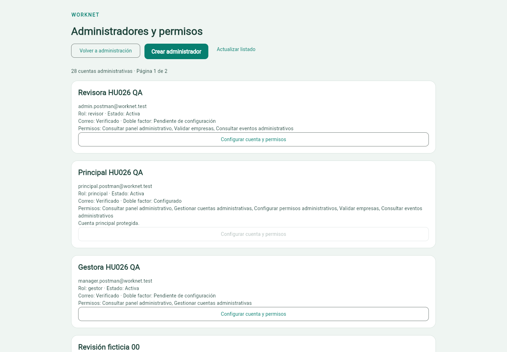

**Caso V06 listado.** **Esperado:** Mostrar nombre, correo, rol y estado. **Obtenido:** Listado real con cuenta principal protegida y controles según autoridad. **Alcance demostrado:** Flutter de escritorio conectado a Django; no maqueta.

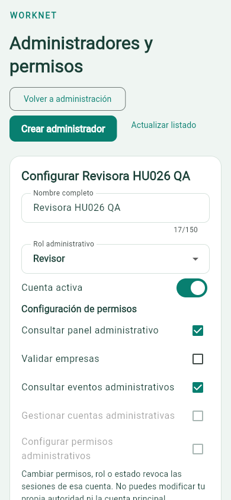

**Caso V11 móvil.** **Esperado:** Consultar la configuración según el rol en móvil. **Obtenido:** Nombre, rol, estado y permisos visibles en 390×844. **Alcance demostrado:** Captura parcial del formulario desplazable; el botón Guardar queda fuera de este encuadre. Guardado acreditado en V08 de escritorio y pruebas Flutter; móvil web emulado, no equipo físico.

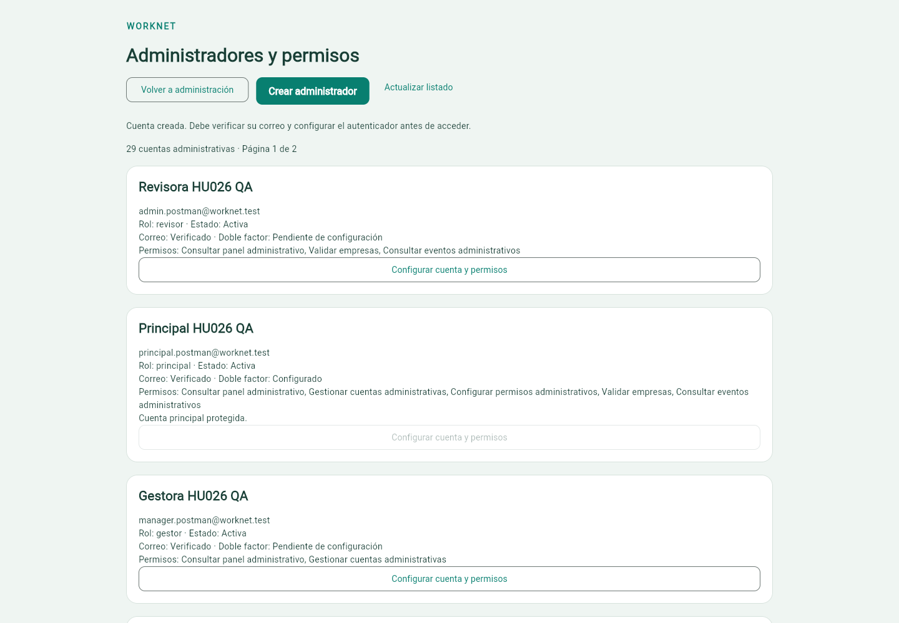

**Caso V07 alta.** **Esperado:** Crear por principal sin conceder acceso antes de verificar correo y TOTP. **Obtenido:** Alta confirmada con verificación y segundo factor pendientes. **Alcance demostrado:** No acredita entrega SMTP; V13 consume el enlace real del correo a archivos.

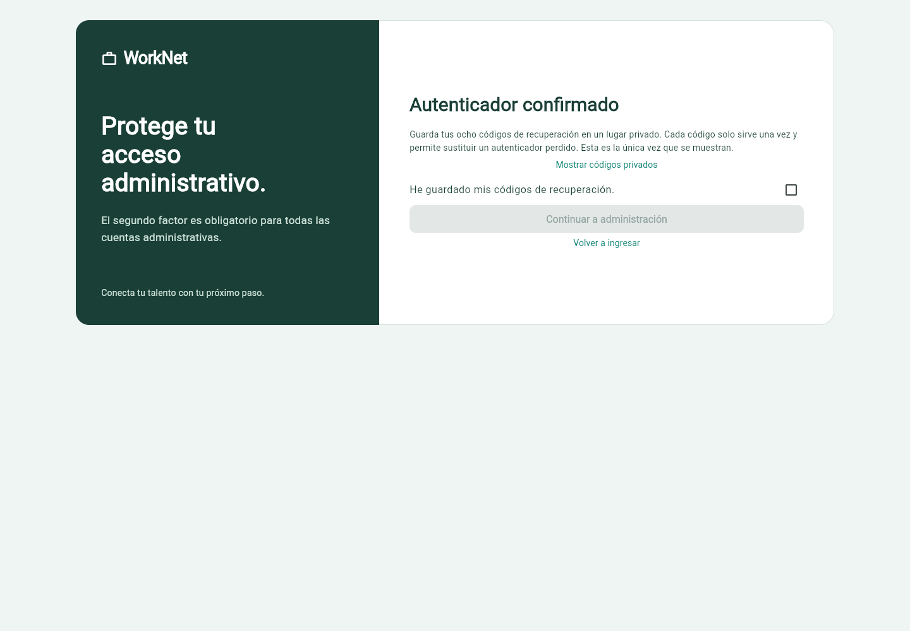

**Caso V04 doble factor.** **Esperado:** Entrar solo después de verificar TOTP y guardar los códigos de recuperación. **Obtenido:** Autenticador confirmado, códigos ocultos y confirmación pendiente. **Alcance demostrado:** Autenticador software ficticio con reloj real; verificación django-otp, sin simulación.

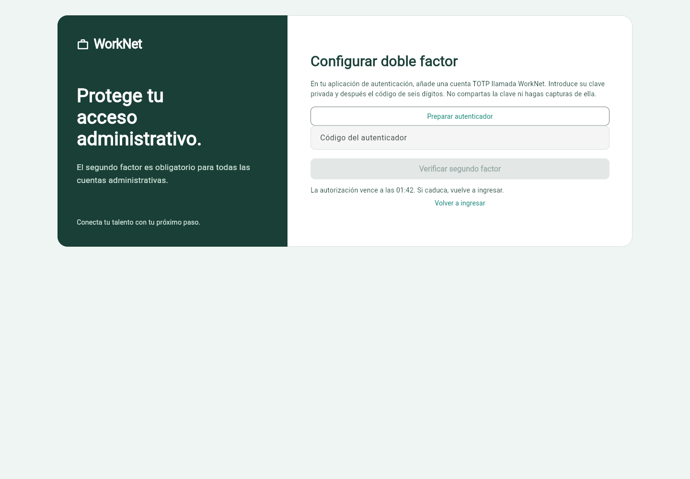

**Caso V15 recuperación.** **Esperado:** Un código de recuperación debe revocar la sesión anterior y exigir otro autenticador. **Obtenido:** Se presenta configurar doble factor, con campo privado vacío. **Alcance demostrado:** La corrida completa configura y verifica TOTP nuevo; no omite MFA.

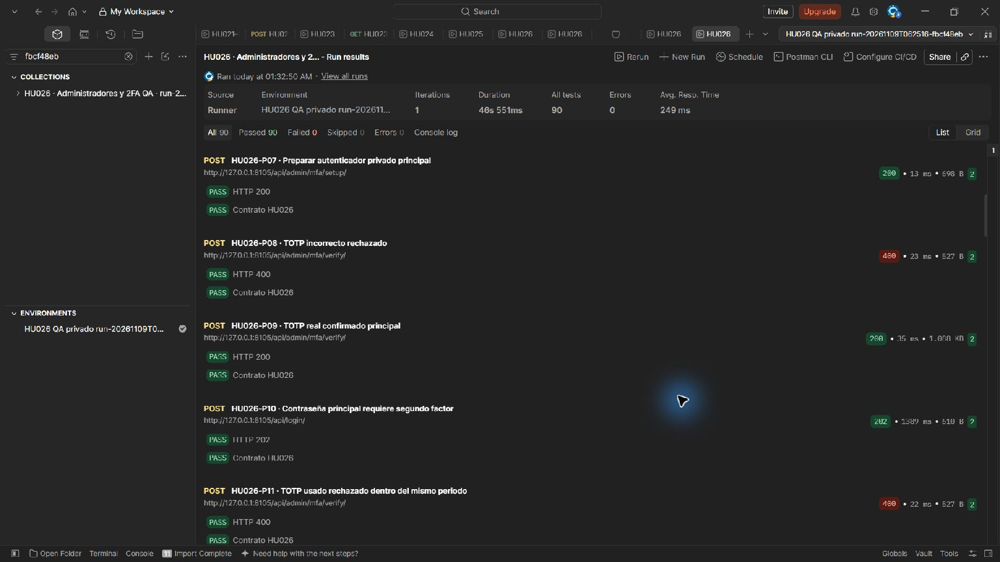

**Caso Desktop completo.** **Esperado:** Ejecutar una sola iteración sobre otra base QA aislada. **Obtenido:** 55 peticiones, 90 PASS, cero fallos/errores/omitidas. **Alcance demostrado:** Postman Desktop 12.35.5 original; no historial de otra historia.

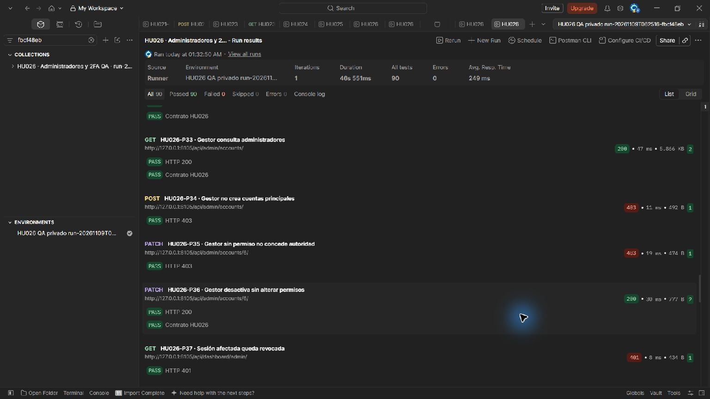

**Caso P33–P37 permisos.** **Esperado:** Denegar crear/conceder autoridad sin permiso y revocar tras baja. **Obtenido:** 200/403/403/200/401, todas las aserciones PASS. **Alcance demostrado:** Restricciones reales del servidor; no depende de ocultar botones.

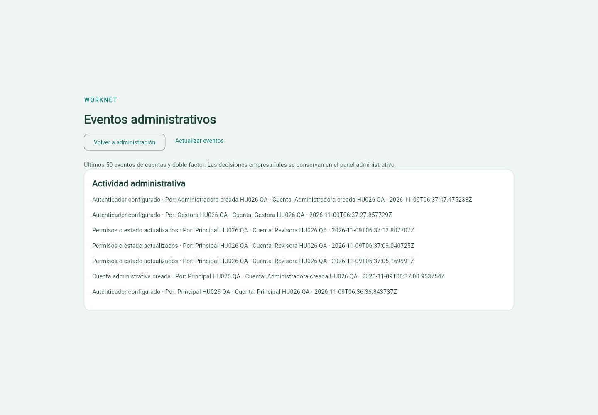

**Caso V14 eventos.** **Esperado:** Mostrar eventos administrativos autorizados sin secretos. **Obtenido:** Altas y segundo factor visibles con actor/cuenta/fecha. **Alcance demostrado:** No cambia la gestión normal de postulaciones.

**Registros verificables y publicación**

[Resultado Desktop](https://github.com/Danilo2334/Work_net/blob/1dd49544a7def685a414b7cda931b694f8ada8ae/backend/docs/evidencias/hu026-20261109/resultado-desktop.json) · [Resultado navegador](https://github.com/Danilo2334/Work_net/blob/1dd49544a7def685a414b7cda931b694f8ada8ae/backend/docs/evidencias/hu026-20261109/resultado-navegador.json) · [Manifest Desktop](https://github.com/Danilo2334/Work_net/blob/1dd49544a7def685a414b7cda931b694f8ada8ae/backend/docs/evidencias/hu026-20261109/capturas-postman.json) · [Manifest navegador](https://github.com/Danilo2334/Work_net/blob/1dd49544a7def685a414b7cda931b694f8ada8ae/backend/docs/evidencias/hu026-20261109/capturas-navegador.json) · [Rendimiento](https://github.com/Danilo2334/Work_net/blob/1dd49544a7def685a414b7cda931b694f8ada8ae/backend/docs/evidencias/hu026-20261109/rendimiento.json).

Django por Danilo2334: [#218](https://github.com/Danilo2334/Work_net/pull/218), sprint `bbce05db50f137dba2fe99b563fca3887593315f`; [#220](https://github.com/Danilo2334/Work_net/pull/220), develop `ba3e72c778d5d8785550ec5254e19694f3ac33cc`. Flutter y sus pruebas por francisco3788: [#219](https://github.com/Danilo2334/Work_net/pull/219), frontend `67b98364af5afd2ea406c98bed7bbb84f03b6463`; incorporación del backend revisado [#221](https://github.com/Danilo2334/Work_net/pull/221), frontend `0993033fe0df3128b71105412b6627672c19d973`. Archivos funcionales remotos contrastados con el conjunto aceptado. El PR de entrega a main es [#222](https://github.com/Danilo2334/Work_net/pull/222). Los seguimientos únicos enlazados registran el SHA definitivo y el contraste independiente de cierre, Done y contadores. La revisión técnica delegada no se atribuye como aprobación humana.

**Seguimientos únicos**

[#132](https://github.com/Danilo2334/Work_net/issues/132#issuecomment-6734102930) · [#133](https://github.com/Danilo2334/Work_net/issues/133#issuecomment-6734103236) · [#134](https://github.com/Danilo2334/Work_net/issues/134#issuecomment-6734103540) · [#135](https://github.com/Danilo2334/Work_net/issues/135#issuecomment-6734103787) · [#136](https://github.com/Danilo2334/Work_net/issues/136#issuecomment-6734104096).

**Reproducción**

En checkouts aislados, instalar requirements fijados; `python manage.py test`, `python manage.py check`, `python manage.py makemigrations --check --dry-run`; frontend `flutter test`, `flutter analyze`, `flutter build web --release --no-web-resources-cdn`. HU026 añade accounts0005 y las migraciones de django-otp; aplicar únicamente a la base que se vaya a usar, conservando los entornos existentes.

Navegador: `python frontend/tool/browser_qa/run.py --suite hu026 --frontend-ref SHA_FLUTTER --backend-ref SHA_DJANGO`. Exporta fuentes, instala dependencias fijadas y crea otra base y contextos temporales; nunca registra HAR, storageState ni secretos. Desktop: `python frontend/tool/browser_qa/hu026_api.py prepare --port PUERTO_LIBRE`; generar colección con `hu026_collection.py --run RUN --port PUERTO`, servir con `hu026_server.py --run RUN --port PUERTO`, importar los dos archivos de import-hu026 y seleccionar solo el entorno de esa corrida sin abrir valores. Runner Functional/Local,55 seleccionadas, 1 iteración, conservar respuestas, detener ante error, sin cookies anteriores ni guardar cookies. No repetir una base consumida. Contrastar con `hu026_api.py contrast --run RUN`.

**Administración local**

Un principal se prepara mediante el mecanismo Django existente `python manage.py createsuperuser` sobre la base local elegida. El mecanismo de aprovisionamiento local crea ese principal con correo verificado; no acredita recepción de correo. Las cuentas nuevas creadas desde la interfaz sí deben verificar el enlace real enviado por el backend antes del acceso. La aplicación exige registrar un autenticador TOTP privado de seis dígitos/30 segundos/SHA1 y confirmar sus ocho códigos de recuperación; no introducir valores en Issues, capturas, consola o documentación. Una cuenta administrativa anterior también debe enrolarse: su Token antiguo no acredita MFA. El sitio Django usa un segundo factor igualmente y no expone editores brutos de Tokens/dispositivos/permisos. La clave de desarrollo y DEBUG del settings general no acreditan un despliegue productivo; el preparador QA los sustituye por configuración privada, DEBUG=False y hosts de loopback. No se desplegó ni se activó ningún servicio cloud.

<details>
<summary>Antecedentes de aceptación conservados</summary>

Desktop 383c377d: 7 HTTP/10 PASS, error de ejecutor globalThis antes de P08. f3020868:27 HTTP/42 PASS/1 fallo y 1 error, primer OTP de revisor no tenía formato válido. fac04ca3:50 HTTP/80 PASS/1 fallo y 1 error en reenrolamiento; auditoría detectó P08 con marcador de preparación, por lo que no acredita TOTP incorrecto. Corrección del ejecutor: mantener el evento hasta terminar WebCrypto y componer el cuerpo después, antes de enviar. La corrida vigente fbcf48eb es una base nueva; no se reejecutaron las consumidas. Importación transitoria Collection not found resuelta conservando la colección anterior, sin cambiar cuenta/workspace/entornos previos.

Navegador a2b6c12f y 0085ff0e se detuvieron en V14; el segundo identificó una fuente externa de un símbolo nuevo. Se sustituyó por etiquetas locales y se mantuvo el bloqueo de red. 95dfd713/553516f2 llegaron hasta V14 y el guard de V15 encontró un campo oculto de recuperación no vacío en el DOM; ninguna captura de ese estado se guardó. Se reconstruyó la entrada al cambiar desafío y se repitió en otra base. La vigente 6fe5ad04 acredita 18/18 y campo vacío. Estos antecedentes no se cuentan como aceptación completa.

Revisión técnica delegada del agente; no aprobación humana de Danilo o Francisco. Los defectos de sesiones tardías y guardado Android del CV descubiertos en revisión final se documentan por separado, con sus pruebas y procedencia. HU027 sigue cancelada/not_planned/Cancelada, no implementada ni probada.

</details>

<!-- hu026-vigente-fin -->

<!-- cierre-regresiones-20261109 -->
## Revisión final HU001–HU026: sesión y CV Android — 09/11/2026

**Qué se hizo**

La revisión técnica delegada detectó y corrigió respuestas tardías de páginas anteriores que podían cerrar otra sesión o aplicar a ella un nombre, rol o Token. Se conserva la credencial de cada operación antes de efectos posteriores y de encadenar foto/logo; el contenido protegido se reinicia al cambiar usuario/rol. La rotación legítima de contraseña conserva la confirmación y borra los campos privados. Corrección Flutter y pruebas propias por francisco3788, [cee027e](https://github.com/Danilo2334/Work_net/commit/cee027e3c7097c1b194f921a6e1ba7b55e8aa89a).

También se corrigió el guardado nativo del CV generado: file_selector no implementa esa operación en Android. Se reutiliza file_saver 0.7.0/SAF, manteniendo los bytes autenticados y el guardado web. Tres pruebas del canal comprueban bytes/nombre/MIME, cancelación y error; ocho casos de aislamiento comprueban 401/éxito tardío, cadena de foto y reemplazo real de usuario en WorkNetApp. [Corrección CV 5b10458](https://github.com/Danilo2334/Work_net/commit/5b10458413c57ab79ce7e74688fce727d8ffdf1a). La verificación conjunta completa pasó 227 Flutter; tras dos ajustes de estilo sin cambio de comportamiento pasaron los ocho casos afectados y el análisis final sin incidencias. Las 285 pruebas Django y la aceptación HU026 descritas arriba conservan sus fuentes propias.

**Preparación**

Otra base QA `run-20261109T063447-a0a3b4ff`, puerto 8106, 18 ofertas/27 postulaciones y CV ficticio guardado, correo a archivos y credenciales privadas. Se reutiliza el preparador HU025 para generar esos datos, sin atribuir esta descarga a su aceptación anterior. APK debug del target QA explícito `tool/browser_qa/android_final.dart`, fuente `d7b8c2409e68d1f651040df826d06532fb008f12`; backend `4bfffaca80a2a0bd3e420f1281a3bf9c405b8a63`. AVD nuevo vacío propio WorkNet_QA_Cierre, API 37/Android 17 emulado, 360×640/160dpi, 2GB/2CPU; se conservaron los AVD previos. No se usa como target normal lib/main.dart ni se publica el APK con defines privados.

Se canceló el primer selector: retorno a WorkNet y ausencia del archivo comprobada en el AVD. Se volvió a abrir y se guardó realmente `Downloads/curriculum-worknet.pdf`: 42.425 bytes, SHA256 `cb30764198f02831d08e55ebc42cbeb28ec0348c0def6f7bc444a5c1bd510e08`, una página de plantilla moderna. Diez valores del CV coinciden con SQLite; trece tablas de negocio permanecen idénticas a la copia inicial. Render Poppler 110dpi inspeccionado, legible y sin recortes/solapamientos. No se afirma identidad binaria entre generaciones PDF distintas, prueba física, SMTP o carga.

[Resultado y contraste Android](https://github.com/Danilo2334/Work_net/blob/24874d632129d4045fb6e222b227e05c6616c953/frontend/docs/evidencias/cierre-hu001-hu026-20261109/aceptacion-android-cv.json) · [Manifest de ocho JPEG originales](https://github.com/Danilo2334/Work_net/blob/24874d632129d4045fb6e222b227e05c6616c953/frontend/docs/evidencias/cierre-hu001-hu026-20261109/capturas-android-cv.json) · [PDF original guardado](https://github.com/Danilo2334/Work_net/blob/24874d632129d4045fb6e222b227e05c6616c953/frontend/docs/evidencias/cierre-hu001-hu026-20261109/CV-Android-guardado.pdf) · [Inspección del render](https://github.com/Danilo2334/Work_net/blob/24874d632129d4045fb6e222b227e05c6616c953/frontend/docs/evidencias/cierre-hu001-hu026-20261109/revision-pdf.json). Diez binarios remotos HTTP 200 y SHA256 idénticos: ocho JPEG, PDF y render. A01/A02 son antecedentes del primer AVD con encuadre incompleto; A03–A08 corresponden al definitivo y no se cuentan como ocho casos distintos. Servidores y emuladores propios detenidos; bases, archivos y entornos conservados.

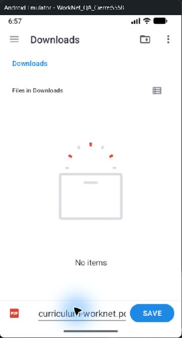

**Caso Android cancelar.** **Esperado:** Abrir el selector del PDF y permitir cancelar. **Obtenido:** SAF muestra Downloads sin archivos y el nombre propuesto. **Alcance demostrado:** Imagen previa a cancelar; la ausencia posterior se comprobó por el nombre exacto en ese AVD propio.

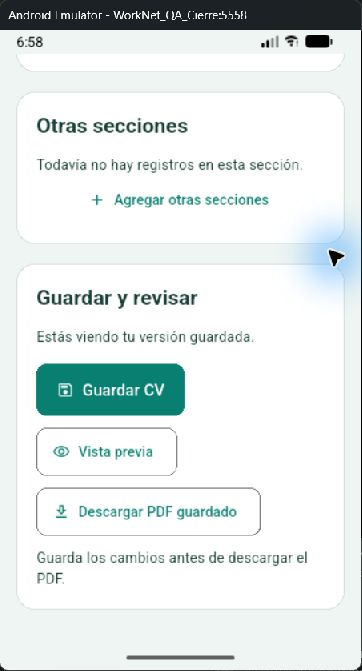

**Caso Android retorno.** **Esperado:** Volver sin anunciar un archivo guardado. **Obtenido:** WorkNet vuelve a mostrar el CV guardado y sus controles. **Alcance demostrado:** La imagen demuestra el retorno; el contraste del AVD acredita que no existe el archivo tras cancelar.

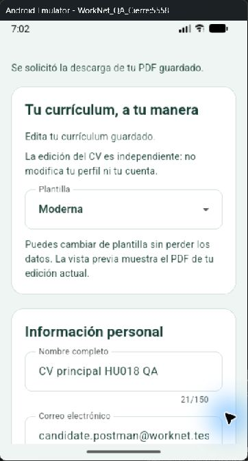

**Caso Android guardar.** **Esperado:** Guardar por SAF el PDF generado persistido. **Obtenido:** WorkNet confirma que se solicitó la descarga del PDF guardado. **Alcance demostrado:** La persistencia se acredita además con el archivo extraído y sus 42.425 bytes/diez campos contra SQLite; no solo con este mensaje.

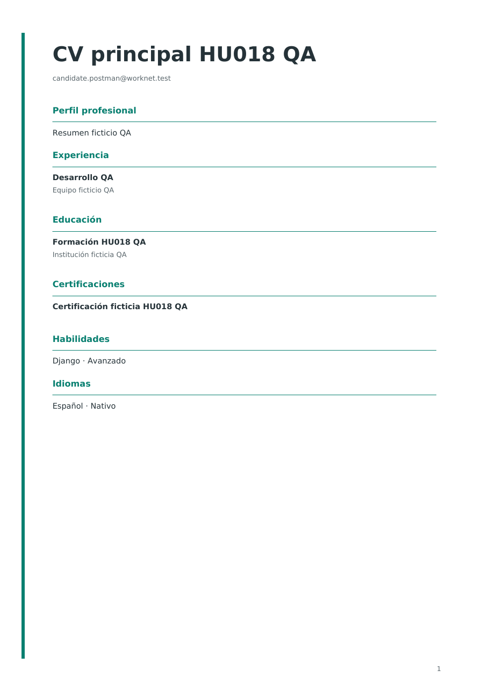

**Caso PDF nativo guardado.** **Esperado:** Obtener un CV legible con los datos persistidos. **Obtenido:** Nombre/correo ficticios, resumen, experiencia, formación, certificación, habilidad e idioma y página 1 legibles. **Alcance demostrado:** Render Poppler del PDF auténtico descargado; no captura de navegador, Android ni Postman.

**Reproducción**

Crear otra QA con `hu025_api.py prepare --port PUERTO_LIBRE` y servir esa corrida con `android_hu025_server.py --run RUN`, que verifica el marcador del preparador, correo a archivos y loopback. Preparar un AVD QA vacío separado; la entrada `android_final.dart` exige host 10.0.2.2, identidad de servidor, candidato ficticio y confirmación de aislamiento. Inyectar defines solo desde archivo privado ignorado con `flutter build apk --debug --target tool/browser_qa/android_final.dart --dart-define-from-file=ARCHIVO_PRIVADO`; no publicar ese archivo ni el APK. Abrir el CV guardado, cancelar el selector y volver a guardar. Contrastar el PDF extraído con el CV y las tablas de la SQLite de esa corrida, y revisar su render. El flujo normal conserva lib/main.dart y el perfil/CV manual; HU027 sigue cancelada.

<!-- cierre-regresiones-20261109-fin -->

<!-- hu025-vigente-inicio -->
## HU025 — Exportación de postulantes — 08/11/2026

**Qué se hizo**

CSV/PDF de todas las coincidencias autorizadas, filtros/orden conservados, vacío, validación y protección de fórmulas. Descargas reales en escritorio, móvil web y Android nativo emulado, con negocio intacto.

| Criterio original HU025 | Evidencia vigente |
|---|---|
| Exportar CSV | V02/V04/V05/V06/V09/V10, P02/P04–P10, Android SAF CSV y archivos reales |
| Exportar PDF | V03/V06/V09, P03/P11, Android SAF PDF y documentos legibles |
| Solo información autorizada | Proyección explícita; P21–P25, 403/404/401 y pruebas SQL sin documentos/contactos |
| Respetar filtros aplicados | Consulta HU020 compartida; individuales 9/6/6 y combinados 4; orden estable contrastado |
| Sin registros | V07/V08 deshabilitados, P13 informa 400 sin archivo |
| Archivo corresponde con sistema | Todas las filas/campos/orden contra SQL en CSV/PDF, 14 totales/4 combinadas/6 móvil; negocio intacto |

**Preparación**

Aceptación del **08/11/2026, America/Bogota**, Windows. Base main `491f4ef0c210125eb6cf60e460f77214917b5fd9`. Django [`234ed32`](https://github.com/Danilo2334/Work_net/commit/234ed32a34abee4bd144f37331439b2806c1fb05); Flutter funcional y sus pruebas [`e2194db`](https://github.com/Danilo2334/Work_net/commit/e2194dbf3295c2c6cf37a35cc2613e2e1af1d1fd), con lib/test idénticos en los ejecutores posteriores. Navegador final [`9e131b3`](https://github.com/Danilo2334/Work_net/commit/9e131b391b80d03b9cc1a435a0fc8634545aa3f6); entrada/servidor QA Android [`ae6ce84`](https://github.com/Danilo2334/Work_net/commit/ae6ce8423a53891efc805f973ba1d097967d20d1). Medios permanentes `d420bd3c5cf427a16773a7f5ef22c4ca422f67d7`: identifica su publicación, no otra ejecución.

Tres SQLite nuevas e independientes, **18 ofertas/27 postulaciones, 14 sobre la oferta 3 cerrada**, usuarios ficticios, correo a archivos y credenciales privadas. Perfiles actuales conocidos: filtros Backend 9, educación Ingenieria 6, habilidad Python 6 y combinados 4. Nombres ficticios con fórmulas, espacios, tildes, comillas/comas y nombres extensos; los nombres y bytes originales de los CV enviados se conservan. Estados iniciales son fixtures, no transiciones empresariales observadas en esta aceptación.

Navegador `browser-qa-20261109T043030-f398e5ed`: **13/13**, 18 PNG originales y 11 descargas reales; escritorio 1440×1000 y móvil web390×844 emulado. CSV: siete campos, IDs y orden de todas las filas; PDF: IDs extraídos y orden, nombre/fecha UTC/estado/CV por bloque, oferta, conteo y páginas, contra SQL independiente. PDF completo14 filas/dos páginas y combinado4/una página inspeccionados visualmente. Los tres renders Poppler se identifican como derivados del archivo.

Postman Desktop `run-20261109T041747-2b35c70d`, puerto 8103: **28 peticiones/40 PASS**, una iteración, cero fallos/errores/omitidas,4.338 ms totales y 42 ms medios;12 JPEG originales. Preparador `f06675c`, checkout servidor `077322df66c654465d9c6ea15f00b7233c70e806`, backend funcional234ed32. Inicio UTC2026-11-09T04:22:29.285Z. Resumen transcrito del Runner observado, no ejecución CLI ni exportación de respuestas. Se importaron solo los dos archivos de esa corrida, sin abrir valores privados ni Vault; no se repite la colección consumida.

Android `run-20261109T043031-766ab00b`, puerto 8104: AVD QA nuevo y vacío, Android 17/API 37 x86_64,480×800/160 dpi,2 GB RAM/2 CPU. WorkNetApp y guards reales; preflight de identidad QA, login API ficticio y restauración de sesión solo en memoria. Dashboard → ofertas propias/página 2 → oferta 3 cerrada/14 → guardar CSV y PDF con SAF. **Dos archivos realmente persistidos**, extraídos de Downloads y contrastados con SQL, 8 JPEG originales. No prueba de login manual ni de dispositivo físico. APK/defines/credenciales/AVD permanecen privados.

Python 3.12.10, Django 6.1.1, DRF 3.18.3, ReportLab 5.1.0, Flutter 3.47.5, Dart 3.13.4, Playwright 1.65.0, Chromium 158.0.8127.18 y Postman Desktop 12.35.5. Windows/SQLite local; sin PostgreSQL ni prueba de carga. Las38 capturas originales y tres renders son conjuntos compartidos entre tareas, no se multiplican al reutilizarlos.

**Contrato y resultados**

`GET /api/company/offers/{id}/applications/export/?file_type=csv|pdf` admite experience, education, skill y order=newest|oldest|name|name_desc, los mismos filtros de perfil actual y desempates de HU020. Incluye **todas las coincidencias**, hasta5.000, sin page/page_size. Una exportación consulta el estado actual; no congela el listado entre peticiones. CSV/PDF contienen solo oferta/ID, postulación/ID, nombre, fecha UTC, estado y nombre del CV ya consultables; no correos, contactos, perfiles completos, documentos, hashes ni tokens. Nombre seguro `postulantes-oferta-ID.csv|pdf`, privado/no-store. La empresa debe estar autenticada, verificada, aprobada y ser propietaria, incluso en ofertas inactivas.

Las tres bases conservan cuentas, perfiles, ofertas, postulaciones, relaciones/fechas, documentos y avisos: **cero registros de negocio nuevos y cero duplicados**. CSV ante `= + - @` tras espacios/controles: apóstrofo protector, comillas CSV y UTF-8/BOM; el dato original no cambia. PDF con texto escapado, ajuste de filas, cabecera repetida y pie. Vacío/consulta inválida400, rol/aprobación403, oferta ajena404, sesión ausente/revocada401 y escritura405. Error503 de interfaz identificado como inyectado; su reintento descarga contra API real200. Una respuesta tardía no se guarda tras expirar la sesión.

**Pruebas y revisión**

**265 Django, 203 Flutter**, ocho nuevas por implementación;19 Django de exportación/HU020 repetidas después de exponer las cabeceras CORS, check limpio, sin cambios de migraciones y cero pendientes. Análisis Flutter limpio, incluida entrada QA;20 guards Python/6 Node. Compilación web release por el ejecutor; Android debug x64 estándar444,7 s y entrada QA40,4 s. JVM 25.0.3 requirió una ruta temporal privada de sockets por comando; no se cambiaron configuración global ni ajustes de seguridad. Advertencia futura de KGP/pdfx conservada, sin fallo en esta versión.

Revisión técnica delegada de código, QA y evidencias: sin hallazgos pendientes tras corregir BOM del decodificador y exposición CORS; no se atribuye aprobación humana. Rendimiento local adicional:20 GET APIClient sobre18 ofertas/27 postulaciones/14 filas, medianas CSV 3,0818 ms y PDF 23,6194 ms, con negocio idéntico antes/después. Son lecturas suplementarias con sesión QA, no peticiones nuevas de Postman ni carga productiva. Regresión completa incluye HU020 y HU024.

[Resultados web](https://github.com/Danilo2334/Work_net/blob/d420bd3c5cf427a16773a7f5ef22c4ca422f67d7/frontend/docs/evidencias/hu025-20261108/resultados.json) · [Descargas Android](https://github.com/Danilo2334/Work_net/blob/d420bd3c5cf427a16773a7f5ef22c4ca422f67d7/frontend/docs/evidencias/hu025-20261108/resultados-android.json) · [Capturas Android](https://github.com/Danilo2334/Work_net/blob/d420bd3c5cf427a16773a7f5ef22c4ca422f67d7/frontend/docs/evidencias/hu025-20261108/capturas-android.json) · [Revisión PDF](https://github.com/Danilo2334/Work_net/blob/d420bd3c5cf427a16773a7f5ef22c4ca422f67d7/frontend/docs/evidencias/hu025-20261108/revision-pdf.json) · [Resultados Desktop](https://github.com/Danilo2334/Work_net/blob/d420bd3c5cf427a16773a7f5ef22c4ca422f67d7/backend/docs/evidencias/hu025-20261108/resultados-desktop.json) · [Capturas Desktop](https://github.com/Danilo2334/Work_net/blob/d420bd3c5cf427a16773a7f5ef22c4ca422f67d7/backend/docs/evidencias/hu025-20261108/capturas-desktop.json) · [Colección pública](https://github.com/Danilo2334/Work_net/blob/d420bd3c5cf427a16773a7f5ef22c4ca422f67d7/backend/docs/evidencias/hu025-20261108/casos.postman_collection.json) · [Persistencia Desktop](https://github.com/Danilo2334/Work_net/blob/d420bd3c5cf427a16773a7f5ef22c4ca422f67d7/backend/docs/evidencias/hu025-20261108/contraste-persistencia.json) · [Migraciones/rendimiento](https://github.com/Danilo2334/Work_net/blob/d420bd3c5cf427a16773a7f5ef22c4ca422f67d7/backend/docs/evidencias/hu025-20261108/migraciones-rendimiento.json) · [Validación técnica](https://github.com/Danilo2334/Work_net/blob/d420bd3c5cf427a16773a7f5ef22c4ca422f67d7/backend/docs/evidencias/hu025-20261108/validacion-tecnica.json)

**Publicación e integración**

Django y sus pruebas por Danilo2334: [#212](https://github.com/Danilo2334/Work_net/pull/212) → feature/backend-sprint-3 `26fcfa8`, [#214](https://github.com/Danilo2334/Work_net/pull/214) → develop `08babe4`. Flutter y sus pruebas por francisco3788: [#213](https://github.com/Danilo2334/Work_net/pull/213) → frontend `e2c980b`; backend revisado [#215](https://github.com/Danilo2334/Work_net/pull/215) → frontend `788e098`. Evidencias/guía en [#216](https://github.com/Danilo2334/Work_net/pull/216), entrega conjunta [#217](https://github.com/Danilo2334/Work_net/pull/217), por francisco3788. Publicador, autor y committer contrastados por separado; merges de GitHub con committer automático web-flow. Protecciones efectivas respetadas, sin bypass ni cambios.

El resultado de main y los cierres se registra en los seguimientos únicos tras contrastar SHA remoto y árbol completo, seis criterios originales, closed/completed, Done y relación 4/4 — 100 % por separado. El contador no sustituye los criterios ni las evidencias. HU026 y el pendiente HU007 continúan; HU027 conserva not_planned/Cancelada, fuera del alcance HU001–HU026.


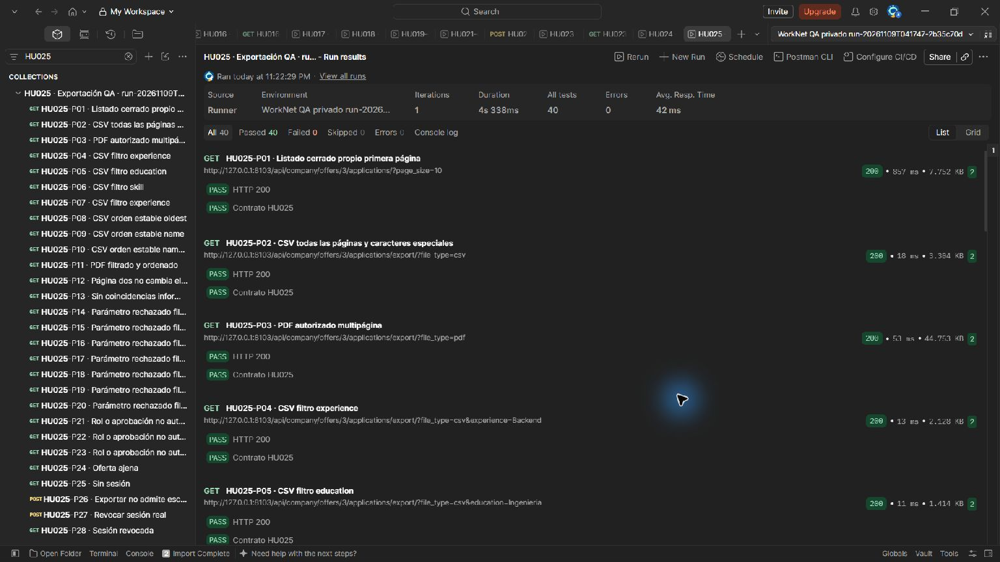

**Caso Desktop.** **Esperado:** Ejecutar una iteración sobre otra QA aislada. **Obtenido:** 28 peticiones y 40 PASS; cero fallos, errores u omitidas. **Alcance demostrado:** Runner real del 08/11/2026; no resultados históricos de otra historia.

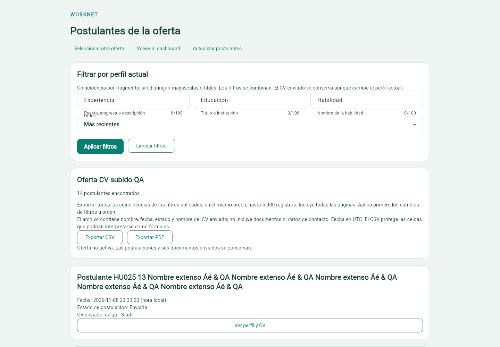

**Caso V01.** **Esperado:** Acceder desde empresa y explicar la descarga. **Obtenido:** Controles CSV/PDF y alcance de 14 coincidencias, filtros aplicados y todas las páginas. **Alcance demostrado:** Escritorio real1440×1000 con API de otro origen; no maqueta.

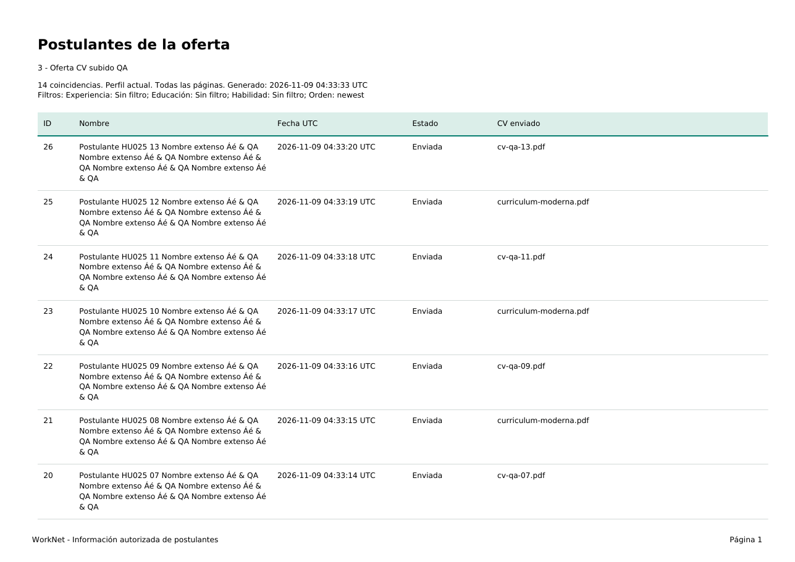

**Caso PDF página 1.** **Esperado:** Obtener un documento legible con filas extensas. **Obtenido:** Primera página con cabecera, fechas UTC, nombres y CV; sin recortes ni solapamientos. **Alcance demostrado:** Raster Poppler110 dpi del PDF auténtico descargado de 14 filas; es un render del archivo, no captura de navegador o Postman.

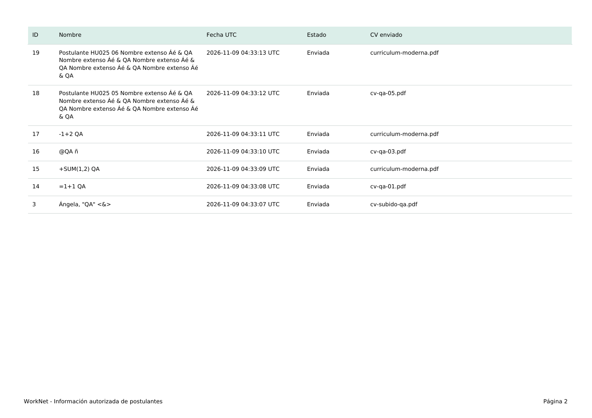

**Caso PDF página 2.** **Esperado:** Continuar la tabla y conservar caracteres especiales. **Obtenido:** Cabecera repetida, filas restantes, tildes/comillas y pie Página2 legibles. **Alcance demostrado:** Segunda página del mismo archivo; no una ejecución adicional.

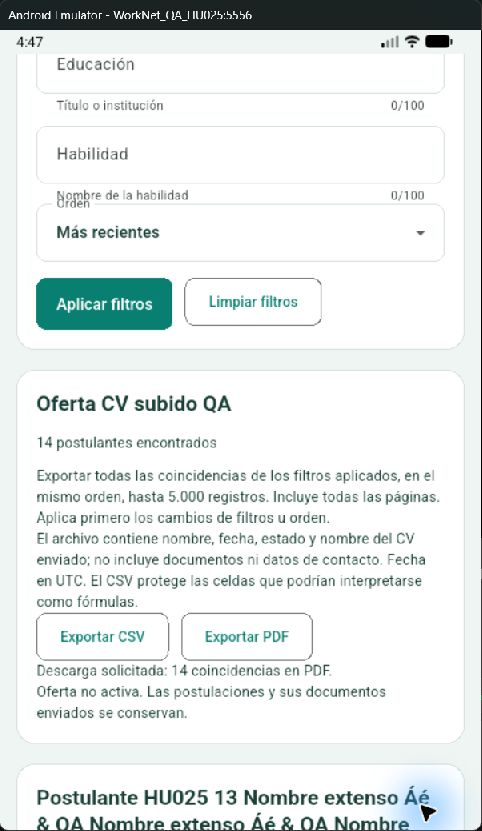

**Caso Android PDF.** **Esperado:** Guardar el PDF en Android. **Obtenido:** Confirmación de 14 coincidencias después de guardar con SAF. **Alcance demostrado:** PDF persistido de dos páginas; IDs, orden y campos contrastados con SQL. No se atribuye prueba de dispositivo físico.

**Seguimientos únicos**

[#128](https://github.com/Danilo2334/Work_net/issues/128#issuecomment-6732593307) · [#129](https://github.com/Danilo2334/Work_net/issues/129#issuecomment-6732593623) · [#130](https://github.com/Danilo2334/Work_net/issues/130#issuecomment-6732593953) · [#131](https://github.com/Danilo2334/Work_net/issues/131#issuecomment-6732594259)

**Reproducción**

En checkouts aislados con dependencias fijadas: backend `python manage.py test`, `python manage.py check` y `python manage.py makemigrations --check --dry-run`; frontend `flutter test`, `flutter analyze` y `flutter build web --release --no-web-resources-cdn`. Navegador: `python frontend/tool/browser_qa/run.py --suite hu025 --frontend-ref SHA_FLUTTER --backend-ref SHA_DJANGO`, que crea venv, compilación y base nuevos. Desktop: `python frontend/tool/browser_qa/hu025_api.py prepare --port PUERTO_LIBRE`, servir esa corrida con `python backend/postman/qa.py serve --run RUN`, importar sus dos archivos import-hu025 y ejecutar una sola iteración conservando respuestas; después `python frontend/tool/browser_qa/hu025_api.py contrast --run RUN`. Nunca reutilizar bases consumidas ni publicar entornos, correo, bases o APK QA.

Android usa un AVD QA vacío separado y la misma preparación en otro puerto. `python frontend/tool/browser_qa/android_hu025_server.py --run RUN` sirve solo127.0.0.1 y admite el alias del emulador10.0.2.2; la entrada `android_hu025.dart` exige marcador/servidor QA antes del login. Inyectar defines ficticios únicamente desde archivo privado, compilar el target QA y conservar el APK privado; el target normal sigue siendo lib/main.dart. La aceptación aquí no modifica un AVD personal ni emplea sus archivos.

<details>
<summary>Antecedentes y límites conservados</summary>

Primera preparación rechazó un intento del ejecutor de cambiar cv_filename inmutable; se corrigió el preparador y se usaron bases nuevas, conservando la incompleta. Corrida inicial `f06675c`: 13/13 conservada, con validación PDF entonces limitada a nombres/CV/conteo/páginas; la vigente `9e131b3` añade IDs extraídos, orden y campos por fila. El metadato anterior «CV extensos» se corrigió: los nombres de CV y sus bytes siempre se conservaron. La instancia Android inicial sin ventana capturable se detuvo; la aceptación vigente usa un AVD QA vacío propio. No se atribuye prueba física, PostgreSQL o carga. HU026 y el cierre pendiente de HU007 continúan; HU027 está cancelada.

</details>

<!-- hu025-vigente-fin -->

<!-- hu024-vigente-inicio -->
## HU024 — Estadísticas / cierre de HU006 — 08/11/2026

**Qué se hizo**

Estadísticas reales por rol, conteos completos y estados, detalle paginado por oferta y accesos desde ambos dashboards. Completa el último acceso pendiente de HU006, conservando los anteriores.

| Criterio original HU024 | Comprobación vigente |
|---|---|
| Postulaciones por oferta | V05/V06; P02/P03 y 15 contrastes SQL; oferta 3 conserva14 |
| Ofertas activas | V04/V07/V09; P02/P14/P15,11→10 tras cierre real |
| Estados empresariales | V04/V06/V09; P02/P09, cuatro estados y otros históricos |
| Postulaciones candidatas | V01/V03/V08; P01/P04/P11,13 propias y otro0→1 |
| Candidatas en revisión | V02; P07/P08,3→4 por transición real |
| Candidatas aceptadas/rechazadas | V01/V02/V08; P01/P08,2 y 2 conservadas |
| Tasa de respuesta opcional | Omitida expresamente; no impide los seis criterios obligatorios |

| Nueve criterios originales HU006 | Evidencia vigente y conservada |
|---|---|
| Cantidad de ofertas activas | V04/V07; P06/P15, coherente con estadísticas |
| Cantidad de ofertas cerradas | V07; P15 muestra3 tras cierre real |
| Cantidad de postulaciones recibidas | V04/V06/V07; P15 muestra27 |
| Postulaciones recientes | V04/V07; P15 con nombres/puestos/fechas ficticios reales |
| Acceso a crear/gestionar ofertas | V15 botones y GET200 de formulario/activas; HU013–HU015 conservadas |
| Acceso a postulantes | V06/V15 y HU020; consulta/página y retorno actualizados |
| Acceso a mensajes | V15 GET200 y aceptación HU022 conservada |
| Acceso a estadísticas | V04/V15, HTTP200 autorizado, escritorio y móvil |
| Solo empresas aprobadas | V14 guard UI; P18–P21 y pruebas actuales; dashboard403 de HU023-P50 conserva código idéntico |

**Preparación**

Aceptación del **08/11/2026**, Windows. Main anterior `5cdd951e7e0f4c7e9fb829e1adf94beece8c5bc9`; se conserva el cambio de alcance de `6929a381b9eafb188dd11be39ca13aeb575f3d55`: entrega HU001–HU026, HU027 cancelada/not_planned. Django [ff39826](https://github.com/Danilo2334/Work_net/commit/ff3982697211bde837f5b9b2e9475ce1ccff8fdc), Flutter funcional [5f2ab62](https://github.com/Danilo2334/Work_net/commit/5f2ab620a71c84895dfeb6edf1d986b65950f818), ejecutor final [3070f79](https://github.com/Danilo2334/Work_net/commit/3070f79ba4c32a3ba1bc6226aa802239ab23ded0). lib/test de3070f79 y 4c157d2 son idénticos a5f2ab62, con 195 pruebas completas aprobadas. Imágenes publicadas en `9d0bbb447f99d251ff0fe1e3a5576931e9262164`; este SHA es de publicación, no otra ejecución.

Dos SQLite QA nuevas e independientes, usuarios ficticios, correo a archivos y credenciales privadas. Cada base inicia con **18 ofertas,27 postulaciones,23 mensajes y 63 avisos**. La empresa principal tiene17 ofertas,11 activas y 26 postulaciones; el candidato,13. Estados iniciales candidato 6/3/2/2 y empresa 19/3/2/2, en orden Enviada/En revisión/Aceptada/Rechazada. Son fixtures históricas; el cambio nuevo usa una transición empresarial real. Los esperados se calculan por SQL independiente del endpoint.

Navegador `browser-qa-20261109T034437-035ac6e8`: **16/16,27 PNG originales y 15 contrastes de respuestas con SQL**, escritorio 1440×1000 y móvil web emulado 390×844. Los actores API ficticios generan1 cambio de estado,1 postulación de otro candidato y 1 cierre de oferta 2; la UI acredita consulta, navegación, páginas y actualización. Postman Desktop `run-20261109T033609-4d372045`: **34 peticiones /50 PASS**, una iteración, cero fallos/errores/omitidas y 12 JPEG originales. Inicio08/11/2026 22:42:59 Bogotá, hash de base idéntico a la instantánea inicial antes de ejecutar. Preparador4c157d2; checkout del servidor al inicio `398ee95ac527190c147877aec00e90645daa723a`, backend funcional idéntico a `ff39826`. Las respuestas posteriores se abrieron sin volver a enviarlas. El JSON Desktop transcribe el resumen observado, no es una exportación cruda.

Ambas bases terminan con **28 postulaciones,65 avisos**,1 evento nuevo de estado y 1 cierre, sin duplicados. La empresa tiene27 postulaciones y 10 activas; el candidato principal conserva13 y el otro pasa0→1. Se conservan avisos y lecturas anteriores, documentos congelados, fechas originales, relaciones, perfiles, cuentas, CV, favoritos y mensajes. Las dos corridas se comparten entre estas tareas, no se multiplican por compartir imágenes.

Python 3.12.10, Django 6.1.1, DRF 3.18.3, Flutter 3.47.5, Dart 3.13.4, Playwright 1.65.0, Chromium 158.0.8127.18 y Postman Desktop 12.35.5. Windows/SQLite local y móvil web emulado; no dispositivo físico, PostgreSQL ni prueba de carga.

**Reglas y conservación**

Totales de todas las postulaciones persistidas propias, también sobre ofertas cerradas, archivadas o vencidas. Cuatro estados vigentes y categoría Otros para valores históricos desconocidos, sin borrarlos. Las métricas globales no se limitan a la página de ofertas. Activas reutiliza la regla empresarial existente: publicada y no vencida. Detalle de ofertas por ID descendente, page positiva y page_size1–50; la app usa10. Parámetros desconocidos/repetidos e intentos de inyectar otro titular se rechazan. Respuestas privadas no-store/Vary Authorization; requiere candidato verificado o empresa verificada/aprobada. La tasa de respuesta es opcional y se omite, sin fórmula ni historial inventados.

Las transacciones ofrecen coherencia de una respuesta en SQLite. Cada página es una lectura nueva y puede reflejar cambios posteriores; no se promete una instantánea congelada entre páginas ni aislamiento PostgreSQL. La actualización manual vuelve a página 1; el retorno contextual conserva la página y reconsulta. El retorno desde postulantes sobrevive a filtros/paginación. El cambio de sesión o aprobación limpia la información y descarta respuestas antiguas.

**Pruebas, revisión y límites**

257 Django (8 nuevas),195 Flutter (9 nuevas),19 afectadas de navegación,20 guards Python y 6 Node aprobados. Análisis limpio, compilación web JavaScript release, check sin incidencias y makemigrations sin cambios. HU024 no modifica modelos;0009 aplicada y plan pendiente cero. Pruebas incluyen agregados completos, ceros, estados desconocidos, ofertas inactivas, paginación, parámetros, permisos actuales, lectura sin efectos y transición real con PDF/fecha intactos.

Revisión técnica y de evidencias delegada del agente autorizado; sin aprobación humana atribuida. Se corrigieron el valor semántico de las barras y el retorno obsoleto después de replace; la regresión con componentes reales falla antes y pasa con RouteAware. También se corrigen desplazamiento al inicio y etiqueta de vacío. Las dos primeras corridas web se conservaron: una falló localizando texto accesible de Flutter y otra al capturar una URL pública de postulantes no incluida aún en esa suite. Se corrigió solo el ejecutor, reutilizando el guard estricto existente, y se repitió íntegra en otra base. No se suman a 16/16. El503 es inyectado; reintento200 y revocación de sesión son reales.

Las39 imágenes se conservan originales, sin edición. Las leyendas no atribuyen rótulos fuera de encuadre: V09 móvil muestra el resumen tras página 2, no su pie; V11 muestra ceros/barras, no el rótulo de paginación; V05 no muestra la tarjeta14. V06 sí muestra14 postulantes de la oferta inactiva, y API/SQL contrastan sus agregados.

Rendimiento básico posterior a Desktop:30 GET APIClient, diez por endpoint, sobre18 ofertas/28 postulaciones/23 mensajes/65 avisos,17 ofertas y 27 postulaciones propias de empresa. Medianas3,0365 ms candidato,7,6015 ms empresa página 1 y 7,3155 ms página 2; contraste completo antes/después idéntico. Desktop 5.296 ms totales y 35 ms medios. Son lecturas locales, no carga ni medición productiva.

[Resultados navegador](https://github.com/Danilo2334/Work_net/blob/9d0bbb447f99d251ff0fe1e3a5576931e9262164/frontend/docs/evidencias/hu024-20261108/resultados.json) · [Manifest navegador](https://github.com/Danilo2334/Work_net/blob/9d0bbb447f99d251ff0fe1e3a5576931e9262164/frontend/docs/evidencias/hu024-20261108/capturas-navegador.json) · [Resultados Desktop](https://github.com/Danilo2334/Work_net/blob/9d0bbb447f99d251ff0fe1e3a5576931e9262164/backend/docs/evidencias/hu024-20261108/resultados-desktop.json) · [Manifest Desktop](https://github.com/Danilo2334/Work_net/blob/9d0bbb447f99d251ff0fe1e3a5576931e9262164/backend/docs/evidencias/hu024-20261108/capturas-desktop.json) · [Colección pública](https://github.com/Danilo2334/Work_net/blob/9d0bbb447f99d251ff0fe1e3a5576931e9262164/backend/docs/evidencias/hu024-20261108/casos.postman_collection.json) · [Contraste Desktop](https://github.com/Danilo2334/Work_net/blob/9d0bbb447f99d251ff0fe1e3a5576931e9262164/backend/docs/evidencias/hu024-20261108/contraste-persistencia.json) · [Migraciones/rendimiento](https://github.com/Danilo2334/Work_net/blob/9d0bbb447f99d251ff0fe1e3a5576931e9262164/backend/docs/evidencias/hu024-20261108/migraciones-rendimiento.json) · [Validación técnica](https://github.com/Danilo2334/Work_net/blob/9d0bbb447f99d251ff0fe1e3a5576931e9262164/backend/docs/evidencias/hu024-20261108/validacion-tecnica.json)

**Publicación e integración**

Django y sus pruebas publicados por Danilo2334: [#206](https://github.com/Danilo2334/Work_net/pull/206) → feature/backend-sprint-3 `34fda5b`, [#208](https://github.com/Danilo2334/Work_net/pull/208) → develop `1deeafa`. Flutter y sus pruebas por francisco3788: [#207](https://github.com/Danilo2334/Work_net/pull/207) → frontend `c9eff69`; backend revisado [#209](https://github.com/Danilo2334/Work_net/pull/209) → frontend `04a41d4`. Evidencias/guía en [#210](https://github.com/Danilo2334/Work_net/pull/210) y entrega conjunta [#211](https://github.com/Danilo2334/Work_net/pull/211), por francisco3788. Publicador, autor y committer contrastados por separado; GitHub/web-flow realiza los commits de fusión. Protecciones efectivas respetadas, sin bypass ni cambios.

El resultado de main y los cierres se registra en los seguimientos únicos después de contrastar SHA remoto y árbol completo, criterios originales, closed/completed, Done y cada contador4/4 — 100 % por separado. El contador no sustituye los criterios ni las evidencias. HU027 conserva su cancelación not_planned, fuera de alcance.

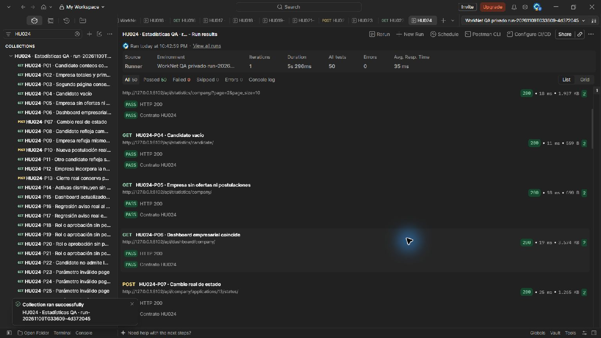

**Caso Runner HU024.** **Esperado:** ejecutar una iteración en otra base nueva. **Obtenido:** 34 peticiones y 50 PASS, cero fallos, errores u omitidas. **Alcance demostrado:** Postman Desktop 12.35.5 auténtico; abrir respuestas para capturar no vuelve a enviarlas.

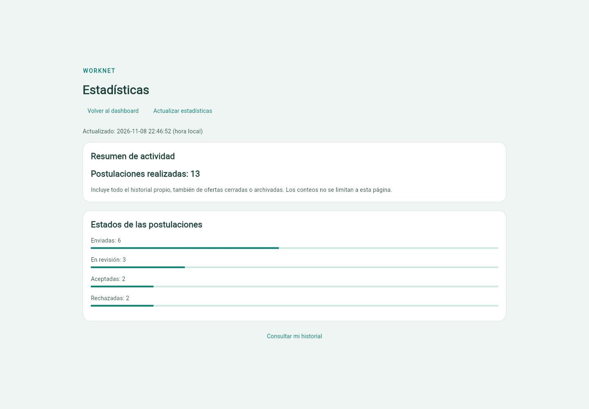

**Caso HU024-V01.** **Esperado:** consultar el total propio y sus estados. **Obtenido:** 13 postulaciones, con 6 enviadas,3 en revisión,2 aceptadas y 2 rechazadas. **Alcance demostrado:** UI candidata con conteos reales contrastados por SQL; los estados iniciales son fixtures históricas.

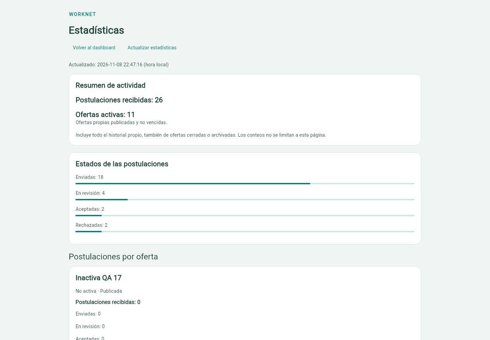

**Caso HU024-V04.** **Esperado:** mostrar las métricas empresariales completas. **Obtenido:** 26 postulaciones y 11 activas; desglose18/4/2/2. **Alcance demostrado:** ocurre después de V02: la transición ya cambió los estados; el total incluye las dos páginas y ofertas inactivas.

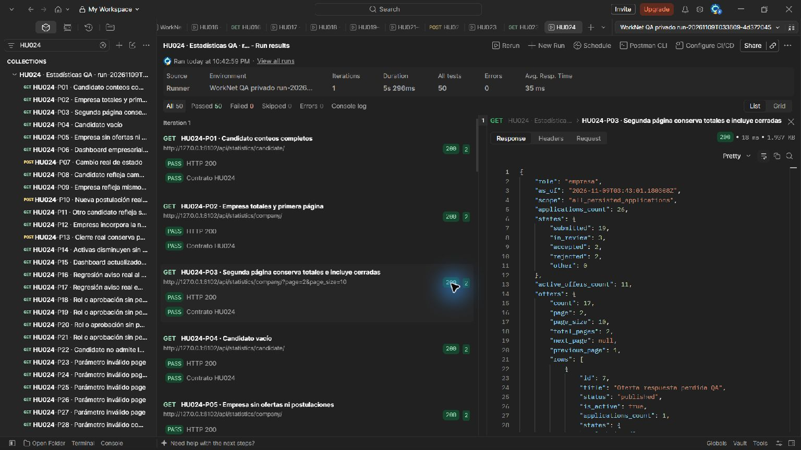

**Caso HU024-P03.** **Esperado:** conservar totales al consultar la segunda página. **Obtenido:** HTTP200, total 26, activas11 y página 2 de2; dos PASS. **Alcance demostrado:** metadatos y resumen visibles. La aserción pública también contrasta ausencia de repetidos y 14 postulaciones de oferta 3; esa fila no aparece en el encuadre.

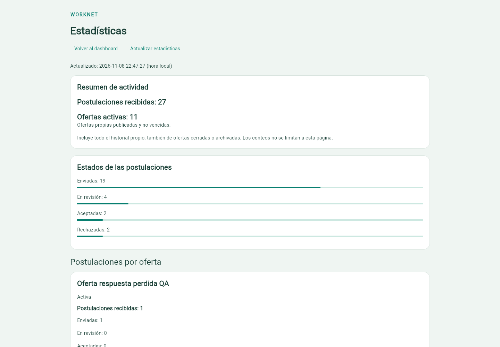

**Caso HU024-V06 / retorno.** **Esperado:** refrescar estadísticas tras volver de postulantes paginados. **Obtenido:** 27 postulaciones,11 activas y estados19/4/2/2. **Alcance demostrado:** actor candidato API crea una postulación; el retorno real tras replace vuelve a consultar. La página 2 se contrasta en red/SQL; su pie no aparece en esta imagen.

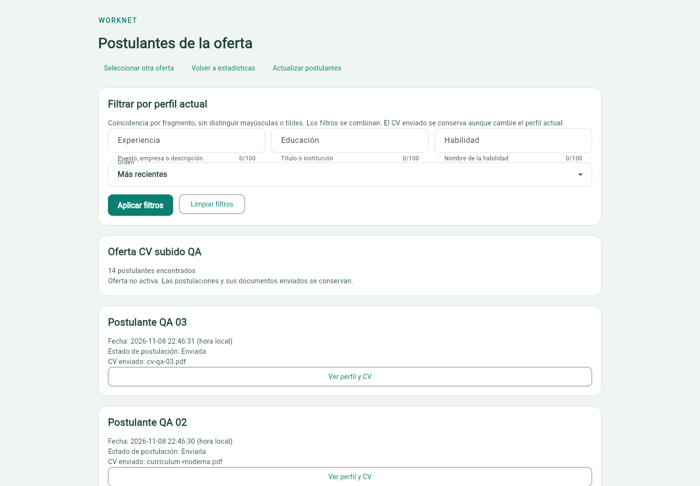

**Caso HU024-V06 / postulantes.** **Esperado:** contrastar las coincidencias de una oferta inactiva. **Obtenido:** Oferta CV subido QA,14 postulantes y oferta no activa. **Alcance demostrado:** vista existente de postulantes, abierta desde estadísticas; acredita el conjunto autorizado, no una tarjeta14 visible en el panel estadístico.

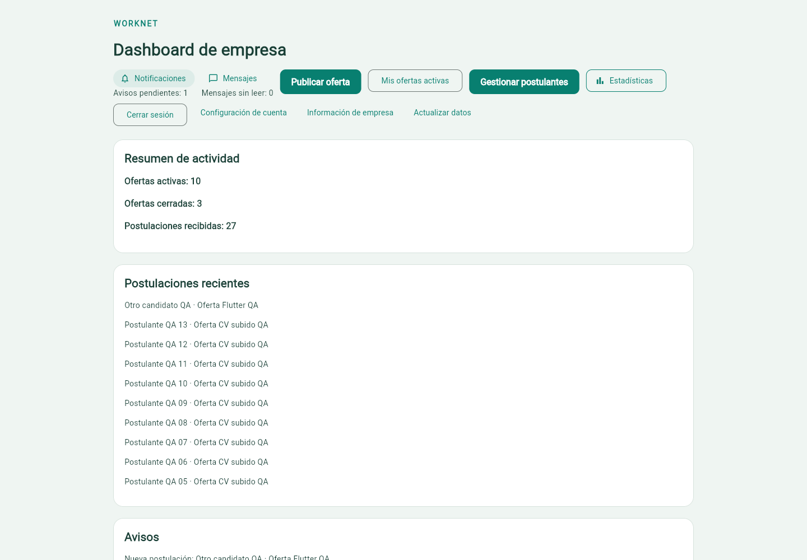

**Caso HU024-V07 / dashboard.** **Esperado:** mantener coherencia al volver después de una alta y un cierre. **Obtenido:** dashboard actualizado con 10 activas,3 cerradas y 27 postulaciones. **Alcance demostrado:** métricas reales contrastadas con estadísticas y SQL; incluye postulaciones recientes y conserva datos anteriores.

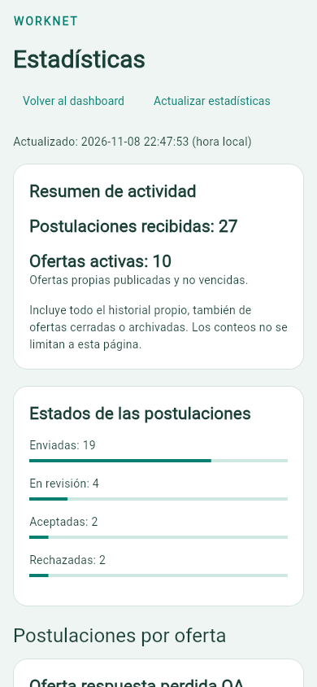

**Caso HU024-V09.** **Esperado:** conservar métricas completas en móvil al paginar. **Obtenido:** 27 postulaciones,10 activas y los cuatro estados visibles. **Alcance demostrado:** 390×844 emulado; la captura muestra el resumen, no el pie Página2. La respuesta/red/SQL verifican la página consultada.

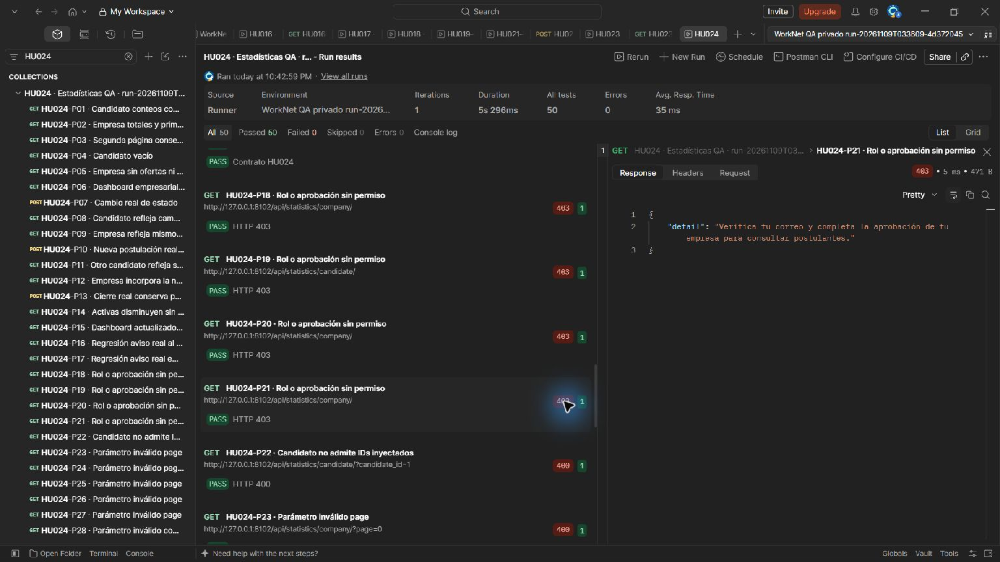

**Caso HU024-P21.** **Esperado:** exigir aprobación empresarial. **Obtenido:** HTTP403 y Test Result PASS. **Alcance demostrado:** la cuenta ficticia está pendiente en esta corrida; se rechaza la consulta, no se ejecuta una decisión de rechazo de cuenta.

**Seguimientos únicos**

[#124](https://github.com/Danilo2334/Work_net/issues/124#issuecomment-6731890135) · [#125](https://github.com/Danilo2334/Work_net/issues/125#issuecomment-6731890376) · [#126](https://github.com/Danilo2334/Work_net/issues/126#issuecomment-6731890587) · [#127](https://github.com/Danilo2334/Work_net/issues/127#issuecomment-6731890798) · [#51](https://github.com/Danilo2334/Work_net/issues/51#issuecomment-6260291090) · [#53](https://github.com/Danilo2334/Work_net/issues/53#issuecomment-6260291383) · [#54](https://github.com/Danilo2334/Work_net/issues/54#issuecomment-6260276785)

**Reproducción**

En checkouts aislados con dependencias fijadas: `python manage.py test`, `python manage.py check`, `python manage.py makemigrations --check --dry-run`; en frontend `flutter test` y `flutter analyze`. Navegador: `python frontend/tool/browser_qa/run.py --suite hu024 --frontend-ref REFERENCIA_PUBLICADA --backend-ref REFERENCIA_DJANGO`; crea venv, compilación y base nuevos. Desktop: `python frontend/tool/browser_qa/hu024_api.py prepare --port PUERTO_LIBRE`, `python backend/postman/qa.py serve --run RUN_NUEVO`; importar sus dos archivos import-hu024 y ejecutar una sola iteración conservando respuestas. Contrastar con `python frontend/tool/browser_qa/hu024_api.py contrast --run RUN_NUEVO`. No reutilizar bases consumidas ni publicar entornos, bases o correo.

<details>
<summary>Antecedentes conservados</summary>

Las dos corridas incompletas del ejecutor, las bases anteriores y los seguimientos históricos de HU006 se conservan separados. Los eventos iniciales son fixtures; los nuevos actores API están identificados. HU007 permanece pendiente de HU026, HU025 continúa por implementar y HU027 está cancelada/not_planned, fuera del alcance HU001–HU026.

</details>

<!-- hu024-vigente-fin -->

<!-- hu023-vigente-inicio -->
## HU023 — Sistema de notificaciones — 08/11/2026

**Qué se hizo**

Centro privado integrado con los cuatro eventos, contador global, historial con filtros y páginas, lectura explícita, contexto y preferencias. Preserva los avisos históricos y el acceso restringido de empresas pendientes o rechazadas.

| Criterio original HU023 | Evidencia vigente |
|---|---|
| Nueva postulación para empresa | V11; P23/P24; aviso real por alta autorizada |
| Cambio de estado para candidato | V05; P25–P27; repetición sin duplicar |
| Nuevo mensaje al destinatario | V06–V10; P28–P43; lectura independiente y preferencias |
| Aprobación/rechazo empresarial | V12/V13; P44–P50; aviso propio y restricciones conservadas |
| Contador de pendientes | V01/V04/V07/V14; resumen y contraste por titular |
| Marcar como leída | V04/V14; P05–P15/P31–P34; explícita, idempotente y privada |
| Historial | V01–V03; P02/P03; páginas estables, filtros y datos anteriores |
| Preferencias disponibles | V09/V10/V14; P35–P43/P51–P54; cuatro tipos, efecto futuro |

**Preparación**

Aceptación del **08/11/2026**, Windows. Base main `a5e908dfb3a334999c84d836ee7ac8de577c5643`; se conservó el avance estático de LinkedIn `a9bbf324c8deeec45b462cba84eb620b0dbf0f18`. Django [5e1b6cb](https://github.com/Danilo2334/Work_net/commit/5e1b6cbd23e49175d1d74b99ab4c9aa6110e281d), Flutter y ejecutor [7098e65](https://github.com/Danilo2334/Work_net/commit/7098e65afc7505f3025025f9deb27fb26d42e0ad). lib/test son idénticos a `4a8e5c28145cd38f92e2b3ff2136564bb0ed82ad`, donde pasaron las 186 pruebas completas. El SHA `6aef68192d6412bbeee4f798d247aba7ade87810` identifica la publicación de imágenes, no otra ejecución.

Dos SQLite QA nuevas, usuarios ficticios, correo a archivos y credenciales privadas. Cada base comienza con **18 ofertas, 27 postulaciones, 14 conversaciones, 23 mensajes leídos y 63 avisos**. Los avisos previos de candidato y empresa se leyeron por API durante la preparación; trece avisos legados ficticios se prepararon por ORM y se identifican como históricos. El candidato inicia con27 avisos y13 pendientes; la empresa con35 y0.

Navegador `browser-qa-20261109T021122-1cd98433`: **18/18 y25 PNG originales**, escritorio1440×1000 y móvil web emulado390×844. Actores API reales originan eventos; la UI acredita centro, filtros, lectura, preferencias y navegación. Postman Desktop `run-20261109T020533-64f14ab7`: **58 peticiones /91 PASS**, una iteración, cero fallos/errores/omitidas y13 JPEG originales. Ejecución08/11/2026 21:12:33 Bogotá; preparador `4a8e5c2`, checkout de servidor al inicio `77ae274936f640d448ae18690c5dd9b3f332900f`, backend funcional idéntico a `5e1b6cb`. Abrir respuestas guardadas para capturar no volvió a enviarlas. Resumen JSON Desktop transcrito de la observación, no exportación cruda de respuestas.

Cada corrida termina con **7 avisos nuevos** (1 alta, 1 estado, 3 mensajes, 2 decisiones), 4 mensajes y 1 postulación, sin duplicados. Se conservan contenido, fecha y destinatario de los avisos anteriores, fechas de lectura previas, mensajes antiguos, relaciones y PDF congelados. Un aviso legado se lee explícitamente; el navegador lee 2 mensajes nuevos desde chat, Desktop ninguno. Las dos corridas son compartidas entre las cuatro tareas; no se multiplican por compartir imágenes. Los campos heredados notices=50 y pending_notifications_count=14 del registro de preparación pertenecen a la fase anterior; el inicio final de HU023 está en notice_count=63, candidate_notices=27 y candidate_unread=13.

Python3.12.10, Django6.1.1, DRF3.18.3, Flutter3.47.5, Dart3.13.4, Playwright1.65.0, Chromium158.0.8127.18, Postman Desktop12.35.5. Windows/SQLite local; no PostgreSQL, dispositivo físico, entrega externa push ni prueba de carga.

**Reglas y conservación**

Los cuatro ajustes se aplican solo a eventos futuros; no eliminan historial ni cambian lecturas. Repetir una intención suprimida no reconstruye su aviso al habilitarla. Se conserva independiente el ajuste push de HU004; no se configura entrega externa. Un aviso leído no lee el mensaje, ni abrir el contexto lee automáticamente el aviso. Solo se aceptan IDs enteros propios, distintos, hasta50; lotes ajenos se rechazan completos y la primera fecha de lectura se conserva. Historial por fecha/ID descendente con ancla through_id, page positiva y page_size1–50; el contador es global del titular. Respuestas privadas no-store/Vary Authorization; sesión y rol se revalidan. Una empresa pendiente/rechazada accede a sus avisos y preferencias, conservando las restricciones empresariales.

**Pruebas, revisión y límites**

249 Django (13 nuevas),186 Flutter (9 nuevas),20 guards Python y6 Node aprobados; análisis limpio y compilación web release. Check sin incidencias, makemigrations sin cambios, migración0009 aplicada y plan pendiente cero. Prueba de migración conserva avisos legados, destinatarios, tipos, fechas y unicidad; pruebas de SQL y concurrencia cubren las correcciones técnicas. Las regresiones incluyen postulaciones, estados, mensajes, documentos y dashboards anteriores.

Revisión técnica delegada del agente autorizado, sin atribuir aprobación humana. Tres hallazgos P2 corregidos: consulta que cargaba PDF/cuerpo de mensaje, GET antiguo que podía sobrescribir preferencias guardadas y contención en creación concurrente de preferencias SQLite. Las regresiones respectivas pasan. La primera corrida de navegador pasó V01–V15 y se detuvo por una expectativa equivocada del texto503 normalizado; se corrigió solo el ejecutor y se repitió completo en otra base. El503 es inyectado, el reintento HTTP200 y la revocación de sesión son reales. Se conservan las bases y corridas anteriores, sin sumarlas a18/18.

Rendimiento básico posterior a Desktop:30 GET APIClient independientes, diez por endpoint, sobre18ofertas/28postulaciones/14conversaciones/27mensajes/70avisos. Medianas: resumen1,5505ms, historial3,4805ms, pendientes3,2665ms; conteos conservados. Desktop8.516ms totales y33ms medios. Son lecturas locales, no carga ni medición productiva.

[Resultados navegador](https://github.com/Danilo2334/Work_net/blob/6aef68192d6412bbeee4f798d247aba7ade87810/frontend/docs/evidencias/hu023-20261108/resultados.json) · [Manifest navegador](https://github.com/Danilo2334/Work_net/blob/6aef68192d6412bbeee4f798d247aba7ade87810/frontend/docs/evidencias/hu023-20261108/capturas-navegador.json) · [Resultados Desktop](https://github.com/Danilo2334/Work_net/blob/6aef68192d6412bbeee4f798d247aba7ade87810/backend/docs/evidencias/hu023-20261108/resultados-desktop.json) · [Manifest Desktop](https://github.com/Danilo2334/Work_net/blob/6aef68192d6412bbeee4f798d247aba7ade87810/backend/docs/evidencias/hu023-20261108/capturas-desktop.json) · [Colección pública](https://github.com/Danilo2334/Work_net/blob/6aef68192d6412bbeee4f798d247aba7ade87810/backend/docs/evidencias/hu023-20261108/casos.postman_collection.json) · [Contraste Desktop](https://github.com/Danilo2334/Work_net/blob/6aef68192d6412bbeee4f798d247aba7ade87810/backend/docs/evidencias/hu023-20261108/contraste-persistencia.json) · [Migraciones/rendimiento](https://github.com/Danilo2334/Work_net/blob/6aef68192d6412bbeee4f798d247aba7ade87810/backend/docs/evidencias/hu023-20261108/migraciones-rendimiento.json) · [Validación técnica](https://github.com/Danilo2334/Work_net/blob/6aef68192d6412bbeee4f798d247aba7ade87810/backend/docs/evidencias/hu023-20261108/validacion-tecnica.json)

**Publicación e integración**

Django y sus pruebas publicados por Danilo2334: [#198](https://github.com/Danilo2334/Work_net/pull/198) → feature/backend-sprint-3 `d613493`, [#200](https://github.com/Danilo2334/Work_net/pull/200) → develop `42ff409`. Flutter y sus pruebas por francisco3788: [#199](https://github.com/Danilo2334/Work_net/pull/199) → frontend `df0c499`; backend revisado [#201](https://github.com/Danilo2334/Work_net/pull/201) → frontend `bba1984`. Evidencias/guía en [#202](https://github.com/Danilo2334/Work_net/pull/202) y entrega conjunta [#203](https://github.com/Danilo2334/Work_net/pull/203), por francisco3788. Publicador, autor y committer contrastados por separado; GitHub/web-flow es el committer automático de los merges. Protecciones efectivas respetadas, sin bypass ni cambios. El resultado final de main y los cierres se registra en los seguimientos únicos después de comprobar por separado SHA remoto, criterios originales, closed/completed, Done y contador 4/4 — 100 %. El contador no sustituye los criterios ni las evidencias.


**Caso Runner HU023.** **Esperado:** ejecutar una iteración en una base QA nueva. **Obtenido:** 58 peticiones y 91 PASS; cero fallos, errores u omitidas. **Alcance demostrado:** resumen auténtico Postman Desktop12.35.5; las consultas posteriores de respuestas no son nuevas ejecuciones.


**Caso HU023-P24.** **Esperado:** notificar una postulación nueva a la empresa propietaria. **Obtenido:** HTTP200, aviso application_created y un pendiente; dos PASS. **Alcance demostrado:** P23 crea realmente la postulación28 en oferta1; no es una fixture atribuida a esta acción.


**Caso HU023-V05.** **Esperado:** recibir el cambio de estado en el centro candidato. **Obtenido:** En revisión, fecha, trece pendientes y enlace al evento. **Alcance demostrado:** un actor empresarial ficticio usa la API real; la UI consulta y permite navegar al detalle.


**Caso HU023-P32.** **Esperado:** conservar pendiente el mensaje al leer su aviso. **Obtenido:** HTTP200 y unread_count1 de mensajes; P31 y P32 con PASS. **Alcance demostrado:** acuse del aviso y lectura del chat son operaciones independientes.


**Caso HU023-P36.** **Esperado:** deshabilitar solo avisos de mensajes futuros. **Obtenido:** HTTP200, message_received false y scope future_events_only; dos PASS. **Alcance demostrado:** P37–P43 contrastan mensaje persistido sin aviso, repetición sin reconstrucción y nuevo aviso tras habilitar.


**Caso HU023-V13.** **Esperado:** permitir consultar la decisión de la cuenta rechazada. **Obtenido:** rechazo propio con motivo, fecha, enlace y preferencias. **Alcance demostrado:** centro accesible sin aprobación; la restricción del dashboard se contrasta en V13 y P50.


**Caso HU023-V14 / lectura.** **Esperado:** marcar solo el aviso elegido y actualizar el contador. **Obtenido:** aviso leído con fecha, catorce pendientes y el aviso anterior todavía pendiente. **Alcance demostrado:** móvil web emulado 390×844; lectura explícita por API real.


**Caso HU023-V14 / preferencias.** **Esperado:** mostrar los ajustes y su efecto sobre eventos nuevos. **Obtenido:** cuatro preferencias, explicación del historial y botón Guardar. **Alcance demostrado:** interfaz móvil; la persistencia y supresión se contrastan con V09/V10 y P35–P43.

**Seguimientos únicos**

[#120](https://github.com/Danilo2334/Work_net/issues/120#issuecomment-6730818473) · [#121](https://github.com/Danilo2334/Work_net/issues/121#issuecomment-6730818706) · [#122](https://github.com/Danilo2334/Work_net/issues/122#issuecomment-6730818921) · [#123](https://github.com/Danilo2334/Work_net/issues/123#issuecomment-6730819202)

**Reproducción**

En checkouts aislados y con las dependencias fijadas: `python manage.py test`, `python manage.py check`, `python manage.py makemigrations --check --dry-run`; en frontend `flutter test` y `flutter analyze`. Navegador: `python frontend/tool/browser_qa/run.py --suite hu023 --frontend-ref REFERENCIA_PUBLICADA --backend-ref REFERENCIA_DJANGO`; crea venv, compilación y base nuevos. Desktop: `python frontend/tool/browser_qa/hu023_api.py prepare --port PUERTO_LIBRE`; `python backend/postman/qa.py serve --run RUN_NUEVO`; importar sus dos archivos import-hu023 y ejecutar una sola iteración conservando respuestas. Contrastar con `python frontend/tool/browser_qa/hu023_api.py contrast --run RUN_NUEVO`. No reutilizar bases consumidas ni publicar entornos, bases o correo.

<details>
<summary>Antecedentes y dependencias conservadas</summary>

HU021/HU022 aportaron eventos y mensajes; sus avisos antiguos se mantienen con su procedencia. La primera corrida incompleta del ejecutor y todas las bases anteriores se conservan como antecedentes. HU024–HU027 y los pendientes de HU006/HU007 siguen separados; las páginas estáticas de LinkedIn preparan el registro de la app y no acreditan OAuth real.

</details>

<!-- hu023-vigente-fin -->

<!-- hu021-hu022-vigente-inicio -->
## HU021 — Cambio de estado / HU022 — Mensajería — 08/11/2026

**Qué se hizo**

La empresa propietaria puede revisar, aceptar o rechazar una postulación con confirmación y comentario opcional. El candidato recibe un aviso interno real y consulta el nuevo estado en su historial. Cada cambio conserva fecha original, relaciones y CV enviado. Mensajes conecta ambas partes de una postulación real con búsqueda, páginas, contacto, fechas, pendientes y recuperación de envíos sin duplicarlos.

| Criterio original HU021 | Comprobación vigente |
|---|---|
| En revisión | UI V03/V04 y Desktop P04; versión y fecha reales |
| Aceptada | UI V05 y P11; comentario ausente permitido |
| Rechazada | UI V06/V12 y P15; comentario presente |
| Comentario opcional | V03/V05/V06, P04/P11/P15 y validaciones |
| Confirmar antes de guardar | V02 cancelar sin persistir y V03 confirmar; P02/P03 |
| Notificar automáticamente al candidato | V03 empresa → V04 aviso/detalle/historial; P08 y contraste atómico |
| Fecha de modificación | V04/V05/V06, P04; fecha original y PDF conservados; fecha legada desconocida |

| Criterio original HU022 | Comprobación vigente |
|---|---|
| Lista de conversaciones | V01/V11, P03; candidato12/empresa13 previas, páginas reales |
| Búsqueda | V11 y P04/P06, por contacto/oferta/empresa, vacío y límites |
| Contacto al seleccionar | V02/V03/V06/V07, P08, derivado de postulación autorizada |
| Envío de texto | V03/V06/V07 y P10/P16; bidireccional real |
| Diferencia enviados/recibidos | V06/V07/V16; alineación, color y etiquetas |
| Fecha y hora | V06/V07/V16, P10/P16; persistidas y presentadas |
| Pendientes de lectura | V04, P14/P18/P21, complemento C02–C04 contador1→0 al volver |
| Usuarios autorizados | V13/V14/V17, P38–P55; 401/403/404 y revalidación actual en cada operación |

**Preparación**

Aceptación del **08/11/2026**, Windows. Base main `c63c8418ebd8709e0b055172fd94572ac582c063`; sin avances posteriores al comenzar. Django [03e2dd2](https://github.com/Danilo2334/Work_net/commit/03e2dd2526ced86487a495ba0e3e4c05f620125e), Flutter funcional [21cbcf5](https://github.com/Danilo2334/Work_net/commit/21cbcf551ab35e0183bfb8147fa71e5bb48f3ff3), ejecutor navegador [21cbcf5](https://github.com/Danilo2334/Work_net/commit/21cbcf551ab35e0183bfb8147fa71e5bb48f3ff3). Las imágenes se publicaron en `61854161b28133eef9244a13e35c9857cc90df32`: ese SHA identifica la publicación, no otra ejecución.

Dos SQLite QA nuevas e independientes, usuarios ficticios, correo a archivos y credenciales privadas. Cada preparación contiene **18 ofertas, 27 postulaciones, 14 conversaciones y 23 mensajes previos leídos**; 13 postulaciones del candidato principal y 14 postulantes en la oferta 3. Las conversaciones y mensajes previos se prepararon por APIClient; los estados legados son fixtures, con fecha de transición desconocida. No se atribuyen a una acción empresarial observada.

Navegador `browser-qa-20261109T004701-ddb4f801`: **34/34**, **78 PNG originales**, escritorio 1440×1000 y móvil web emulado 390×844. Cambia estados desde UI, recibe avisos, conversa entre ambas partes y realiza una postulación real adicional. Termina con 7 eventos/avisos de estado, 1 nueva conversación, 10 mensajes nuevos y 1 nueva postulación/aviso de alta; no altera las copias originales.

Postman Desktop `run-20261108T232223-937f2bc5`, puerto 8100, checkout de servidor `151ad4e3c27f9584ae25cd7a4ec6d3c3fc2117d2` con backend funcional idéntico a `03e2dd2526ced86487a495ba0e3e4c05f620125e`: **101 peticiones / 154 PASS**, una iteración, cero fallos/errores/omitidas y **15 JPEG originales**. Preparador `f41541d91c6b67895dc34296bbf2bf5f8713e362`; importación local de sus dos archivos, sin abrir valores privados ni Vault. Su contraste final: 4 eventos y avisos de estado, 1 conversación y 6 mensajes nuevos; 0 postulaciones nuevas, 0 duplicados; registros anteriores y PDF intactos. Estas dos corridas son compartidas entre las ocho tareas; no se multiplican por compartir evidencias.

Python 3.12.10, Django 6.1.1, DRF 3.18.3, Flutter 3.47.5, Dart 3.13.4, Playwright 1.65.0, Chromium 158.0.8127.18 y Postman Desktop 12.35.5. Windows/SQLite local; no dispositivo físico, PostgreSQL ni prueba de carga.

Complemento independiente `browser-qa-20261109T004711-f3db255c` con la misma fuente final `21cbcf551ab35e0183bfb8147fa71e5bb48f3ff3`: **5/5 y 7 PNG originales**, otra SQLite nueva, 18 ofertas/27 postulaciones/14 conversaciones/23 mensajes previos. Un actor API empresarial envía un mensaje real antes de entrar; el candidato lo consulta y vuelve por los botones del producto, con contador **1 → 0**, 12 conversaciones propias y métricas 13/6 conservadas. Sin nuevas postulaciones, eventos ni conversaciones. No se suma a 34/34 ni a sus 78 imágenes.

**Pruebas, revisión y límites**

236 Django (24 nuevas) y 177 Flutter (19 nuevas), todas aprobadas. 20 guards Python y 6 Node, análisis Flutter limpio, compilación JavaScript release, check Django sin incidencias y makemigrations sin cambios. Migraciones 0007/0008 aplicadas en QA, plan pendiente cero; pruebas desde esquema anterior conservan registros y unicidades. Regresiones de HU018/HU019/HU020, documentos y dashboards incluidas.

Revisión técnica delegada del agente autorizada; sin aprobación humana atribuida. Se corrigieron el bloqueo de FK concurrentes, las vías de upsert de eventos, el tipo estricto del comentario, la lectura de una ruta oculta/ventana no presentada y el detalle desactualizado ante 409. El complemento detectó un contador obsoleto al volver al dashboard: se conserva la pila con pop cuando existe y se usa la ruta por rol para acceso directo. Una regresión con componentes reales falla antes y pasa después; la aceptación final se repitió íntegra en otras bases con el mismo código final. También se corrigieron desplazamientos/etiquetas del ejecutor QA y la serialización de fechas de su actor concurrente. Las corridas incompletas quedan como antecedentes y no se suman a la aceptación vigente.

Los abortos de red y 503 están identificados como inyecciones. La respuesta perdida se descarta después de una escritura real y se consulta su recibo por GET; el actor concurrente y los mensajes que llegan durante lectura usan API real, con procedencia registrada. La revocación de sesión es real. Desktop comprueba repetición/recibos, sin atribuirle la pérdida de transporte inyectada por navegador. Los avisos son internos; no se añade el alcance adicional de HU023.

[Resultados navegador](https://github.com/Danilo2334/Work_net/blob/61854161b28133eef9244a13e35c9857cc90df32/frontend/docs/evidencias/hu021-hu022-20261108/resultados.json) · [Complemento acceso y lectura](https://github.com/Danilo2334/Work_net/blob/61854161b28133eef9244a13e35c9857cc90df32/frontend/docs/evidencias/hu021-hu022-20261108/complemento-hu005/resultados.json) · [Manifest navegador](https://github.com/Danilo2334/Work_net/blob/61854161b28133eef9244a13e35c9857cc90df32/frontend/docs/evidencias/hu021-hu022-20261108/capturas-navegador.json) · [Resultados Desktop](https://github.com/Danilo2334/Work_net/blob/61854161b28133eef9244a13e35c9857cc90df32/backend/docs/evidencias/hu021-hu022-20261108/resultados-desktop.json) · [Manifest Desktop](https://github.com/Danilo2334/Work_net/blob/61854161b28133eef9244a13e35c9857cc90df32/backend/docs/evidencias/hu021-hu022-20261108/capturas-desktop.json) · [Colección pública](https://github.com/Danilo2334/Work_net/blob/61854161b28133eef9244a13e35c9857cc90df32/backend/docs/evidencias/hu021-hu022-20261108/casos.postman_collection.json) · [Contraste Desktop](https://github.com/Danilo2334/Work_net/blob/61854161b28133eef9244a13e35c9857cc90df32/backend/docs/evidencias/hu021-hu022-20261108/contraste-persistencia.json) · [Migraciones y rendimiento](https://github.com/Danilo2334/Work_net/blob/61854161b28133eef9244a13e35c9857cc90df32/backend/docs/evidencias/hu021-hu022-20261108/migraciones-rendimiento.json) · [Validación técnica](https://github.com/Danilo2334/Work_net/blob/61854161b28133eef9244a13e35c9857cc90df32/backend/docs/evidencias/hu021-hu022-20261108/validacion-tecnica.json)

**Publicación e integración**

Django y sus pruebas publicados por Danilo2334; Flutter y sus pruebas, integración y aceptación por francisco3788. Cuentas, autores y committers contrastados separadamente; GitHub/web-flow es el committer automático de los merges. Backend [#189](https://github.com/Danilo2334/Work_net/pull/189) → feature/backend-sprint-3 `64335fc`, [#191](https://github.com/Danilo2334/Work_net/pull/191) → develop `3494712`; Flutter [#190](https://github.com/Danilo2334/Work_net/pull/190) → frontend `bc3382d`; backend revisado [#192](https://github.com/Danilo2334/Work_net/pull/192) → frontend `258bac8`. Corrección de navegación y aceptación [#193](https://github.com/Danilo2334/Work_net/pull/193); evidencias/guía en [#194](https://github.com/Danilo2334/Work_net/pull/194); entrega conjunta [#195](https://github.com/Danilo2334/Work_net/pull/195). La comprobación final del SHA remoto, closed/completed, Done y cada contador 4/4 — 100 % queda registrada por separado en los seguimientos únicos después de integrar main. Los criterios se contrastan con las evidencias; el contador por sí solo no acredita su cumplimiento.

**Reglas y conservación**

HU021 admite Enviada → En revisión/Aceptada/Rechazada y En revisión → Aceptada/Rechazada. Las decisiones finales no se reabren. Requiere confirmación, versión entera, UUID y comentario de texto opcional hasta 2000 caracteres. La misma intención se recupera/repite sin crear otro evento o aviso; una versión obsoleta o UUID con otro contenido produce 409. Cambio, evento, comentario, fecha y aviso son atómicos. Cancela sin persistir; no inventa fecha empresarial para los registros anteriores. Conserva alta HU018, fecha de postulación, relaciones y PDF congelado.

HU022 permite a candidato y empresa activa/verificada/aprobada conversar en el contexto de una postulación propia. No acepta participantes inyectados; revalida a ambos en creación/lista/búsqueda/detalle/envío/lectura/resumen. Búsqueda literal por contacto/oferta/empresa, texto hasta 100 caracteres; orden actividad/ID descendente y page positiva y tamaño de página 1–50 (10 por defecto). Mensajes de texto 1–4000, orden cronológico dentro de ventanas estables por ID y ancla through_id. UUID por remitente/conversación recupera la misma intención; otro UUID permite texto igual. Solo se marcan IDs recibidos y presentados, conservando fecha y pendientes nuevos no consultados. Sin sesión 401, rol/aprobación 403 y contexto ajeno 404. Respuestas privadas no-store/Vary.

**Rendimiento básico**

Windows/SQLite local, 18 ofertas, 27 postulaciones, 14 conversaciones y 23 mensajes previos. Treinta GET APIClient previos a Desktop, diez por endpoint: medianas 10,306 ms para estados, 17,2635 ms para conversaciones y 17,0085 ms para mensajes; consultas y muestras en migraciones-rendimiento.json. Desktop registra 12.651 ms totales y 28 ms medios. No es carga ni medición PostgreSQL; los tiempos no se extrapolan a producción.


**Caso Runner HU021/HU022.** **Esperado:** ejecutar una iteración nueva de la QA aislada. **Obtenido:** 101 peticiones, 154 PASS, cero fallos, errores u omitidas. **Alcance demostrado:** resumen auténtico de Postman Desktop 12.35.5; abrir respuestas no vuelve a ejecutarlas.


**Caso HU021-P04.** **Esperado:** guardar En revisión con comentario y fecha. **Obtenido:** POST HTTP 200, in_review, versión 1, comentario y fecha; dos Test Results PASS. **Alcance demostrado:** transición empresarial real; conserva fecha original y copia del CV.


**Caso HU021-V04.** **Esperado:** recibir el cambio empresarial en el dashboard candidato. **Obtenido:** aviso En revisión con fecha y enlace a su postulación. **Alcance demostrado:** aviso originado por la acción UI anterior; los avisos genéricos previos se identifican como fixtures.


**Caso HU021-V04 / historial.** **Esperado:** actualizar el historial tras un cambio empresarial real. **Obtenido:** En revisión, fecha modificada y comentario en la página dos; fecha original conservada. **Alcance demostrado:** sustituye el límite histórico del actor ORM de HU019, que se conserva como antecedente.


**Caso HU021-V11.** **Esperado:** refrescar el estado concurrente y exigir nueva revisión. **Obtenido:** detalle y formulario muestran En revisión; el aviso pide confirmar de nuevo. **Alcance demostrado:** otro actor QA usa la API real antes del POST de esta vista; el 409 no sobrescribe su decisión.


**Caso HU022-V06.** **Esperado:** distinguir enviados y recibidos con fecha. **Obtenido:** dos recibidos y respuesta propia a la derecha con fecha y hora. **Alcance demostrado:** sesión candidata ficticia; la respuesta se confirmó por POST real.


**Caso HU022-V16.** **Esperado:** enviar y recibir desde móvil web. **Obtenido:** burbujas diferenciadas, fechas, lectura y respuesta móvil candidata. **Alcance demostrado:** 390×844 emulado con API real; el contacto/contexto se acredita también en el listado y GET.


**Caso HU022-P21.** **Esperado:** conservar pendiente el mensaje llegado después de la consulta. **Obtenido:** HTTP 200, marked_read 0 y unread_count 1; PASS. **Alcance demostrado:** repetir el acuse anterior no consume la llegada nueva; P22 contrasta también la fecha anterior.


**Caso HU005-C02.** **Esperado:** mostrar acceso Mensajes y pendiente en móvil. **Obtenido:** botón Mensajes con contador 1 visible. **Alcance demostrado:** viewport 390×844 y desplazamiento real, antes de consultar el mensaje.


**Caso HU005-C04.** **Esperado:** actualizar el contador al volver por los botones del producto. **Obtenido:** contador 0 tras chat → conversaciones → dashboard. **Alcance demostrado:** regresión de navegación corregida; resumen vuelto a consultar, sin refresco manual.

**Seguimientos únicos por subtarea**

[#112](https://github.com/Danilo2334/Work_net/issues/112#issuecomment-6729702948) · [#113](https://github.com/Danilo2334/Work_net/issues/113#issuecomment-6729703288) · [#114](https://github.com/Danilo2334/Work_net/issues/114#issuecomment-6729703530) · [#115](https://github.com/Danilo2334/Work_net/issues/115#issuecomment-6729703738) · [#116](https://github.com/Danilo2334/Work_net/issues/116#issuecomment-6729703915) · [#117](https://github.com/Danilo2334/Work_net/issues/117#issuecomment-6729704167) · [#118](https://github.com/Danilo2334/Work_net/issues/118#issuecomment-6729704395) · [#119](https://github.com/Danilo2334/Work_net/issues/119#issuecomment-6729704599)

**Dependencias y antecedentes**

Resultado vigente: HU005 se completó con HU022; HU006 con HU024; HU007 con HU026. HU018 resolvió la selección del CV en HU011/HU012/#79 y el bloqueo de postulación de HU015/#91. HU027 quedó cancelada, fuera del alcance funcional. Los seguimientos únicos enlazados conservan la verificación remota y los criterios originales.

<details>
<summary>Dependencias del corte HU021/HU022; HU006 se resolvió con HU024 y HU023 ya se entregó</summary>

HU005 deja de tener Mensajes pendiente: se contrastaron los diez criterios originales, no solo el contador de subtareas. HU006 incorpora Mensajes y conserva Estadísticas HU024 pendiente; #51/#53/#54 continúan abiertas hasta su alcance completo. HU019 obtiene ahora empresa → cambio confirmado → aviso → historial actualizado; el actor ORM de su primera aceptación permanece como antecedente, sin atribuirle una acción empresarial. HU019/HU020 y HU011/HU012/HU015 conservan sus cierres salvo regresión demostrada; no se detectó ninguna. HU023 recibe eventos/lectura reutilizables, sus funciones adicionales no se iniciaron.

</details>

Las tres vistas de HU020 P28/P33/P35 ya se capturaron de las respuestas históricas conservadas, sin nuevas peticiones: sección siguiente y seguimientos #109/#110/#111. Su ejecución es la del08/11/2026 14:05:14 Bogotá, Postman12.34.1, no la nueva Desktop12.35.5. Se preserva el bloqueo anterior como histórico.

Las ejecuciones incompletas y la aceptación anterior de fuente7b se conservaron en sus bases originales. La revisión adicional descubrió el retorno con contador obsoleto y motivó la nueva prueba de regresión y las corridas finales de fuente21; ninguna corrida anterior se suma a la aceptación vigente. No se publican entornos, bases, secretos ni archivos de correo. Los 103 originales publicados del bloque (100 nuevos y3históricos) responden HTTP200 y tienen hash idéntico al original local.

| Criterio original HU005 | Resultado comprobado |
|---|---|
| Completitud del perfil | 100 % en C01; dato real API |
| Cantidad de postulaciones | 13 en C01, 14 tras postulación real en regresión principal |
| Cantidad de guardados | 6 en C01 y al volver C04 |
| Trabajos recomendados o recientes | Trabajos recientes visibles en C01, ofertas reales QA |
| Notificaciones pendientes | 2 previas en C01; aviso empresarial real en HU021-V04; 9 tras secuencia principal |
| Acceso al perfil | Tus accesos en C01/C02; regresiones de navegación y perfil |
| Acceso al currículum | C01/C02 y regresión de documento congelado |
| Acceso a búsqueda | C01/C02; Buscar ofertas integrado, postulación real desde él |
| Acceso a Mensajes | C02 botón visible → C03 clic/GET200 → chat/lectura → C04 retorno con0 |
| Acceso al historial | C01/C02 y HU021-V04 historial actualizado por cambio empresarial real |

**Reproducción en otra base nueva**

Con las dependencias fijadas: `python manage.py test`, `python manage.py check`, `python manage.py makemigrations --check --dry-run` en backend aislado; `flutter test` y `flutter analyze` en frontend. Aceptación: `python frontend/tool/browser_qa/run.py --suite hu021-hu022 --frontend-ref REFERENCIA_PUBLICADA --backend-ref REFERENCIA_DJANGO`. El ejecutor crea exportación/venv/base propios y compila web release. Complemento: el mismo comando con `--suite hu005-messages-access`, en otra base nueva.

Desktop: `python frontend/tool/browser_qa/hu02122_api.py prepare --port PUERTO_LIBRE`, `python backend/postman/qa.py serve --run RUN_NUEVO`; importar los dos archivos de import-hu021-hu022, seleccionar solo ese entorno y ejecutar una iteración conservando respuestas. Contrastar: `python frontend/tool/browser_qa/hu02122_api.py contrast --run RUN_NUEVO`. No publicar el entorno ni reutilizar una base consumida. Los guards comprueban origen, puerto, run e iteración.

<!-- hu021-hu022-vigente-fin -->

<!-- hu019-hu020-vigente-inicio -->
## HU019 — Historial de postulaciones / HU020 — Gestión y filtrado — 08/11/2026

**Qué se hizo**

HU019 amplía Mis postulaciones con los cuatro estados mínimos, detalle privado, documento enviado y actualización al entrar, volver o reconsultar. Conserva historial, privacidad, fechas y documentos de HU018. HU020 permite a la empresa aprobada elegir una oferta propia, consultar candidatos con nombres, filtrar/ordenar/paginar, abrir el perfil actual y el CV realmente enviado. Se integra desde ambos dashboards y recorridos de ofertas; incluye carga, vacío, errores, reintento y sesión en escritorio y móvil web.

**HU019: siete criterios originales satisfechos en el alcance de lectura autorizado**

| Criterio original | Evidencia vigente |
|---|---|
| Cargo de cada postulación | V01/V02, P02; cargo real de la oferta |
| Empresa | V01/V02, P02; empresa de la oferta |
| Fecha de postulación | V01/V02, P02; fecha original conservada |
| Estado actual | V03–V05: GET después del cambio persistido por QA |
| Cuatro estados mínimos | P02–P05, V01 y enum Dart/modelo coherentes |
| Detalle de la postulación | V02/V06/V11; datos y PDF privados |
| Cambios reflejados en el historial | V03 retorno, V04 Actualizar y V07 nueva sesión; actor ORM identificado |

**HU020: diez criterios originales**

| Criterio original | Evidencia vigente |
|---|---|
| Seleccionar oferta propia | V01, P01; 17 ofertas propias, incluye conservadas |
| Listado de candidatos | V01/V02, P02/P03; 14 postulantes paginados |
| Nombre de cada candidato | V01/V06, P02 |
| Acceso al perfil | V06/V12, P25; perfil actual protegido |
| CV utilizado en esa postulación | V07/V08, P33–P36; hash/copia enviada tras borrar fuente |
| Filtro experiencia | V03/P04; nueve coincidencias Backend |
| Filtro educación | V03/P05; seis coincidencias Ingenieria |
| Filtro habilidades | V03/P06; seis coincidencias Python |
| Orden de resultados | V05/P09/P10 y tests; desempate y páginas estables |
| Solo empresa propietaria | V09/V10, P17–P24; 404 directo, 403 rol/aprobación, 401 sesión |

**Preparación**

Aceptación del **08/11/2026**, Windows. Base main `04832ede4b0b09bf336f95a9bb7cb7b2db2d3093`; referencias actualizadas sin avances posteriores al comenzar. Fuentes: Django [ac52411](https://github.com/Danilo2334/Work_net/commit/ac5241136d82e8c3385a07fdb118e93913e570c3); Flutter/ejecutor [4cd15ee](https://github.com/Danilo2334/Work_net/commit/4cd15eec2d0a8be0708f9abb86a1d07e37d28f0e). El producto Flutter probado es `348e68c` (lib/test idénticos en `c7cd35a` y `4cd15ee`); la última revisión añade cobertura móvil del historial. Publicación permanente de imágenes `3d26c94572a0d335b726b4799f4f4b4ca46be8c9`: identifica la publicación, no otra ejecución.

Dos SQLite QA nuevas e independientes: **18 ofertas ficticias, 17 propias de la empresa principal, 27 postulaciones preparadas, 13 del candidato principal y 14 en la oferta 3**, dos históricas sin CV. Usuarios ficticios, correo a archivos, credenciales y entornos privados. CV subido y generado preparados mediante APIClient real existente; no se atribuye ese paso a una pantalla o login de Desktop.

Navegador `browser-qa-20261108T191151-c475d817`: **28/28**, **64 PNG originales**, escritorio 1440×1000 y móvil web emulado 390×844. Incluye una nueva postulación por UI y un aviso interno: termina con 28 registros; conserva los 27 preparados. Postman Desktop `run-20261108T185525-5a36414f`, puerto 8099, servidor desde `0c8cd3f` con backend funcional idéntico a `ac52411`: **56 peticiones / 90 PASS**, 18 JPEG originales, una iteración, cero fallos/errores/omitidas. Desktop conserva 27 registros y no crea postulaciones ni avisos. Son dos corridas compartidas, sin sumar ni multiplicar sus casos por subtarea.

Python 3.12.10, Django 6.1.1, DRF 3.18.3, Flutter 3.47.5, Dart 3.13.4, go_router 16.3.0, Playwright 1.65.0, Chromium 158.0.8127.18 y Postman Desktop 12.34.1. Windows/SQLite local; sin dispositivo físico, PostgreSQL ni prueba de carga.

Reproducir en bases nuevas: `python frontend/tool/browser_qa/run.py --suite hu019-hu020 --frontend-ref HEAD --backend-ref HEAD`. Desktop: `python frontend/tool/browser_qa/hu01920_api.py prepare --port PUERTO_LIBRE`; servir con `python backend/postman/qa.py serve --run RUN_NUEVO`, importar los dos archivos de `import-hu019-hu020`, seleccionar únicamente ese entorno nuevo y ejecutar una iteración conservando respuestas. Contrastar con `python frontend/tool/browser_qa/hu01920_api.py contrast --run RUN_NUEVO`. No reutilizar una base consumida ni publicar el entorno. Colección noauth con variables privadas y guards de origen/puerto/run.

**Contrato, filtros y documentos**

HU019 reutiliza GET `/api/applications/`, `/api/applications/{id}/` y `/cv/` privados del candidato, con `submitted`/Enviada, `in_review`/En revisión, `accepted`/Aceptada y `rejected`/Rechazada coherentes entre modelo, migración, serialización, Dart y widgets. La creación de HU018 sigue siendo submitted; los recibos existentes pueden tener cualquiera de los cuatro estados. Historial por fecha e ID descendentes, page positiva, tamaño 1–50 (10 por defecto). Entrar, actualizar o volver reconsulta los datos; nunca modifica el estado.

HU020 añade GET `/api/company/applicant-offers/` y `/api/company/offers/{id}/applications/` para empresa aprobada, verificada y propietaria; incluye ofertas conservadas cerradas/archivadas. Reutiliza detalle, perfil y PDF privados de HU018, con validación cruzada de oferta/candidato/postulación. Sesión ausente 401, rol/aprobación 403, recurso ajeno 404; respuestas privadas no-store/Vary Authorization.

Filtros `experience`, `education`, `skill`: texto de hasta 100 caracteres sobre el **perfil actual**. Experiencia busca cargo, empresa y descripción; educación, título e institución; habilidades, nombre. Se adaptan las claves legadas ya admitidas por el perfil. No se comparan años, niveles ni IDs. NFKD/casefold, sin diacríticos, espacios normalizados y coincidencia literal parcial; AND entre filtros, sin unir frases entre registros. Ausencia de perfil/campo no coincide con un filtro no vacío. Filtros vacíos no restringen. Las proyecciones se mantienen al guardar el perfil y en las actualizaciones admitidas.

Orden `newest`/`oldest`: fecha e ID; `name`/`name_desc`: nombre en minúsculas, ID de candidato e ID de postulación como desempate. page positiva, page_size 1–50 (default 10); rechaza orden desconocido, controles, repetidos, query ajena, longitudes inválidas y páginas inexistentes. Filtro y LIMIT se aplican en SQL antes de serializar; PDF diferido y sin N+1. URL conserva filtros/orden al paginar, Aplicar/Limpiar reinicia página 1. Perfil actual y copia del CV enviado se presentan como fuentes distintas; históricos sin copia muestran ausencia, sin reemplazo por el documento actual.

**Rendimiento básico:** Windows/SQLite local, 18 ofertas y 27 postulaciones, 14 postulantes de la oferta elegida. Diez lecturas APIClient independientes del listado con Backend (9 coincidencias): 6 consultas SQL cada una, mediana 5,688 ms; primera 387,195 ms. Desktop: 5.029 ms total, media 20 ms, primera respuesta 515 ms. No mide carga ni permite extrapolar a producción.


**Caso HU019-V01.** **Esperado:** consultar cargo, empresa, fecha y estado propios. **Obtenido:** Mis postulaciones presenta los cuatro estados persistidos. **Alcance demostrado:** lectura real de historial; los estados iniciales son fixtures QA.


**Caso HU019-V03.** **Esperado:** reflejar un cambio persistido al actualizar. **Obtenido:** detalle muestra En revisión después del GET real. **Alcance demostrado:** estado guardado por estado_controlado_HU019 mediante ORM; no acción empresarial UI/API.


**Caso HU019-V11 / detalle móvil.** **Esperado:** abrir el detalle desde móvil web. **Obtenido:** detalle y acceso al CV enviados visibles. **Alcance demostrado:** navegación y diseño móvil de HU019.


**Caso HU019-P02.** **Esperado:** leer una postulación propia. **Obtenido:** GET HTTP 200, submitted, fecha y CV; Test Results PASS. **Alcance demostrado:** respuesta guardada de la ejecución Desktop indicada.


**Caso HU019-P03.** **Esperado:** admitir in_review. **Obtenido:** GET HTTP 200 con En revisión y Test Results PASS. **Alcance demostrado:** catálogo de lectura sobre fixture persistida QA.


**Caso HU019-P13.** **Esperado:** rechazar el detalle de otro candidato. **Obtenido:** HTTP 404 y Test Results PASS. **Alcance demostrado:** identificador directo ajeno; P14 contrasta también el PDF.


**Caso HU020-V01.** **Esperado:** seleccionar una oferta propia conservada. **Obtenido:** selector incluye ofertas propias cerradas y archivadas. **Alcance demostrado:** propiedad y consulta de postulaciones conservadas.


**Caso HU020-V04.** **Esperado:** combinar experiencia, educación y habilidad. **Obtenido:** cuatro candidatos coinciden. **Alcance demostrado:** resultado real de tres filtros AND; los valores aplicados constan en URL/resultados.


**Caso HU020-V05 / cambio.** **Esperado:** volver a página uno al modificar el filtro. **Obtenido:** Backend muestra nueve coincidencias desde página uno. **Alcance demostrado:** formulario, URL y consulta paginada sincronizados.


**Caso HU020-V12 / móvil.** **Esperado:** consultar postulantes en 390×844. **Obtenido:** lista, nombres y acceso al detalle utilizables. **Alcance demostrado:** móvil web emulado con la misma API privada.


**Caso HU020-P07.** **Esperado:** combinar Backend, Ingenieria y Python. **Obtenido:** HTTP 200 con cuatro coincidencias; Test Results PASS. **Alcance demostrado:** intersección AND de los tres filtros.


**Caso HU020-P17.** **Esperado:** rechazar una oferta ajena. **Obtenido:** HTTP 404 y Test Results PASS. **Alcance demostrado:** control de propiedad real; P18–P20 cubren detalle, perfil y PDF.


**Caso HU020-V06.** **Esperado:** abrir el perfil del postulante propio. **Obtenido:** datos estructurados actuales del candidato ficticio. **Alcance demostrado:** reutiliza endpoint protegido HU018.


**Caso HU020-V08 / subido.** **Esperado:** abrir el PDF enviado después de borrar su fuente. **Obtenido:** PDF privado subido original renderizado. **Alcance demostrado:** hash y bytes contrastados en resultados; cambio/borrado por actor QA APIClient.


**Caso HU020-V08 / generado.** **Esperado:** mantener el PDF de plantilla originalmente enviado. **Obtenido:** copia generada original visible tras modificar y borrar la fuente. **Alcance demostrado:** hash y plantilla originales; no se reconstruye desde el perfil actual.


**Caso HU020-V13.** **Esperado:** informar ausencia de CV en un registro previo. **Obtenido:** detalle histórico indica que no tiene documento enviado. **Alcance demostrado:** no se atribuye un CV actual a una postulación sin copia.

**Pruebas y revisión:** 212 pruebas Django y 158 Flutter aprobadas (14 y 10 nuevas respectivamente), 22 guards (18 Python/4 Node), check Django limpio, makemigrations sin cambios, análisis Flutter sin incidencias y compilación web JavaScript release correcta. La migración 0005 amplía el catálogo; 0006 rellena proyecciones derivadas sin cambiar JSON originales. Pruebas aisladas desde el esquema anterior conservan fechas, relaciones, fotografías, guardados, avisos y PDF congelados. Las nuevas migraciones se aplicaron en QA, plan pendiente cero. Regresiones HU018/documentos/dashboards incluidas; una postulación real nueva mantiene UNIQUE y un solo aviso. HU011/HU012/HU015 conservan sus cierres y reglas.

Revisión técnica delegada autorizada del agente, sin revisión personal ni aprobación humana atribuida. Se corrigió la posibilidad interna de escribir directamente las proyecciones derivadas: las escrituras autorizadas recalculan desde JSON; las operaciones de lote incompatibles se rechazan. Sus pruebas específicas y la suite completa pasaron. No quedaron bloqueantes funcionales dentro de HU019/HU020.

**Procedencia y límites:** cuatro estados iniciales preparados como fixtures. En navegador, `estado_controlado_HU019` persiste `submitted → in_review → accepted → rejected` mediante ORM `save(update_fields=['status'])`; luego se verifican GET, Actualizar y regreso al historial. No hay operación empresarial para cambiar estados, comentario, fecha de modificación ni notificación de transición: ese flujo permanece en HU021. El actor QA `candidate_ficticio` modifica/elimina fuentes de CV por APIClient; las pantallas sí obtienen y renderizan las copias privadas originales. Los 503 son fallos inyectados y el reintento utiliza HTTP real; el 401 corresponde a tokens realmente revocados.

**Complemento comprobado el 08/11/2026:** Postman conservaba P28/P33/P35 de `run-20261108T185525-5a36414f`. Se capturaron sus respuestas y Test Results originales, sin enviar nuevas peticiones. La ejecución sigue siendo 56 peticiones / 90 PASS; ahora hay 21 JPEG (18 originales y 3 vistas complementarias), no otra corrida. Backend `ac52411`, checkout servidor `0c8cd3f`, ejecución original 14:05:14 America/Bogota; capturas posteriores con fecha/hash en el manifiesto publicado `75f2f1afc35f207dfddfe63afd75e8eb8662a73b`. Bloqueo histórico resuelto; seguimientos #109/#110/#111 actualizados conservando IDs y autores.


**Caso HU020-P28.** **Esperado:** consultar el registro histórico sin copia de CV. **Obtenido:** HTTP 200 y cv:null, Test Results PASS. **Alcance demostrado:** ausencia honesta de documento; no se atribuye el currículum actual.


**Caso HU020-P33.** **Esperado:** conservar metadatos del PDF subido tras borrar su fuente. **Obtenido:** nombre, tamaño y SHA-256 originales; HTTP 200 y PASS. **Alcance demostrado:** copia congelada de la postulación original.


**Caso HU020-P35.** **Esperado:** conservar metadatos del PDF generado tras cambiar y borrar la fuente. **Obtenido:** plantilla moderna, nombre, tamaño y SHA-256 originales; HTTP 200 y PASS. **Alcance demostrado:** procedencia original, sin regeneración desde datos actuales.

[Manifiesto con procedencia y hashes](https://github.com/Danilo2334/Work_net/blob/75f2f1afc35f207dfddfe63afd75e8eb8662a73b/backend/docs/evidencias/hu019-hu020-20261108/capturas-complementarias.json). Publicación permanente `75f2f1afc35f207dfddfe63afd75e8eb8662a73b`, verificada por HTTP y SHA-256.

<details>
<summary>Antecedente del bloqueo nativo, ya resuelto</summary>

El control nativo rechazó tres vistas adicionales de resultados con `user input was detected in this window; call get_window_state before continuing`, incluso tras refrescar, volver a seleccionar e intervención local para maximizar. Se publican solo las 18 vistas Desktop efectivamente obtenidas; P28/P33/P35 no tienen una captura nativa adicional. La colección, resultado global, contraste y navegador acreditan esos casos. No hubo otra ejecución por abrir respuestas guardadas. El indicador histórico «1 Import Failed» es de HU016, no de la corrida vigente. La colección y el entorno se importaron por separado, sin abrir valores privados ni Vault.

</details>

[Resultados Desktop](https://github.com/Danilo2334/Work_net/blob/3d26c94572a0d335b726b4799f4f4b4ca46be8c9/backend/docs/evidencias/hu019-hu020-20261108/resultados-desktop.json) · [Colección pública](https://github.com/Danilo2334/Work_net/blob/3d26c94572a0d335b726b4799f4f4b4ca46be8c9/backend/docs/evidencias/hu019-hu020-20261108/casos.postman_collection.json) · [Contraste Desktop](https://github.com/Danilo2334/Work_net/blob/3d26c94572a0d335b726b4799f4f4b4ca46be8c9/backend/docs/evidencias/hu019-hu020-20261108/contraste-persistencia.json) · [Resultados navegador y actores](https://github.com/Danilo2334/Work_net/blob/3d26c94572a0d335b726b4799f4f4b4ca46be8c9/frontend/docs/evidencias/hu019-hu020-20261108/resultados.json) · [Manifest navegador](https://github.com/Danilo2334/Work_net/blob/3d26c94572a0d335b726b4799f4f4b4ca46be8c9/frontend/docs/evidencias/hu019-hu020-20261108/capturas-navegador.json) · [Manifest Desktop](https://github.com/Danilo2334/Work_net/blob/3d26c94572a0d335b726b4799f4f4b4ca46be8c9/backend/docs/evidencias/hu019-hu020-20261108/capturas-desktop.json) · [Migraciones/rendimiento](https://github.com/Danilo2334/Work_net/blob/3d26c94572a0d335b726b4799f4f4b4ca46be8c9/backend/docs/evidencias/hu019-hu020-20261108/migraciones-rendimiento.json) · [Validación técnica](https://github.com/Danilo2334/Work_net/blob/3d26c94572a0d335b726b4799f4f4b4ca46be8c9/backend/docs/evidencias/hu019-hu020-20261108/validacion-tecnica.json)

**Dependencias y límites**

Resultado vigente: HU005 se completó con HU022; HU006 con HU024; HU007 con HU026. HU018 resolvió la selección del CV en HU011/HU012/#79 y el bloqueo de postulación de HU015/#91. HU027 quedó cancelada, fuera del alcance funcional. Los seguimientos únicos enlazados conservan la verificación remota y los criterios originales.

<details>
<summary>Dependencias del corte HU019/HU020; HU005 y HU006 ya están completas</summary>

HU005/#47/#50 avanza con historial completo y permanece abierta por mensajes HU022. HU006/#51/#53/#54 avanza con gestión de postulantes y mantiene mensajes HU022 y estadísticas HU024. No se cierran tareas con navegación parcial. Se conservan sus comentarios únicos, IDs, autores y antecedentes, y se actualizan los resúmenes padre. HU011/HU012/HU015 siguen cerradas; se verifican documentos y ofertas inactivas sin regresión. HU021 conserva el flujo empresarial de cambios de estado; HU022–HU027 no se inician.

</details>

**Publicación y cierre**

Danilo2334 publica Django y sus pruebas; francisco3788 publica Flutter y sus pruebas, integración y aceptación. Cuenta, autor y committer se comprueban por separado; se preservan las autorías históricas. API [#183](https://github.com/Danilo2334/Work_net/pull/183) → feature/backend-sprint-3 (`c0ee3c7`), [#185](https://github.com/Danilo2334/Work_net/pull/185) → develop (`f505f22`); Flutter [#184](https://github.com/Danilo2334/Work_net/pull/184) → frontend (`19d7590`), backend revisado [#186](https://github.com/Danilo2334/Work_net/pull/186) → frontend (`3f1cd76`). Ampliación QA móvil, evidencias y guía en [#187](https://github.com/Danilo2334/Work_net/pull/187); entrega conjunta [#188](https://github.com/Danilo2334/Work_net/pull/188). El SHA final remoto, closed/completed, Status Done y cada contador **4/4 — 100 %** se contrastan después de integrar main y se registran en los seguimientos únicos; este registro previo a la fusión no sustituye esa verificación.

Seguimientos específicos: [#104](https://github.com/Danilo2334/Work_net/issues/104#issuecomment-6726051397) · [#105](https://github.com/Danilo2334/Work_net/issues/105#issuecomment-6726051608) · [#106](https://github.com/Danilo2334/Work_net/issues/106#issuecomment-6726056648) · [#107](https://github.com/Danilo2334/Work_net/issues/107#issuecomment-6726056804) · [#108](https://github.com/Danilo2334/Work_net/issues/108#issuecomment-6726056988) · [#109](https://github.com/Danilo2334/Work_net/issues/109#issuecomment-6726057151) · [#110](https://github.com/Danilo2334/Work_net/issues/110#issuecomment-6726057346) · [#111](https://github.com/Danilo2334/Work_net/issues/111#issuecomment-6726057526). [Carga pública y hashes de las 82 imágenes](../../backend/docs/evidencias/hu019-hu020-20261108/verificacion-publicacion.json).

<details>
<summary>Antecedentes operativos y resultados anteriores</summary>

La primera corrida válida `browser-qa-20261108T185550-3f7c2717`, Flutter `c7cd35a`, aprobó 27/27 y produjo 61 PNG. Se conserva privada íntegra como antecedente. La revisión añadió el recorrido específico de historial/detalle/PDF móvil; se ejecutó otra base nueva completa, la corrida vigente de 28/28 citada arriba. No son 55 casos diferentes. Los resultados HU018 y anteriores permanecen debajo con su fecha y alcance; sus pendientes históricos no reemplazan el estado vigente.

</details>

<!-- hu019-hu020-vigente-fin -->

<!-- hu018-vigente-inicio -->
## HU018 — Postulación a oferta de empleo — 08/11/2026

**Qué se hizo**

El candidato abre Postularme desde búsqueda o Guardados, elige un CV propio subido o generado, revisa y confirma. Se reutilizan el perfil y documentos disponibles. El recibo aparece únicamente tras aceptación real del servidor; hay estados de carga, validación, ausencia de CV con retorno a la oferta, errores, recuperación de respuesta perdida y sesión protegida. Mis postulaciones ofrece la consulta básica requerida por HU018.

Se reutilizan Application, su UNIQUE candidato–oferta, los modelos de CV y Notification. Se registra fecha, estado submitted y una copia inmutable del PDF con origen, ID, revisión, nombre, plantilla, tamaño y SHA256. Candidato y destinatario se resuelven desde sesión y oferta. Una transacción crea registro, copia y aviso interno; repetir devuelve el recibo original sin avisos adicionales. Se validan propiedad, revisión, disponibilidad y oferta activa, con rutas privadas para candidato y empresa propietaria. Los registros anteriores conservan relaciones y fecha sin inventar documentos.

Se conectan búsqueda y Guardados con selección, revisión, POST y recibo real. El dashboard empresarial existente recibe exactamente un aviso interno por alta, dirigido a la empresa dueña de la oferta. Mis postulaciones permite al candidato reconsultar fecha, empresa, oferta, estado y PDF enviado. GET recupera un envío aceptado con respuesta perdida; recarga, nueva sesión y cierre/archivo conservan el historial y documentos. Esta consulta y notificación básicas satisfacen HU018 y no completan el alcance adicional de HU019/HU023.

| Criterio original HU018 | Comprobación vigente |
|---|---|
| Solo ofertas activas | P27–P36, V07/V08/V17; nueva aplicación 404 y sin confirmación |
| Elegir CV subido o generado | P02/P07, V02/V03; ofertas 3 y 4, documentos distintos |
| Flujo corto con datos disponibles | V01–V03: elegir, revisar y confirmar; sin repetir perfil |
| Sin duplicados | P03/P08/P51; UNIQUE y cuatro envíos simultáneos en Django |
| Confirmación correcta | V02/V03 y V13: recibo solo tras aceptación o GET conciliado |
| Notificación empresarial | P12/P13/P52 y V06/V15; un aviso interno por nueva alta a la empresa propietaria |
| Fecha registrada | POST 201, historial, recarga y nueva sesión V04 |
| Historial del candidato | GET propio paginado, V04/V16/V17 y PDF privado congelado |

**Preparación**

Aceptación del **08/11/2026**, Windows. Fuentes confirmadas: Django `5d7c6f2535708d43bc88f7365d8d54886958b0c8`; Flutter/suite `15c480432526980adb4e9560a01c00773c2cff20`. Publicación de imágenes `55264de29a1fe7f8ea74f3c3311ce978044767b0`: este SHA publica evidencia, no identifica una ejecución nueva.

Dos SQLite QA nuevas e independientes: 17 ofertas ficticias (13 activas), dos postulaciones históricas sin CV, seis guardados propios y dos ajenos, candidatos y empresas ficticios, CV propio subido y generado. Correo a archivos y credenciales privadas. Navegador `browser-qa-20261108T172546-51286d0c`: **20/20** (19 casos HU018 y un control), 44 PNG originales, tres altas y tres avisos, además de los dos registros previos. Postman `run-20261108T172019-b5651a29`, puerto 8098, servidor desde `d05d8b96` con backend funcional idéntico a `5d7c6f2`: **58 peticiones / 95 PASS**, 19 JPEG nativos, dos altas y dos avisos. Los conteos son compartidos entre subtareas; no se multiplican por reutilizar imágenes.

Python 3.12.10, Django 6.1.1, DRF 3.18.3, Flutter 3.47.5, Dart 3.13.4, go_router 16.3.0, Chromium 158.0.8127.18, Playwright 1.65.0 y Postman Desktop 12.34.1. Escritorio 1440×1000 y móvil web emulado 390×844; Postman 1536×864. No dispositivo físico ni PostgreSQL.

Reproducir en otra base nueva desde un commit integrado: `python frontend/tool/browser_qa/run.py --suite hu018 --frontend-ref HEAD --backend-ref HEAD`. Desktop: `python frontend/tool/browser_qa/hu018_api.py prepare --port PUERTO_LIBRE`, servir con `python backend/postman/qa.py serve --run RUN_NUEVO`, importar los dos archivos de `import-hu018`, seleccionar solo ese entorno y ejecutar una iteración conservando respuestas. Contrastar con `python frontend/tool/browser_qa/hu018_api.py contrast --run RUN_NUEVO`. El preparador usa APIClient real para crear los dos CV y tokens locales tras verificar contraseñas; no acredita upload ni login por Desktop. Colección noauth con cabeceras referidas a variables privadas y guards de origen/puerto/run. No publicar el entorno ni sus valores.


**Caso V02 / CV subido.** **Esperado:** confirmar después de un POST aceptado. **Obtenido:** recibo real de oferta 3, fecha y CV subido; PDF obtenido por la ruta privada. **Alcance demostrado:** selección y envío real HU011; el hash se contrasta en resultados.json.


**Caso V03 / CV generado.** **Esperado:** postular desde Guardados con un CV generado propio. **Obtenido:** oferta 4 confirmada con curriculum-moderna.pdf y fecha. **Alcance demostrado:** selección y envío real HU012; no se sustituye por el CV subido.


**Caso P02.** **Esperado:** crear una postulación con CV subido propio. **Obtenido:** POST oferta 3: HTTP 201, created true, ID, fecha, source uploaded y hash; Test Results PASS. **Alcance demostrado:** contrato de creación real y trazabilidad del documento elegido.


**Caso P07.** **Esperado:** crear otra postulación con CV generado propio. **Obtenido:** POST oferta 4: HTTP 201, source generated, plantilla moderna, fecha y hash; Test Results PASS. **Alcance demostrado:** ambos tipos de CV en ofertas distintas, sin confundir los documentos.


**Caso P12.** **Esperado:** entregar un aviso interno por cada nueva postulación a su empresa. **Obtenido:** GET dashboard de la empresa: dos avisos con título y fecha, HTTP 200 y Test Results PASS. **Alcance demostrado:** destinatario real por oferta; contraste de base confirma relación uno a uno.


**Caso V04.** **Esperado:** consultar las postulaciones después de recargar y volver a iniciar sesión. **Obtenido:** Mis postulaciones conserva ambos envíos y los dos registros históricos. **Alcance demostrado:** historial básico propio con oferta, empresa, fecha y estado inicial; no completa HU019.


**Caso P31–P33.** **Esperado:** rechazar el envío después de cerrar la oferta abierta en el contexto. **Obtenido:** GET inicial activo, transición real de empresa y POST oferta 5 HTTP 404; Test Results PASS. **Alcance demostrado:** inactivación entre formulario y envío; no representa una carrera simultánea de cierre y POST.


**Caso V07.** **Esperado:** rechazar si la oferta se cierra después de abrir el formulario. **Obtenido:** POST real 404 y mensaje de oferta no disponible, sin confirmación ni alta. **Alcance demostrado:** estado revalidado al enviar; cierre provocado por APIClient del actor QA, no por esta pantalla.


**Caso P56.** **Esperado:** conservar la plantilla y hash elegidos originalmente. **Obtenido:** consulta HTTP 200 mantiene moderna y hash original después de editar y borrar la fuente; Test Results PASS. **Alcance demostrado:** snapshot privado inmutable; P43/P44/P55 contrastan contenido PDF y permisos.


**Caso V15–V16.** **Esperado:** conservar historial después de cerrar y archivar ofertas con postulaciones reales. **Obtenido:** ofertas 3 cerrada y 4 archivada conservan recibos; los dos PDF privados mantienen sus hashes. **Alcance demostrado:** cierre y archivo por UI empresarial en V15, consulta candidata en V16 y contraste de persistencia.


**Caso V13.** **Esperado:** recuperar una respuesta perdida sin duplicar. **Obtenido:** tras reenviar al servidor y abortar la respuesta 201, Comprobar postulación recuperó por GET el único recibo. **Alcance demostrado:** fallo de transporte inyectado y escritura real contrastada; no fue una caída espontánea del servidor.


**Caso V17 / móvil.** **Esperado:** consultar historial en 390×844 sin desbordamiento. **Obtenido:** tarjetas y navegación de Mis postulaciones utilizables en móvil web emulado. **Alcance demostrado:** viewport de navegador con ratón/teclado; no dispositivo físico.

**Pruebas y alcance**

**198 pruebas Django y 148 Flutter aprobadas**, 18 y 11 específicas de postulación respectivamente; check Django limpio, makemigrations sin cambios, análisis Flutter sin incidencias, compilación web JavaScript release correcta y 16 controles del preparador aprobados. Migración 0004 aplicada en la QA nueva, plan pendiente vacío. Otra prueba aislada migra desde 0003 con postulación, guardado y aviso anteriores y conserva fechas y relaciones sin inventar CV ni avisos históricos.

La suite Django cubre cuatro envíos simultáneos, UNIQUE candidato–oferta, un aviso por envío, privacidad, revisión y conservación del PDF, paginación y vencimiento durante la preparación del documento. SQLite tiene reintentos acotados y 503 recuperable; no se afirma prueba de carga ni ejecución PostgreSQL. Postman: una iteración, 7 s 384 ms, media 30 ms, primera respuesta 834 ms; 17 ofertas locales, no extrapolable a producción.

El aviso es la **notificación interna real del dashboard existente**, no un correo externo ni una entrega push. V12 inyecta red/503; V13 aborta antes de escribir y luego pierde una respuesta 201 realmente aceptada. GET reconcilia la postulación. V07–V10 usan APIClient real de actores QA para cambiar estado, eliminar o editar fuentes entre pasos; V15 sí cierra/archiva por UI empresarial. Los contrastes de persistencia distinguen esas procedencias. Los servidores propios de estas corridas están detenidos.

[Resultados Desktop](https://github.com/Danilo2334/Work_net/blob/55264de29a1fe7f8ea74f3c3311ce978044767b0/backend/docs/evidencias/hu018-20261108/resultados-desktop.json) · [Colección pública](https://github.com/Danilo2334/Work_net/blob/55264de29a1fe7f8ea74f3c3311ce978044767b0/backend/docs/evidencias/hu018-20261108/casos.postman_collection.json) · [Contraste Desktop](https://github.com/Danilo2334/Work_net/blob/55264de29a1fe7f8ea74f3c3311ce978044767b0/backend/docs/evidencias/hu018-20261108/contraste-persistencia.json) · [Resultados navegador y actores QA](https://github.com/Danilo2334/Work_net/blob/55264de29a1fe7f8ea74f3c3311ce978044767b0/frontend/docs/evidencias/hu018-20261108/resultados.json) · [Migraciones](https://github.com/Danilo2334/Work_net/blob/55264de29a1fe7f8ea74f3c3311ce978044767b0/backend/docs/evidencias/hu018-20261108/migraciones-qa.json) · [Validación técnica](https://github.com/Danilo2334/Work_net/blob/55264de29a1fe7f8ea74f3c3311ce978044767b0/backend/docs/evidencias/hu018-20261108/validacion-tecnica.json).

**Contrato y conservación**

GET/POST `/api/offers/{id}/application/` devuelve contexto propio o crea el envío con `cv_source`, `cv_id`, `cv_revision` y `confirm: true`; rechaza actores/campos/query ajenos. El contexto de una inactiva solo es accesible si ya es guardada o postulada por el candidato. POST nuevo exige oferta visible y vuelve a comprobar el estado tras obtener el PDF; repetir una propia devuelve 200 con el recibo y copia originales incluso si la oferta o fuente cambió. Creación 201, validación 400, sesión 401, rol 403, recurso ajeno/inactivo 404 y bloqueo SQLite agotado 503 recuperable.

GET `/api/applications/` consulta solo el historial propio, page positiva y page_size 1–50 (10 por defecto), orden estable fecha e ID descendentes y tres consultas incluyendo autenticación. GET `/api/applications/{id}/` y `/cv/` son privados del candidato; `/api/company/applications/{id}/` y `/cv/` corresponden a la empresa aprobada propietaria. Listados difieren el PDF y documentos privados usan no-store. No hay cambios de estado, gestión ni filtros adicionales de HU019/HU023. La migración conserva registros históricos con CV vacío y avisos sin asociación previa.

**Dependencias anteriores y límites de alcance**

HU011 (#12, ocho criterios) añade la selección del subido con V02/P02. HU012 (#13/#79, once criterios) añade la del generado con V03/P07/P56. HU015 (#16/#91, siete criterios) añade el rechazo a nuevas postulaciones desde API/pantalla y conserva las anteriores al cerrar/archivar; #90 conserva la exclusión del buscador acreditada por HU016. Sus pruebas previas siguen vigentes y se conservan en los seguimientos. Los contadores a contrastar tras entrega son HU011 4/4, HU012 5/5, HU015 4/4 y HU018 4/4 — 100 %, además de completed y Status Done independientes.

Resultado vigente: HU005 se completó con HU022; HU006 con HU024; HU007 con HU026. HU018 resolvió la selección del CV en HU011/HU012/#79 y el bloqueo de postulación de HU015/#91. HU027 quedó cancelada, fuera del alcance funcional. Los seguimientos únicos enlazados conservan la verificación remota y los criterios originales.

<details>
<summary>Dependencias del corte HU018; HU019/HU022/HU023 ya se entregaron</summary>

HU005 avanza con Mis postulaciones básico desde el dashboard; mantiene los requisitos adicionales de HU019 y mensajes HU022. HU019/HU023 disponen de registro, documento y aviso interno reutilizables; sus funcionalidades adicionales no se implementan ni se cierran en este bloque. HU019–HU027 no se inician.

</details>

**Corrección documental de HU017**

`6248a49b6f9f34b2af6f5557ad30c0a28b033090` corrige solo 36 etiquetas `casos/N/nombre` de resultados-desktop.json, contrastadas en UTF-8 con la colección y capturas originales. JSON válido y diff exclusivamente textual. Se conservan conteos, resultados, fechas, versiones, procedencia e imágenes; no hubo nuevas ejecuciones por este ajuste. Los cuatro comentarios de HU017 conservan sus IDs y autores y enlazan el JSON corregido.

**Publicación, responsables y cierre**

Danilo2334 publica Django y sus pruebas propias; francisco3788 publica Flutter y sus pruebas, integración y aceptación. Se comprueban por separado cuenta de publicación y autor/committer. Backend #177→feature/backend-sprint-3 (3a1ce32), #179→develop (a9ff4c7); Flutter #178→frontend (c16b58e) y backend revisado #180→frontend (6043539). Evidencia permanente en `55264de29a1fe7f8ea74f3c3311ce978044767b0`, guía en [#181](https://github.com/Danilo2334/Work_net/pull/181) y entrega conjunta [#182](https://github.com/Danilo2334/Work_net/pull/182). La verificación final de SHA remoto, completed, Done y contadores se registra en los seguimientos únicos, después de cumplir los criterios. No se deduce el cierre de una historia solo del contador.

Seguimientos específicos: [#100](https://github.com/Danilo2334/Work_net/issues/100#issuecomment-6724917102) · [#101](https://github.com/Danilo2334/Work_net/issues/101#issuecomment-6724918766) · [#102](https://github.com/Danilo2334/Work_net/issues/102#issuecomment-6724920715) · [#103](https://github.com/Danilo2334/Work_net/issues/103#issuecomment-6724921065). [Carga y hashes públicos de las 63 imágenes](../../backend/docs/evidencias/hu018-20261108/verificacion-publicacion.json). Los registros anteriores se conservan debajo con su fecha y alcance; sus pendientes históricos no sustituyen el resultado vigente.

**Revisión y antecedentes**

Revisión técnica delegada autorizada, sin atribuir revisión personal ni aprobación humana. Se corrigieron dos defectos: vencimiento de la oferta mientras se preparaba el PDF (ahora 404), y pérdida de la oferta al ir a crear un CV ausente (ahora conserva el retorno y reconsulta opciones). Ambos cuentan con pruebas específicas; V09 acredita además el retorno real. El helper QA se corrigió para usar HTTP_HOST local y desplazar al encabezado antes de navegar. No cambió el producto por esos dos ajustes del ejecutor.

<details>
<summary>Antecedentes operativos conservados</summary>

Primera preparación `browser-qa-20261108T171720-26ec8f6e` y Desktop `run-20261108T171833-ff0d905b`: APIClient con host testserver rechazado (400), antes de completar la preparación. Se conservan y no se cuentan como aceptación. Pasada `browser-qa-20261108T172027-be5697e8`: control y V01–V14 aprobados; V15 completó tres POST 200, pero el ejecutor no alcanzó Volver al dashboard fuera del encuadre. Se corrigió el desplazamiento y se ejecutó la nueva corrida completa citada arriba. El indicador inferior «1 Import Failed» visible en Postman es el antecedente de importación cancelada de HU016, no un fallo de la corrida HU018. No se alteran imágenes ni historiales de esas corridas.

</details>

<!-- hu018-vigente-fin -->

<!-- hu017-vigente-inicio -->
## HU017 — Guardar ofertas favoritas — 08/11/2026

**Qué se hizo**

Guardar/Quitar en cada resultado HU016 y oferta reciente del dashboard;
Guardados accesible desde la cuenta candidata, paginación, persistencia al
recargar y volver a iniciar sesión, y sincronización al regresar al buscador.
Las favoritas cerradas/archivadas se conservan con su estado real y se pueden
retirar; siguen excluidas de consultas activas. Carga, vacío, errores, reintento,
sesión, rol y navegación comprobados en escritorio y móvil web emulado.

Se reutiliza SavedOffer y su UNIQUE existente. GET `/api/offers/saved/` lista
solo al candidato autenticado: page positiva, page_size 1–50, default 10,
orden estable por fecha de guardado e ID de relación descendentes; rechaza
parámetros ajenos/repetidos y páginas inexistentes. PUT/DELETE
`/api/offers/{id}/saved/` no aceptan campos ni parámetros y devuelven 200 con
`offer_id`/`is_saved`. Repetir es idempotente; DELETE ausente no revela relaciones
ajenas. Crear exige la visibilidad activa compartida; repetir una propia inactiva
se permite. Una lista incluye status/availability/is_active, salario cuando
existe y fechas. Bloqueo transaccional de oferta, UNIQUE de base y reintento
acotado de bloqueo SQLite mantienen consistencia. Dos consultas del listado
de ofertas y una de autenticación, sin N+1. [Contrato API](../../backend/postman/README.md#contrato-de-favoritos-hu017).

**Preparación**

Aceptación nueva del **08/11/2026**. Base de partida main
`97850b54c0a7904545f7eb6c15573f66147559bd`, sin avances posteriores al comenzar.
Fuentes: Django `742e60077bd018f7e88d141201c3c218eeefa075`;
Flutter/suite `a27b6b550ab7ad3b89b8271f825e186941d9bd75`.
Dos SQLite QA independientes con **17 ofertas ficticias, 13 activas,
un favorito inicial propio y dos de otro candidato**; correo a archivos,
credenciales aleatorias privadas y puertos exclusivos. Navegador:
`browser-qa-20261108T161017-db5505e2`. Desktop:
`run-20261108T155805-1836ef4f`, puerto 8097, backend servido desde `ba195ed4`;
sus archivos funcionales coinciden con Django `742e600`.

Python 3.12.10, Django 6.1.1, DRF 3.18.3, Flutter 3.47.5, Dart 3.13.4,
go_router 16.3.0, Chromium 158.0.8127.18, Playwright 1.65.0 y
Postman Desktop 12.34.1 sobre Windows. Escritorio 1440×1000 y móvil web
emulado 390×844, sin dispositivo físico. Tokens Desktop preparados localmente
verificando contraseñas: no se contabiliza como login de Postman.

Repetir desde un commit integrado:
`python frontend/tool/browser_qa/run.py --suite hu017 --frontend-ref HEAD --backend-ref HEAD`.
El orquestador exporta fuentes confirmadas y crea venv, SQLite, correo,
puertos y navegador nuevos. Para Desktop:
`python frontend/tool/browser_qa/hu017_api.py prepare --port 8097`
(elegir otro puerto libre si está ocupado), seguido de
`python backend/postman/qa.py serve --run RUN_NUEVO`.
Importar los dos archivos de `import-hu017`, seleccionar solo el nuevo entorno,
ejecutar una iteración conservando respuestas y contrastar con
`python frontend/tool/browser_qa/hu017_api.py contrast --run RUN_NUEVO`.
La colección usa noauth y cabeceras con referencias a variables privadas;
sus guards exigen origen/puerto/run exactos. No publicar ni abrir esos valores.

**Pruebas y límites**

**180 pruebas Django y 137 Flutter aprobadas**, análisis Flutter sin incidencias,
build JavaScript release correcto, check Django limpio y 14 pruebas de guards.
Sin migraciones nuevas: la QA tiene todas aplicadas y conserva el UNIQUE
`dashboard_unique_saved_offer`. La prueba concurrente ejerce cuatro PUT y cuatro
DELETE con autenticación aislada para comprobar las mutaciones; los permisos y
tokens reales se verifican por separado en API y aceptación. SQLite puede devolver
503 recuperable tras agotar su espera/reintentos; no se afirma una prueba de carga
ni una ejecución sobre PostgreSQL.

Aceptación compartida: **17/17 casos de navegador** (16 HU017 y un control),
**31 capturas originales**; **36 peticiones / 70 PASS de Desktop**, cero
fallos, errores u omitidas y **22 capturas originales**. No son ejecuciones nuevas
por cada subtarea. Red/503 y pérdida de respuesta son inyecciones identificadas;
la carga retiene temporalmente un GET real. Reintentos, cierre/archivado, consultas,
persistencia y revocación 401 usan Django real. Desktop duró 7,267 s,
promedio 50 ms y primera respuesta 1194 ms sobre esas 17 ofertas locales;
incluye transporte local y no representa rendimiento de producción.


**Caso V02.** Esperado: guardar la oferta Django desde el resultado HU016. Obtenido: PUT real 200, aviso de guardado y botón Quitar de Guardados. Alcance demostrado: acción confirmada por API, sin estado optimista.


**Caso V11.** Esperado: paginar trece favoritos a 390 px sin desbordamiento. Obtenido: página 2/2 con tres ofertas restantes y controles legibles. Alcance demostrado: móvil web emulado, no dispositivo físico.


**Caso V12.** Esperado: conservar favoritos tras cerrar y archivar por el flujo empresarial real. Obtenido: trece favoritos; Flutter QA Cerrada y Django QA Archivada, con Quitar y aviso de inactividad. Alcance demostrado: estados actuales y conservación; consultas específicas del buscador devuelven cero.


**Caso V13.** Esperado: retirar las dos inactivas sin borrar ofertas ni relaciones ajenas. Obtenido: aviso de retirada, once favoritos y una fila activa en página 2/2; SQLite conserva 17 ofertas y dos favoritos ajenos. Alcance demostrado: DELETE propios y disposición móvil emulada; la conservación se acredita con el contraste, no solo con esta imagen.


**Caso P03.** Esperado: PUT de membresía propia para la oferta 2. Obtenido: HTTP 200, offer_id 2 e is_saved true, con dos PASS. Alcance demostrado: petición, respuesta y Test Results auténticos de Postman Desktop.


**Caso P04.** Esperado: repetir el PUT sin crear otra relación. Obtenido: misma respuesta 200/true y dos PASS; P05 y SQLite confirman dos IDs únicos y cero duplicados. Alcance demostrado: idempotencia HTTP; la garantía UNIQUE y concurrencia tienen pruebas Django propias.


**Caso P22.** Esperado: mantener también la oferta 1 tras cerrarla. Obtenido: ID1 closed, is_active false e is_saved true; dos PASS. Alcance demostrado: conservación de la cerrada; se muestra otra parte del cuerpo de P22.


**Caso P24.** Esperado: mantener la exclusión activa de HU015/HU016. Obtenido: consulta específica Django QA, HTTP 200, count 0/offers [], dos PASS; P23 comprobó la cerrada. Alcance demostrado: regresión de búsqueda activa, sin implementar postulación HU018.


**Criterios anteriores reevaluados**

Resultado vigente: HU005 se completó con HU022; HU006 con HU024; HU007 con HU026. HU018 resolvió la selección del CV en HU011/HU012/#79 y el bloqueo de postulación de HU015/#91. HU027 quedó cancelada, fuera del alcance funcional. Los seguimientos únicos enlazados conservan la verificación remota y los criterios originales.

<details>
<summary>Dependencias del corte HU017; HU018/HU019/HU022 ya resolvieron estos criterios</summary>

HU005/#47/#50 avanzan con acceso real a Guardados, acciones en trabajos recientes
y contador reconsultado. Continúan abiertos los criterios de historial HU019 y
mensajes HU022. La conservación y exclusión de inactivas refuerzan HU015/HU016;
#90 ya estaba cerrada y se conserva. HU015/#91 siguen pendientes del recorrido
de postulación HU018. HU011/HU012/#79 conservan selección de CV dependiente
de HU018. No se inició HU018–HU027 ni se cerraron criterios futuros.

</details>

**Integración, procedencia y revisión**

[#171](https://github.com/Danilo2334/Work_net/pull/171) → backend-sprint-3,
[#173](https://github.com/Danilo2334/Work_net/pull/173) → develop,
[#172](https://github.com/Danilo2334/Work_net/pull/172) → frontend y
[#174](https://github.com/Danilo2334/Work_net/pull/174) incorpora backend revisado
a frontend `76c6ce5b9fc2557f513c774410c500eb4d810cb6`.
Documentación/evidencias: [#175](https://github.com/Danilo2334/Work_net/pull/175),
antes de la entrega conjunta a main y del cierre verificado por separado.
Django y sus pruebas propias: **Danilo2334**. Flutter y sus pruebas propias,
integración y aceptación nueva: **francisco3788**. Cuenta de publicación,
autor y committer comprobados; GitHub usa web-flow para sus merges.
Revisión técnica delegada del agente, sin atribuir revisión personal ni aprobación humana.

Publicación de las imágenes `842a89134cd2813488732eb3e8e0933b13333836`, distinta de los SHA de producto.
Las **53 imágenes** respondieron HTTP 200 con SHA256 idéntico al original;
se revisó su legibilidad y correspondencia con cada caso.
[Resultados de navegador](https://github.com/Danilo2334/Work_net/blob/842a89134cd2813488732eb3e8e0933b13333836/frontend/docs/evidencias/hu017-20261108/resultados.json) ·
[Resultados Desktop](https://github.com/Danilo2334/Work_net/blob/6248a49b6f9f34b2af6f5557ad30c0a28b033090/backend/docs/evidencias/hu017-20261108/resultados-desktop.json) ·
[Conservación Desktop](https://github.com/Danilo2334/Work_net/blob/842a89134cd2813488732eb3e8e0933b13333836/backend/docs/evidencias/hu017-20261108/contraste-persistencia.json).
Los servidores propios terminaron y se comprobaron cerrados 8097/51168/51169.
Los checkouts, entornos y corridas anteriores se conservan.

<details>
<summary>Límite del corte HU017 del 08/11/2026; alcance posterior ya contrastado</summary>

HU018–HU027 no se iniciaron en aquel bloque. Posteriormente se entregaron HU018–HU026 y se canceló HU027; las secciones vigentes y los seguimientos únicos registran esos resultados.

</details>

<details>
<summary>Antecedentes de esta implementación, conservados con su alcance</summary>

No existía comentario previo en #96–#99: este es el único seguimiento de cada
subtarea. El modelo SavedOffer y su UNIQUE ya existían; se reutilizan.
La primera preparación de navegador se canceló antes de ejecutar la suite al
corregir el ID esperado en V14. La corrida `browser-qa-20261108T155849-35814c84`
detectó un defecto real: al abrir Guardados, la URL seguía en búsqueda y recargar
restauraba esa pantalla. Se corrigió en `f6a75e8` reflejando la ruta imperativa
en GoRouter; Guardados es una ruta directa protegida. La corrida
`browser-qa-20261108T160443-23a0a16b` acreditó V01–V11 y detectó una expectativa
QA incorrecta al volver del dashboard empresa; `a27b6b5` distingue las rutas.
La corrida vigente posterior aprobó todos los casos. Se conservan las bases y
resultados fallidos, sin presentarlos como aceptación aprobada.
El aviso inferior «1 Import Failed» de Postman pertenece a una importación
histórica anterior; la importación y ejecución HU017 finalizaron correctamente.

</details>

[Verificación de las imágenes publicadas](evidencias/hu017-20261108/verificacion-imagenes-publicadas.json) ·
[Hashes originales del navegador](evidencias/hu017-20261108/capturas-navegador.json) ·
[Hashes originales Desktop](../../backend/docs/evidencias/hu017-20261108/capturas-desktop.json) ·
[Migraciones QA](../../backend/docs/evidencias/hu017-20261108/migraciones-qa.json).

<!-- hu017-vigente-fin -->

<!-- hu016-vigente-inicio -->
## HU016 — Búsqueda y filtrado de ofertas — 08/11/2026

**Estado de esta comprobación:** implementación incorporada en `frontend` por
#165 → backend-sprint-3, #167 → develop, #166 → frontend y #168 → frontend.
Aceptación completa: navegador **15/15** y Postman Desktop **30 peticiones / 58 PASS**,
sin fallos ni errores. Evidencias y guía en [PR #169](https://github.com/Danilo2334/Work_net/pull/169)
hacia frontend; entrega conjunta mediante [PR #170](https://github.com/Danilo2334/Work_net/pull/170) a main. El cierre
de issues y Status Done se contrastan por separado del contador de subtareas.
Referencia inicial main `5a5851d90509c9ed1c2d436908feda4fd143fd78`, comprobada sin
avances posteriores antes de comenzar; los checkouts y entornos anteriores se conservan.

**Qué se hizo**

Buscador accesible desde el dashboard candidato: palabras clave, ubicación,
rango salarial inclusivo, categoría, contrato, relevancia y fecha. Tarjetas con
cargo, empresa, ubicación, contrato, categoría, salario cuando existe y fecha;
paginación de diez resultados. Al editar se ocultan resultados anteriores y se
vuelve a página 1 al aplicar; los cambios de página conservan filtros y orden.
Se cubren carga, vacío, validación, errores, reintento, sesión, rol y navegación.

Django reutiliza `active_offers` y la visibilidad del dashboard: publicación no
futura, empresa activa de rol empresa y vigencia estricta. Se excluyen cerradas,
archivadas, borradores y vencidas. Cada palabra debe aparecer en alguno de cargo,
requisitos, descripción o empresa; suma respectivamente 4, 2, 2 y 1 por campo.
Se deduplica por casefold conservando el primer texto, se comparan subcadenas
literales sin distinguir mayúsculas Unicode y se distinguen tildes. El desempate
es fecha descendente e ID descendente. Fecha ordena por esos dos campos.
La paginación es estable con el conjunto sin cambios; no ofrece una instantánea
entre sesiones concurrentes. Parámetros desconocidos, repetidos, límites,
precisión y rango salarial se validan. Dos consultas de ofertas (conteo y SELECT
limitado), sin N+1; sin migraciones. [Contrato API](../../backend/postman/README.md#contrato-de-búsqueda-hu016).

**Preparación**

Dos QA independientes, 1.024 ofertas ficticias cada una, correo a archivos y
credenciales aleatorias privadas. Navegador: `browser-qa-20261108T102926-e15de610`,
Flutter/suite `d3961bde190076c25e78f17902e2d563341b0966`, Django
`cd808354da5dbb68c9d059a680ea47e8aff5f314`. Combinación remota incorporada en
`add0b04f0b507857ae777baa81c97ee62c303060`: mismos árboles funcionales;
la diferencia backend son evidencias históricas. Python 3.12.10, Django 6.1.1,
DRF 3.18.3, Flutter 3.47.5, Dart 3.13.4, Chromium 158.0.8127.18 y Playwright 1.65.0.
Escritorio 1440×1000 y móvil web emulado 390×844, sin dispositivo físico.

Para repetir desde un commit integrado, con Python/Flutter/Node disponibles:
`python frontend/tool/browser_qa/run.py --suite hu016 --frontend-ref HEAD --backend-ref HEAD`.
El orquestador exporta commits y crea venv, SQLite, puertos, correo y navegador
nuevos; no reutiliza sesiones personales ni guarda HAR, trazas o storageState.
Para Desktop: `python frontend/tool/browser_qa/hu016_api.py prepare --port 8096`
(elija otro puerto libre si está ocupado), y después
`python backend/postman/qa.py serve --run RUN_NUEVO`. Importar únicamente la
colección y el entorno privado nuevos de `import-hu016`, seleccionar ese entorno
y ejecutar una iteración conservando respuestas. Los guards exigen base local,
puerto y run exactos. No publicar el entorno ni abrir sus valores en capturas.
La preparación local de tokens verifica contraseñas; no se contabiliza como login Desktop.

**Pruebas y alcance demostrado**

168 pruebas Django y 129 Flutter aprobadas, incluidas nueve de búsqueda API y
cinco nuevas de adaptador/widgets. Check Django, migraciones sin cambios, análisis
Flutter y compilación JavaScript release correctos; doce pruebas de guards aprobadas.
Aceptación: **15/15 casos, 23 capturas originales**. Fallos de red y 503 son
inyectados explícitamente; la carga se hace observable reteniendo temporalmente
una petición real. Reintentos, resultados, rol y revocación 401 son reales.
HU016-V12 cierra/archiva mediante la UI y endpoints existentes, reconsulta el
buscador y conserva las 1.024 ofertas, información, otras ofertas, dos
postulaciones y un guardado. No implementa postulación HU018.


**Caso HU016-V02.** Esperado: palabras combinadas y relevancia con cargo, empresa,
ubicación, contrato y salario. Obtenido: 24 ofertas, líder antes que reciente,
tarjetas con datos de Django. Demuestra búsqueda y presentación en escritorio;
la puntuación y exclusiones se contrastan también con API y SQLite.


**Caso HU016-V10.** Esperado: conservar Python/Pasto al paginar sin desbordar 390 px.
Obtenido: dos resultados restantes, página 2/2 y Siguiente deshabilitado.
Demuestra navegación y disposición móvil web emulada, no dispositivo físico.


**Caso HU016-V12.** Esperado: el cierre real oculta la oferta al candidato.
Obtenido: búsqueda específica vacía tras POST de cierre 200; el archivado se
comprobó de la misma forma. El contraste de SQLite conserva información y
relaciones. Demuestra la dependencia de #90 en el buscador completo.

**Aceptación Postman Desktop 12.34.1:** corrida nueva
`run-20261108T102954-257e92c2`, puerto exclusivo 8096, backend funcional `cd808354`,
servido desde `fab0b008`; mismos archivos funcionales de la integración revisada.
Una iteración, 30 peticiones, **58 PASS**, 0 fallos/errores/omitidas, 4,297 s;
29 capturas originales, publicación `3d4e53d7cb880e34a237fcd6ac60cc9304c4b849`. Promedio Desktop 36 ms,
primera respuesta 684 ms: incluye transporte local y no sustituye APIClient.
Se seleccionaron cuerpos y Test Results; el resumen no se presenta como un JSON.
Se detuvo el servidor propio y se verificó cerrado 8096; se preservaron los runs anteriores.


**Caso P06.** Esperado: combinar palabras, ubicación, salario inclusivo,
categoría y contrato. Obtenido: dos filas con salarios de 5 y 3 millones,
HTTP 200 y Test Results PASS. Demuestra los datos de respuesta de esa combinación;
los filtros individuales tienen casos y capturas separados en el registro Desktop.


**Caso P28→P29.** Esperado: archivar por endpoint real y excluir del buscador.
Obtenido: POST 200 y consulta específica con count 0/offers [], HTTP 200 y PASS.
El cierre tuvo el mismo contraste. SQLite confirma 1.024 ofertas conservadas,
solo estados 1/2 modificados, información, otras ofertas, dos postulaciones y
un guardado intactos. Demuestra la dependencia de #90; no la postulación HU018.

[Resultados Desktop](../../backend/docs/evidencias/hu016-20261108/resultados-desktop.json) ·
[Capturas y hashes Desktop](../../backend/docs/evidencias/hu016-20261108/capturas-desktop.json) ·
[Conservación](../../backend/docs/evidencias/hu016-20261108/contraste-persistencia.json) ·
[Verificación de imágenes publicadas](../../backend/docs/evidencias/hu016-20261108/verificacion-imagenes-publicadas.json).

<details>
<summary>Antecedentes de acceso HU016 resueltos</summary>

El usuario cargó los dos archivos del selector y restauró Postman. El primer
intento de colección se canceló al cerrar Vault; se corrigió a encabezados con
referencias, como las colecciones existentes, y se reimportó solo el JSON público.
El indicador Import Failed de las capturas pertenece a ese intento cancelado;
el Runner nuevo muestra 58 PASS y cero fallos. No se desbloqueó Vault ni se
mostraron valores privados. El agente ejecutó los casos y realizó las capturas;
los clics locales del usuario no se presentan como QA personal.

</details>

**Rendimiento básico:** SQLite local, 1.024 ofertas, 1.017 visibles, 24 coincidencias,
página 2 de diez, consulta Python Django por relevancia. APIClient Django real:
30 muestras después de un calentamiento; mediana **31,056 ms**, p95 **36,184 ms**,
máximo 75,433 ms, tres SQL totales (autenticación + dos de ofertas). Windows 11;
sin red ni navegador, no es un compromiso de producción ni una medición Desktop.

[Casos, red y hashes de navegador](evidencias/hu016-20261108/resultados-navegador.json) ·
[Verificación conjunta y revisión delegada](evidencias/hu016-20261108/verificacion-conjunta.json) ·
[Rendimiento](../../backend/docs/evidencias/hu016-20261108/rendimiento-api.json) ·
[Preparación API](../../backend/docs/evidencias/hu016-20261108/preparacion.json).

**Responsables y revisión:** backend y sus pruebas propias, Danilo2334; Flutter y
sus pruebas propias, integración, aceptación nueva y evidencias, francisco3788.
Cuenta de publicación, autor y committer verificados separadamente. Revisión
final delegada al agente: Unicode y repetición de palabras corregidos, sin defectos
pendientes detectados en código y aceptación de navegador. No es aprobación humana.

**Seguimientos únicos vigentes:** [#92](https://github.com/Danilo2334/Work_net/issues/92#issuecomment-6720473511) · [#93](https://github.com/Danilo2334/Work_net/issues/93#issuecomment-6720582888) · [#94](https://github.com/Danilo2334/Work_net/issues/94#issuecomment-6720473704) · [#95](https://github.com/Danilo2334/Work_net/issues/95#issuecomment-6720588402). Cada imagen conserva caso, esperado, obtenido y alcance.

Resultado vigente: HU005 se completó con HU022; HU006 con HU024; HU007 con HU026. HU018 resolvió la selección del CV en HU011/HU012/#79 y el bloqueo de postulación de HU015/#91. HU027 quedó cancelada, fuera del alcance funcional. Los seguimientos únicos enlazados conservan la verificación remota y los criterios originales.

<details>
<summary>Dependencias del corte HU016; HU005, HU011/HU012/#79 y HU015/#91 ya están resueltas</summary>

**Dependencias:** HU005 ya tiene el acceso al buscador; conserva mensajes HU022
e historial HU019, así como los criterios parciales de #47/#50. #90 cuenta con aceptación completa de exclusión
y se cierra al verificar la entrega remota; HU015/#91 conservan postulación HU018.
HU011/HU012/#79 mantienen la selección de CV al postular pendiente de HU018.
HU017–HU027 no se iniciaron.

</details>
<!-- hu016-vigente-fin -->

<details>
<summary>Antecedentes íntegros hasta el07/11/2026: versiones, pendientes y comprobaciones de esos cortes</summary>

Los pendientes que figuran en este bloque son históricos. El alcance y las aceptaciones vigentes se presentan arriba; la revisión final conserva los cierres actuales en los seguimientos únicos, sin atribuir nuevas ejecuciones a estas imágenes.

## Antecedente: normalización HU001–HU015 y regla documental — 07/11/2026

**Cierre de evidencias comprobado el 08/11/2026.** Los once faltantes de
Postman quedaron resueltos documentalmente. #60 reutiliza tres capturas auténticas
del 24/10/2026; #62 reutiliza esas fuentes y añade la precarga perfil→CV nueva.
Las otras tareas incorporan respuestas seleccionadas y Test Results de la nueva
QA. Se verificaron en GitHub las 63 subtareas: un comentario por tarea, mismos
ID y autores, apartados de alcance/preparación, 215 apariciones de imagen visibles
fuera de históricos y 144 URL de imagen distintas. #84 y #86 permanecen íntegros.
Solo se editaron #60, #62, #76, #77, #79, #81, #83, #85, #87, #89 y #91.
Criterios, estados, responsables, etiquetas, hitos y fechas de cierre se cotejaron
sin cambios; no se alteraron Sprint, fechas ni relaciones de Project.

**Ejecución nueva.** Postman Desktop **12.34.1**, Django **6.1.1**, Python
**3.12.10**; producto servido del árbol funcional
`399caa93b51bc23cc2c6d5a8d05ac21f7a1d9608`. Los commits siguientes de este
bloque solo contienen documentación/evidencias. Las **55 capturas nuevas**
son originales de Desktop, revisadas visualmente; sus URL permanentes en
`94481398738b9f7e43a4e47d7da1cce619253cc0` devolvieron HTTP 200 y los bytes
coincidieron con Git y con la captura inspeccionada. No se publicaron entornos,
contraseñas, tokens, bases, sesiones ni correos. Las imágenes PDF muestran
`PDF File`, estado y PASS del contrato binario; no se presentan como un visor
del interior del documento.

| Conjunto focalizado | Corrida nueva / puerto | Peticiones / PASS | Resultado |
|---|---|---:|---|
| HU012, PM255–PM275 y casos complementarios de descarga/rol | `run-20261108T073316-8bb751d2` / 8092 | 25 / 66 | Sin fallos, errores ni omitidas |
| HU013, catálogos/publicación/empresa pendiente | `run-20261108T073316-3311b183` / 8093 | 3 / 9 | Sin fallos, errores ni omitidas |
| HU014, edición/persistencia/validación/permisos/estados | `run-20261108T073316-cf600cde` / 8094 | 15 / 35 | Sin fallos, errores ni omitidas |
| HU015, transiciones/consultas/permisos/conservación | `run-20261108T073316-a657df23` / 8095 | 15 / 39 | Sin fallos, errores ni omitidas |
| Total nuevo, una iteración por colección | Cuatro bases exclusivas | **58 / 149** | **0 fallos, 0 errores** |

**Preparación reproducible y aislamiento.** Se reutilizaron `qa.py prepare`,
las colecciones existentes HU012/HU013 y los módulos de fixtures HU014/HU015.
La [preparación reproducible](../../backend/docs/evidencias/postman/20261108/preparacion-reproducible.json)
conserva el código exacto del generador local y sus pasos; es evidencia de la
preparación, no código funcional nuevo. Para otro checkout, extraer su campo
`source` al `relative_script_path` indicado y ejecutar el rol con un puerto libre.
Cada invocación crea un run nuevo; después servirlo con `qa.py serve --run RUN_NUEVO`,
importar su colección focalizada y entorno privado y ejecutar una sola iteración
en Desktop, conservando respuestas/variables. Los guards comparan origen local,
puerto e identificador de run exactos antes de enviar. No reutilizar las bases
consumidas de esta evidencia. Las sesiones de preparación se obtuvieron localmente
en Django verificando la contraseña del entorno privado; no se contabilizan como
login Desktop. El nombre de cuenta esperado de HU012 se prepara con QA012-P01;
el CV posterior conserva su independencia de cuenta/perfil. Correo a archivos,
sin SMTP, sin modificar los entornos anteriores. Las postulaciones son fixtures
existentes de dominio: no se implementa HU018.

**Contraste observado.** HU012 conservó el perfil y mantuvo independientes nombre
de cuenta y CV; persistieron certificación y sección adicional. HU013 creó una
sola oferta de la empresa correcta y el rechazo no creó otra. HU014 conservó
identidad, otras ofertas, relaciones y aprobación/revisiones empresariales.
HU015 solo cambió el estado de las ofertas 1/2: ocho ofertas, dos postulaciones
y un guardado conservados. Se detuvieron exclusivamente los cuatro servidores
propios y se comprobaron cerrados 8092–8095. No se repitieron suites completas
válidas para cambiar el formato documental.

[Resultados y versiones](../../backend/docs/evidencias/postman/20261108/resultados-desktop.json) ·
[Capturas y hashes](../../backend/docs/evidencias/postman/20261108/capturas-nuevas.json) ·
[Contrastes de persistencia](../../backend/docs/evidencias/postman/20261108/contrastes-persistencia.json) ·
[Imágenes publicadas verificadas](../../backend/docs/evidencias/postman/20261108/verificacion-imagenes-publicadas.json) ·
[Auditoría de 63 subtareas](../../backend/docs/evidencias/postman/20261108/verificacion-63-subtareas.json).

**Publicación y procedencia.** Evidencias incorporadas mediante [PR #161 hacia frontend](https://github.com/Danilo2334/Work_net/pull/161) y [PR #162 hacia main](https://github.com/Danilo2334/Work_net/pull/162), entrega `8eecbec8a44c26a9086c06ea13817857fac6e3d1`. QA, imágenes y documentación publicadas como **francisco3788**, con cuenta, autor y committer verificados. Los comentarios conservan su ID y autor original. Django: **Danilo2334**; Flutter, integración y QA pendiente: **francisco3788**. La ejecución y revisión técnica son del agente autorizado; no se atribuyen comprobaciones personales ni aprobaciones humanas. Los antecedentes de acceso e importación se conservan fechados en las secciones históricas siguientes.

**Revisión de coherencia documental — 08/11/2026.** Se contrastaron las 15 historias, sus 63 subtareas y las 215 apariciones visibles de imágenes (144 URL distintas) con sus objetivos y criterios. Los seguimientos vigentes conservan el formato HU001: alcance realizado, preparación, caso, resultado esperado/obtenido y límites. Los resúmenes padre reflejan las evidencias disponibles; la leyenda móvil de #59 describe el encuadre de habilidades e idiomas. Los comentarios de ofertas contienen únicamente las explicaciones correspondientes a sus casos. Esta revisión no ejecuta pruebas ni genera capturas nuevas; conserva los datos, fechas y versiones comprobados. Los registros operativos resueltos permanecen como antecedentes secundarios. Las tareas abiertas mantienen sus dependencias funcionales.

**Pendientes en el corte documental anterior (histórico).** HU011/HU012/#79 mantienen la selección
del CV al postular pendiente de HU018. HU015/#90/#91 mantienen buscador HU016 y
flujo/API de postulación HU018. Completar las imágenes no cierra esos criterios.
**HU016–HU027 no se iniciaron.** Los cortes y bloqueos anteriores se conservan
como históricos con su fecha y procedencia.

**Qué se hizo en la normalización del 07/11/2026.** Se leyeron completos los comentarios de #29–#33 y se tomó #29
como modelo Flutter, #30/#31 como modelo de API/Postman. Se revisaron las 63
subtareas #29–#91 y sus 15 historias padre, incluidas las abiertas. Se corrigieron
45 comentarios existentes y se conservaron 18 que ya seguían el modelo. #84 no
se editó: mismo ID, contenido, imágenes e histórico. Un comentario de seguimiento
por subtarea; las presentaciones anteriores permanecen en históricos secundarios.
Los resúmenes padre conservan los criterios y enlazan todos sus seguimientos.

**Preparación y comprobaciones de esta edición.** Referencia integrada main
`9a9dfb8dd382c4e910e51ace514cfe186cbe336b`; no había avance posterior de main al
contrastar las referencias remotas. Se cotejaron ID, autor, cuerpo, estado,
responsables y relaciones antes y después. Se verificaron el HTML renderizado
por GitHub y las imágenes fuera de históricos; las 98 referencias de imagen
previstas cargaron por HTTP 200 y sus bytes coincidieron con los archivos
publicados. Son 124 apariciones visibles de 88 imágenes distintas, reutilizadas
en los casos pertinentes, no 124 capturas nuevas. Las referencias originales
adicionales se conservan en sus históricos. La inspección de las imágenes
contrasta legibilidad, caso y ausencia de contraseñas, tokens o sesiones visibles.
No se volvieron a ejecutar suites, no se cambiaron código funcional ni entornos
y no se enviaron correos.

<details>
<summary>Antecedente de acceso y publicación del 08/11/2026</summary>

**Acceso resuelto, atribución e integración.** El usuario completó la carga local
de los recursos en el selector nativo; después el agente ejecutó las cuatro
colecciones, seleccionó las respuestas y capturó Desktop. El fallo de pipe del
07/11 y el bloqueo de importación previo del 08/11 se conservan abajo como
históricos, sin describirlos como impedimentos actuales. Nueva QA, imágenes y
documentación se publican como **francisco3788**, con cuenta, autor y committer
verificados por separado. Los comentarios conservan ID/autor original mediante
edición con su cuenta. Django: **Danilo2334**; Flutter/integración/QA pendiente:
**francisco3788**. La revisión es técnica por agente autorizado; no se atribuyen
revisiones personales ni aprobaciones humanas. Entrega documental por
[PR #161 hacia frontend](https://github.com/Danilo2334/Work_net/pull/161), seguida
del flujo existente mediante PR a main, comprobando que el diff solo contenga
documentación y evidencias y respetando las protecciones.

</details>

<details>
<summary>Importación pendiente antes de la acción local del 08/11/2026, conservada</summary>

**Actualización documental del 08/11/2026.** El control de la ventana de Postman
Desktop 12.34.1 funciona desde la aplicación Windows. La captura de acceso mostraba
resultados históricos de HU011 y no acredita una ejecución nueva. Para #60 se
recuperaron y revisaron tres capturas específicas del 24/10/2026 que estaban
dentro de su histórico: perfil autorizado (PM214), fotografía privada (PM224)
y empresa ajena (PM219). Sus URL permanentes devolvieron HTTP 200 y los bytes
coincidieron con Git; ahora son visibles en el mismo comentario de #60, conservando
ID, autor e histórico. El faltante de esa tarea queda resuelto por reutilización,
sin repetir la QA. La consulta de perfil y la fotografía de #62 pueden reutilizar
esas fuentes; su contrato perfil→CV y los demás casos siguen pendientes.

Se prepararon cuatro corridas nuevas exclusivas para HU012–HU015 en 8092–8095,
con el preparador existente, credenciales privadas, bases separadas y correo
a archivos. La importación de recursos encuentra una limitación en el diálogo
nativo de carpetas: `point (600, 442) is over Postman.exe "", not target window
Postman.exe "Import"`. Se solicitó pulsar localmente **Cargar**; preparar bases
o importar una colección no cuenta como ejecución Desktop aprobada. La
normalización continúa incompleta hasta obtener y verificar las demás evidencias.


</details>

<details>
<summary>Bloqueo de acceso y once faltantes registrados el 07/11/2026</summary>

**Acceso a Postman Desktop y alcance pendiente en ese corte.** La comprobación de disponibilidad
con `mcp__node_repl__js`, `@oai/sky`, `sky.list_apps` devolvió:
`Computer Use native pipe is unavailable: failed to connect native pipe: El sistema no puede encontrar el archivo especificado. (os error 2)`.
Falta conexión con el helper nativo de Windows. No se pudo abrir una petición QA
ni obtener una nueva captura de Desktop. No se reintentó ese mecanismo ni se
cambió cuenta, plan o workspace. Newman no acredita control de Desktop.
Se reutilizan capturas auténticas existentes; el resumen del Runner no acredita
un cuerpo de respuesta que no muestra. Quedan faltantes concretos en
**#60, #62, #76, #77, #79, #81, #83, #85, #87, #89 y #91**, detallados en la tabla.
La normalización de evidencias **no está completa** mientras falten esas capturas.
Eso no cambia retrospectivamente los estados funcionales.

</details>

**Responsables y atribución.** Danilo2334 conserva backend y los QA históricos
que realmente publicó; francisco3788 conserva Flutter/integración y nuevo
QA/evidencias. Esta reorganización la realiza el agente autorizado, usando la
cuenta del autor original para editar su mismo comentario. Cuenta de publicación,
autor y committer de la aportación de documentación se verifican por separado.
La comprobación personal mínima comunicada por Francisco el 06/11 en #38 y la
recepción SMTP aportada por el usuario conservan su alcance y fecha; no se
atribuyen nuevas revisiones personales ni aprobaciones cruzadas.

**Regla de presentación desde HU016 hasta HU026.** Aplicar este formato al
seguimiento existente de cada subtarea, sin iniciar esas historias en este bloque:

1. Comenzar con **Qué se hizo**, seguido de una explicación breve y específica
   del alcance realizado en esa subtarea. A continuación, **Preparación** con
   entorno, fixtures ficticias, pasos reproducibles, fecha, versiones y límites.
2. Incorporar las imágenes pertinentes directamente mediante
   `` antes de cualquier histórico plegado.
   Debajo de cada imagen explicar caso, resultado esperado, resultado obtenido,
   qué demuestra y qué queda pendiente. No usar el mismo resumen como evidencia
   de tareas diferentes. Los enlaces a esta guía no sustituyen las imágenes.
3. Flutter/integración: mostrar recorridos y resultados reales de interfaz,
   distinguir escritorio, móvil web emulado y dispositivo físico, y separar
   respuestas reales de errores inyectados. Backend/QA API: capturas auténticas
   de Postman Desktop con petición, respuesta HTTP y Test Results de los casos
   correspondientes, como #30/#31. Runner general, Newman, terminal o widgets
   conservan su alcance; no se rotulan como otra herramienta ni como cuerpos
   JSON/PDF que no muestran. Una imagen de diálogo previo no demuestra guardado.
4. Reutilizar imágenes válidas conservando fecha, SHA de producto y SHA de
   publicación, distinguiéndolos. Comprobar carga, bytes, legibilidad y el caso
   explicado. No presentar reorganización como ejecución nueva. Si falta una
   evidencia, identificar tarea y caso; si se requiere otra comprobación, usar
   otra base QA aislada, correo a archivos y credenciales del entorno privado.
   No publicar secretos, enlaces de verificación, sesiones ni datos personales.
5. Editar el mismo comentario: conservar ID, autor, responsables, criterios,
   estados, Sprint, fechas y relaciones. Mantener exactamente un seguimiento
   por subtarea y conservar los históricos en una sección secundaria. No borrar
   declaraciones exigidas ni atribuciones originales. Distinguir responsable
   de publicación de quien comunicó una comprobación personal.
6. Verificar primero un ejemplo de interfaz y otro de API en GitHub y después
   comprobar todas las tareas publicadas, no solo archivos locales. Los ejemplos
   de este bloque fueron [#88](https://github.com/Danilo2334/Work_net/issues/88#issuecomment-6713608969)
   y [#60](https://github.com/Danilo2334/Work_net/issues/60#issuecomment-6272924156);
   #60 muestra las capturas específicas de consulta empresarial y fotografía privada, con su fecha y alcance. Corregir formato no
   acredita funcionalidad pendiente ni justifica cerrar tareas o simular revisión.

**Fuentes, fechas y versiones de la tabla.** Las claves evitan repetir SHA completos
en cada fila. Las fechas son las de las evidencias, no una ejecución de este bloque.

- **P19:** Postman Desktop del **19/10/2026**, Django `f9e4dea9bd8078170d899b402a537952ad508d53`; capturas publicadas en `8b5e975d630dfaff16d85e383f5041029a738b91`. La versión numérica de Desktop no consta en ese registro.
- **P24:** Postman Desktop **12.33.3**, ejecución histórica del **24/10/2026**, Django `2547c3786bbbe8abcc1b887a3767ba9223c123aa`, QA 8012; capturas específicas publicadas en `d18bbbdd6359973cca15c9b04e6d7f1bbcab5d93`. Consulta PM214, fotografía PM224 y aislamiento PM219 revisados visualmente el 08/11/2026, URL HTTP 200 y bytes cotejados con Git. No se ejecutó de nuevo HU008.
- **N12:** Postman Desktop **12.34.1**, **08/11/2026**, producto `399caa93b51bc23cc2c6d5a8d05ac21f7a1d9608`, corrida `run-20261108T073316-8bb751d2`, 8092: 25 peticiones/66 PASS; capturas en `94481398738b9f7e43a4e47d7da1cce619253cc0`. Precarga, JSON persistido, tres plantillas, PDF y permisos.
- **N13:** Mismas versiones y publicación que N12; corrida `run-20261108T073316-3311b183`, 8093: 3 peticiones/9 PASS. Catálogos, POST 201 y empresa pendiente 403.
- **N14:** Mismas versiones y publicación que N12; corrida `run-20261108T073316-cf600cde`, 8094: 15 peticiones/35 PASS. Edición y reconsulta, invalidez atómica y permisos/estados.
- **N15:** Mismas versiones y publicación que N12; corrida `run-20261108T073316-a657df23`, 8095: 15 peticiones/39 PASS. Transiciones, activas/conservadas, permisos y relaciones. Los cuatro conjuntos nuevos no tuvieron fallos ni errores.
- **F19:** Flutter Web del **19/10/2026**, código `04e7e5cc942c12b234bed4e2809b6c6d72cbaa82`, Django `f9e4dea9bd8078170d899b402a537952ad508d53`; imágenes publicadas en `677aebad368977ca5f7cf96d5ec5b9bc1aac681d`. Móvil web es viewport emulado, no dispositivo físico.
- **P11:** Postman Desktop **12.33.3**, ejecución del **24/10/2026** y capturas conservadas el **25/10/2026**, Django `84746c36efb8ef49e044e2889e677a1f70e9fb25`; imágenes publicadas en `47d5f1ec039d8f18321d8fafe9ff2ed0b2568493`. Consultar el resultado histórico para distinguir la fecha de ejecución de la fecha de captura.
- **F11:** Flutter Web de HU011 del **24–25/10/2026**, backend `84746c36efb8ef49e044e2889e677a1f70e9fb25`; base Flutter registrada `0eb65d495b20157a910ff18e1e68cfaf5d75b7ae` y material publicado en `91207ad37f13f1dd9f647264b48717ae514cb2f7`. La cancelación nativa del 25/10 se identifica por separado; no se atribuye al móvil emulado.
- **F12:** Aceptación de navegador del **07/11/2026**, Flutter y Django de `940f8a917511da833755f24a8071f4849e0dedf0`, Chromium **158.0.8127.18** y Playwright **1.65.0**. Imágenes originales en la entrega hasta HU013, conservadas en main `9a9dfb8`; escritorio y móvil web emulado 390×844, no dispositivo físico.
- **P12:** Postman Desktop **12.35.4**, **06/11/2026**, Django `84746c36efb8ef49e044e2889e677a1f70e9fb25`, material `3959d08385a8fd14161c53216179f3a01e769d42`: 31 solicitudes (4 de preparación y 27 casos), 87 aserciones aprobadas, sin fallos. La imagen es resumen histórico del Runner, no un cuerpo JSON ni un PDF seleccionado.
- **P13:** Postman Desktop **12.35.4**, **06/11/2026**, Django `2f1b2f78e01e5e8da69295c5bca97c51e09fb04b`: 10 solicitudes y 21 aserciones aprobadas. Se conserva el ensayo inicial 15/21 por codificación de la colección, corregida sin cambiar producto. El resumen disponible no muestra el cuerpo de publicación ni el rechazo por aprobación.
- **F14:** Aceptación de navegador del **07/11/2026**, Flutter/suite `6484120a49e58a269f09eb96abeafad1c8babfbd`, Django `344606382c98274edb701627108ed4700430c236`, Chromium **158.0.8127.18** / Playwright **1.65.0**. Capturas de HU014 publicadas en `b0351ec2ef246787bd3869dedc39a8f47b783078`. Móvil web emulado 390×844, no dispositivo físico.
- **F15:** Segunda aceptación de navegador HU015 del **07/11/2026**, Flutter y Django de `8a1d4fc7bd130b0c3f395b5f2868810876f837f5`, Chromium **158.0.8127.18** / Playwright **1.65.0**; publicada en main `9a9dfb8dd382c4e910e51ace514cfe186cbe336b`. Escritorio 1440×1000 y móvil web emulado 390×844; no dispositivo físico.
- **F18/19:** Flutter: capturas del **18/10/2026**, publicadas en `2970dea6ae115177e7d6044ad1f084acf4818730`; regresión del **19/10/2026** con Flutter `04e7e5cc942c12b234bed4e2809b6c6d72cbaa82` / Django `f9e4dea9bd8078170d899b402a537952ad508d53`. El SHA de publicación de las imágenes no se presenta como la versión ejecutada el 18/10: ese registro no declara su SHA exacto de producto.
- **S19:** Recuperación con SMTP del **19/10/2026**, Flutter `04e7e5cc942c12b234bed4e2809b6c6d72cbaa82` / Django `f9e4dea9bd8078170d899b402a537952ad508d53`, QA distinta 55007/8007; imágenes publicadas en `1f0de2b`. La recepción fue aportada por el usuario y se conserva como tal; no se reenvió correo en esta normalización.

**Comprobación de las 63 subtareas.** Los enlaces de la primera columna abren el
comentario existente; la segunda enlaza todas sus imágenes visibles actuales.
«Sin faltante específico identificado» se refiere a esta revisión documental,
no a una nueva prueba funcional. Los pendientes funcionales abiertos se distinguen
de los faltantes de captura. #85/#89 incorporan ahora 16 capturas Desktop específicas cada una; los bloqueos
anteriores se conservan en sus históricos y no son faltantes actuales.

| Tarea / comentario | Imágenes visibles actuales | Procedencia, fecha y versión | Faltantes o bloqueos concretos |
|---|---|---|---|
| [#29](https://github.com/Danilo2334/Work_net/issues/29#issuecomment-6259568713) | 2: [Cuenta creada antes del rol](https://raw.githubusercontent.com/Danilo2334/Work_net/677aeba/frontend/docs/evidencias/revision-sprint/registro-candidato-rol-posterior.png); [Correo duplicado](https://raw.githubusercontent.com/Danilo2334/Work_net/677aeba/frontend/docs/evidencias/revision-sprint/registro-correo-duplicado.png) | F19 | Sin faltante específico identificado; se conserva el alcance histórico. |
| [#30](https://github.com/Danilo2334/Work_net/issues/30#issuecomment-6272919540) | 1: [hu001 registro duplicado](https://raw.githubusercontent.com/Danilo2334/Work_net/8b5e975d630dfaff16d85e383f5041029a738b91/backend/docs/evidencias/postman/capturas/hu001-registro-duplicado.png) | P19 | Sin faltante específico identificado; se conserva el alcance histórico. |
| [#31](https://github.com/Danilo2334/Work_net/issues/31#issuecomment-6272920035) | 2: [hu001 verificacion respuesta](https://raw.githubusercontent.com/Danilo2334/Work_net/8b5e975d630dfaff16d85e383f5041029a738b91/backend/docs/evidencias/postman/capturas/hu001-verificacion-respuesta.png); [hu001 verificacion pruebas](https://raw.githubusercontent.com/Danilo2334/Work_net/8b5e975d630dfaff16d85e383f5041029a738b91/backend/docs/evidencias/postman/capturas/hu001-verificacion-pruebas.png) | P19 | Sin faltante específico identificado; se conserva el alcance histórico. |
| [#32](https://github.com/Danilo2334/Work_net/issues/32#issuecomment-6245224132) | 2: [Cuenta creada antes del rol](https://raw.githubusercontent.com/Danilo2334/Work_net/677aeba/frontend/docs/evidencias/revision-sprint/registro-candidato-rol-posterior.png); [Registro y rol confirmados](https://raw.githubusercontent.com/Danilo2334/Work_net/677aeba/frontend/docs/evidencias/revision-sprint/registro-candidato-confirmado.png) | F19 | Sin faltante específico identificado; se conserva el alcance histórico. |
| [#33](https://github.com/Danilo2334/Work_net/issues/33#issuecomment-6245223825) | 2: [hu001 registro duplicado](https://raw.githubusercontent.com/Danilo2334/Work_net/8b5e975d630dfaff16d85e383f5041029a738b91/backend/docs/evidencias/postman/capturas/hu001-registro-duplicado.png); [hu001 verificacion pruebas](https://raw.githubusercontent.com/Danilo2334/Work_net/8b5e975d630dfaff16d85e383f5041029a738b91/backend/docs/evidencias/postman/capturas/hu001-verificacion-pruebas.png) | P19 | Sin faltante específico identificado; se conserva el alcance histórico. |
| [#34](https://github.com/Danilo2334/Work_net/issues/34#issuecomment-6245479135) | 2: [Error de acceso](https://raw.githubusercontent.com/Danilo2334/Work_net/677aeba/frontend/docs/evidencias/revision-sprint/login-error-vigente.png); [Empresa rechazada en móvil web](https://raw.githubusercontent.com/Danilo2334/Work_net/677aeba/frontend/docs/evidencias/revision-sprint/empresa-rechazada-movil.png) | F19 | Sin faltante específico identificado; se conserva el alcance histórico. |
| [#35](https://github.com/Danilo2334/Work_net/issues/35#issuecomment-6272920507) | 1: [hu002 token revocado](https://raw.githubusercontent.com/Danilo2334/Work_net/8b5e975d630dfaff16d85e383f5041029a738b91/backend/docs/evidencias/postman/capturas/hu002-token-revocado.png) | P19 | Sin faltante específico identificado; se conserva el alcance histórico. |
| [#36](https://github.com/Danilo2334/Work_net/issues/36#issuecomment-6245479333) | 2: [Error de acceso](https://raw.githubusercontent.com/Danilo2334/Work_net/677aeba/frontend/docs/evidencias/revision-sprint/login-error-vigente.png); [Empresa rechazada en móvil web](https://raw.githubusercontent.com/Danilo2334/Work_net/677aeba/frontend/docs/evidencias/revision-sprint/empresa-rechazada-movil.png) | F19 | Sin faltante específico identificado; se conserva el alcance histórico. |
| [#37](https://github.com/Danilo2334/Work_net/issues/37#issuecomment-6260288501) | 2: [Empresa rechazada en móvil web](https://raw.githubusercontent.com/Danilo2334/Work_net/677aeba/frontend/docs/evidencias/revision-sprint/empresa-rechazada-movil.png); [Dashboard de empresa sin actividad](https://raw.githubusercontent.com/Danilo2334/Work_net/677aeba/frontend/docs/evidencias/revision-sprint/empresa-dashboard-vacio.png) | F19 | Sin faltante específico identificado; se conserva el alcance histórico. |
| [#38](https://github.com/Danilo2334/Work_net/issues/38#issuecomment-6245480254) | 2: [hu002 token revocado](https://raw.githubusercontent.com/Danilo2334/Work_net/8b5e975d630dfaff16d85e383f5041029a738b91/backend/docs/evidencias/postman/capturas/hu002-token-revocado.png); [empresa rechazada movil](https://raw.githubusercontent.com/Danilo2334/Work_net/677aebad368977ca5f7cf96d5ec5b9bc1aac681d/frontend/docs/evidencias/revision-sprint/empresa-rechazada-movil.png) | P19, F19 | Sin faltante específico identificado; se conserva el alcance histórico. |
| [#39](https://github.com/Danilo2334/Work_net/issues/39#issuecomment-6245479481) | 1: [Recuperación confirmada](https://raw.githubusercontent.com/Danilo2334/Work_net/677aeba/frontend/docs/evidencias/revision-sprint/recuperacion-confirmada.png) | F19 | Sin faltante específico identificado; se conserva el alcance histórico. |
| [#40](https://github.com/Danilo2334/Work_net/issues/40#issuecomment-6272921015) | 2: [hu003 solicitud](https://raw.githubusercontent.com/Danilo2334/Work_net/8b5e975d630dfaff16d85e383f5041029a738b91/backend/docs/evidencias/postman/capturas/hu003-solicitud.png); [hu003 cambio confirmado](https://raw.githubusercontent.com/Danilo2334/Work_net/8b5e975d630dfaff16d85e383f5041029a738b91/backend/docs/evidencias/postman/capturas/hu003-cambio-confirmado.png) | P19 | Sin faltante específico identificado; se conserva el alcance histórico. |
| [#41](https://github.com/Danilo2334/Work_net/issues/41#issuecomment-6245479640) | 3: [Recuperación con correo recibido — escritorio](https://raw.githubusercontent.com/Danilo2334/Work_net/1f0de2b/frontend/docs/evidencias/correo-real/recuperacion-smtp-escritorio.png); [Recuperación con correo recibido — móvil web](https://raw.githubusercontent.com/Danilo2334/Work_net/1f0de2b/frontend/docs/evidencias/correo-real/recuperacion-smtp-movil.png); [Recuperación confirmada](https://raw.githubusercontent.com/Danilo2334/Work_net/677aeba/frontend/docs/evidencias/revision-sprint/recuperacion-confirmada.png) | F19, S19 | Sin faltante específico identificado; se conserva el alcance histórico. |
| [#42](https://github.com/Danilo2334/Work_net/issues/42#issuecomment-6245480431) | 3: [hu003 solicitud](https://raw.githubusercontent.com/Danilo2334/Work_net/8b5e975d630dfaff16d85e383f5041029a738b91/backend/docs/evidencias/postman/capturas/hu003-solicitud.png); [hu003 cambio confirmado](https://raw.githubusercontent.com/Danilo2334/Work_net/8b5e975d630dfaff16d85e383f5041029a738b91/backend/docs/evidencias/postman/capturas/hu003-cambio-confirmado.png); [recuperacion confirmada](https://raw.githubusercontent.com/Danilo2334/Work_net/677aebad368977ca5f7cf96d5ec5b9bc1aac681d/frontend/docs/evidencias/revision-sprint/recuperacion-confirmada.png) | P19, F19 | Sin faltante específico identificado; se conserva el alcance histórico. |
| [#43](https://github.com/Danilo2334/Work_net/issues/43#issuecomment-6245716590) | 2: [Cuenta en escritorio](https://raw.githubusercontent.com/Danilo2334/Work_net/2970dea6ae115177e7d6044ad1f084acf4818730/frontend/docs/evidencias/hu004/cuenta-escritorio.png); [Nombre guardado](https://raw.githubusercontent.com/Danilo2334/Work_net/2970dea6ae115177e7d6044ad1f084acf4818730/frontend/docs/evidencias/hu004/nombre-guardado.png) | F18/19 | Sin faltante específico identificado; se conserva el alcance histórico. |
| [#44](https://github.com/Danilo2334/Work_net/issues/44#issuecomment-6272921535) | 4: [hu004 nombre persistente](https://raw.githubusercontent.com/Danilo2334/Work_net/8b5e975d630dfaff16d85e383f5041029a738b91/backend/docs/evidencias/postman/capturas/hu004-nombre-persistente.png); [hu004 token anterior](https://raw.githubusercontent.com/Danilo2334/Work_net/8b5e975d630dfaff16d85e383f5041029a738b91/backend/docs/evidencias/postman/capturas/hu004-token-anterior.png); [hu004 eliminacion](https://raw.githubusercontent.com/Danilo2334/Work_net/8b5e975d630dfaff16d85e383f5041029a738b91/backend/docs/evidencias/postman/capturas/hu004-eliminacion.png); [hu004 cuenta eliminada 401](https://raw.githubusercontent.com/Danilo2334/Work_net/8b5e975d630dfaff16d85e383f5041029a738b91/backend/docs/evidencias/postman/capturas/hu004-cuenta-eliminada-401.png) | P19 | Sin faltante específico identificado; se conserva el alcance histórico. |
| [#45](https://github.com/Danilo2334/Work_net/issues/45#issuecomment-6272922011) | 1: [hu004 preferencia persistente](https://raw.githubusercontent.com/Danilo2334/Work_net/8b5e975d630dfaff16d85e383f5041029a738b91/backend/docs/evidencias/postman/capturas/hu004-preferencia-persistente.png) | P19 | Sin faltante específico identificado; se conserva el alcance histórico. |
| [#46](https://github.com/Danilo2334/Work_net/issues/46#issuecomment-6245716821) | 4: [Nombre y sesión actualizados](https://raw.githubusercontent.com/Danilo2334/Work_net/2970dea6ae115177e7d6044ad1f084acf4818730/frontend/docs/evidencias/hu004/nombre-guardado.png); [Preferencia guardada](https://raw.githubusercontent.com/Danilo2334/Work_net/2970dea6ae115177e7d6044ad1f084acf4818730/frontend/docs/evidencias/hu004/preferencias-guardadas.png); [Confirmación móvil web](https://raw.githubusercontent.com/Danilo2334/Work_net/2970dea6ae115177e7d6044ad1f084acf4818730/frontend/docs/evidencias/hu004/eliminacion-confirmacion-movil.png); [Resultado de eliminación QA](https://raw.githubusercontent.com/Danilo2334/Work_net/2970dea6ae115177e7d6044ad1f084acf4818730/frontend/docs/evidencias/hu004/eliminacion-completada.png) | F18/19 | Sin faltante específico identificado; se conserva el alcance histórico. |
| [#47](https://github.com/Danilo2334/Work_net/issues/47#issuecomment-6245479801) | 1: [candidato regresion](https://raw.githubusercontent.com/Danilo2334/Work_net/677aebad368977ca5f7cf96d5ec5b9bc1aac681d/frontend/docs/evidencias/revision-sprint/candidato-regresion.png) | F19 | La tarea sigue abierta por búsqueda HU016, mensajes HU022 e historial HU019. |
| [#48](https://github.com/Danilo2334/Work_net/issues/48#issuecomment-6272922606) | 1: [Resumen del candidato](https://raw.githubusercontent.com/Danilo2334/Work_net/8b5e975/backend/docs/evidencias/postman/capturas/hu005-resumen.png) | P19 | Sin faltante específico identificado; se conserva el alcance histórico. |
| [#49](https://github.com/Danilo2334/Work_net/issues/49#issuecomment-6245479981) | 1: [Regresión del candidato](https://raw.githubusercontent.com/Danilo2334/Work_net/677aeba/frontend/docs/evidencias/revision-sprint/candidato-regresion.png) | F19 | Sin faltante específico identificado; se conserva el alcance histórico. |
| [#50](https://github.com/Danilo2334/Work_net/issues/50#issuecomment-6245480602) | 2: [hu005 resumen](https://raw.githubusercontent.com/Danilo2334/Work_net/8b5e975d630dfaff16d85e383f5041029a738b91/backend/docs/evidencias/postman/capturas/hu005-resumen.png); [candidato regresion](https://raw.githubusercontent.com/Danilo2334/Work_net/677aebad368977ca5f7cf96d5ec5b9bc1aac681d/frontend/docs/evidencias/revision-sprint/candidato-regresion.png) | P19, F19 | La tarea sigue abierta por los accesos completos a búsqueda HU016, mensajes HU022 e historial HU019. |
| [#51](https://github.com/Danilo2334/Work_net/issues/51#issuecomment-6260291090) | 2: [empresa dashboard escritorio](https://raw.githubusercontent.com/Danilo2334/Work_net/677aebad368977ca5f7cf96d5ec5b9bc1aac681d/frontend/docs/evidencias/revision-sprint/empresa-dashboard-escritorio.png); [empresa dashboard movil](https://raw.githubusercontent.com/Danilo2334/Work_net/677aebad368977ca5f7cf96d5ec5b9bc1aac681d/frontend/docs/evidencias/revision-sprint/empresa-dashboard-movil.png) | F19 | Continúa abierta por postulantes HU020, mensajes HU022 y estadísticas HU024. HU014/HU015 ya están integradas y dejan de listarse como pendientes de implementación. |
| [#52](https://github.com/Danilo2334/Work_net/issues/52#issuecomment-6272923113) | 1: [Resumen de empresa](https://raw.githubusercontent.com/Danilo2334/Work_net/8b5e975/backend/docs/evidencias/postman/capturas/hu006-resumen.png) | P19 | Sin faltante específico identificado; se conserva el alcance histórico. |
| [#53](https://github.com/Danilo2334/Work_net/issues/53#issuecomment-6260291383) | 2: [empresa dashboard vacio](https://raw.githubusercontent.com/Danilo2334/Work_net/677aebad368977ca5f7cf96d5ec5b9bc1aac681d/frontend/docs/evidencias/revision-sprint/empresa-dashboard-vacio.png); [HU015 V01 activas escritorio](https://raw.githubusercontent.com/Danilo2334/Work_net/9a9dfb8dd382c4e910e51ace514cfe186cbe336b/frontend/docs/evidencias/hu015-20261107/integracion/HU015-V01-activas-escritorio.png) | F19, F15 | Sigue abierta por navegación a postulantes HU020, mensajes HU022 y estadísticas HU024; la gestión de ofertas HU014/HU015 ya no es un faltante de implementación. |
| [#54](https://github.com/Danilo2334/Work_net/issues/54#issuecomment-6260276785) | 2: [hu006 resumen](https://raw.githubusercontent.com/Danilo2334/Work_net/8b5e975d630dfaff16d85e383f5041029a738b91/backend/docs/evidencias/postman/capturas/hu006-resumen.png); [HU015 V01 activas escritorio](https://raw.githubusercontent.com/Danilo2334/Work_net/9a9dfb8dd382c4e910e51ace514cfe186cbe336b/frontend/docs/evidencias/hu015-20261107/integracion/HU015-V01-activas-escritorio.png) | P19, F15 | Siguen pendientes postulantes HU020, mensajes HU022 y estadísticas HU024. El buscador completo continúa en HU016; esta tarea no se cierra por reorganizar imágenes. |
| [#55](https://github.com/Danilo2334/Work_net/issues/55#issuecomment-6260291727) | 2: [administracion escritorio](https://raw.githubusercontent.com/Danilo2334/Work_net/677aebad368977ca5f7cf96d5ec5b9bc1aac681d/frontend/docs/evidencias/revision-sprint/administracion-escritorio.png); [administracion movil](https://raw.githubusercontent.com/Danilo2334/Work_net/677aebad368977ca5f7cf96d5ec5b9bc1aac681d/frontend/docs/evidencias/revision-sprint/administracion-movil.png) | F19 | Sigue abierta por gestión de administradores y permisos HU026. |
| [#56](https://github.com/Danilo2334/Work_net/issues/56#issuecomment-6272923641) | 1: [Resumen administrativo](https://raw.githubusercontent.com/Danilo2334/Work_net/8b5e975/backend/docs/evidencias/postman/capturas/hu007-resumen.png) | P19 | Sin faltante específico identificado; se conserva el alcance histórico. |
| [#57](https://github.com/Danilo2334/Work_net/issues/57#issuecomment-6260292130) | 2: [Dashboard administrativo](https://raw.githubusercontent.com/Danilo2334/Work_net/677aeba/frontend/docs/evidencias/revision-sprint/administracion-escritorio.png); [Administración en móvil web](https://raw.githubusercontent.com/Danilo2334/Work_net/677aeba/frontend/docs/evidencias/revision-sprint/administracion-movil.png) | F19 | Sin faltante específico identificado; se conserva el alcance histórico. |
| [#58](https://github.com/Danilo2334/Work_net/issues/58#issuecomment-6260277494) | 1: [hu007 resumen](https://raw.githubusercontent.com/Danilo2334/Work_net/8b5e975d630dfaff16d85e383f5041029a738b91/backend/docs/evidencias/postman/capturas/hu007-resumen.png) | P19 | La tarea sigue abierta por el recorrido de gestión de administradores y permisos de HU026. |
| [#59](https://github.com/Danilo2334/Work_net/issues/59#issuecomment-6246221677) | 2: [Perfil en escritorio](https://raw.githubusercontent.com/Danilo2334/Work_net/2970dea6ae115177e7d6044ad1f084acf4818730/frontend/docs/evidencias/hu008/perfil-completo-escritorio.png); [Registros en móvil web](https://raw.githubusercontent.com/Danilo2334/Work_net/2970dea6ae115177e7d6044ad1f084acf4818730/frontend/docs/evidencias/hu008/registros-movil.png) | F18/19 | Sin faltante específico identificado; se conserva el alcance histórico. |
| [#60](https://github.com/Danilo2334/Work_net/issues/60#issuecomment-6272924156) | 6: [Educación editada y recuperada en Postman](https://raw.githubusercontent.com/Danilo2334/Work_net/8b5e975d630dfaff16d85e383f5041029a738b91/backend/docs/evidencias/postman/capturas/hu008-educacion-persistente.png); [Otro candidato no modifica el registro en Postman](https://raw.githubusercontent.com/Danilo2334/Work_net/8b5e975d630dfaff16d85e383f5041029a738b91/backend/docs/evidencias/postman/capturas/hu008-permisos.png); [PNG corrupto rechazado en Postman](https://raw.githubusercontent.com/Danilo2334/Work_net/8b5e975d630dfaff16d85e383f5041029a738b91/backend/docs/evidencias/postman/capturas/hu008-foto-invalida.png); [Consulta autorizada PM214](https://raw.githubusercontent.com/Danilo2334/Work_net/d18bbbdd6359973cca15c9b04e6d7f1bbcab5d93/backend/docs/evidencias/postman/capturas/hu008-seleccion/consulta-autorizada.png); [Fotografía privada PM224](https://raw.githubusercontent.com/Danilo2334/Work_net/d18bbbdd6359973cca15c9b04e6d7f1bbcab5d93/backend/docs/evidencias/postman/capturas/hu008-seleccion/fotografia-privada.png); [Empresa ajena PM219](https://raw.githubusercontent.com/Danilo2334/Work_net/d18bbbdd6359973cca15c9b04e6d7f1bbcab5d93/backend/docs/evidencias/postman/capturas/hu008-seleccion/empresa-ajena.png) | P19, P24 | Sin faltante específico identificado: consulta empresarial y fotografía recuperadas del histórico y verificadas el 08/11/2026; no es una ejecución nueva. |
| [#61](https://github.com/Danilo2334/Work_net/issues/61#issuecomment-6246221840) | 2: [Fotografía guardada](https://raw.githubusercontent.com/Danilo2334/Work_net/2970dea6ae115177e7d6044ad1f084acf4818730/frontend/docs/evidencias/hu008/fotografia-guardada.png); [Archivo inválido](https://raw.githubusercontent.com/Danilo2334/Work_net/2970dea6ae115177e7d6044ad1f084acf4818730/frontend/docs/evidencias/hu008/fotografia-invalida.png) | F18/19 | Sin faltante específico identificado; se conserva el alcance histórico. |
| [#62](https://github.com/Danilo2334/Work_net/issues/62#issuecomment-6246223309) | 4: [PM214: perfil empresarial autorizado](https://raw.githubusercontent.com/Danilo2334/Work_net/d18bbbdd6359973cca15c9b04e6d7f1bbcab5d93/backend/docs/evidencias/postman/capturas/hu008-seleccion/consulta-autorizada.png); [PM224: fotografía privada](https://raw.githubusercontent.com/Danilo2334/Work_net/d18bbbdd6359973cca15c9b04e6d7f1bbcab5d93/backend/docs/evidencias/postman/capturas/hu008-seleccion/fotografia-privada.png); [PM219: otra empresa rechazada](https://raw.githubusercontent.com/Danilo2334/Work_net/d18bbbdd6359973cca15c9b04e6d7f1bbcab5d93/backend/docs/evidencias/postman/capturas/hu008-seleccion/empresa-ajena.png); [PM255 · #76 · Precargar el CV desde el perfil sin guardarlo: 02-precarga-perfil-pm255](https://raw.githubusercontent.com/Danilo2334/Work_net/94481398738b9f7e43a4e47d7da1cce619253cc0/backend/docs/evidencias/postman/20261108/hu012/02-precarga-perfil-pm255.png) | P24, N12 | Consulta/foto históricas P24 verificadas y contrato perfil→CV nuevo; sin faltante documental específico. |
| [#63](https://github.com/Danilo2334/Work_net/issues/63#issuecomment-6260293510) | 2: [empresa pendiente escritorio](https://raw.githubusercontent.com/Danilo2334/Work_net/677aebad368977ca5f7cf96d5ec5b9bc1aac681d/frontend/docs/evidencias/revision-sprint/empresa-pendiente-escritorio.png); [empresa logo](https://raw.githubusercontent.com/Danilo2334/Work_net/677aebad368977ca5f7cf96d5ec5b9bc1aac681d/frontend/docs/evidencias/revision-sprint/empresa-logo.png) | F19 | Sin faltante específico identificado; se conserva el alcance histórico. |
| [#64](https://github.com/Danilo2334/Work_net/issues/64#issuecomment-6272924656) | 1: [Información empresarial persistida](https://raw.githubusercontent.com/Danilo2334/Work_net/8b5e975/backend/docs/evidencias/postman/capturas/hu009-informacion-persistente.png) | P19 | Sin faltante específico identificado; se conserva el alcance histórico. |
| [#65](https://github.com/Danilo2334/Work_net/issues/65#issuecomment-6260293907) | 2: [empresa rechazada movil](https://raw.githubusercontent.com/Danilo2334/Work_net/677aebad368977ca5f7cf96d5ec5b9bc1aac681d/frontend/docs/evidencias/revision-sprint/empresa-rechazada-movil.png); [empresa reenvio](https://raw.githubusercontent.com/Danilo2334/Work_net/677aebad368977ca5f7cf96d5ec5b9bc1aac681d/frontend/docs/evidencias/revision-sprint/empresa-reenvio.png) | F19 | Sin faltante específico identificado; se conserva el alcance histórico. |
| [#66](https://github.com/Danilo2334/Work_net/issues/66#issuecomment-6260278891) | 3: [hu009 informacion persistente](https://raw.githubusercontent.com/Danilo2334/Work_net/8b5e975d630dfaff16d85e383f5041029a738b91/backend/docs/evidencias/postman/capturas/hu009-informacion-persistente.png); [hu010 rechazo notificado](https://raw.githubusercontent.com/Danilo2334/Work_net/8b5e975d630dfaff16d85e383f5041029a738b91/backend/docs/evidencias/postman/capturas/hu010-rechazo-notificado.png); [hu010 aprobacion](https://raw.githubusercontent.com/Danilo2334/Work_net/8b5e975d630dfaff16d85e383f5041029a738b91/backend/docs/evidencias/postman/capturas/hu010-aprobacion.png) | P19 | Sin faltante específico identificado; se conserva el alcance histórico. |
| [#67](https://github.com/Danilo2334/Work_net/issues/67#issuecomment-6260294278) | 2: [solicitudes escritorio](https://raw.githubusercontent.com/Danilo2334/Work_net/677aebad368977ca5f7cf96d5ec5b9bc1aac681d/frontend/docs/evidencias/revision-sprint/solicitudes-escritorio.png); [rechazo motivo obligatorio](https://raw.githubusercontent.com/Danilo2334/Work_net/677aebad368977ca5f7cf96d5ec5b9bc1aac681d/frontend/docs/evidencias/revision-sprint/rechazo-motivo-obligatorio.png) | F19 | Sin faltante específico identificado; se conserva el alcance histórico. |
| [#68](https://github.com/Danilo2334/Work_net/issues/68#issuecomment-6272925177) | 3: [hu010 rechazo notificado](https://raw.githubusercontent.com/Danilo2334/Work_net/8b5e975d630dfaff16d85e383f5041029a738b91/backend/docs/evidencias/postman/capturas/hu010-rechazo-notificado.png); [hu010 aprobacion](https://raw.githubusercontent.com/Danilo2334/Work_net/8b5e975d630dfaff16d85e383f5041029a738b91/backend/docs/evidencias/postman/capturas/hu010-aprobacion.png); [hu010 version obsoleta](https://raw.githubusercontent.com/Danilo2334/Work_net/8b5e975d630dfaff16d85e383f5041029a738b91/backend/docs/evidencias/postman/capturas/hu010-version-obsoleta.png) | P19 | Sin faltante específico identificado; se conserva el alcance histórico. |
| [#69](https://github.com/Danilo2334/Work_net/issues/69#issuecomment-6260294733) | 2: [aprobacion confirmacion](https://raw.githubusercontent.com/Danilo2334/Work_net/677aebad368977ca5f7cf96d5ec5b9bc1aac681d/frontend/docs/evidencias/revision-sprint/aprobacion-confirmacion.png); [hu010 rechazo notificado](https://raw.githubusercontent.com/Danilo2334/Work_net/8b5e975d630dfaff16d85e383f5041029a738b91/backend/docs/evidencias/postman/capturas/hu010-rechazo-notificado.png) | F19, P19 | Sin faltante específico identificado; se conserva el alcance histórico. |
| [#70](https://github.com/Danilo2334/Work_net/issues/70#issuecomment-6260279554) | 2: [hu010 rechazo notificado](https://raw.githubusercontent.com/Danilo2334/Work_net/8b5e975d630dfaff16d85e383f5041029a738b91/backend/docs/evidencias/postman/capturas/hu010-rechazo-notificado.png); [hu010 version obsoleta](https://raw.githubusercontent.com/Danilo2334/Work_net/8b5e975d630dfaff16d85e383f5041029a738b91/backend/docs/evidencias/postman/capturas/hu010-version-obsoleta.png) | P19 | Sin faltante específico identificado; se conserva el alcance histórico. |
| [#71](https://github.com/Danilo2334/Work_net/issues/71#issuecomment-6393908663) | 2: [02 carga confirmada](https://raw.githubusercontent.com/Danilo2334/Work_net/91207ad37f13f1dd9f647264b48717ae514cb2f7/frontend/docs/evidencias/hu011/02-carga-confirmada.png); [10 movil visor](https://raw.githubusercontent.com/Danilo2334/Work_net/91207ad37f13f1dd9f647264b48717ae514cb2f7/frontend/docs/evidencias/hu011/10-movil-visor.png) | F11 | Sin faltante específico identificado; se conserva el alcance histórico. |
| [#72](https://github.com/Danilo2334/Work_net/issues/72#issuecomment-6393909036) | 3: [02 carga pdf valido](https://raw.githubusercontent.com/Danilo2334/Work_net/47d5f1ec039d8f18321d8fafe9ff2ed0b2568493/backend/docs/evidencias/hu011/02-carga-pdf-valido.png); [07 candidato ajeno](https://raw.githubusercontent.com/Danilo2334/Work_net/47d5f1ec039d8f18321d8fafe9ff2ed0b2568493/backend/docs/evidencias/hu011/07-candidato-ajeno.png); [10 candidato sin verificar](https://raw.githubusercontent.com/Danilo2334/Work_net/47d5f1ec039d8f18321d8fafe9ff2ed0b2568493/backend/docs/evidencias/hu011/10-candidato-sin-verificar.png) | P11 | Sin faltante específico identificado; se conserva el alcance histórico. |
| [#73](https://github.com/Danilo2334/Work_net/issues/73#issuecomment-6393908849) | 2: [04 pdf reemplazado](https://raw.githubusercontent.com/Danilo2334/Work_net/91207ad37f13f1dd9f647264b48717ae514cb2f7/frontend/docs/evidencias/hu011/04-pdf-reemplazado.png); [07 persistencia recarga](https://raw.githubusercontent.com/Danilo2334/Work_net/91207ad37f13f1dd9f647264b48717ae514cb2f7/frontend/docs/evidencias/hu011/07-persistencia-recarga.png) | F11 | Sin faltante específico identificado; se conserva el alcance histórico. |
| [#74](https://github.com/Danilo2334/Work_net/issues/74#issuecomment-6393909202) | 3: [04 reemplazo persistido](https://raw.githubusercontent.com/Danilo2334/Work_net/47d5f1ec039d8f18321d8fafe9ff2ed0b2568493/backend/docs/evidencias/hu011/04-reemplazo-persistido.png); [05 pdf corrupto](https://raw.githubusercontent.com/Danilo2334/Work_net/47d5f1ec039d8f18321d8fafe9ff2ed0b2568493/backend/docs/evidencias/hu011/05-pdf-corrupto.png); [08 eliminacion persistida](https://raw.githubusercontent.com/Danilo2334/Work_net/47d5f1ec039d8f18321d8fafe9ff2ed0b2568493/backend/docs/evidencias/hu011/08-eliminacion-persistida.png) | P11, F11 | Sin faltante específico identificado; se conserva el alcance histórico. |
| [#75](https://github.com/Danilo2334/Work_net/issues/75#issuecomment-6677450277) | 2: [HU012 V04 plantilla](https://raw.githubusercontent.com/Danilo2334/Work_net/9a9dfb8dd382c4e910e51ace514cfe186cbe336b/frontend/docs/evidencias/retoma-20261107/integracion/HU012-V04-plantilla.png); [HU012 V05 salida](https://raw.githubusercontent.com/Danilo2334/Work_net/9a9dfb8dd382c4e910e51ace514cfe186cbe336b/frontend/docs/evidencias/retoma-20261107/integracion/HU012-V05-salida.png) | F12 | Sin faltante específico identificado; se conserva el alcance histórico. |
| [#76](https://github.com/Danilo2334/Work_net/issues/76#issuecomment-6677473873) | 8: [PM262 · #76 · Consultar nuevamente conserva el CV guardado: 01-reconsulta-json-pm262](https://raw.githubusercontent.com/Danilo2334/Work_net/94481398738b9f7e43a4e47d7da1cce619253cc0/backend/docs/evidencias/postman/20261108/hu012/01-reconsulta-json-pm262.png); [PM258 · #76 · Guardar el CV precargado con plantilla Clásica: 04-guardar-json-pm258](https://raw.githubusercontent.com/Danilo2334/Work_net/94481398738b9f7e43a4e47d7da1cce619253cc0/backend/docs/evidencias/postman/20261108/hu012/04-guardar-json-pm258.png); [PM259 · #76 · Cambiar a plantilla moderna sin perder datos: 05-plantilla-moderna-pm259](https://raw.githubusercontent.com/Danilo2334/Work_net/94481398738b9f7e43a4e47d7da1cce619253cc0/backend/docs/evidencias/postman/20261108/hu012/05-plantilla-moderna-pm259.png); [PM260 · #76 · Cambiar a plantilla minimalista sin perder datos: 07-plantilla-minimalista-pm260](https://raw.githubusercontent.com/Danilo2334/Work_net/94481398738b9f7e43a4e47d7da1cce619253cc0/backend/docs/evidencias/postman/20261108/hu012/07-plantilla-minimalista-pm260.png); [PM263 · #76 · Editar datos personales, resumen y secciones opcionales: 09-edicion-secciones-pm263](https://raw.githubusercontent.com/Danilo2334/Work_net/94481398738b9f7e43a4e47d7da1cce619253cc0/backend/docs/evidencias/postman/20261108/hu012/09-edicion-secciones-pm263.png); [PM263 · #76 · Editar datos personales, resumen y secciones opcionales: 10-certificacion-extra-pm263](https://raw.githubusercontent.com/Danilo2334/Work_net/94481398738b9f7e43a4e47d7da1cce619253cc0/backend/docs/evidencias/postman/20261108/hu012/10-certificacion-extra-pm263.png); [PM271 · #76 · Plantilla desconocida rechazada: 18-plantilla-invalida-pm271](https://raw.githubusercontent.com/Danilo2334/Work_net/94481398738b9f7e43a4e47d7da1cce619253cc0/backend/docs/evidencias/postman/20261108/hu012/18-plantilla-invalida-pm271.png); [PM275 · #79 · Errores no destruyen el CV guardado: 19-reconsulta-tras-errores-pm275](https://raw.githubusercontent.com/Danilo2334/Work_net/94481398738b9f7e43a4e47d7da1cce619253cc0/backend/docs/evidencias/postman/20261108/hu012/19-reconsulta-tras-errores-pm275.png) | N12 | Sin faltante documental específico; evidencia Desktop nueva del 08/11/2026 verificada. |
| [#77](https://github.com/Danilo2334/Work_net/issues/77#issuecomment-6677474163) | 10: [DOC12 PDF guardado moderna: 06-descarga-moderna](https://raw.githubusercontent.com/Danilo2334/Work_net/94481398738b9f7e43a4e47d7da1cce619253cc0/backend/docs/evidencias/postman/20261108/hu012/06-descarga-moderna.png); [DOC12 PDF guardado minimalista: 08-descarga-minimalista](https://raw.githubusercontent.com/Danilo2334/Work_net/94481398738b9f7e43a4e47d7da1cce619253cc0/backend/docs/evidencias/postman/20261108/hu012/08-descarga-minimalista.png); [PM265 · #77 · Generar PDF de vista previa clasica: 11-previa-clasica-pm265](https://raw.githubusercontent.com/Danilo2334/Work_net/94481398738b9f7e43a4e47d7da1cce619253cc0/backend/docs/evidencias/postman/20261108/hu012/11-previa-clasica-pm265.png); [PM266 · #77 · Generar PDF de vista previa moderna: 12-previa-moderna-pm266](https://raw.githubusercontent.com/Danilo2334/Work_net/94481398738b9f7e43a4e47d7da1cce619253cc0/backend/docs/evidencias/postman/20261108/hu012/12-previa-moderna-pm266.png); [PM267 · #77 · Generar PDF de vista previa minimalista: 13-previa-minimalista-pm267](https://raw.githubusercontent.com/Danilo2334/Work_net/94481398738b9f7e43a4e47d7da1cce619253cc0/backend/docs/evidencias/postman/20261108/hu012/13-previa-minimalista-pm267.png); [PM268 · #77 · Descargar el PDF del CV guardado: 14-descarga-clasica-pm268](https://raw.githubusercontent.com/Danilo2334/Work_net/94481398738b9f7e43a4e47d7da1cce619253cc0/backend/docs/evidencias/postman/20261108/hu012/14-descarga-clasica-pm268.png); [PM268 · #77 · Descargar el PDF del CV guardado: 15-descarga-headers-pm268](https://raw.githubusercontent.com/Danilo2334/Work_net/94481398738b9f7e43a4e47d7da1cce619253cc0/backend/docs/evidencias/postman/20261108/hu012/15-descarga-headers-pm268.png); [PM269 · #77 · Descarga sin sesión rechazada: 16-sin-sesion-pm269](https://raw.githubusercontent.com/Danilo2334/Work_net/94481398738b9f7e43a4e47d7da1cce619253cc0/backend/docs/evidencias/postman/20261108/hu012/16-sin-sesion-pm269.png); [PM270 · #77 · Otra cuenta no descarga el CV ajeno: 17-otra-cuenta-pm270](https://raw.githubusercontent.com/Danilo2334/Work_net/94481398738b9f7e43a4e47d7da1cce619253cc0/backend/docs/evidencias/postman/20261108/hu012/17-otra-cuenta-pm270.png); [DOC12 Descarga empresa rechazada: 20-empresa-rechazada](https://raw.githubusercontent.com/Danilo2334/Work_net/94481398738b9f7e43a4e47d7da1cce619253cc0/backend/docs/evidencias/postman/20261108/hu012/20-empresa-rechazada.png) | N12 | Sin faltante documental específico; evidencia Desktop nueva del 08/11/2026 verificada. |
| [#78](https://github.com/Danilo2334/Work_net/issues/78#issuecomment-6677451237) | 2: [HU012 V12 reentrada](https://raw.githubusercontent.com/Danilo2334/Work_net/9a9dfb8dd382c4e910e51ace514cfe186cbe336b/frontend/docs/evidencias/retoma-20261107/integracion/HU012-V12-reentrada.png); [HU012 V07 pdf movil](https://raw.githubusercontent.com/Danilo2334/Work_net/9a9dfb8dd382c4e910e51ace514cfe186cbe336b/frontend/docs/evidencias/retoma-20261107/integracion/HU012-V07-pdf-movil.png) | F12 | Sin faltante específico identificado; se conserva el alcance histórico. |
| [#79](https://github.com/Danilo2334/Work_net/issues/79#issuecomment-6677474473) | 13: [PM255 · #76 · Precargar el CV desde el perfil sin guardarlo: 02-precarga-perfil-pm255](https://raw.githubusercontent.com/Danilo2334/Work_net/94481398738b9f7e43a4e47d7da1cce619253cc0/backend/docs/evidencias/postman/20261108/hu012/02-precarga-perfil-pm255.png); [PM258 · #76 · Guardar el CV precargado con plantilla Clásica: 04-guardar-json-pm258](https://raw.githubusercontent.com/Danilo2334/Work_net/94481398738b9f7e43a4e47d7da1cce619253cc0/backend/docs/evidencias/postman/20261108/hu012/04-guardar-json-pm258.png); [DOC12 PDF guardado moderna: 06-descarga-moderna](https://raw.githubusercontent.com/Danilo2334/Work_net/94481398738b9f7e43a4e47d7da1cce619253cc0/backend/docs/evidencias/postman/20261108/hu012/06-descarga-moderna.png); [DOC12 PDF guardado minimalista: 08-descarga-minimalista](https://raw.githubusercontent.com/Danilo2334/Work_net/94481398738b9f7e43a4e47d7da1cce619253cc0/backend/docs/evidencias/postman/20261108/hu012/08-descarga-minimalista.png); [PM263 · #76 · Editar datos personales, resumen y secciones opcionales: 10-certificacion-extra-pm263](https://raw.githubusercontent.com/Danilo2334/Work_net/94481398738b9f7e43a4e47d7da1cce619253cc0/backend/docs/evidencias/postman/20261108/hu012/10-certificacion-extra-pm263.png); [PM265 · #77 · Generar PDF de vista previa clasica: 11-previa-clasica-pm265](https://raw.githubusercontent.com/Danilo2334/Work_net/94481398738b9f7e43a4e47d7da1cce619253cc0/backend/docs/evidencias/postman/20261108/hu012/11-previa-clasica-pm265.png); [PM266 · #77 · Generar PDF de vista previa moderna: 12-previa-moderna-pm266](https://raw.githubusercontent.com/Danilo2334/Work_net/94481398738b9f7e43a4e47d7da1cce619253cc0/backend/docs/evidencias/postman/20261108/hu012/12-previa-moderna-pm266.png); [PM267 · #77 · Generar PDF de vista previa minimalista: 13-previa-minimalista-pm267](https://raw.githubusercontent.com/Danilo2334/Work_net/94481398738b9f7e43a4e47d7da1cce619253cc0/backend/docs/evidencias/postman/20261108/hu012/13-previa-minimalista-pm267.png); [PM268 · #77 · Descargar el PDF del CV guardado: 14-descarga-clasica-pm268](https://raw.githubusercontent.com/Danilo2334/Work_net/94481398738b9f7e43a4e47d7da1cce619253cc0/backend/docs/evidencias/postman/20261108/hu012/14-descarga-clasica-pm268.png); [PM269 · #77 · Descarga sin sesión rechazada: 16-sin-sesion-pm269](https://raw.githubusercontent.com/Danilo2334/Work_net/94481398738b9f7e43a4e47d7da1cce619253cc0/backend/docs/evidencias/postman/20261108/hu012/16-sin-sesion-pm269.png); [PM270 · #77 · Otra cuenta no descarga el CV ajeno: 17-otra-cuenta-pm270](https://raw.githubusercontent.com/Danilo2334/Work_net/94481398738b9f7e43a4e47d7da1cce619253cc0/backend/docs/evidencias/postman/20261108/hu012/17-otra-cuenta-pm270.png); [PM275 · #79 · Errores no destruyen el CV guardado: 19-reconsulta-tras-errores-pm275](https://raw.githubusercontent.com/Danilo2334/Work_net/94481398738b9f7e43a4e47d7da1cce619253cc0/backend/docs/evidencias/postman/20261108/hu012/19-reconsulta-tras-errores-pm275.png); [DOC12 Descarga empresa rechazada: 20-empresa-rechazada](https://raw.githubusercontent.com/Danilo2334/Work_net/94481398738b9f7e43a4e47d7da1cce619253cc0/backend/docs/evidencias/postman/20261108/hu012/20-empresa-rechazada.png) | N12 | Sin faltante documental específico. HU018: seleccionar el CV al postular continúa pendiente; #79/HU012 conservan ese criterio abierto. |
| [#80](https://github.com/Danilo2334/Work_net/issues/80#issuecomment-6679336067) | 2: [HU013 V01 formulario](https://raw.githubusercontent.com/Danilo2334/Work_net/9a9dfb8dd382c4e910e51ace514cfe186cbe336b/frontend/docs/evidencias/retoma-20261107/integracion/HU013-V01-formulario.png); [HU013 V04 salario](https://raw.githubusercontent.com/Danilo2334/Work_net/9a9dfb8dd382c4e910e51ace514cfe186cbe336b/frontend/docs/evidencias/retoma-20261107/integracion/HU013-V04-salario.png) | F12 | Sin faltante específico identificado; se conserva el alcance histórico. |
| [#81](https://github.com/Danilo2334/Work_net/issues/81#issuecomment-6679337039) | 3: [HU013-02 Catalogos: 01-catalogos](https://raw.githubusercontent.com/Danilo2334/Work_net/94481398738b9f7e43a4e47d7da1cce619253cc0/backend/docs/evidencias/postman/20261108/hu013/01-catalogos.png); [HU013-03 Publicar oferta: 02-publicacion-201](https://raw.githubusercontent.com/Danilo2334/Work_net/94481398738b9f7e43a4e47d7da1cce619253cc0/backend/docs/evidencias/postman/20261108/hu013/02-publicacion-201.png); [HU013-09 Empresa pendiente rechazada: 03-empresa-pendiente-403](https://raw.githubusercontent.com/Danilo2334/Work_net/94481398738b9f7e43a4e47d7da1cce619253cc0/backend/docs/evidencias/postman/20261108/hu013/03-empresa-pendiente-403.png) | N13 | Sin faltante documental específico; evidencia Desktop nueva del 08/11/2026 verificada. |
| [#82](https://github.com/Danilo2334/Work_net/issues/82#issuecomment-6679338031) | 3: [HU013 V05 confirmacion](https://raw.githubusercontent.com/Danilo2334/Work_net/9a9dfb8dd382c4e910e51ace514cfe186cbe336b/frontend/docs/evidencias/retoma-20261107/integracion/HU013-V05-confirmacion.png); [HU013 V05 dashboard 3](https://raw.githubusercontent.com/Danilo2334/Work_net/9a9dfb8dd382c4e910e51ace514cfe186cbe336b/frontend/docs/evidencias/retoma-20261107/integracion/HU013-V05-dashboard-3.png); [HU013 V07 red borrador](https://raw.githubusercontent.com/Danilo2334/Work_net/9a9dfb8dd382c4e910e51ace514cfe186cbe336b/frontend/docs/evidencias/retoma-20261107/integracion/HU013-V07-red-borrador.png) | F12 | Sin faltante específico identificado; se conserva el alcance histórico. |
| [#83](https://github.com/Danilo2334/Work_net/issues/83#issuecomment-6679338987) | 3: [HU013-02 Catalogos: 01-catalogos](https://raw.githubusercontent.com/Danilo2334/Work_net/94481398738b9f7e43a4e47d7da1cce619253cc0/backend/docs/evidencias/postman/20261108/hu013/01-catalogos.png); [HU013-03 Publicar oferta: 02-publicacion-201](https://raw.githubusercontent.com/Danilo2334/Work_net/94481398738b9f7e43a4e47d7da1cce619253cc0/backend/docs/evidencias/postman/20261108/hu013/02-publicacion-201.png); [HU013-09 Empresa pendiente rechazada: 03-empresa-pendiente-403](https://raw.githubusercontent.com/Danilo2334/Work_net/94481398738b9f7e43a4e47d7da1cce619253cc0/backend/docs/evidencias/postman/20261108/hu013/03-empresa-pendiente-403.png) | N13 | Sin faltante documental específico; evidencia Desktop nueva del 08/11/2026 verificada. |
| [#84](https://github.com/Danilo2334/Work_net/issues/84#issuecomment-6713011975) | 2: [Oferta editada y reconsultada en escritorio](https://raw.githubusercontent.com/Danilo2334/Work_net/b0351ec2ef246787bd3869dedc39a8f47b783078/frontend/docs/evidencias/hu014-20261107/HU014-V04-persistencia.png); [Oferta editada y reconsultada en móvil web](https://raw.githubusercontent.com/Danilo2334/Work_net/b0351ec2ef246787bd3869dedc39a8f47b783078/frontend/docs/evidencias/hu014-20261107/HU014-V05-persistencia-movil.png) | F14 | Conservado íntegramente por instrucción: ID, imágenes e histórico sin edición. |
| [#85](https://github.com/Danilo2334/Work_net/issues/85#issuecomment-6713013329) | 16: [D14-01 Listado propio activo: 01-listado-activo](https://raw.githubusercontent.com/Danilo2334/Work_net/94481398738b9f7e43a4e47d7da1cce619253cc0/backend/docs/evidencias/postman/20261108/hu014/01-listado-activo.png); [D14-01 Listado propio activo: 01b-listado-propietarios-estados](https://raw.githubusercontent.com/Danilo2334/Work_net/94481398738b9f7e43a4e47d7da1cce619253cc0/backend/docs/evidencias/postman/20261108/hu014/01b-listado-propietarios-estados.png); [D14-02 Precarga: 02-precarga](https://raw.githubusercontent.com/Danilo2334/Work_net/94481398738b9f7e43a4e47d7da1cce619253cc0/backend/docs/evidencias/postman/20261108/hu014/02-precarga.png); [D14-03 PATCH siete campos: 03-patch-valido](https://raw.githubusercontent.com/Danilo2334/Work_net/94481398738b9f7e43a4e47d7da1cce619253cc0/backend/docs/evidencias/postman/20261108/hu014/03-patch-valido.png); [D14-04 Reconsulta persistida: 04-reconsulta-persistida](https://raw.githubusercontent.com/Danilo2334/Work_net/94481398738b9f7e43a4e47d7da1cce619253cc0/backend/docs/evidencias/postman/20261108/hu014/04-reconsulta-persistida.png); [D14-05 Inválidos sin escritura: 05-invalido-400](https://raw.githubusercontent.com/Danilo2334/Work_net/94481398738b9f7e43a4e47d7da1cce619253cc0/backend/docs/evidencias/postman/20261108/hu014/05-invalido-400.png); [D14-06 Reconsulta tras inválidos: 06-sin-escritura-parcial](https://raw.githubusercontent.com/Danilo2334/Work_net/94481398738b9f7e43a4e47d7da1cce619253cc0/backend/docs/evidencias/postman/20261108/hu014/06-sin-escritura-parcial.png); [D14-07 Sin sesión: 07-sin-sesion-401](https://raw.githubusercontent.com/Danilo2334/Work_net/94481398738b9f7e43a4e47d7da1cce619253cc0/backend/docs/evidencias/postman/20261108/hu014/07-sin-sesion-401.png); [D14-08 Candidato: 08-candidato-403](https://raw.githubusercontent.com/Danilo2334/Work_net/94481398738b9f7e43a4e47d7da1cce619253cc0/backend/docs/evidencias/postman/20261108/hu014/08-candidato-403.png); [D14-09 Empresa pendiente: 09-empresa-pendiente-403](https://raw.githubusercontent.com/Danilo2334/Work_net/94481398738b9f7e43a4e47d7da1cce619253cc0/backend/docs/evidencias/postman/20261108/hu014/09-empresa-pendiente-403.png); [D14-10 Oferta ajena: 10-oferta-ajena-404](https://raw.githubusercontent.com/Danilo2334/Work_net/94481398738b9f7e43a4e47d7da1cce619253cc0/backend/docs/evidencias/postman/20261108/hu014/10-oferta-ajena-404.png); [D14-11 PATCH ajeno: 11-patch-ajeno-404](https://raw.githubusercontent.com/Danilo2334/Work_net/94481398738b9f7e43a4e47d7da1cce619253cc0/backend/docs/evidencias/postman/20261108/hu014/11-patch-ajeno-404.png); [D14-12 Archivada: 12-archivada-409](https://raw.githubusercontent.com/Danilo2334/Work_net/94481398738b9f7e43a4e47d7da1cce619253cc0/backend/docs/evidencias/postman/20261108/hu014/12-archivada-409.png); [D14-13 Cerrada: 13-cerrada-409](https://raw.githubusercontent.com/Danilo2334/Work_net/94481398738b9f7e43a4e47d7da1cce619253cc0/backend/docs/evidencias/postman/20261108/hu014/13-cerrada-409.png); [D14-14 Borrador: 14-borrador-409](https://raw.githubusercontent.com/Danilo2334/Work_net/94481398738b9f7e43a4e47d7da1cce619253cc0/backend/docs/evidencias/postman/20261108/hu014/14-borrador-409.png); [D14-15 Vencida: 15-vencida-409](https://raw.githubusercontent.com/Danilo2334/Work_net/94481398738b9f7e43a4e47d7da1cce619253cc0/backend/docs/evidencias/postman/20261108/hu014/15-vencida-409.png) | N14 | Sin faltante documental específico; evidencia Desktop nueva del 08/11/2026 verificada. |
| [#86](https://github.com/Danilo2334/Work_net/issues/86#issuecomment-6713014288) | 2: [HU014 V04 persistencia](https://raw.githubusercontent.com/Danilo2334/Work_net/b0351ec2ef246787bd3869dedc39a8f47b783078/frontend/docs/evidencias/hu014-20261107/HU014-V04-persistencia.png); [HU014 V08 red borrador](https://raw.githubusercontent.com/Danilo2334/Work_net/b0351ec2ef246787bd3869dedc39a8f47b783078/frontend/docs/evidencias/hu014-20261107/HU014-V08-red-borrador.png) | F14 | Sin faltante específico identificado; se conserva el alcance histórico. |
| [#87](https://github.com/Danilo2334/Work_net/issues/87#issuecomment-6713015077) | 16: [D14-01 Listado propio activo: 01-listado-activo](https://raw.githubusercontent.com/Danilo2334/Work_net/94481398738b9f7e43a4e47d7da1cce619253cc0/backend/docs/evidencias/postman/20261108/hu014/01-listado-activo.png); [D14-01 Listado propio activo: 01b-listado-propietarios-estados](https://raw.githubusercontent.com/Danilo2334/Work_net/94481398738b9f7e43a4e47d7da1cce619253cc0/backend/docs/evidencias/postman/20261108/hu014/01b-listado-propietarios-estados.png); [D14-02 Precarga: 02-precarga](https://raw.githubusercontent.com/Danilo2334/Work_net/94481398738b9f7e43a4e47d7da1cce619253cc0/backend/docs/evidencias/postman/20261108/hu014/02-precarga.png); [D14-03 PATCH siete campos: 03-patch-valido](https://raw.githubusercontent.com/Danilo2334/Work_net/94481398738b9f7e43a4e47d7da1cce619253cc0/backend/docs/evidencias/postman/20261108/hu014/03-patch-valido.png); [D14-04 Reconsulta persistida: 04-reconsulta-persistida](https://raw.githubusercontent.com/Danilo2334/Work_net/94481398738b9f7e43a4e47d7da1cce619253cc0/backend/docs/evidencias/postman/20261108/hu014/04-reconsulta-persistida.png); [D14-05 Inválidos sin escritura: 05-invalido-400](https://raw.githubusercontent.com/Danilo2334/Work_net/94481398738b9f7e43a4e47d7da1cce619253cc0/backend/docs/evidencias/postman/20261108/hu014/05-invalido-400.png); [D14-06 Reconsulta tras inválidos: 06-sin-escritura-parcial](https://raw.githubusercontent.com/Danilo2334/Work_net/94481398738b9f7e43a4e47d7da1cce619253cc0/backend/docs/evidencias/postman/20261108/hu014/06-sin-escritura-parcial.png); [D14-07 Sin sesión: 07-sin-sesion-401](https://raw.githubusercontent.com/Danilo2334/Work_net/94481398738b9f7e43a4e47d7da1cce619253cc0/backend/docs/evidencias/postman/20261108/hu014/07-sin-sesion-401.png); [D14-08 Candidato: 08-candidato-403](https://raw.githubusercontent.com/Danilo2334/Work_net/94481398738b9f7e43a4e47d7da1cce619253cc0/backend/docs/evidencias/postman/20261108/hu014/08-candidato-403.png); [D14-09 Empresa pendiente: 09-empresa-pendiente-403](https://raw.githubusercontent.com/Danilo2334/Work_net/94481398738b9f7e43a4e47d7da1cce619253cc0/backend/docs/evidencias/postman/20261108/hu014/09-empresa-pendiente-403.png); [D14-10 Oferta ajena: 10-oferta-ajena-404](https://raw.githubusercontent.com/Danilo2334/Work_net/94481398738b9f7e43a4e47d7da1cce619253cc0/backend/docs/evidencias/postman/20261108/hu014/10-oferta-ajena-404.png); [D14-11 PATCH ajeno: 11-patch-ajeno-404](https://raw.githubusercontent.com/Danilo2334/Work_net/94481398738b9f7e43a4e47d7da1cce619253cc0/backend/docs/evidencias/postman/20261108/hu014/11-patch-ajeno-404.png); [D14-12 Archivada: 12-archivada-409](https://raw.githubusercontent.com/Danilo2334/Work_net/94481398738b9f7e43a4e47d7da1cce619253cc0/backend/docs/evidencias/postman/20261108/hu014/12-archivada-409.png); [D14-13 Cerrada: 13-cerrada-409](https://raw.githubusercontent.com/Danilo2334/Work_net/94481398738b9f7e43a4e47d7da1cce619253cc0/backend/docs/evidencias/postman/20261108/hu014/13-cerrada-409.png); [D14-14 Borrador: 14-borrador-409](https://raw.githubusercontent.com/Danilo2334/Work_net/94481398738b9f7e43a4e47d7da1cce619253cc0/backend/docs/evidencias/postman/20261108/hu014/14-borrador-409.png); [D14-15 Vencida: 15-vencida-409](https://raw.githubusercontent.com/Danilo2334/Work_net/94481398738b9f7e43a4e47d7da1cce619253cc0/backend/docs/evidencias/postman/20261108/hu014/15-vencida-409.png) | N14 | Sin faltante documental específico; evidencia Desktop nueva del 08/11/2026 verificada. |
| [#88](https://github.com/Danilo2334/Work_net/issues/88#issuecomment-6713608969) | 2: [Confirmación de archivado en escritorio](https://raw.githubusercontent.com/Danilo2334/Work_net/9a9dfb8dd382c4e910e51ace514cfe186cbe336b/frontend/docs/evidencias/hu015-20261107/integracion/HU015-V02-confirmacion-archivar.png); [Confirmación de archivado en móvil web](https://raw.githubusercontent.com/Danilo2334/Work_net/9a9dfb8dd382c4e910e51ace514cfe186cbe336b/frontend/docs/evidencias/hu015-20261107/integracion/HU015-V05-confirmacion-movil.png) | F15 | Sin faltante específico identificado; se conserva el alcance histórico. |
| [#89](https://github.com/Danilo2334/Work_net/issues/89#issuecomment-6713609559) | 16: [D15-01 Activas iniciales: 01-activas-iniciales](https://raw.githubusercontent.com/Danilo2334/Work_net/94481398738b9f7e43a4e47d7da1cce619253cc0/backend/docs/evidencias/postman/20261108/hu015/01-activas-iniciales.png); [D15-02 Conservadas iniciales: 02-conservadas-iniciales](https://raw.githubusercontent.com/Danilo2334/Work_net/94481398738b9f7e43a4e47d7da1cce619253cc0/backend/docs/evidencias/postman/20261108/hu015/02-conservadas-iniciales.png); [D15-03 Archivado sin confirmar: 03-confirmacion-invalida-400](https://raw.githubusercontent.com/Danilo2334/Work_net/94481398738b9f7e43a4e47d7da1cce619253cc0/backend/docs/evidencias/postman/20261108/hu015/03-confirmacion-invalida-400.png); [D15-04 Sin cambio tras inválido: 04-invalido-sin-cambio](https://raw.githubusercontent.com/Danilo2334/Work_net/94481398738b9f7e43a4e47d7da1cce619253cc0/backend/docs/evidencias/postman/20261108/hu015/04-invalido-sin-cambio.png); [D15-05 Cierre válido: 05-cierre-200](https://raw.githubusercontent.com/Danilo2334/Work_net/94481398738b9f7e43a4e47d7da1cce619253cc0/backend/docs/evidencias/postman/20261108/hu015/05-cierre-200.png); [D15-06 Archivado confirmado: 06-archivado-200](https://raw.githubusercontent.com/Danilo2334/Work_net/94481398738b9f7e43a4e47d7da1cce619253cc0/backend/docs/evidencias/postman/20261108/hu015/06-archivado-200.png); [D15-07 Activas tras transiciones: 07-activas-exclusion](https://raw.githubusercontent.com/Danilo2334/Work_net/94481398738b9f7e43a4e47d7da1cce619253cc0/backend/docs/evidencias/postman/20261108/hu015/07-activas-exclusion.png); [D15-08 Historial conservado: 08-historial-count](https://raw.githubusercontent.com/Danilo2334/Work_net/94481398738b9f7e43a4e47d7da1cce619253cc0/backend/docs/evidencias/postman/20261108/hu015/08-historial-count.png); [D15-08 Historial conservado: 08b-historial-estados](https://raw.githubusercontent.com/Danilo2334/Work_net/94481398738b9f7e43a4e47d7da1cce619253cc0/backend/docs/evidencias/postman/20261108/hu015/08b-historial-estados.png); [D15-09 Transición incompatible: 09-transicion-incompatible-409](https://raw.githubusercontent.com/Danilo2334/Work_net/94481398738b9f7e43a4e47d7da1cce619253cc0/backend/docs/evidencias/postman/20261108/hu015/09-transicion-incompatible-409.png); [D15-10 Oferta ajena: 10-oferta-ajena-404](https://raw.githubusercontent.com/Danilo2334/Work_net/94481398738b9f7e43a4e47d7da1cce619253cc0/backend/docs/evidencias/postman/20261108/hu015/10-oferta-ajena-404.png); [D15-11 Sin sesión: 11-sin-sesion-401](https://raw.githubusercontent.com/Danilo2334/Work_net/94481398738b9f7e43a4e47d7da1cce619253cc0/backend/docs/evidencias/postman/20261108/hu015/11-sin-sesion-401.png); [D15-12 Candidato: 12-candidato-403](https://raw.githubusercontent.com/Danilo2334/Work_net/94481398738b9f7e43a4e47d7da1cce619253cc0/backend/docs/evidencias/postman/20261108/hu015/12-candidato-403.png); [D15-13 Empresa pendiente: 13-empresa-pendiente-403](https://raw.githubusercontent.com/Danilo2334/Work_net/94481398738b9f7e43a4e47d7da1cce619253cc0/backend/docs/evidencias/postman/20261108/hu015/13-empresa-pendiente-403.png); [D15-14 Reintento idempotente: 14-reintento-idempotente](https://raw.githubusercontent.com/Danilo2334/Work_net/94481398738b9f7e43a4e47d7da1cce619253cc0/backend/docs/evidencias/postman/20261108/hu015/14-reintento-idempotente.png); [D15-15 Relaciones del dashboard: 15-relaciones-dashboard](https://raw.githubusercontent.com/Danilo2334/Work_net/94481398738b9f7e43a4e47d7da1cce619253cc0/backend/docs/evidencias/postman/20261108/hu015/15-relaciones-dashboard.png) | N15 | Sin faltante documental específico; evidencia Desktop nueva del 08/11/2026 verificada. |
| [#90](https://github.com/Danilo2334/Work_net/issues/90#issuecomment-6713610102) | 2: [HU015 V03 cerrada excluida](https://raw.githubusercontent.com/Danilo2334/Work_net/9a9dfb8dd382c4e910e51ace514cfe186cbe336b/frontend/docs/evidencias/hu015-20261107/integracion/HU015-V03-cerrada-excluida.png); [HU015 V04 archivada persistida](https://raw.githubusercontent.com/Danilo2334/Work_net/9a9dfb8dd382c4e910e51ace514cfe186cbe336b/frontend/docs/evidencias/hu015-20261107/integracion/HU015-V04-archivada-persistida.png) | F15 | Continúa abierta: falta integrar/acreditar exclusión en el buscador completo de HU016, aún inexistente. HU018 mantiene pendiente el recorrido completo de postulación en #16/#91. |
| [#91](https://github.com/Danilo2334/Work_net/issues/91#issuecomment-6713610614) | 16: [D15-01 Activas iniciales: 01-activas-iniciales](https://raw.githubusercontent.com/Danilo2334/Work_net/94481398738b9f7e43a4e47d7da1cce619253cc0/backend/docs/evidencias/postman/20261108/hu015/01-activas-iniciales.png); [D15-02 Conservadas iniciales: 02-conservadas-iniciales](https://raw.githubusercontent.com/Danilo2334/Work_net/94481398738b9f7e43a4e47d7da1cce619253cc0/backend/docs/evidencias/postman/20261108/hu015/02-conservadas-iniciales.png); [D15-03 Archivado sin confirmar: 03-confirmacion-invalida-400](https://raw.githubusercontent.com/Danilo2334/Work_net/94481398738b9f7e43a4e47d7da1cce619253cc0/backend/docs/evidencias/postman/20261108/hu015/03-confirmacion-invalida-400.png); [D15-04 Sin cambio tras inválido: 04-invalido-sin-cambio](https://raw.githubusercontent.com/Danilo2334/Work_net/94481398738b9f7e43a4e47d7da1cce619253cc0/backend/docs/evidencias/postman/20261108/hu015/04-invalido-sin-cambio.png); [D15-05 Cierre válido: 05-cierre-200](https://raw.githubusercontent.com/Danilo2334/Work_net/94481398738b9f7e43a4e47d7da1cce619253cc0/backend/docs/evidencias/postman/20261108/hu015/05-cierre-200.png); [D15-06 Archivado confirmado: 06-archivado-200](https://raw.githubusercontent.com/Danilo2334/Work_net/94481398738b9f7e43a4e47d7da1cce619253cc0/backend/docs/evidencias/postman/20261108/hu015/06-archivado-200.png); [D15-07 Activas tras transiciones: 07-activas-exclusion](https://raw.githubusercontent.com/Danilo2334/Work_net/94481398738b9f7e43a4e47d7da1cce619253cc0/backend/docs/evidencias/postman/20261108/hu015/07-activas-exclusion.png); [D15-08 Historial conservado: 08-historial-count](https://raw.githubusercontent.com/Danilo2334/Work_net/94481398738b9f7e43a4e47d7da1cce619253cc0/backend/docs/evidencias/postman/20261108/hu015/08-historial-count.png); [D15-08 Historial conservado: 08b-historial-estados](https://raw.githubusercontent.com/Danilo2334/Work_net/94481398738b9f7e43a4e47d7da1cce619253cc0/backend/docs/evidencias/postman/20261108/hu015/08b-historial-estados.png); [D15-09 Transición incompatible: 09-transicion-incompatible-409](https://raw.githubusercontent.com/Danilo2334/Work_net/94481398738b9f7e43a4e47d7da1cce619253cc0/backend/docs/evidencias/postman/20261108/hu015/09-transicion-incompatible-409.png); [D15-10 Oferta ajena: 10-oferta-ajena-404](https://raw.githubusercontent.com/Danilo2334/Work_net/94481398738b9f7e43a4e47d7da1cce619253cc0/backend/docs/evidencias/postman/20261108/hu015/10-oferta-ajena-404.png); [D15-11 Sin sesión: 11-sin-sesion-401](https://raw.githubusercontent.com/Danilo2334/Work_net/94481398738b9f7e43a4e47d7da1cce619253cc0/backend/docs/evidencias/postman/20261108/hu015/11-sin-sesion-401.png); [D15-12 Candidato: 12-candidato-403](https://raw.githubusercontent.com/Danilo2334/Work_net/94481398738b9f7e43a4e47d7da1cce619253cc0/backend/docs/evidencias/postman/20261108/hu015/12-candidato-403.png); [D15-13 Empresa pendiente: 13-empresa-pendiente-403](https://raw.githubusercontent.com/Danilo2334/Work_net/94481398738b9f7e43a4e47d7da1cce619253cc0/backend/docs/evidencias/postman/20261108/hu015/13-empresa-pendiente-403.png); [D15-14 Reintento idempotente: 14-reintento-idempotente](https://raw.githubusercontent.com/Danilo2334/Work_net/94481398738b9f7e43a4e47d7da1cce619253cc0/backend/docs/evidencias/postman/20261108/hu015/14-reintento-idempotente.png); [D15-15 Relaciones del dashboard: 15-relaciones-dashboard](https://raw.githubusercontent.com/Danilo2334/Work_net/94481398738b9f7e43a4e47d7da1cce619253cc0/backend/docs/evidencias/postman/20261108/hu015/15-relaciones-dashboard.png) | N15 | Sin faltante documental específico. HU016: buscador completo; HU018: postulación. HU015/#90/#91 conservan esas dependencias abiertas. |

**Seguimiento funcional conservado.** HU005/HU006/HU007 mantienen sus dependencias
de módulos futuros; HU013/HU014 y el alcance existente de HU015 están integrados.
HU011/HU012/#79 continúan abiertos por selección del CV al postular (HU018).
HU015/#90/#91 continúan abiertos por buscador completo HU016 y postulación HU018;
la regla ORM y las consultas actuales no acreditan esos recorridos inexistentes.
No se iniciaron HU016–HU027 ni se cerraron tareas durante esta normalización.

## HU015: cierre y archivado de ofertas — 07/11/2026

**Alcance y responsables.** HU015 #16 asignada a ambos integrantes. #89 backend:
Danilo2334; #88 acciones, #90 integración y #91 QA/evidencias: francisco3788.
Base main `b0351ec`, sin avances posteriores al iniciar; checkouts nuevos y
entornos anteriores conservados. Revisión técnica delegada al agente por el
titular; publicación con las identidades indicadas, sin atribuir comprobaciones
personales ni aprobaciones humanas a integrantes.

**Preparación y pasos.** Empresa aprobada → Mis ofertas activas. Cerrar oferta
explica sus efectos y pide confirmación. Archivar oferta exige confirmación;
Cancelar no envía la transición. Ver ofertas conservadas permite consultar
cerradas/archivadas, su información y estado; no se ofrece edición ni reapertura.
La ruta de conservadas persiste al recargar. Las acciones preservan ID,
propietario, información, postulaciones y guardados; no requieren nueva aprobación.
Ante errores se conserva la oferta y se pide reconsultar antes de repetir.
La API acepta reintentos al mismo estado sin duplicar ni reabrir.

**Automatización reutilizable.** Otra corrida nueva con el preparador existente,
SQLite y venv exclusivos, Chromium temporal y correo a archivos. Fixtures
ficticias solo tras validar el guard; acciones mediante la interfaz, contraste
de persistencia/relaciones y revocación de sesión mediante el puente QA privado.
Credenciales del entorno privado, sin SMTP, perfiles personales, trazas, HAR,
storageState ni registros de autenticación. Dependencias fijadas en requirements
y lockfile; Node 20+, Python 3.12+ y Flutter como en los apartados existentes.

```powershell
git fetch origin
python frontend/tool/browser_qa/run.py --suite hu015 --backend-ref origin/feature/hu015-estados
```

En la entrega integrada, usar `--backend-ref HEAD` y ejecutar desde ese checkout.
El ejecutor exporta únicamente commits, crea otros puertos y rechaza una base
consumida. Las corridas y credenciales quedan privadas en `.git/worknet-browser-qa`.
HU015 añade cancelación, cierre/archivado persistidos, exclusión activa,
conservación de historial, errores, sesión y regresión de publicación/edición.
Móvil web emulado a 390×844 con ratón/teclado; no dispositivo físico.

**Resultados y pruebas.** API `79d45e30422f0973a86e53e34919f071895c1499` y Flutter/suite
`fd5ad27695c231131ea1f73dffeb5e837cccd446`: 159 Django, 124 Flutter y 12 guards aprobados;
análisis limpio, sintaxis Node y compilación JavaScript release correctos.
Migraciones aplicadas en otra QA, sin pendientes ni cambios de modelos.
18 casos de navegador (login y 17 HU015) aprobados, 26 capturas originales.
Chromium 158.0.8127.18 / Playwright 1.65.0, escritorio 1440×1000 y móvil web
390×844 emulado. Los cambios posteriores de esta aportación solo documentan
el resultado; no se atribuye una prueba de dispositivo físico.

Se conservaron la información y relaciones de las ocho ofertas iniciales:
solo cambiaron los estados de las seleccionadas. Las dos postulaciones y el
guardado permanecen intactos, así como aprobación y revisiones empresariales;
las ofertas ajenas/no seleccionadas, el perfil y la cuenta de origen no cambian.
Una novena oferta se publicó y editó por la interfaz para regresión HU013/HU014,
con reconsulta y recarga. Las cerradas/archivadas desaparecen de las consultas
activas y su edición recibe 409. Las pruebas Django comprueban los permisos,
ofertas ajenas 404, transiciones inválidas, confirmación inválida sin escrituras,
paginación, historial consultable y bloqueo de creación individual/masiva de
postulaciones en inactivas. Esta última comprobación es del dominio actual;
no existe aún la API/pantalla de HU018.

V07–V11 usan abortos y 400/503 **inyectados** y comprueban que no cambia la base.
V14 realiza un POST real, comprueba 200 de Django, descarta su respuesta y
verifica el estado persistido; repetir desde UI devuelve 200 sin duplicar ni
reabrir. V16/V17 reciben 403/401 reales de la QA. Tras revocar el token de
prueba, el login queda vacío y volver atrás no muestra ofertas protegidas.
El navegador y los dos servicios propios se cerraron; reutilizar la corrida
consumida fue rechazado sin modificar la base. Credenciales, sesiones y entornos
permanecen privados. [Resultado, respuestas sanitizadas y hashes](evidencias/hu015-20261107/resultados.json).

Se inspeccionaron directamente estas siete imágenes; las otras se conservan
junto al resultado y están asociadas a las aserciones de los 18 casos:

| Captura | Resultado comprobado |
|---|---|
| [V02 confirmación](evidencias/hu015-20261107/HU015-V02-confirmacion-archivar.png) | Identifica oferta y efectos; cancelar no envía POST ni cambia la base |
| [V03 cierre](evidencias/hu015-20261107/HU015-V03-cerrada-excluida.png) | Confirmación y dos activas restantes; la cerrada desaparece |
| [V04 conservadas](evidencias/hu015-20261107/HU015-V04-archivada-persistida.png) | Cerradas/archivadas con información después de recargar, sin edición |
| [V05 móvil](evidencias/hu015-20261107/HU015-V05-conservadas-movil.png) | Listado de conservadas legible en móvil web; archivado directo persistido |
| [V07 red](evidencias/hu015-20261107/HU015-V07-red-cierre.png) | Error visible, oferta conservada y acción recuperable mediante consulta |
| [V14 reintento](evidencias/hu015-20261107/HU015-V14-reintento-idempotente.png) | Cierre confirmado tras perder la primera respuesta real, sin duplicados |
| [V17 sesión](evidencias/hu015-20261107/HU015-V17-sesion-401.png) | 401 real; login sin credenciales y sin escritura de la transición |

**Hallazgos y procedencia.** La revisión reprodujo una reasignación de postulación
mediante `bulk_create(update_conflicts=True)`; se rechaza ese modo y la nueva
prueba pasa dentro de las 159 Django. Se conserva el ensayo de navegador
`0d47453`/`149de96`, fallido en V13: las fixtures usaban fechas ISO con T y
alteraban el orden frente a las fechas SQLite de Django; se normalizó el
preparador en `fd5ad27`. No se presenta ese fallo QA como defecto de producto.
Fechas/versiones del ensayo y de la corrida aprobada constan en el JSON.

**Revisión e integración.** [#156 backend](https://github.com/Danilo2334/Work_net/pull/156)
y [#157 Flutter/QA](https://github.com/Danilo2334/Work_net/pull/157). Se verificaron
contratos, permisos, bloqueos de empresa/oferta, conservación de relaciones,
sesión/navegación y aislamiento del ejecutor. Flujo: API→backend-sprint-3→develop;
Flutter→frontend; backend revisado→entrega→frontend; verificar otra corrida QA
del conjunto antes de main. Los PR y el comentario único de cada subtarea
registran las cabeceras y SHA resultantes. Sin modificar protecciones ni bypass.
Autor, committer y cuenta de publicación se verifican por separado; las fusiones
del servidor conservan committer GitHub. Contrato y pruebas backend en
[COMPANY_API.md](../../backend/accounts/COMPANY_API.md#hu015-cierre-y-archivado-sin-eliminar-historial--07112026).

**Verificación de la entrega combinada.** Tras #156→backend-sprint-3,
[#158→develop](https://github.com/Danilo2334/Work_net/pull/158) y #157→frontend,
se incorporó el backend en `8a1d4fc7bd130b0c3f395b5f2868810876f837f5`.
Su backend coincide con `79d45e3` y su Flutter con `abc496d` (código de `fd5ad27`).
Otra ejecución de `--suite hu015 --backend-ref HEAD` exportó ambos componentes
de ese mismo commit: **18/18 aprobados y otras 26 capturas**. Son los mismos 18
casos repetidos en otra base, no 36 casos distintos. Preparador y dependencias
desde Git, venv/SQLite/Chromium/puertos nuevos, compilación release y migración
desde cero, correo a archivos. Las comprobaciones técnicas válidas anteriores
se reutilizan al coincidir los árboles funcionales; no se repite una auditoría general.

[Resultados integrados, versiones, respuestas y hashes](evidencias/hu015-20261107/integracion/resultados.json).
La primera evidencia permanece intacta con sus fechas y fuentes. En esta segunda
se inspeccionaron directamente [V03 cierre y exclusión](evidencias/hu015-20261107/integracion/HU015-V03-cerrada-excluida.png),
[V05 confirmación en móvil web](evidencias/hu015-20261107/integracion/HU015-V05-confirmacion-movil.png)
y [V17 sesión vencida](evidencias/hu015-20261107/integracion/HU015-V17-sesion-401.png):
confirman presentación del resultado, efectos/cancelación accesibles y login vacío.
La persistencia y conservación de datos/relaciones se contrastan además con Django.
Se rechazó reutilizar la corrida consumida sin cambiar su base y se comprobaron
cerrados los servicios propios. Ninguna credencial, sesión ni base se publica.

La integración conjunta se entrega por [#159](https://github.com/Danilo2334/Work_net/pull/159)
y la cabecera resultante se coteja antes de [#160 hacia main](https://github.com/Danilo2334/Work_net/pull/160).
Los cambios posteriores a `8a1d4fc` solo agregan documentación y esta segunda
evidencia, comprobados por diff. Los PR y comentarios de seguimiento registran
los SHA remotos definitivos y los cierres únicamente después de verificarlos.
Backend publicado como Danilo2334; Flutter/integración/QA como francisco3788.
La revisión es técnica y delegada; no se registran aprobaciones personales.

**Criterios pendientes reales.** HU016 no tiene buscador completo y HU018 no
tiene API/pantalla de postulación. Se verifica la exclusión de las consultas
activas existentes y el bloqueo de escrituras `Application` (creación individual
y por lotes), conservando las relaciones; no se presenta como recorrido de
postulación ni de búsqueda completo. #16/#90/#91 mantienen esos criterios
pendientes hasta acreditar las dependencias. HU011/HU012/#79 siguen abiertos
por selección de CV en HU018. No se inicia HU016–HU027. Los siguientes apartados
son históricos y conservan fechas, versiones y procedencia.

## HU014: edición de ofertas propias activas — 07/11/2026

**Alcance y responsables.** #84 pantalla, #86 integración y #87 nuevo QA/evidencias:
francisco3788. #85 API: Danilo2334. HU014 pertenece a ambos. Se parte de main
`15833c8`, sin avances posteriores al iniciar; la rama backend conserva el mismo
árbol backend y el flujo backend-sprint-3→develop. Los checkouts y entornos
anteriores se conservan. La revisión técnica está delegada por el titular al
agente; no se atribuyen revisiones personales ni aprobaciones humanas.

**Preparación y pasos.** Empresa aprobada → Mis ofertas activas → Editar oferta.
Se precargan título, descripción, requisitos, salario, ubicación, categoría y
contrato. Guardar cambios confirma la actualización; volver al listado, abrir y
recargar permite consultar lo persistido. La consulta paginada solo da soporte a
esa edición. Activa comparte el filtro del dashboard: publicada y no vencida.
No hay cierre ni archivado de HU015.

El ejecutor versionado añade `--suite hu014`, con otra SQLite, venv y Chromium
temporales y correo a archivos. Reutiliza el preparador existente; sus fixtures
añaden ofertas ajenas, archivadas, cerradas, borradores y vencidas solo después
del guard de una base nueva. Editar/guardar se hace por la interfaz; SQL se usa
para fixtures, contraste y revocación QA de sesión. Credenciales únicamente del
entorno privado. No se conectan perfiles personales ni se reutilizan corridas.

Mientras las ramas están separadas:

```powershell
git fetch origin
python frontend/tool/browser_qa/run.py --suite hu014 --backend-ref origin/feature/hu014-api
```

En la entrega integrada ambos componentes se toman del HEAD confirmado:

```powershell
python frontend/tool/browser_qa/run.py --suite hu014
```

**Resultados y pruebas.** Fuente API `344606382c98274edb701627108ed4700430c236`
y Flutter/suite `6484120a49e58a269f09eb96abeafad1c8babfbd`. Los cambios siguientes
solo documentan esta ejecución. Pasaron 150 pruebas Django, 120 Flutter y 10
guards, sintaxis Node, análisis y compilación web JavaScript release. No hay
migraciones nuevas ni pendientes; la nueva base QA se migró antes de los casos.
La suite aprobó 16 casos (login más 15 HU014) y produjo 21 capturas originales.
Chromium 158.0.8127.18 / Playwright 1.65.0; escritorio 1440×1000 y móvil web
390×844 con ratón/teclado, sin dispositivo físico. No se ejecutaron binarios nativos.

Identidad, empresa, fechas, estado y relaciones de la oferta conservados;
otras ofertas intactas y aprobación/revisiones empresariales sin cambios.
El perfil/cuenta de origen también se conservaron. Las filas ajenas y los
estados no editables solo se prepararon como fixtures; no se creó ninguna
acción de cierre/archivado. Guardado y edición se ejecutaron mediante UI.
Los abortos de red y 400/503 están identificados como inyectados; los 200,
401, 403, 404 y 409 proceden del Django QA real. Ningún error probado guardó
parcialmente el borrador. El servidor y navegador propios se cerraron; un
intento de reiniciar la corrida consumida fue rechazado sin cambiar su SQLite.
Contraseñas, sesiones, manifest, bases y entornos permanecen privados.

[Resultados, respuestas sanitizadas y hashes de todas las capturas](evidencias/hu014-20261107/resultados.json).
Se inspeccionaron directamente las imágenes enlazadas en esta tabla; las demás
se conservan junto al resultado y las aserciones de UI cubren los 16 casos.

| Caso / captura | Comprobación |
|---|---|
| [V01 listado](evidencias/hu014-20261107/HU014-V01-ofertas-propias.png) | Solo dos ofertas propias activas; ajenas y no editables ausentes |
| [V02 precarga](evidencias/hu014-20261107/HU014-V02-precarga.png) | Datos iniciales y selecciones de la oferta recibidos de Django |
| [V04 escritorio](evidencias/hu014-20261107/HU014-V04-persistencia.png) | Siete campos modificados, guardados y reconsultados después de recargar |
| [V05 móvil](evidencias/hu014-20261107/HU014-V05-persistencia-movil.png) | Modificación y persistencia de los siete campos en móvil web |
| [V08 red](evidencias/hu014-20261107/HU014-V08-red-borrador.png) | Borrador conservado y base intacta durante el fallo inyectado, antes de reintentar |
| [V12 archivada](evidencias/hu014-20261107/HU014-V12-no-editable-4.png) | Respuesta real 409, sin formulario de edición |
| [V15 sesión](evidencias/hu014-20261107/HU014-V15-sesion-401.png) | 401 real después de revocar el token QA; login sin datos del borrador y sin escritura |

V03 cubre obligatorios y salario inválido sin PATCH. V06/V07, error y reintento
en listado/precarga. V09/V10, 503/400 con borrador conservado. V11, oferta ajena
404. V12 cubre archivada, cerrada, borrador y vencida. V13/V14, candidato y
empresa pendiente; las rutas por rol se comprueban en escritorio y la sesión
vencida en móvil. Los tests API verifican también PATCH no autorizado, campos
protegidos, atomicidad y conservación de relaciones.

**Preparaciones conservadas.** Los ensayos anteriores no se cuentan como
aceptación aprobada. Se ajustó el selector de catálogos con valor precargado,
se guardó la sesión QA antes de navegar a URLs completas y se esperó el control
Recordar sesión después de desplazarse y se activó con foco/barra espaciadora;
los casos de rol fijan escritorio.
Sus fuentes y casos de fallo constan en el JSON. Estos ajustes pertenecen al
ejecutor; no se atribuyen a defectos del producto ni a revisiones humanas.

El diagnóstico focalizado comprobó activación/desactivación por teclado y
restauración de dos sesiones después de recargar contra otra base Django nueva.
Solo ese diagnóstico reutilizó el artefacto JavaScript de `ab86653`, cuya UI no
cambió. La aceptación de 16 casos exportó las fuentes indicadas arriba, instaló
dependencias y compiló de nuevo; no reutilizó una base ni un navegador anterior.

**Revisión e integración.** [#151 API](https://github.com/Danilo2334/Work_net/pull/151)
y [#152 Flutter/QA](https://github.com/Danilo2334/Work_net/pull/152). Flujo:
API→backend-sprint-3→develop; Flutter→frontend; incorporar backend revisado a
frontend por PR y comprobar la cabecera antes de main. Se coteja cada árbol
resultante con estas fuentes funcionales; los cambios posteriores de esta
aportación son documentación y capturas. Los PR y comentarios únicos de
#84–#87 registran los SHA definitivos y su cierre tras la entrega remota.
No se cambian protecciones ni se usa bypass. Las cuentas de publicación,
autores y committers se comprueban por separado; los commits de fusión del
servidor tienen committer GitHub. La revisión técnica es del agente por
delegación, sin aprobación personal atribuida a los integrantes.
HU011/HU012/#79 conservan selección de CV pendiente por HU018.
HU015–HU027 no se iniciaron. Los cortes HU013 siguientes son históricos.

## Integración revisada hasta HU013 — 07/11/2026

**Alcance y responsables.** Revisión de los diffs vigentes #146–#149 y de la
entrega combinada #150. Danilo2334 conserva Django, modelos, APIs, migraciones
y servicios; francisco3788 publica Flutter, integración y nuevo QA/evidencias.
La revisión técnica fue realizada por el agente por delegación expresa del titular,
que sustituyó la espera manual anterior. No se presentan aprobaciones GitHub ni
comprobaciones personales de los integrantes. Sus comprobaciones históricas
conservan abajo sus fechas, versiones y atribuciones.

**Preparación.** Se conservaron los checkouts y entornos previos. La fuente
combinada confirmada y publicada es `940f8a917511da833755f24a8071f4849e0dedf0`:
backend idéntico a `develop` después de #148/#147, Flutter después de #149 y la
corrección `c2c19d0`. Solo README tuvo conflictos; se conservaron contratos,
resultados y enlaces de ambas aportaciones. La cuenta de publicación y autor/
committer de esos dos commits se comprobaron por separado como Francisco.
Los commits de fusión del servidor tienen el autor de la cuenta que integra y
committer GitHub (`web-flow`), distinto de la cuenta autenticada.

| Paquete | Cabecera evaluada / resultado |
|---|---|
| [#148](https://github.com/Danilo2334/Work_net/pull/148) | `2f1b2f7`; migración aditiva, catálogo y publicación; propietario, estado y fecha de servidor; empresa aprobada/verificada. Integrado en backend-sprint-3: `e037d85` |
| [#147](https://github.com/Danilo2334/Work_net/pull/147) | Se comprobó `e037d85` después de #148; árbol igual al backend probado. Perfil propio y consulta empresarial por oferta propia, validación PDF, privacidad, modelos y migraciones. Integrado en develop: `b897123` |
| [#149](https://github.com/Danilo2334/Work_net/pull/149) | `c2c19d0`; formulario, contrato, reentrada del editor, sesión/navegación, aislamiento y dependencias del ejecutor. Integrado en frontend: `e15b3d6` |
| [#150](https://github.com/Danilo2334/Work_net/pull/150) | Incorporación del backend a entrega. Fuente funcional evaluada `940f8a9`; el resto de esta aportación documenta y conserva sus resultados |
| [#146](https://github.com/Danilo2334/Work_net/pull/146) | Entrega a main después de #150. La cabecera y el árbol definitivos se verifican contra esta fuente; los SHA de las fusiones constan en el PR y el seguimiento de las tareas |

Se contrastaron permisos por rol/propietario, ausencia de acceso empresarial al
PDF privado, `no-store`/`Vary: Authorization`, texto escapado y ausencia de recursos
externos en generación; límites y rechazo de PDF activo/cifrado; precarga sin
escritura y separación CV/perfil/cuenta. La publicación valida los campos y
vuelve a comprobar aprobación dentro de la transacción. No se encontró otro
defecto de backend en los cambios examinados.

**Hallazgo y corrección.** Respuestas 200/201 de HU013 con estructura inválida
provocaban errores de tipos no controlados en el adaptador. Dos pruebas fallaron
antes de la corrección. `c2c19d0` valida catálogos no vacíos e ID entero positivo,
genera un error controlado y permite recargar el catálogo. Si no puede confirmar
la publicación, indica consultar el dashboard antes de reenviar. Ocho pruebas
de ofertas, incluida la recuperación de pantalla, pasaron después. Son respuestas
simuladas y widgets, separadas del recorrido real descrito abajo.

**Pasos y resultados.** Desde la raíz de la fuente integrada confirmada:

```powershell
python frontend/tool/browser_qa/run.py
python -m unittest discover -s frontend/tool/browser_qa -p test_safety.py
node --check frontend/tool/browser_qa/suite.cjs
cd frontend
flutter test --no-pub
flutter analyze --no-pub
```

El ejecutor exportó **ambos componentes del HEAD confirmado**, creó otro venv,
instaló requirements y npm desde sus versiones fijadas, compiló web JavaScript
con recursos locales y reutilizó `backend/postman/qa.py prepare` para otra SQLite.
Credenciales desde el entorno privado, correo a archivos y Chromium temporal;
sin perfil personal, SMTP, traces, HAR ni sesiones publicadas. Conserva todas las
corridas anteriores. Los puertos propios quedaron cerrados y un nuevo inicio
sobre la corrida consumida fue rechazado sin cambiar su base.

| Comprobación nueva del conjunto | Resultado |
|---|---|
| Django accounts/candidate_dashboard/curriculum | 141 aprobadas, en entorno QA y base de test independiente |
| `check`, `makemigrations --check --dry-run` y plan aplicado | Sin incidencias ni cambios pendientes |
| Migración HU013 con datos previos | Se descendió a `0002_candidateprofile_photo_data` en otra base QA y se reaplicó `0003`; dos ofertas previas conservaron ID, título, empresa y estado |
| Flutter unidad/widgets | 114 aprobadas |
| Análisis Flutter | Sin incidencias |
| Guard QA / sintaxis Node | 8 aprobadas / correcto |
| Compilación release del ejecutor | Web JavaScript correcta; no acredita Wasm ni binarios nativos |
| Navegador real | 25/25 casos; Chromium 158.0.8127.18 con Playwright 1.65.0; 31 capturas originales nuevas |
| Persistencia y PDF | Cuatro ofertas y un CV generado; perfil/cuenta de origen intactos; texto de vista previa y descarga coincidente |

El primer ensayo auxiliar de migración usó un nombre de migración inexistente.
Se corrigió el comprobador y se repitió en otra base nueva; no fue un defecto del
producto ni se cuenta ese ensayo como aprobado. Las pruebas anteriores de HTTP,
Newman y Postman Desktop conservan su alcance: no se repitió Desktop aquí.

**Capturas y recorrido.** [Resultados, 25 identificadores, respuestas y hashes](evidencias/retoma-20261107/integracion/resultados.json).
Las 31 imágenes se conservan junto a ese JSON. Se inspeccionaron directamente
estas seis; los 25 casos incorporan además aserciones de controles y respuestas:

| Captura | Qué se comprobó |
|---|---|
| [Salida del editor](evidencias/retoma-20261107/integracion/HU012-V05-salida.png) | Diálogo que permite seguir editando el borrador |
| [PDF móvil](evidencias/retoma-20261107/integracion/HU012-V07-pdf-movil.png) | Vista previa del CV con datos ficticios; texto contrastado con la descarga |
| [Publicación escritorio](evidencias/retoma-20261107/integracion/HU013-V05-confirmacion.png) | Confirmación de oferta 3, HTTP 201 y fila de la empresa QA; dashboard pasa a 3 |
| [Publicación móvil](evidencias/retoma-20261107/integracion/HU013-V09-confirmacion.png) | Confirmación de oferta 4 y dashboard actualizado a 4 |
| [Sesión vencida](evidencias/retoma-20261107/integracion/HU013-V10-401.png) | Login sin credenciales visibles tras 401 real; no se creó otra oferta |
| [Empresa sin aprobar](evidencias/retoma-20261107/integracion/HU013-V11-403.png) | Mensaje de permiso y ausencia de formulario tras 403 real |

HU012-V01–V13 cubren precarga, obligatorios, fechas, plantillas, salida/borrador,
red, PDF, opcionales, 503, sesión/segunda cuenta, error de carga, reentrada rápida
y retroceso después de 401. HU013-V01–V11 cubren acceso, campos, catálogos,
obligatorios, salario, publicación, dashboard, errores de carga/red/400 y sesión/
aprobación. NAVEGADOR-01 comprobó login, URL y captura antes del recorrido.
Los abortos de red y respuestas 400/503 son inyectados e identificados; 401/403,
guardados y publicaciones proceden del Django QA real. Móvil es un viewport web
390×844 con ratón/teclado, no un teléfono físico. Los PDF/SQLite/entornos quedan
privados; las imágenes contienen únicamente datos ficticios de QA.

**Entrega y pendientes reales.** Orden autorizado: #148→#147, #149→frontend,
#150→frontend y comprobación de #146→main. GitHub no mostraba protecciones activas;
se usa la fusión normal, sin cambiar reglas ni bypass. Consultar el estado y SHA
final de cada operación en sus PR y en el comentario único de cada subtarea.
La aprobación técnica delegada permite integrar; no crea una revisión humana.
Crear ofertas está implementado y aceptado. HU008 incluye la consulta empresarial
API por postulación propia; no implementa la futura gestión HU020. HU011/HU012 y
#79 conservan abierto seleccionar el CV en una postulación por HU018. HU005
conserva búsqueda/mensajes/historial; HU006 gestión de ofertas/postulantes,
mensajes/estadísticas; HU007 gestión de administradores/permisos. HU014–HU027 no
se iniciaron. Los apartados siguientes son históricos y sus esperas anteriores
no sustituyen este estado.

## Revisión técnica de HU013 — 07/11/2026

**Alcance y responsable:** contrato del formulario de ofertas de #149; publicación
Flutter e integración a cargo de francisco3788. La comprobación la ejecutó el
agente por delegación del titular; no se registra una revisión personal de Danilo
ni de Francisco. Esta autorización sustituye la espera de revisión manual.

**Preparación y pasos:** checkout separado de `4851c3e`, sin modificar los entornos
anteriores. Se inyectaron respuestas HTTP 200/201 sin catálogo, con elementos de
tipo incorrecto y sin identificador válido. Dos pruebas reprodujeron errores de
tipos que escapaban al manejo de errores de la pantalla.

**Corrección y resultados:** el adaptador valida catálogos no vacíos y el ID
entero positivo de publicación. Los fallos se convierten en mensajes recuperables;
una respuesta inválida no confirma una oferta. Si la confirmación es ambigua,
el mensaje indica consultar el dashboard antes de volver a enviar. El caso de
catálogo inválido permite reintentar y cargar el formulario sin una excepción
no controlada. `flutter test test/publish_offer_test.dart --no-pub`: 8 aprobadas.
Son pruebas HTTP simuladas y widgets, sin capturas nuevas ni correos enviados.
Los recorridos reales y sus capturas conservan abajo sus fechas y versiones.

**Enlaces:** [diff vigente #149](https://github.com/Danilo2334/Work_net/pull/149/files),
[adaptador](../lib/features/offers/data/offer_repository.dart) y
[pruebas](../test/publish_offer_test.dart).

> **Estado vigente:** consultar «Integración revisada hasta HU013 — 07/11/2026».
> Los apartados anteriores a ese corte conservan las versiones y condiciones de
> sus ejecuciones, incluida la espera de revisión personal que el titular sustituyó
> después por una revisión técnica delegada. No acreditan aprobaciones humanas nuevas.

Actualización de HU011: 25/10/2026. Backend de PDF probado: `84746c3`; Flutter de HU011 en el PR #146.
La demostración anterior de acceso, perfiles y empresas usaba Flutter `04e7e5c` y backend `f9e4dea`; se conserva abajo con sus cuentas y puertos propios.
Esta guía permite iniciar la demostración y recorrer las funciones disponibles. El PR #146 sigue en borrador.

[Tareas y evidencias en GitHub](https://github.com/Danilo2334/Work_net/issues).

Los resultados y capturas se registran en el comentario existente de cada tarea. Las pruebas de interfaz usan la app Flutter y las del backend, Postman. [Instrucciones para preparar y repetir los casos en Postman](../../backend/postman/README.md).

## Revisar HU011: subir, reemplazar y ver el PDF

Utilizar el backend de `feature/backend-sprint-3` con las dependencias de esa rama. El backend de la demostración anterior no contiene necesariamente estos endpoints.

Desde la raíz del checkout del backend: `python backend/postman/qa.py prepare --port 8015` y después `python backend/postman/qa.py serve --run RUN_NUEVO`. Si el puerto está ocupado, usar otro libre y ajustar también `API_BASE_URL`. Desde el directorio `frontend` de la rama Flutter: `flutter run -d chrome --web-port 55014 --dart-define=API_BASE_URL=http://127.0.0.1:8015/api/`.

El entorno privado está en `backend/postman/.local/RUN_NUEVO/local.postman_environment.json`: consultar allí `qa_password`. Las cuentas `candidate.postman@worknet.test` y `other.postman@worknet.test` ya están verificadas y empiezan sin PDF. Este entorno captura los correos en archivos; el registro de una cuenta nueva no envía mensajes a Gmail.

1. Iniciar sesión y abrir **Mi currículum** desde el dashboard. Debe mostrar el estado vacío y los límites recibidos de Django.
2. Abrir el selector y cancelar: debe permitir seguir usando la pantalla. Subir `backend/postman/fixtures/curriculum-valido.pdf`: esperar la confirmación y comprobar nombre y tamaño. Abrir **Ver currículum** y leer su contenido; el visor admite ampliación y cambio de página.
3. Reemplazar por `curriculum-reemplazo.pdf`. Cancelar otro reemplazo: deben conservarse nombre y contenido. Probar `curriculum-corrupto.pdf` y `.local/fixtures/exceso-cv.pdf`: muestran error y conservan el documento guardado.
4. Volver al dashboard, regresar y recargar con **Recordar sesión**: la app vuelve a consultar los datos persistidos. Comprobar error y reintento interrumpiendo temporalmente la conexión de esa pestaña en las herramientas de Chrome.
5. Cerrar sesión e iniciar con el segundo candidato: no debe aparecer el documento del primero. Para repetir desde vacío, crear otra base con `qa.py prepare`; no borrar ni sustituir la base de una ejecución anterior.

El 24/10/2026 pasaron 91 pruebas Flutter (14 nuevas), análisis y compilación web JavaScript. La compilación avisó sobre compatibilidad Wasm de `flutter_secure_storage_web` y una fuente Cupertino. Los recorridos de la app se comprobaron contra Django en escritorio y móvil web. El 25/10/2026 el usuario confirmó la cancelación sin CV; después se comprobaron ambos casos con automatización de escritorio sobre el botón **Cancelar del diálogo real de Windows**, sin cargas durante la cancelación y con el PDF anterior conservado. Esa ejecución del agente no constituye una revisión humana del código. No se ejecutaron binarios nativos de Windows, Android o iOS.

Los 5 MiB, 50 páginas y las restricciones de documentos cifrados o interactivos son políticas actuales del backend. El editor de plantillas corresponde a HU012 y seleccionar el CV en una postulación depende de HU018.

## Revisar HU012: crear y editar un CV

La interfaz usa los endpoints existentes de `feature/backend-sprint-3`; el backend
que todavía acompaña a la rama `frontend` no contiene esas APIs. Conservar los
servicios y las bases de las demostraciones anteriores. Para una corrida nueva,
usar `qa.py prepare --port 8019` desde un checkout con ese backend y
`qa.py serve --run RUN_NUEVO`; desde Flutter ejecutar
`flutter run -d chrome --web-port 55019 --dart-define=API_BASE_URL=http://127.0.0.1:8019/api/`.
Consultar `qa_password` solamente en el entorno privado de esa corrida.

1. Entrar como `candidate.postman@worknet.test`, abrir Mi currículum → Crear mi CV.
   Contrastar nombre, correo, resumen y secciones precargadas con el perfil de
   esa misma cuenta. La consulta inicial no guarda un CV.
2. Editar información personal, educación, experiencia, habilidades e idiomas;
   agregar certificación y otra sección. Cambiar entre Clásica, Moderna y
   Minimalista: los datos deben conservarse. Abrir Vista previa: muestra el PDF
   del borrador sin guardarlo.
3. Guardar, volver a consultar y regresar al editor. Descargar PDF guardado;
   comprobar su texto. La descarga requiere guardar la última edición y no debe
   confundirse con la vista previa. La edición del CV no modifica el perfil ni
   la cuenta de origen.
4. Probar campos obligatorios, fechas invertidas y un fallo de red. Conservar el
   borrador y permitir reintento. Salir con cambios pide confirmación. Expirar la
   sesión o cambiar de cuenta debe retirar datos y PDF privados.
5. Contrastar el recorrido en escritorio y móvil web. Ejecutar los 27 casos de
   fase 14 en Postman Desktop con su preparación completa de la guía backend;
   las pruebas automáticas de Flutter no sustituyen esa ejecución.

Resultados automáticos nuevos y límites se registran en #75/#78.
El 06/11/2026 Francisco confirmó manualmente en la corrida aislada de integración:
login, datos ficticios del CV, edición y guardado del perfil profesional, cambio
de plantilla sin pérdida de datos y frase editada visible en el PDF de vista
previa. Una consulta posterior de la SQLite confirmó el resumen modificado y la
plantilla guardada. Francisco confirmó después que guardó, descargó y abrió el
archivo: contiene la frase editada y la plantilla elegida. La lectura local del
PDF descargado confirmó un documento válido de una página y el resumen guardado.
El resto de aceptación visual y sus capturas siguen pendientes. Desktop HU012 ya pasó 31 solicitudes/87 aserciones el 06/11/2026; evidencia en backend 3959d08. La revisión del código frontend por
Danilo y del backend por Francisco se registran por separado de ese recorrido.
HU008 #62 conserva el seguimiento de la reutilización efectiva del perfil.
Seleccionar el CV al postular depende de HU018; HU011/HU012 permanecen abiertas.

En la preparación original 8015/55008, corrida
`run-20261106T031216-109fd1a7`, Francisco confirmó manualmente login y dashboard:
83 % de completitud, dos postulaciones, un guardado y dos notificaciones. Este
control mínimo no repite la batería histórica. Postman Desktop abrió su workspace
y colecciones, pero mostró «Editor failed to load»; no se ejecutaron colecciones
durante esa comprobación. Francisco no completó Retry. En la preparación
automatizada posterior, el agente pudo controlar la interfaz principal e importar
la colección pública HU012; esto no acredita solicitudes ejecutadas. La importación
del entorno privado se completó y la ejecución Desktop HU012 pasó 87 aserciones. Chrome permanece bloqueado por verificación de URL; no se acredita el resto del recorrido visual.

## Abrir la demostración anterior de acceso, perfiles y empresas

Desde la raíz, con las dependencias Django instaladas:

```powershell
python frontend/tool/qa_backend.py --port 8006 --frontend-origin http://localhost:55006
```

En otra terminal, desde `frontend`:

```powershell
flutter pub get
flutter run -d chrome --web-port 55006 --dart-define=API_BASE_URL=http://127.0.0.1:8006/api/
```

Si esos puertos ya tienen la demostración de esta sesión, abrir `http://localhost:55006`.
No iniciar un segundo servidor en el mismo puerto. Cada nueva ejecución del backend de QA crea otra SQLite y cuentas ficticias. Las contraseñas aleatorias se consultan **solo localmente** en `frontend/.dart_tool/worknet_qa/latest.json`; no publicar ese archivo. Las cuentas no existen en la base habitual.

| Cuenta de QA | Recorrido |
| --- | --- |
| `candidato.qa@worknet.test` | Dashboard con actividad, perfil y configuración |
| `perfil.qa@worknet.test` | Perfil inicialmente vacío |
| `empresa.qa@worknet.test` | Empresa aprobada, dos ofertas y dos postulaciones controladas |
| `nueva.empresa.qa@worknet.test` | Completar información y solicitar validación |
| `admin.qa@worknet.test` | Revisar solicitudes, aprobar o rechazar con motivo |
| `eliminar.qa@worknet.test` | Cuenta desechable para probar eliminación |

## Recorridos para explicar

1. **Registro:** completar los datos. Primero se crea la cuenta; después aparece Candidato/Empresa. Contraseñas distintas impiden enviar y un correo existente muestra el error en español. En QA el mensaje de verificación queda en archivos privados, no se envía a Gmail.
2. **Acceso del candidato:** iniciar sesión, editar el perfil y volver al dashboard. La completitud viene de Django. Probar Recordar sesión y recargar; cerrar sesión revoca el token en el servidor cuando la respuesta se confirma.
3. **Recuperación:** solicitar el correo, abrir el enlace del mensaje capturado en el buzón de archivos de QA y cambiar la contraseña. La anterior se rechaza y el enlace usado no puede volver a cambiarla. No compartir ni capturar el enlace firmado.
4. **Configuración:** cambiar el nombre y preferencias, volver a consultar, cambiar contraseña y comprobar nueva sesión. Probar eliminación solo con la cuenta desechable y confirmación expresa.
5. **Empresa:** completar razón social, NIT, sector, ubicación, contacto y descripción; enviar solicitud. En Pendiente los datos enviados quedan bloqueados hasta la decisión.
6. **Administrador:** abrir Revisar empresas. Rechazar exige motivo. La empresa puede corregir y reenviar; aprobar permite su dashboard. Los avisos y decisiones se guardan en Django. El logo, sitio web y redes son complementos opcionales después de la aprobación.
7. Repetir las pantallas principales en un viewport móvil web; comprobar desplazamiento y mensajes. Esto no sustituye probar Android/iOS.

## Correo real: comprobación separada

El servidor `qa_backend.py` **siempre captura correo a archivos**. Para SMTP se necesita otro proceso Django con configuración local real y una base de prueba separada; no convertir una prueba de archivos en evidencia de entrega.

En `backend/.env`, ignorado por Git, configurar `GMAIL_USER` (remitente), `GMAIL_APP_PASSWORD` (contraseña de aplicación generada por Google, no contraseña normal) y `PASSWORD_RESET_FRONTEND_URL=http://localhost:55000/reset-password` para Flutter en 55000. No compartir esas credenciales. La URL debe coincidir con el origen de la aplicación usada en esa comprobación.

La configuración privada quedó completada. En la SQLite SMTP separada (Django 8007, Flutter 55007) el enlace de registro recibido y aportado por el usuario devolvió 200, guardó la verificación y permitió login/dashboard desde Flutter. La recuperación también se completó usando el enlace recibido aportado por el usuario: cambio persistido, login/dashboard con la nueva contraseña y rechazo de anterior, sesión previa y enlace usado. [Tareas y evidencias en GitHub](https://github.com/Danilo2334/Work_net/issues). Una respuesta SMTP aceptada no demuestra recepción. Las evidencias públicas deben ocultar tokens y enlaces firmados.

## Pendientes que deben decirse claramente

- Project consultado: HU005–HU010 y #47–#70 en Sprint 2; HU011–HU017 y #71–#79 en Sprint 3. #80–#83 ya están en Sprint 3 según la consulta del 07/11/2026; #84–#99 conservan su planificación sin modificarla en este bloque. No se cambiaron esas asignaciones.
- Registro y recuperación mediante correo real comprobados con los enlaces recibidos. Falta la revisión del código por otro integrante.
- Dashboard candidato: PDF subido y editor de HU012 disponibles con el backend indicado. La aceptación visual restante del editor quedó comprobada en el bloque de abajo; su revisión humana y la selección en postulación HU018 siguen pendientes. Postman Desktop pasó el 06/11/2026 (31 solicitudes/87 aserciones); búsqueda, mensajes, historial y detalle/postulación continúan pendientes.
- Dashboard empresa: **crear/publicar ofertas HU013 ya está implementado y publicado en #148/#149**. Su aceptación visual de escritorio/móvil web quedó completada en el bloque de abajo; quedan revisión humana e integración a las ramas destino. Gestionar ofertas HU014/HU015, postulantes HU020, mensajes HU022 y estadísticas HU024 siguen pendientes y no se iniciaron aquí. Las métricas y postulaciones recientes sí usan datos reales.
- Administración: gestión de administradores y permisos pendiente. Revisión de empresas, métricas y eventos de validación sí están implementados.
- Perfil candidato: la consulta empresarial positiva y sus restricciones ya tienen API y evidencia en #60/#62; falta revisión cruzada y el recorrido empresarial Flutter. La reutilización efectiva para CV se contrasta con HU012.
- Revisión por otro integrante y pruebas en Android/iOS pendientes.

[Tareas y evidencias en GitHub](https://github.com/Danilo2334/Work_net/issues). [Contratos empresariales](../../backend/accounts/COMPANY_API.md). [PR #146](https://github.com/Danilo2334/Work_net/pull/146).

## Revisión cruzada de Danilo y Francisco

La demostración se renovó el 19/10/2026 en otra SQLite. La base anterior se conserva; la cuenta SMTP y sus evidencias están en otra instancia y no se reiniciaron. Las cuentas de la tabla anterior están disponibles en `http://localhost:55006`. Las siete usan la contraseña aleatoria del `latest.json` privado de QA, sin publicarla ni incluirla en capturas.

| Quién revisa | Trabajo que contrasta | Referencias |
| --- | --- | --- |
| Danilo | Pantallas, textos, navegación, integración y diseño de Francisco | #29/#32, #34/#36/#37, #39/#41, #43/#46, #47/#49, #51/#53, #55/#57, #59/#61, #63/#65, #67/#69 |
| Francisco | Contratos, persistencia, permisos y estados del backend de Danilo | #30/#31/#35/#40/#44/#45/#48/#52/#56/#60/#64/#68 |
| Francisco, como otro integrante | Contrastar los resultados de QA de Danilo y registrar observaciones | #33/#38/#42/#46/#50/#54/#58/#62/#66/#70 |

Orden sugerido para conservar cuentas útiles:

1. Abrir dos sesiones de navegador separadas para alternar empresa/administrador. Revisar primero los datos iniciales: candidato con 83%, dos postulaciones, un guardado y dos notificaciones; empresa aprobada con dos ofertas activas, cero cerradas y dos postulaciones; administrador con cuatro candidatos, dos empresas y cero solicitudes completas pendientes. Esos valores cambian legítimamente al crear o editar datos en esta base.
2. Usar `perfil.qa@worknet.test` para crear, modificar y borrar registros/foto; volver al dashboard y comprobar la completitud. Probar archivo inválido y permiso de otra cuenta. No marcar cumplida la consulta empresarial autorizada: todavía no existe.
3. Con `nueva.empresa.qa@worknet.test`, completar seis datos, solicitar validación y comprobar espera. Con `admin.qa@worknet.test`, rechazar con motivo. Volver a empresa, corregir/reenviar; aprobar desde administrador y comprobar dashboard/avisos/logo. Intentar decidir como empresa debe ser rechazado. La aprobación no implementa las funciones futuras de ofertas/postulantes/mensajes/estadísticas.
4. Probar registro con un correo nuevo `@worknet.test` y una contraseña solo de prueba. Revisar que la cuenta se cree antes del rol. Abrir localmente el mensaje en la carpeta `mail` indicada por el archivo privado de QA; verificar, iniciar sesión y recuperar la contraseña de **esa cuenta nueva**. Estos mensajes de demostración van a archivos; el SMTP real ya tiene su informe separado.
5. Dejar para el final `eliminar.qa@worknet.test`: nombre, preferencias, cambio de contraseña/token y eliminación cancelada/confirmada. No usar la cuenta candidata principal para eliminarla o cambiar su contraseña antes de terminar el resto de la demostración.
6. Repetir las pantallas principales en móvil web. Android/iOS quedan pendientes de sus comprobaciones propias. Revisar los criterios de módulos faltantes como pendientes, aunque aparezcan sus avisos.

Después de probar la app o los servicios en Postman, cada integrante actualiza el comentario existente de la tarea con una explicación breve del resultado, las capturas necesarias y cualquier fallo encontrado.

Para HU004, Danilo revisa #43/#46 y Francisco #44/#45. En #46 hay un comentario que identifica la integración de Francisco y el QA de Danilo. Los cierres se decidirán después de revisar los criterios; el alcance del Sprint fue contrastado en WORK_NET el 07/11/2026 sin cambiar sus asignaciones.

## Revisar HU013: publicar una oferta

Con el backend HU013 y su migración, preparar una base nueva en 8021
según la guía de Postman. Configurar Flutter con
`--dart-define=API_BASE_URL=http://127.0.0.1:8021/api/`. Entrar como
empresa aprobada del entorno privado; Dashboard de empresa → Publicar oferta.
Completar título, descripción, requisitos, salario, ubicación, categoría
y contrato. Catálogos se consultan a Django, no se duplican en Flutter.
Campos vacíos/salario inválido impiden enviar. Publicar muestra confirmación
e identificador y bloquea un segundo envío desde esa pantalla. Volver
al dashboard consulta las métricas actualizadas.

Ante un fallo de red, conservar los campos y permitir reintento; un 401
expira la sesión. Empresa sin aprobación no publica aunque llegue por URL
directa: el backend valida permisos en cada solicitud. No se implementa
gestión/edición HU014 en este bloque.

06/11/2026: 110 pruebas Flutter aprobadas (5 nuevas), análisis limpio.
`dart run tool/hu013_api_smoke.dart RUTA_ENTORNO_PRIVADO` hizo 7
comprobaciones HTTP con el adaptador real contra Django 8021; agrega una
oferta ficticia por ejecución y verifica denegaciones sin escritura.
No es navegador real ni Postman. Desktop HU013 pasó por separado
10 solicitudes/21 aserciones. Aceptación visual real, capturas de la
interfaz y revisiones humanas continúan pendientes.


## Retoma de Danilo: aceptación hasta HU013 — 07/11/2026

Esta sección actualiza la guía y las auditorías de las issues existentes; no reemplaza sus resultados históricos. El nuevo QA de aceptación, Postman y evidencias corresponde a Francisco (`francisco3788`); Django/modelos/APIs/migraciones/servicios, a Danilo (`Danilo2334`). Las pruebas que acompañan una implementación mantienen el responsable del código. El QA histórico de Danilo, incluidas #66/#70, no se reasigna retroactivamente.

### Estado local y remoto contrastado

Los PR #146–#149 siguen abiertos y en borrador, sin revisiones humanas registradas. Sus bases publicadas son frontend `91207ad`, backend Sprint 3 `3959d08`, HU013 backend `2f1b2f7` y HU013 Flutter `5cfb9a2`. Los checkouts anteriores permanecen intactos: frontend local `0ee9603`, backend local `47d5f1e`, HU008 `d18bbbd` y backend Sprint 2 `5d3b10a`. Antes de trabajar no había commits sin publicar; se conservó el entorno no rastreado `.venv-hu008-qa/`.

Se creó otro worktree para combinar las dos ramas HU013, sin actualizar ni sustituir bases privadas. El único conflicto fue README; se conservaron los contratos de las APIs nuevas, la documentación SMTP y el seguimiento previo. **La combinación es local de aceptación; no fusiona los PR ni incorpora todavía las APIs a la rama de entrega `main`.**

### Comprobaciones nuevas y preparación reproducible

[Resultados sin secretos](evidencias/retoma-20261107/resultados.json) y [Newman HU013](evidencias/retoma-20261107/hu013-newman.json).

- 141 pruebas Django y 110 pruebas Flutter de unidad/widgets aprobadas. Análisis limpio después de añadir las llaves que faltaban en el comprobador HTTP de HU013. Compilación web JavaScript release correcta; conserva los avisos conocidos de Wasm y fuente Cupertino. No acredita binarios nativos ni salida Wasm.
- Consistencia de migraciones: `makemigrations --check --dry-run` sin cambios. Las bases nuevas de QA se migraron desde cero con las APIs de ambas ramas.
- HU013: 7 comprobaciones del adaptador Dart contra Django real. La colección existente pasó además 10 solicitudes/21 aserciones mediante **Newman 6.2.3**, no Postman Desktop.
- HU008/HU012: 18 comprobaciones del adaptador Dart real: precarga del perfil, cuatro secciones sin IDs privados, tres plantillas, persistencia y conservación de perfil/cuenta; otro candidato no recibe el documento. Los tres PDF guardados contienen el resumen, educación, experiencia y habilidad del perfil ficticio. Se comprobaron mediante pypdf; no es una descarga manual nueva.
- El primer borrador del comprobador de CV comparaba de forma demasiado estricta fechas omitidas y `null`. Se contrastó esa normalización en las SQLite aisladas y se corrigió el comprobador, sin cambiar el producto. Las 18 comprobaciones aprobadas corresponden a otra base nueva.

Para repetir, reunir en un worktree aislado el frontend HU013 y el backend HU013 de los PR apilados. Crear un venv nuevo e instalar `backend/requirements.txt`; no reutilizar a ciegas el Python global. Ejecutar las suites anteriores y `flutter analyze`. La preparación `qa.py prepare --port PUERTO_LIBRE` siempre crea otra base y otro entorno privado; servir con `qa.py serve --run RUN_NUEVO`.

Para el comprobador existente de HU013, el puerto permitido es 8021; respetar su guard y ejecutar `dart run tool/hu013_api_smoke.dart ENTORNO_PRIVADO_NUEVO`. El comprobador `tool/hu012_api_smoke.dart` valida localhost, puerto, marcador QA, ruta de base y run-*; exige empezar sin CV generado y guarda los PDF ficticios exclusivamente junto al entorno privado. Usar **otra corrida** para repetirlo: `dart run tool/hu012_api_smoke.dart ENTORNO_PRIVADO_NUEVO`. No imprimir ni publicar las credenciales de esos entornos.

**Límite comprobado de escritorio:** Computer Use devolvió `Computer Use native pipe is unavailable: failed to connect native pipe (os error 2)`. No se controló Chrome ni Postman Desktop y no se eludió el bloqueo anterior de verificación de URL. HU012 conserva móvil web, validaciones, errores, red y sesión visuales pendientes; HU013 conserva su aceptación visual real pendiente. Los widgets y HTTP anteriores no sustituyen esos recorridos. Se mantienen las capturas históricas explicadas en el comentario único de cada tarea; no se fabricaron capturas nuevas.

### Seguimiento por historia y subtarea

| Historia | Subtareas y alcance actual | Pendiente que impide el cierre |
|---|---|---|
| HU001–HU004 | #29–#46 conservan cierre; regresión Django/Flutter aprobada | No se demostró una incidencia que justifique reabrir |
| HU005 | #48/#49 cerradas. #47/#50 ya incluyen acceso al CV; métricas y perfil conservan evidencias | Búsqueda HU016, historial HU019, mensajes HU022 y revisiones aplicables |
| HU006 | #52 cerrada. #51/#53/#54 tienen métricas y acceso de publicación HU013 en el código apilado | Aceptación visual de publicación; gestión de ofertas HU014/HU015, postulantes HU020, mensajes HU022 y estadísticas HU024 |
| HU007 | #56/#57 cerradas. #55/#58 cubren métricas, solicitudes y eventos | Acceso a gestión de administradores/permisos HU026 y revisión aplicable |
| HU008 | #59/#61 cerradas. #60 implementa lectura empresarial autorizada; #62 añade prueba técnica de perfil→CV→PDF | Revisión humana del backend y contraste de aceptación pendiente; no se exige crear en este bloque una pantalla HU020 |
| HU009 | #63–#66 cerradas; criterios propios contrastados con código, evidencia histórica y pruebas de validación, NIT, estados y complementos | Historia #10 cerrada y Project Done verificados el 07/11; no se dedujo el cierre solo del número de subtareas |
| HU010 | #67–#70 y la historia conservan cierre; se completan responsables históricos | Sin incidencia nueva demostrada; #66/#70 conservan QA de Danilo |
| HU011 | #71/#73 implementación e integración probadas; #72 almacenamiento y permisos; #74 QA histórico completo conservado | Revisiones humanas; seleccionar el CV al postular pertenece a HU018. Historia abierta |
| HU012 | #76/#77 modelos/PDF probados. #75/#78/#79 tienen editor y Desktop histórico, más apoyo HTTP nuevo | Aceptación visual restante y revisiones humanas; selección durante postulación HU018. Historia abierta |
| HU013 | #81 API probada. #80/#82/#83 formulario, contrato y QA automatizados publicados | Recorrido visual real y revisiones humanas. Historia abierta |

Las asignaciones QA abiertas #50/#54/#58/#62/#74/#79/#83 pasan a Francisco por la instrucción del 07/11/2026. #63/#65/#67/#69 quedan históricamente en Francisco; #66/#68/#70, en Danilo, conforme a comentarios y commits. Ambas historias empresariales quedan asignadas a los dos responsables por su alcance.

WORK_NET permitió lectura y escritura como Danilo (`viewerCanUpdate=true`). Sprint Planning, vista 6: HU001–HU004/#29–#46 en Sprint 1; HU005–HU010/#47–#70 en Sprint 2; HU011–HU013/#71–#83 en Sprint 3. #80–#83 ya tenían Sprint 3: no se rellenaron ni cambiaron por suponer lo contrario. Se conservan fechas y asignaciones futuras. El cierre de una issue y el campo Status del Project se comprueban por separado.

### Orden de integración y revisiones

1. PR #148 → `feature/backend-sprint-3`, una vez aceptado y revisado. Conserva la implementación HU013 de Danilo.
2. PR #147 → `develop`, incluyendo el resultado anterior y sus APIs de perfil/CV/ofertas; comprobar destino, migraciones y resultado real.
3. PR #149 → `frontend`, una vez completada su aceptación y revisión. Conserva el formulario HU013 y esta aportación QA de Francisco.
4. Antes del PR #146 → `main`, incorporar de forma revisada la base backend actualizada a la rama de entrega y repetir la comprobación conjunta. El backend antiguo incluido en `frontend` no basta para HU011–HU013. El checkout aislado acredita que se pueden conservar ambas implementaciones, no una fusión remota.

Las dos pilas pueden avanzar independientemente hasta sus puntos de revisión, pero #146 no debe entregarse sin las APIs de #147/#148. Se mantienen los cuatro PR en borrador mientras falten aceptación y revisiones cruzadas. Danilo revisa frontend/integración de Francisco; Francisco revisa backend de Danilo. El nuevo QA de Francisco también requiere el contraste aplicable; un agente, cambiar de cuenta o pasar pruebas no constituye una revisión humana. HU014–HU027 no se iniciaron.


**Verificación final del seguimiento, 07/11/2026.** [Snapshot sanitizado por historia/subtarea](evidencias/retoma-20261107/seguimiento.json): HU009 #10 cerrada y Done; HU001–HU004/HU010 conservan cierre; HU011/HU012 abiertas. Un único comentario por cada subtarea #29–#83. Responsables, estados y relaciones padre/subtarea contrastados después de editar. Los campos Sprint/fechas y el alcance de HU014–HU027 permanecen intactos. Las referencias a PR se comprobaron también en las cronologías de #50/#62/#79/#83. No hay fusiones remotas ni revisiones humanas nuevas; se solicitaron Danilo en #146/#149 y Francisco en #147/#148. La combinación de aceptación `f188c76` queda únicamente local, sin publicar bases, venv, entornos, credenciales o temporales.


## Aceptación visual y revisiones preparadas — 07/11/2026

Continuación de `df14f3d` y `8407619`. Francisco conserva Flutter, integración y
nuevo QA; Danilo conserva Django. [Casos, versiones, respuestas y persistencia
sanitizados](evidencias/retoma-20261107/aceptacion-visual/resultados.json).
La combinación local `f188c76` se conserva y su corrección es `33ec3fc`; se publica
la misma corrección sobre la rama fuente de #149. No se fusionaron ramas.

Computer Use vuelve a fallar por pipe nativo ausente (os error 2). La skill
disponible documenta reintento/reset para timeout, pero no un reinicio del pipe
para este error. No se ejecutaron helpers ni se retomó la sesión personal antes
bloqueada. La alternativa expresamente autorizada sí pasó su prueba mínima:
**Playwright, Chrome for Testing/Chromium 158.0.8127.18**, headless, con navegador y
contextos temporales nuevos; URL `http://127.0.0.1:55031/login`, título WorkNet y
[captura real inspeccionada](evidencias/retoma-20261107/aceptacion-visual/00-login.png).
No usa perfil personal. La base QA nueva y el correo a archivos están separados
de todos los servicios, bases y entornos anteriores. No se hizo envío SMTP.

Escritorio: 1440 × 1000/1100. **Móvil web: viewport 390 × 844 con ratón/teclado**;
no equivale a dispositivo físico, Android/iOS ni prueba táctil. Las acciones de
aceptación se ejecutaron con controles, teclado y desplazamiento reales de la
app. Las capturas se inspeccionaron; las consultas SQLite y la lectura PDF son
contrastes adicionales, no sustitutos del recorrido.

| Recorrido aprobado | Capturas reales |
|---|---|
| HU012: precarga móvil, plantillas, nombre/correo/URL y fechas | [Precarga](evidencias/retoma-20261107/aceptacion-visual/02-hu012-movil-precarga.png), [validaciones](evidencias/retoma-20261107/aceptacion-visual/03-hu012-movil-validacion.png), [fechas](evidencias/retoma-20261107/aceptacion-visual/04-hu012-movil-fechas.png), [plantillas](evidencias/retoma-20261107/aceptacion-visual/05-hu012-movil-plantillas.png) |
| HU012: seguir editando, borrador tras red/503 y reintento de carga | [Salida](evidencias/retoma-20261107/aceptacion-visual/06-hu012-movil-salida.png), [borrador](evidencias/retoma-20261107/aceptacion-visual/07-hu012-movil-red-borrador.png), [red](evidencias/retoma-20261107/aceptacion-visual/08-hu012-movil-error-red.png), [503](evidencias/retoma-20261107/aceptacion-visual/11-hu012-error-servidor-simulado.png), [carga](evidencias/retoma-20261107/aceptacion-visual/33-hu012-carga-red.png) |
| HU012: guardado, PDF/descarga, secciones opcionales, perfil intacto | [PDF móvil](evidencias/retoma-20261107/aceptacion-visual/09-hu012-movil-pdf.png), [PDF completo](evidencias/retoma-20261107/aceptacion-visual/13-hu012-escritorio-pdf-completo.png) |
| HU012: 401 real retira datos/PDF, otra cuenta y Atrás no los recuperan | [Sesión](evidencias/retoma-20261107/aceptacion-visual/14-hu012-sesion-expirada.png), [otra cuenta](evidencias/retoma-20261107/aceptacion-visual/15-hu012-otra-cuenta.png), [móvil y Atrás](evidencias/retoma-20261107/aceptacion-visual/35-hu012-movil-sesion-y-atras.png) |
| HU013: empresa aprobada, siete campos, catálogos, obligatorios y salario | [Formulario](evidencias/retoma-20261107/aceptacion-visual/17-hu013-escritorio-formulario.png), [obligatorios](evidencias/retoma-20261107/aceptacion-visual/18-hu013-escritorio-obligatorios.png), [categorías](evidencias/retoma-20261107/aceptacion-visual/19-hu013-catalogo-categorias.png), [contratos](evidencias/retoma-20261107/aceptacion-visual/20-hu013-catalogo-contratos.png), [salario](evidencias/retoma-20261107/aceptacion-visual/21-hu013-salario-invalido.png) |
| HU013: publicación escritorio/móvil, confirmaciones y dashboard 2 → 3 → 4 | [Escritorio](evidencias/retoma-20261107/aceptacion-visual/22-hu013-escritorio-confirmacion.png), [3 activas](evidencias/retoma-20261107/aceptacion-visual/23-hu013-movil-dashboard-3.png), [móvil](evidencias/retoma-20261107/aceptacion-visual/28-hu013-movil-confirmacion.png), [4 activas](evidencias/retoma-20261107/aceptacion-visual/29-hu013-movil-dashboard-4.png) |
| HU013: catálogo/red, obligatorios móvil, fallo de envío/campo y sesión | [Carga](evidencias/retoma-20261107/aceptacion-visual/24-hu013-movil-catalogo-red.png), [obligatorios](evidencias/retoma-20261107/aceptacion-visual/25-hu013-movil-obligatorios.png), [borrador](evidencias/retoma-20261107/aceptacion-visual/26-hu013-movil-error-red-borrador.png), [400 controlado](evidencias/retoma-20261107/aceptacion-visual/27-hu013-movil-error-campo-simulado.png), [401 real](evidencias/retoma-20261107/aceptacion-visual/30-hu013-movil-sesion-expirada.png) |
| HU013: empresa no aprobada sin acceso; URL directa recibe 403 real sin formulario | [Empresa](evidencias/retoma-20261107/aceptacion-visual/31-hu013-empresa-no-aprobada.png), [403](evidencias/retoma-20261107/aceptacion-visual/32-hu013-acceso-directo-denegado.png) |

Los fallos de red se inyectaron únicamente en las solicitudes de la pestaña QA;
503 de CV y 400 de oferta son respuestas controladas de Playwright. No se
atribuyen a un fallo observado en Django. Los 401 y 403 sí proceden del backend;
para el 401 se revocó solo el token correspondiente de la SQLite nueva.
Los reintentos de guardado/publicación y las confirmaciones proceden de Django.
La SQLite conserva una única oferta por envío exitoso, ambas con propietario QA,
estado `published`, categoría/contrato y salario correctos. Los intentos fallidos
no crearon ofertas. La comparación con la SQLite inicial confirma perfil intacto.
Vista previa y descarga UI coinciden por texto tanto antes como después de añadir
idiomas, certificación y otra sección; ambos PDF tienen una página. Concuerda con
las 18 comprobaciones HTTP y tres plantillas PDF anteriores, conservadas con su alcance.

**Defecto demostrado y corregido (HU012):** al confirmar salir y volver antes de
terminar la transición, la `GlobalKey` compartida recuperaba el estado descartado.
[Antes](evidencias/retoma-20261107/aceptacion-visual/10-hu012-reabrir.png).
El widget reprodujo clave duplicada y una consulta en vez de dos. Ahora se renueva
la clave al confirmar salida y cada página captura la suya; cancelar salida sigue
conservando el borrador. [Después, nueva consulta y resumen guardado](evidencias/retoma-20261107/aceptacion-visual/34-hu012-descarte-corregido.png).
Pasaron 46 pruebas pertinentes (CV generado/subido, ofertas y páginas de acceso),
análisis y compilación JavaScript release. No se repitió toda la batería técnica.
Persisten los avisos conocidos de Wasm/Cupertino. No hubo cambios de producto backend.

### Revisión técnica preparada y condiciones de integración

[Comprobaciones automáticas de los PR](evidencias/retoma-20261107/aceptacion-visual/revision-automatizada.json):
diff completo base...head sin errores de whitespace; contratos, permisos,
persistencia, normalización salarial, PDF privado y manejo de sesión contrastados
de forma dirigida con código/recorrido/evidencia existente. Los cuatro PR siguen
abiertos y en borrador. GitHub devuelve cero check-runs y cero contextos de status:
el `pending` agregado no acredita CI ejecutada. Los resultados locales anteriores
se conservan. No se presentó una revisión humana ni una aprobación por cambiar cuenta.

| Revisor humano pendiente | Cambios/evidencias que debe contrastar | Condición concreta |
|---|---|---|
| Danilo, #146 | Acceso/perfiles/dashboards y HU011/HU012 de Francisco; evidencia histórica y nueva, salida sin guardar/401/PDF; corrección publicada por #149 | Registrar revisión real. El arreglo y nuevo QA entran por #149; #146 todavía no los contiene. Antes de entregar a main necesita backend revisado de #147/#148 e inspección del resultado conjunto |
| Danilo, #149 | Formulario HU013, errores y publicación → dashboard; regresión de reentrada HU012 y 46 pruebas pertinentes | Revisar la nueva cabecera y su diff. Verificar capturas y autorización. No basta la solicitud de revisión existente |
| Francisco, #147 | Backend de perfil empresarial autorizado, CV subido/generado, serializers/límites y privacidad del PDF; 141 pruebas y Desktop históricos | Revisión real del código de Danilo. HU018 no está implementada. Incorporar primero #148 y volver a comprobar la cabecera/resultante antes de integrar a develop |
| Francisco, #148 | Migración de campos, contratos/catálogos, bloqueo por empresa verificada/aprobada y propietario/estado/fecha fijados en servidor | Revisar código y migración; contrastar 403 y oferta persistida de UI y evidencia Postman. No convertir este QA automatizado en revisión humana |

**Estados por resultado:** #75/#78 pasan a In review tras aceptación propia;
#76/#77 se mantienen In review. #79 continúa QA / Testing porque su objetivo
incluye postulación (HU018), además de revisión humana pendiente; HU012 permanece
abierta en QA / Testing. #80/#82/#83 y HU013 pasan a In review; #81 se mantiene
In review. Su aceptación propia está comprobada, pero ninguna se cierra sin las
revisiones aplicables. HU011 conserva el criterio pendiente de HU018. Las casillas
de revisión por otro integrante permanecen abiertas. Las asignaciones, Sprint,
fechas y registros históricos se conservan, con un único comentario por subtarea.

Orden intacto: #148 → backend-sprint-3 antes de #147 → develop; #149 → frontend;
incorporar el backend revisado a entrega y verificar después antes de #146 → main.
Ni estar mergeable ni completar aceptación suplen revisión o integración. No se
inició HU014–HU027, no se fusionó ni aprobó ningún PR y este bloque termina aquí.

[Verificación final de estados, revisores y comentarios](evidencias/retoma-20261107/aceptacion-visual/seguimiento.json):
55 subtareas con un único comentario cada una; asignaciones, Sprint, fechas y
relaciones intactas. Cuenta, autor y committer del bloque publicados como Francisco.
Project actualizado con la autorización existente de Danilo. Navegador y servicios
de esta corrida cerrados; bases y entornos anteriores y la nueva SQLite conservados.

## Repetir los 25 casos con el ejecutor Playwright versionado

El recorrido anterior se hizo por tramos en una sesión interactiva de Node. En
`18bb060` se publicaron sus resultados y capturas, pero faltaba un ejecutor único.
[`tool/browser_qa`](../tool/browser_qa/) reúne ahora esos pasos en una suite
reutilizable con los mismos 25 identificadores: 1 prueba mínima, 13 HU012 y 11
HU013. Esta nueva ejecución automatizada no cambia las fechas, versiones ni el
alcance de las evidencias históricas. Tampoco constituye revisión humana.

Requisitos: Git, Python 3.12+, Node 20+ con npm y Flutter compatible con el
`pubspec.lock` publicado. Playwright está fijado a **1.65.0** en `package.json` y
`package-lock.json`; su Chromium se instala con la revisión que fija ese paquete.
El venv nuevo instala las versiones de `backend/requirements.txt` de la fuente
backend exportada. No es necesario preparar manualmente cuentas, contraseñas,
navegador o Postman.

Desde la raíz de un checkout que contenga esta herramienta:

```powershell
git fetch origin --prune
python frontend/tool/browser_qa/run.py
```

En la entrega integrada, por defecto exporta **el HEAD confirmado** tanto de
Flutter/suite como del backend. No copia modificaciones sin commit, archivos
privados ni entornos del checkout. Debe ejecutarse desde una versión que contenga
ambos componentes. La primera reproducción, conservada abajo, fijaba el backend
`2f1b2f78e01e5e8da69295c5bca97c51e09fb04b`; ese valor ya no es el predeterminado.
Para repetir explícitamente aquella combinación y elegir puertos libres:

```powershell
python frontend/tool/browser_qa/run.py --frontend-ref HEAD --backend-ref 2f1b2f78e01e5e8da69295c5bca97c51e09fb04b --api-port 8025 --web-port 55032
```

Sin esos argumentos, el orquestador elige dos puertos libres. Un puerto solicitado
ocupado causa rechazo; no detiene ni reutiliza el servicio que lo ocupa. Cada
ejecución crea otra carpeta privada `worknet-browser-qa/browser-qa-*` dentro del
directorio Git común, conservando todas las anteriores. Allí exporta las fuentes,
crea un venv, ejecuta `npm ci`, instala Chromium y compila Flutter JavaScript con
recursos web locales. Reutiliza **el preparador backend existente** `postman/qa.py
prepare` y su configuración de SQLite/correo a archivos. La configuración SMTP
no se reutiliza, y el servidor comprueba el backend de correo antes de arrancar.

Las credenciales se leen en tiempo de ejecución del
`local.postman_environment.json` privado que genera ese preparador. No se pasan
como argumentos, no están en el código y no se imprimen. El ejecutor no publica
cabeceras/cuerpos de autenticación, excepciones con valores de formularios,
traces, HAR ni `storageState`. Rechaza capturas durante login o con contraseña
rellena. Solo controla un Chromium/contexto temporal nuevo; no admite perfil
personal ni conexión a un navegador abierto. Bloquea solicitudes fuera de sus
dos orígenes locales; los recursos Flutter se sirven localmente.

Antes de actuar verifica marcador QA, rutas canónicas de base/entorno, cuentas
ficticias exactas, URLs/puertos y la identidad de **ambos servicios propios** con
un nonce de esa corrida. Exige que la base coincida con su copia inicial y que
la suite no haya sido iniciada. Si algo falla, se detiene. Los únicos cambios SQL
directos son revocar tokens QA para provocar los 401 y contrastar la persistencia;
guardar/publicar/editar/descargar se ejecuta desde la interfaz. No implementa HU018
ni toca HU014–HU027. Los errores de red/400/503 se marcan como inyectados; los
401/403, guardados y publicaciones proceden del Django QA real.

La consola muestra los identificadores y el resultado, nunca credenciales. El
archivo nuevo `artifacts/resultados.json` registra commits exactos, versiones,
25 resultados, rutas/códigos de respuesta sanitizados y hashes de las capturas.
Las capturas y los PDF ficticios permanecen en esa carpeta privada; no se copian
automáticamente al repositorio. Se comparan los PDF de vista previa/descarga y la
SQLite inicial/final. Ante fallo se conserva la corrida y se devuelve salida no
cero. Al terminar se cierra Chromium y se detienen únicamente los servidores
propios; no se borran bases, artefactos ni entornos anteriores. Para repetir se
ejecuta otra vez `run.py`, que crea una corrida distinta.

Los guards pueden comprobarse sin arrancar servicios:

```powershell
python -m unittest discover -s frontend/tool/browser_qa -p test_safety.py
node --check frontend/tool/browser_qa/suite.cjs
```

**Reproducción comprobada el 07/11/2026:** [resultado nuevo sanitizado](evidencias/retoma-20261107/ejecutor-playwright/reproduccion.json).
El comando anterior exportó la fuente confirmada `215cf729fb935b26af64e5fe7063072a51754527`
y el backend fijado `2f1b2f7`, instaló desde cero sus dependencias en otra carpeta,
compiló y ejecutó **25/25 casos aprobados**, con 31 capturas nuevas privadas.
Se usaron Python 3.12.10, Node 22.23.3, Flutter 3.47.5/Dart 3.13.4 y Chromium
158.0.8127.18. Pasaron 8 pruebas del guard y el análisis sintáctico de la suite.
Un intento directo de iniciar otra vez la corrida consumida fue rechazado sin
modificar su SQLite. Perfil/cuenta iniciales intactos, cuatro ofertas QA y un CV
generado al final; vista previa y descarga PDF coincidentes. Los puertos quedaron
libres al terminar. Las dependencias y scripts de esa fuente son los publicados
en este bloque; los cambios posteriores solo documentan el resultado.

Los dos primeros ensayos del nuevo ejecutor se detuvieron en HU012-V01: faltaba
esperar la pantalla y los clics de campos podían coincidir con un desplazamiento
del canvas Flutter. Se conservan esas corridas como fallidas; no son 25 casos
aprobados ni fallos nuevos del producto. El ejecutor corregido espera la carga
y usa foco/teclado para campos, manteniendo los controles reales y las aserciones
de UI. No se repitieron Postman, la auditoría general ni las suites técnicas del
producto; no se solicitó una comprobación manual adicional.

### Historial: paquetes de revisión preparados antes de la delegación

| Persona / PR | Alcance concreto del paquete |
|---|---|
| Danilo / [#146](https://github.com/Danilo2334/Work_net/pull/146) | Cabecera `91207ad37f13f1dd9f647264b48717ae514cb2f7`: pantallas/integración y HU011/HU012. El ejecutor nuevo está en #149, todavía fuera de esta cabecera. Revisar esa dependencia y la incorporación posterior del backend antes de main |
| Danilo / [#149](https://github.com/Danilo2334/Work_net/pull/149) | Formulario HU013, corrección de reentrada HU012 y ahora ejecutor/lockfile/guards: aislamiento, lectura de secretos, aserciones reales, fallos inyectados y limpieza de servicios. Su descripción fija la nueva cabecera y el diff completo inmutable para revisión |
| Francisco / [#147](https://github.com/Danilo2334/Work_net/pull/147) | Cabecera `3959d08385a8fd14161c53216179f3a01e769d42`: código de Danilo de perfil/CV/PDF, permisos, validación, límites y migraciones. Incorporar #148 primero y verificar de nuevo la cabecera resultante |
| Francisco / [#148](https://github.com/Danilo2334/Work_net/pull/148) | Cabecera `2f1b2f78e01e5e8da69295c5bca97c51e09fb04b`: migración y contrato de oferta, aprobación/verificación, propietario/estado/fecha y bloqueo transaccional |

Los enlaces a diff completo, cabeceras y este paquete se fijan también en las
descripciones de los cuatro PR. No se presentó revisión, aprobación ni cierre de
casillas por cambiar de cuenta. HU012/#79 y la selección de CV conservan HU018
pendiente. Estados, roles, criterios pendientes y orden #148→#147, #149→frontend,
backend revisado→entrega→#146 permanecen vigentes. No se fusionó ningún PR, no se
cerró una historia ni se inició HU014–HU027.

</details>
