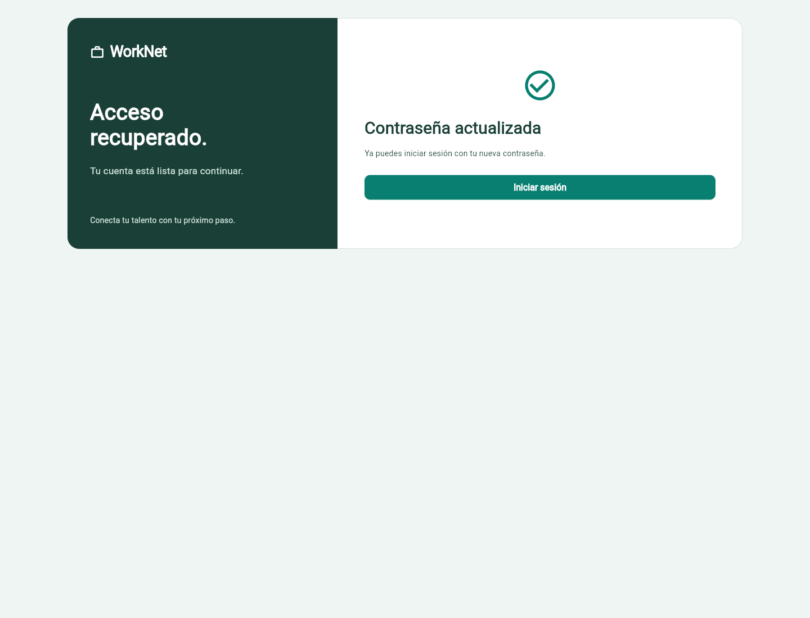
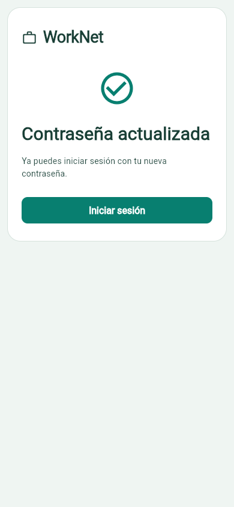

# Correo real — confirmación desde Flutter

19/10/2026. Flutter e integración: **francisco3788**; QA: **Danilo2334**. Se completaron el registro y la recuperación desde la app con los enlaces de los correos recibidos. Falta la revisión del código por otro integrante.

El registro real quedó verificado y permite login/dashboard. La recuperación mediante el enlace recibido cambió la contraseña: HTTP 200 y cambio persistido. La anterior devuelve 400, la sesión previa 401 y reutilizar el enlace devuelve 400. La contraseña nueva permite login/dashboard desde Flutter (200); logout revoca el nuevo token y la base queda sin sesiones activas.

| Caso | Esperado | Obtenido | Comprobación |
| --- | --- | --- | --- |
| Cambio desde el mensaje recibido | Confirmación y URL sin parámetros | HTTP 200; `/password-updated` sin query | Navegador + API |
| Persistencia | Contraseña cambiada | Hash diferente al previo en SQLite | Base aislada |
| Contraseña anterior | Rechazada | HTTP 400 | API |
| Sesión previa / enlace usado | Revocados o rechazados | HTTP 401 / HTTP 400 | API |
| Nueva contraseña | Login y dashboard correctos | HTTP 200 en ambos desde Flutter | Navegador + API |
| Salir después de recuperar | Token nuevo revocado | Logout 200; token 401; cero sesiones activas | Navegador + API + SQLite |

## Confirmación en escritorio

Viewport 1440×1100. Se capturó después del cambio usando el enlace recibido; la pantalla de éxito ya no contiene parámetros privados. Esta imagen muestra presentación; la persistencia y sesiones se respaldan en las comprobaciones anteriores.

## Confirmación en móvil web

Viewport 390×844, mismo resultado del recorrido SMTP. No acredita ejecución nativa ni una captura del buzón.

## Referencias y límites

[Detalle de las pruebas de correo](../../../../backend/docs/evidencias/revision-sprint/SMTP.md). El PR #146 sigue en borrador, pendiente de revisión.

Datos de una SQLite exclusiva de SMTP QA, separada de la base habitual: Django 8007, Flutter 55007. Código de producto sin cambios, `f9e4dea`/`04e7e5c`. Estas dos imágenes y comprobaciones son adicionales a la fase anterior a archivos: no se reejecutaron ni se suman como nuevas sus 77 pruebas Flutter, 103 Django, 50 casos navegador/API o 49 HTTP. Los errores de envío y vencimientos conservan sus pruebas automáticas previas.

No se publican destinatario real, remitente, contraseñas, tokens ni enlaces firmados. Las contraseñas aleatorias de esta cuenta son solo de QA y permanecen en archivos privados ignorados. Falta revisión por otro integrante y validación nativa. No se cierran historias/issues ni se modifican sus criterios, Sprints o fechas.
