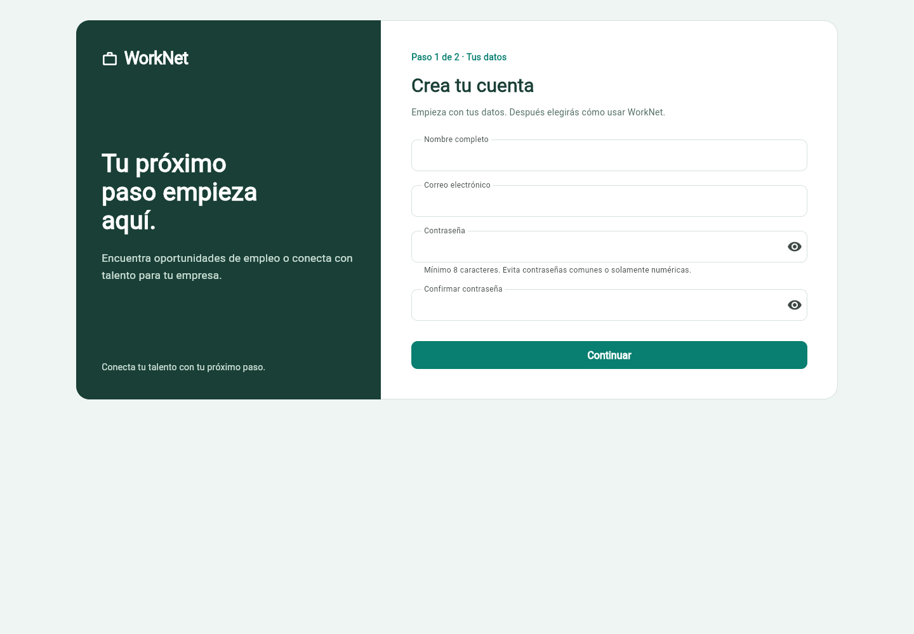
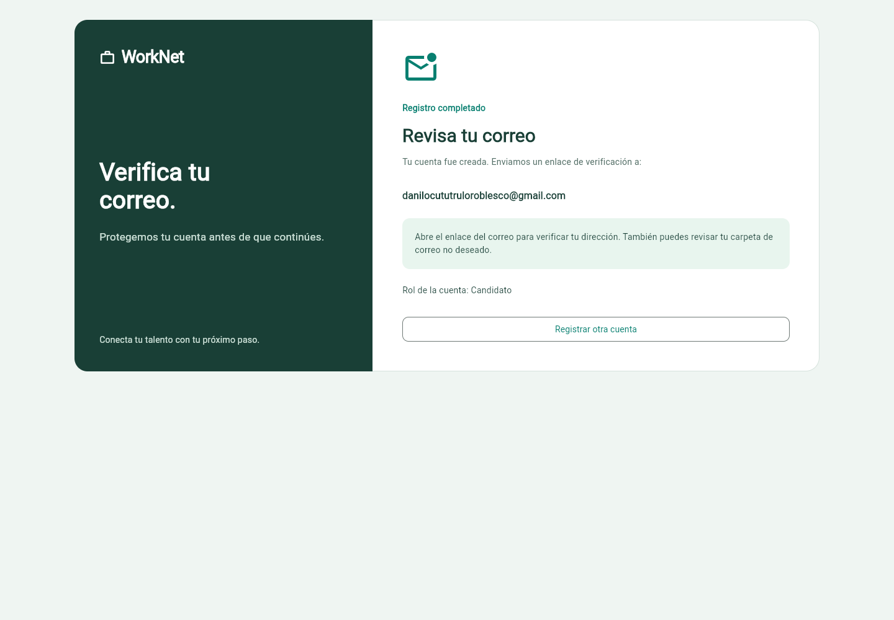
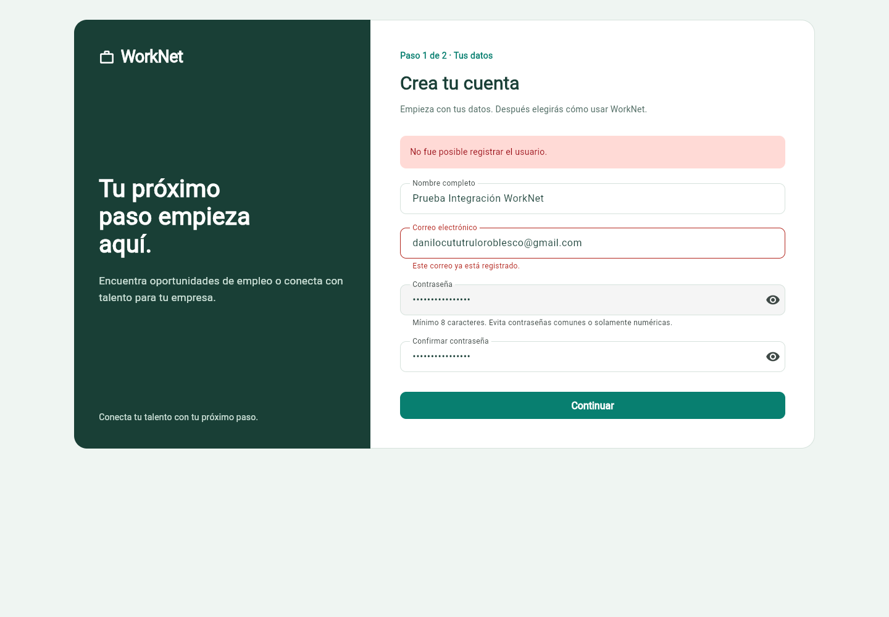

# Reconstrucción de HU001 — evidencia local

**Estado: validación parcial del nuevo frontend, 17 de octubre de 2026.**

Esta evidencia corresponde a la reconstrucción Flutter, relacionada con #29,
#31, #32 y #33. Las tareas cerradas de la entrega anterior no se consideran una
aprobación completa de este bloque nuevo.

## Comprobado

- Campos obligatorios y contraseñas coincidentes impiden avanzar con datos inválidos.
- Selección de Candidato y Empresa antes de enviar los datos.
- Registro contra Django con HTTP 201 y confirmación visual de correo y rol.
- Correo repetido con HTTP 400 y «Este correo ya está registrado.» junto al campo.
- Revisión visual de escritorio sin recortes visibles.

## Pruebas automatizadas

| Área | Comando | Resultado |
| --- | --- | --- |
| Flutter | `flutter analyze` | Sin incidencias |
| Flutter | `flutter test` | 21 pruebas aprobadas |
| Backend | `python manage.py test accounts candidate_dashboard --noinput` | 70 pruebas aprobadas |

El backend se verificó en `feature/backend-sprint-2`, commit `763fceb`,
con la corrección de correo duplicado de Danilo2334. El avance Flutter
y estas evidencias se publican por separado en `frontend`, con Francisco Molina.

## Alcance de la integración local

Flutter se ejecutó en el puerto 55000 y Django en el 8001, con
`API_BASE_URL=http://127.0.0.1:8001/api/`. La comprobación visual utilizó una
copia aislada de SQLite y el backend de correo a archivos de Django, configurados
solo para el proceso de prueba. No se modificó la configuración SMTP del proyecto.

Las capturas muestran el correo solicitado para la prueba. La cuenta se creó
en la copia de prueba y no ocupa ese correo en la base habitual. La pantalla
«Revisa tu correo» demuestra la respuesta HTTP 201; **no demuestra entrega
real en Gmail**.

## Revisión de verificación y login

Responsables: backend y QA, Danilo2334; Flutter e integración, francisco3788.
`develop` se actualizó por fast-forward desde `1365991` hasta `763fceb`, sin
crear otro commit ni cambiar la autoría de la corrección. La actualización se
publicó con Danilo2334 y las 70 pruebas del backend aprobaron en esa rama.

La configuración existente usa SMTP. En el equipo no existe `backend/.env` y
no están configurados `GMAIL_USER` ni `GMAIL_APP_PASSWORD`. No se dispone de una
sesión del buzón para acreditar recepción. Por estos motivos no se intentó un
envío real ni se registró la cuenta en la base habitual.

Se completó una comprobación adicional de la API con base de datos temporal y
correo en memoria. El [resultado sanitizado](verificacion-correo-local.json)
contiene 13 comprobaciones aprobadas, sin contraseñas, enlaces firmados ni
tokens de sesión.

El recorrido central también está cubierto por la prueba existente
`accounts.test_backend_integration.ConsolidatedBackendTests.test_registration_verification_login_and_dashboard_work_together`,
incluida en las 70 pruebas ejecutadas con `python manage.py test accounts candidate_dashboard --noinput`.

| Caso | Resultado esperado | Resultado obtenido | Alcance |
| --- | --- | --- | --- |
| Registro | HTTP 201 y cuenta sin verificar | HTTP 201; `email_verified=false` | API y correo local |
| Recepción en Gmail | Mensaje recibido en el buzón real | No ejecutado: falta configuración SMTP y acceso al buzón | Bloqueado |
| Abrir el enlace del mensaje recibido en Gmail | Verificación HTTP 200 | No ejecutado: no hubo correo real | Bloqueado |
| Abrir el enlace capturado localmente | HTTP 200 y cuenta verificada | HTTP 200; `email_verified=true` | API y correo local |
| Login antes y después de verificar | Rechazo previo y acceso posterior | HTTP 400 antes; HTTP 200 después | API |
| Enlace inválido o expirado | HTTP 400 | HTTP 400 en ambos casos | API |
| Reutilizar enlace ya verificado | Respuesta idempotente HTTP 200 | HTTP 200 | API |
| Acceder al endpoint del dashboard después del login | HTTP 200 | HTTP 200 | API; no prueba navegación Flutter |

El HTTP 201 recibido por Flutter y la presentación de correo y rol conservan
la evidencia visual anterior de esta reconstrucción. El código Flutter no se
modificó en esta ronda; se mantienen los resultados de 21 pruebas y análisis
limpio del commit `fddd990`. Se reutilizan las tres capturas vigentes: no se
añaden imágenes que aparenten una recepción real no comprobada.

## Capturas

### Formulario

### Registro exitoso en la prueba local

### Correo repetido en español

## Pendiente

- Entrega real mediante SMTP y verificación desde el correo recibido.
- Continuación al dashboard del candidato.
- Información empresarial y solicitud de validación.
- Revisión del orden registro/rol: el frontend actual elige el rol antes de crear la cuenta.

Los estados e información reales de empresa dependen también de #64 y #68.
Las listas de cierre vigentes se conservan en sus issues; esta documentación
no cierra #31, #32 ni #33 ni cambia sus criterios originales.

**Esta evidencia no declara HU001 completa.**
