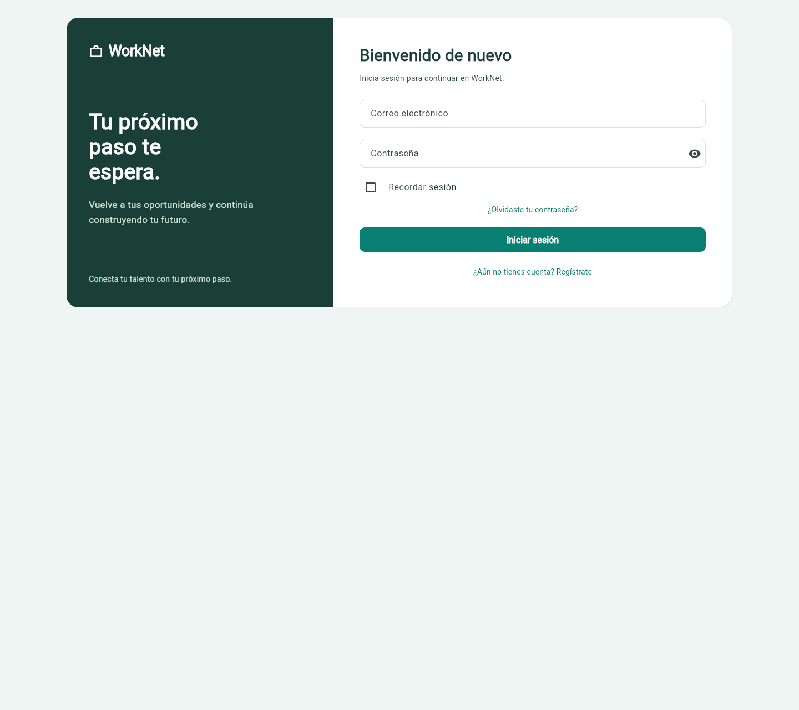
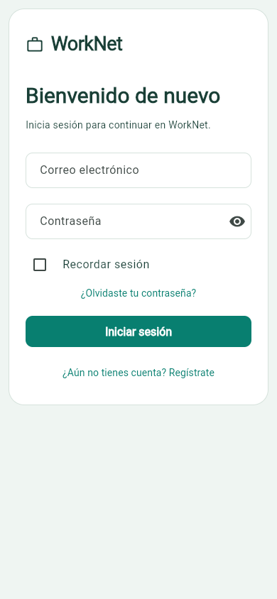
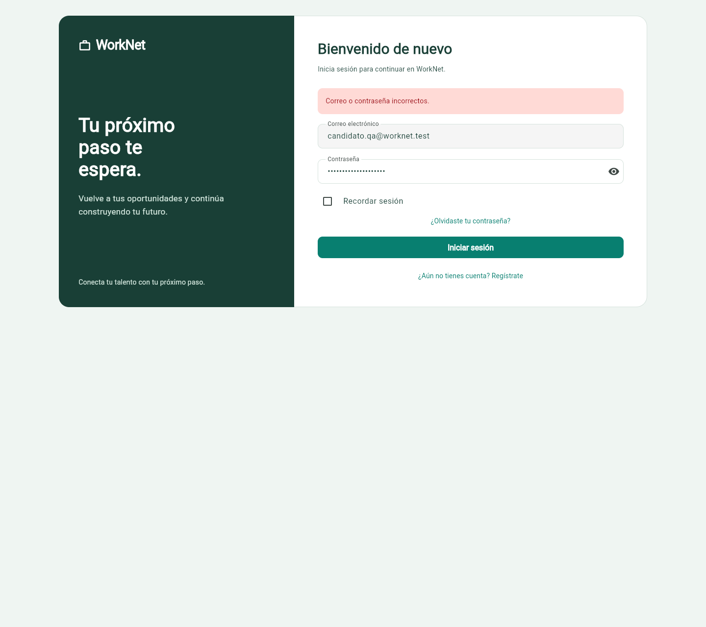
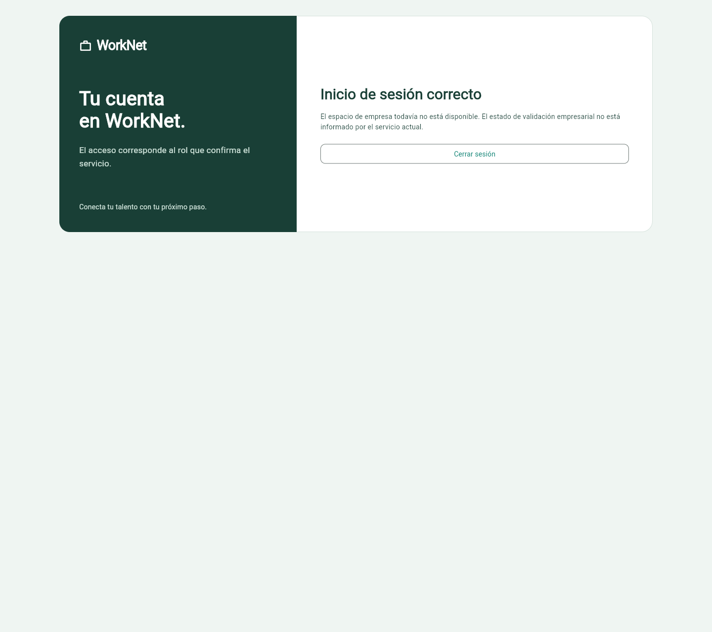

# HU002 — acceso y sesión del candidato

Responsables: implementación e integración, francisco3788; QA, Danilo2334.
Tareas: #34, #36 y #38. Criterios leídos en la historia #3 y las tareas vigentes.

## Qué funciona

El login envía correo normalizado y contraseña exacta a `POST /api/login/`.
Valida obligatorios, muestra errores de Django y conecta registro y recuperación.
Un candidato autenticado abre `/dashboard` y las peticiones privadas llevan
`Authorization: Token`. Recordar sesión conserva la credencial en el almacenamiento
del dispositivo/navegador sin guardar la contraseña. Sin esa opción solo se usa memoria.

Cerrar sesión borra el almacenamiento local y vuelve al login. Un HTTP 401 hace
lo mismo. La recarga directa de `/dashboard` espera a restaurar la sesión y reconstruye
la vista. Una entrada corrupta o un fallo de almacenamiento se trata sin anunciar un
acceso persistido exitoso. El backend todavía no tiene endpoint de revocación para logout.

## Cómo se probó

Análisis Flutter limpio; 40 pruebas Flutter y 70 del backend aprobadas. La suite
incluye contrato de login, persistencia, errores, rutas protegidas, roles y regresión
de recarga directa. En Chrome se utilizó `frontend/tool/qa_backend.py`: SQLite aislada,
cuentas verificadas y contraseñas generadas en archivos privados ignorados por Git.

| Caso | Esperado | Obtenido |
| --- | --- | --- |
| Credenciales incorrectas | Error y posibilidad de reintentar | Mensaje de Django visible; login no concedido |
| Candidato verificado | HTTP 200 y dashboard autenticado | Dashboard con datos de la SQLite QA |
| Recordar sesión y recargar | Restaurar el acceso | Comprobado en Chrome |
| Cerrar sesión y recargar | Volver al login | Comprobado; credencial local eliminada |
| Entrar sin Recordar sesión y recargar | No restaurar la sesión | Comprobado |
| Token revocado en Django | HTTP 401 y limpieza de sesión | Comprobado |
| Empresa/administrador | No inventar destinos ni aprobación | Aviso de destino pendiente; no acceden al dashboard candidato |

El [informe conjunto del navegador](../acceso-candidato/resultados-qa.json)
contiene resultados sanitizados de 19 comprobaciones de acceso, recuperación y dashboard.

## Capturas vigentes

### Login en escritorio

### Login en móvil

### Credenciales incorrectas

### Destino de empresa pendiente

## Qué falta

Los estados reales Pendiente/Aprobada/Rechazada y sus acciones dependen de #64 y #68.
Los dashboards de empresa y administrador tampoco están disponibles. La validación
manual fue web; no se acredita Android ni otros destinos nativos. #36 y #38 conservan
estos límites pendientes y #34 queda disponible para revisión; no se cierra HU002 ni
se modifican los criterios originales o las listas de cierre de las issues.
