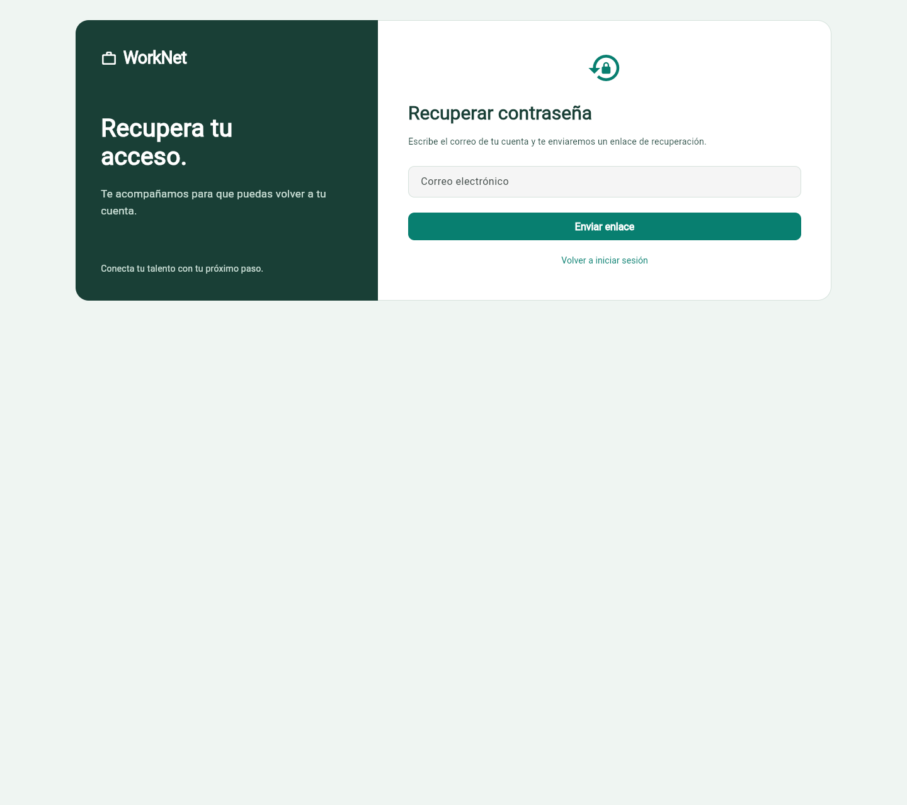
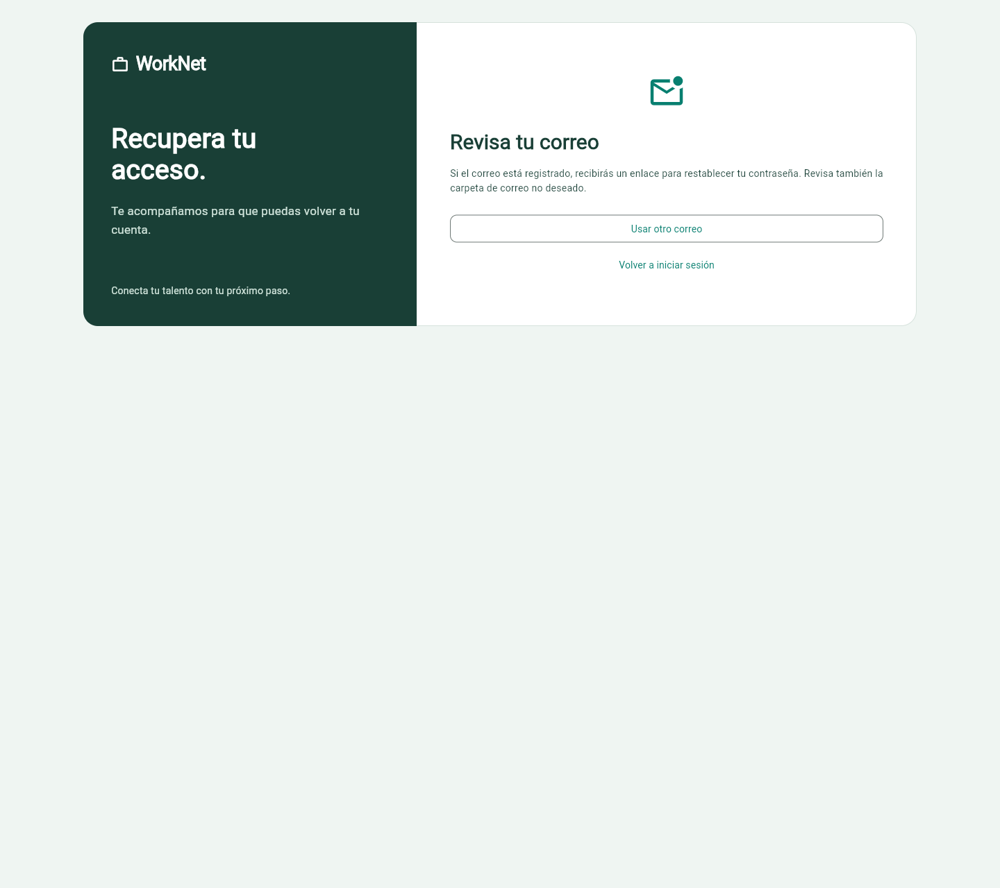
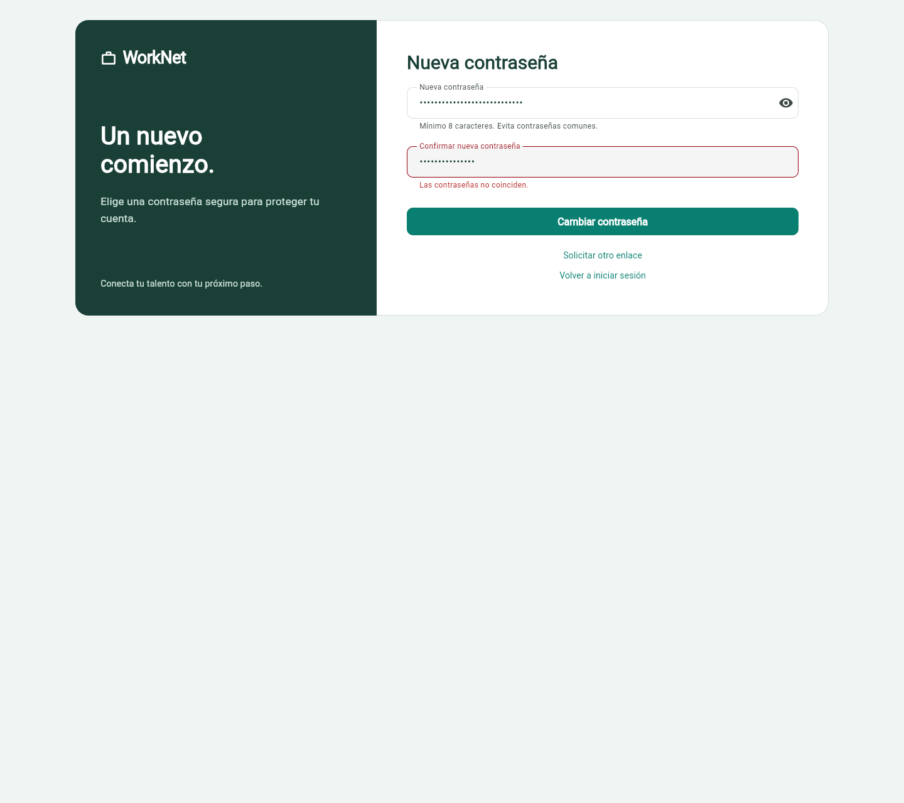
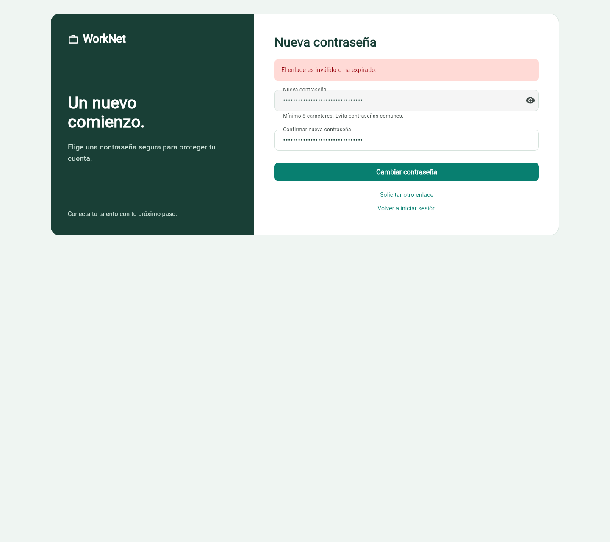
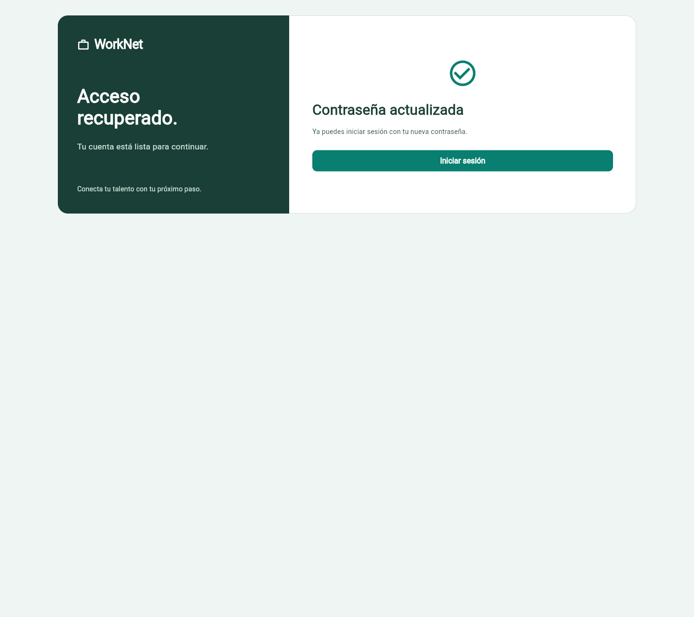
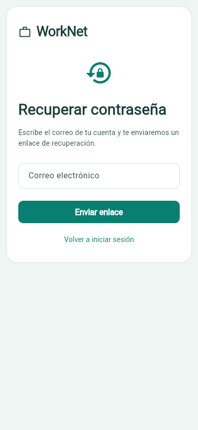
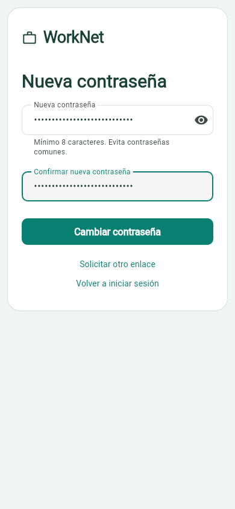

# HU003 — seguimiento actualizado

19/10/2026. La solicitud y confirmación continúan conectadas a Django. Se repitió el recorrido en Chrome con enlace capturado a archivos: cambio confirmado, contraseña anterior rechazada y nueva aceptada. API adicional cubre vencimiento y reutilización. Recuperación SMTP ya comprobada con el enlace recibido que aportó el usuario: cambio persistido, login/dashboard con la nueva contraseña, anterior y enlace usado rechazados y sesiones revocadas. [Capturas de esta continuación](../correo-real/README.md). Falta la revisión del código por otro integrante y las pruebas en Android/iOS.

[Informe vigente, casos nuevos y capturas](../revision-sprint/README.md). Código Flutter `04e7e5c`, backend `f9e4dea`: análisis limpio, **77 pruebas Flutter y 103 Django aprobadas en esta fase**. Estos totales no se atribuyen al informe histórico de abajo. Falta la revisión por otro integrante. PR #146 en borrador.

Las capturas y resultados anteriores se conservan como evidencia de su fecha. Las referencias antiguas a selección previa del rol, logout solo local o destinos empresariales inexistentes quedan superadas por el seguimiento anterior.

## Informe histórico conservado

# HU003 — recuperación de contraseña

Responsables: implementación e integración, francisco3788; QA, Danilo2334.
Tareas: #39, #41 y #42. Criterios leídos en la historia #4 y las tareas vigentes.

## Qué funciona

La solicitud consume `POST /api/password-recovery/request/` y conserva el mensaje
genérico para no confirmar si un correo pertenece a una cuenta. El enlace abre
`/reset-password?uid=…&token=…` y el formulario envía los campos `uid`, `token`,
`new_password` y `new_password_confirm` a `/api/password-recovery/confirm/`.

Se valida la coincidencia de contraseñas, se muestra el rechazo de enlaces inválidos,
expirados o reutilizados y se ofrece solicitar otro. Solo tras respuesta exitosa se
confirma el cambio y se vuelve al login. La pantalla de éxito elimina los parámetros
del enlace de la URL y limpia las contraseñas de los controladores. El nuevo login se
realiza con la contraseña nueva; Django revoca el token anterior al restablecerla.

## Cómo se probó

Análisis limpio, 40 pruebas Flutter y 70 del backend aprobadas. En Chrome se solicitó
un correo mediante la API, se extrajo el enlace del archivo local generado por Django
y se completó el formulario. Un enlace de QA firmado con antigüedad superior al plazo
configurado permitió comprobar el rechazo por vencimiento sin cambiar el timeout real.

| Caso | Esperado | Obtenido |
| --- | --- | --- |
| Solicitar enlace | Respuesta genérica de API | HTTP 200 y mensaje visible |
| Correo de QA | Mensaje generado localmente | Archivo de correo capturado; no enviado a Gmail |
| Contraseñas diferentes | Bloqueo local | Error visible y ningún cambio |
| Enlace vencido | Rechazo del backend | HTTP 400, aviso y opción de solicitar otro |
| Enlace válido | Confirmación del cambio | HTTP 200 y «Contraseña actualizada» |
| URL posterior al cambio | Sin parámetros del enlace | Comprobado en navegador |
| Reutilizar enlace después del cambio | Rechazo | HTTP 400 |
| Contraseña anterior | Login rechazado | HTTP 400 |
| Contraseña nueva | Login y dashboard | HTTP 200 y datos reales de la SQLite QA |

El [informe conjunto](../acceso-candidato/resultados-qa.json) no contiene contraseñas
ni enlaces firmados. Las pruebas automatizadas cubren además el enlace ausente,
el inválido y el error SMTP sin anunciar un envío exitoso.

## Capturas vigentes

## Qué falta

La recepción SMTP real y la apertura del enlace desde un buzón recibido siguen
bloqueadas: no existe `backend/.env`, faltan credenciales y no hay sesión del buzón.
La prueba local no equivale a recepción en Gmail. Configurar localmente el remitente,
la contraseña de aplicación y `PASSWORD_RESET_FRONTEND_URL` al origen real antes de
esa validación; nunca incluirlos en commits. #39 queda para revisión, #41 acredita
integración local y #42 conserva pendiente la entrega real. No se cierra HU003.
