# HU004 — configuración de cuenta conectada a Django

Implementación e integración: **Francisco Molina / francisco3788** (#43 y #46).
QA ejecutado mediante automatización y registrado como **Danilo2334** (#46).
La revisión humana por otro integrante **no ha ocurrido y permanece pendiente**.

Código comprobado: [1f9a341](https://github.com/Danilo2334/Work_net/commit/1f9a34136e65904965a5b7005f6bea174dc576a8).
Se leyeron la historia #5 y las tareas #43, #44, #45 y #46. Se conservan los
contratos y la lógica Django existentes; esta entrega no modifica el backend.

## Qué funciona

El icono «Configuración de cuenta» del dashboard abre `/account`, ruta protegida
por la sesión. La pantalla conserva el diseño del registro y acceso existentes.
Incluye carga, errores del servicio, reintento, validaciones y confirmaciones.

| Acción | Contrato Django | Comportamiento de Flutter |
| --- | --- | --- |
| Consultar cuenta | `GET /api/account/` | Nombre, correo, rol y verificación reales |
| Guardar nombre | `PATCH /api/account/` con `full_name` | Solo envía el nombre; actualiza la sesión |
| Cambiar contraseña | `POST /api/account/password/` | Contraseña actual, nueva y confirmación; sustituye el token |
| Consultar preferencias | `GET /api/account/notifications/` | Lee el booleano recibido |
| Guardar preferencias | `PATCH /api/account/notifications/` | Envía `push_notifications` como booleano JSON |
| Eliminar cuenta | `DELETE /api/account/delete/` | JSON con contraseña actual y `confirmation: true`, tras diálogo y casilla explícita |

Correo, rol y verificación se muestran como datos de solo lectura. La preferencia
push se consulta y guarda; este alcance no acredita entrega de notificaciones a un
dispositivo. Una respuesta malformada produce error, sin inventar preferencias.

Al cambiar la contraseña se conserva la elección de Recordar sesión: reemplaza
la credencial persistida si estaba activada; mantiene el nuevo token solo en
memoria si no lo estaba. El nombre también se actualiza en la sesión. Un HTTP 401
limpia el acceso. Tras eliminar la cuenta se limpia la sesión y se vuelve al login.

## Entorno y pruebas

- Windows, Flutter web en Chrome; escritorio **1440×1280** y móvil **390×844**.
- Flutter `http://localhost:55002`; Django `http://127.0.0.1:8003/api/`.
- SQLite nueva y separada, creada con `frontend/tool/qa_backend.py`; cuentas,
  empresas y ofertas identificadas como QA. La base habitual no se utilizó.
- La eliminación se ejecutó exclusivamente con `eliminar.qa@worknet.test`,
  cuenta desechable creada por esa herramienta.
- `flutter analyze`: **sin incidencias**.
- `flutter test`: **54 pruebas aprobadas**, incluidas las 40 anteriores y 14
  nuevas sobre configuración, sesión, errores, confirmación y vista móvil.
- `python manage.py test accounts candidate_dashboard --noinput`: **70 aprobadas**.
- **28 comprobaciones nuevas aprobadas** contra Django real en el navegador y
  por consultas auxiliares a la API. [Informe sanitizado](resultados-qa.json).
- Regresión automatizada de registro, login, recuperación y dashboard incluida
  en las 54 pruebas. Las [19 comprobaciones previas del acceso](../acceso-candidato/resultados-qa.json)
  se conservan como evidencia de su entrega original; no se presentan como una
  nueva ejecución manual en esta fase.

| Caso | Esperado | Obtenido |
| --- | --- | --- |
| Acceso sin sesión | Ruta al login; API protegida | Redirección y HTTP 401 en cuenta/preferencias |
| Entrada desde dashboard | Consultar los datos propios | Información real visible |
| Guardar nombre y consultar de nuevo | Conservar el nombre en API y sesión | HTTP 200, recarga y saludo del dashboard actualizados |
| Guardar notificaciones en `false` | Booleano conservado | HTTP 200; API y recarga muestran desactivado |
| Contraseñas distintas | No ejecutar el cambio | Error local visible |
| Contraseña actual incorrecta | Rechazar sin rotar token | HTTP 400; mensaje del backend visible |
| Cambio válido | Renovar sesión | HTTP 200; token anterior recibe HTTP 401 |
| Contraseña anterior tras el cambio | Rechazar login | HTTP 400 |
| Recordar sesión activado | Restaurar token nuevo | Recarga de configuración correcta |
| Recordar sesión desactivado | No convertirla en persistente | Token nuevo permite dashboard; recarga pide login |
| Red desconectada y reintento | Error recuperable | Error visible; guardar funciona al reconectar |
| Cancelar eliminación | Conservar cuenta, sin DELETE desde UI | Consulta posterior HTTP 200 |
| No marcar confirmación | Impedir envío | Botón final deshabilitado |
| Omitir `confirmation` / enviar `false` a API | Rechazar eliminación | HTTP 400 en ambos casos |
| Contraseña incorrecta al eliminar | Conservar la cuenta | HTTP 400; consulta posterior HTTP 200 |
| Eliminación explícita y contraseña correcta | Eliminar y limpiar sesión | HTTP 200, aviso y login; token HTTP 401, nuevo login HTTP 400 |

Las pruebas automatizadas comprueban además el JSON exacto de PATCH/DELETE,
el rechazo de preferencias malformadas, carga con reintento, 401 y la salida
segura si falla la persistencia después de renovar el token.

## Capturas vigentes

### Cuenta en escritorio y móvil

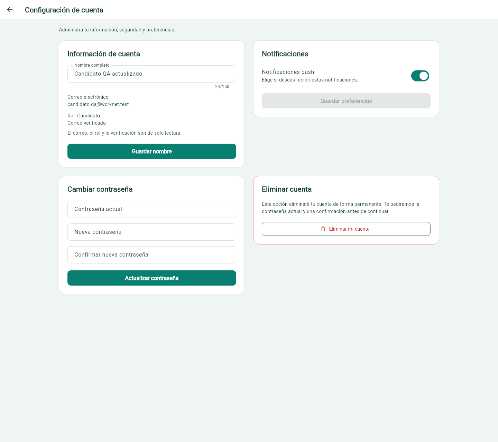

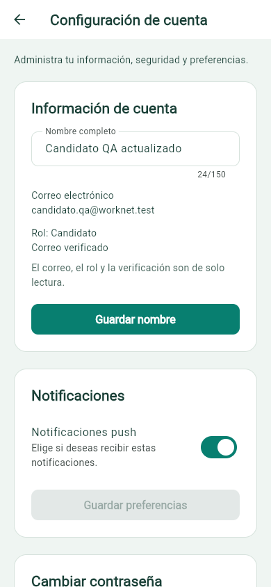

### Datos y preferencias guardados

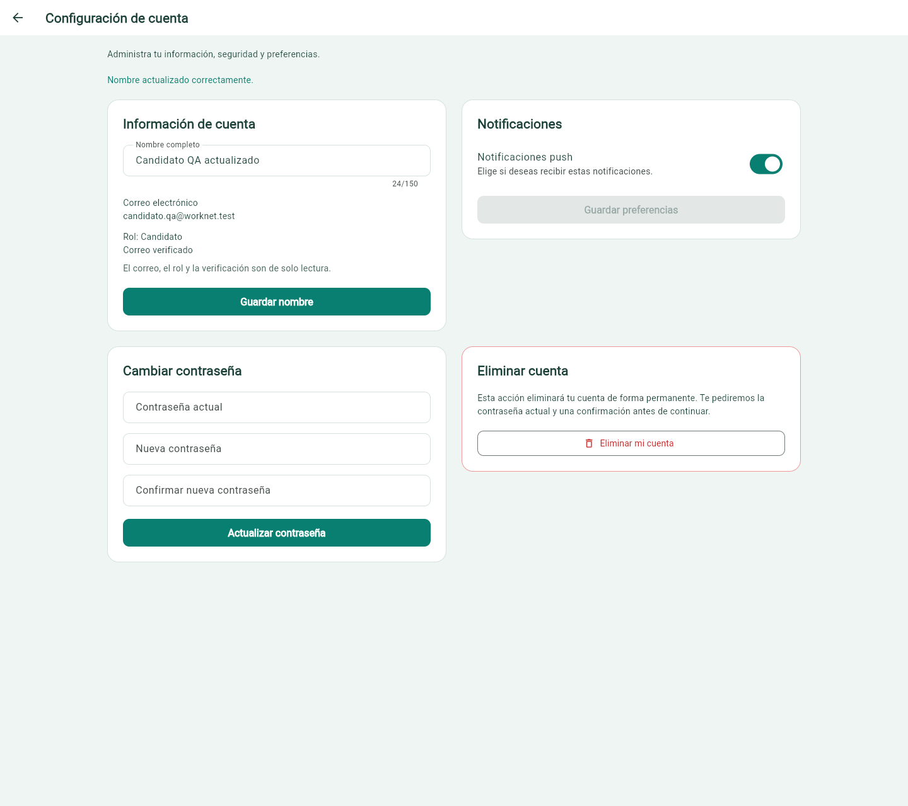

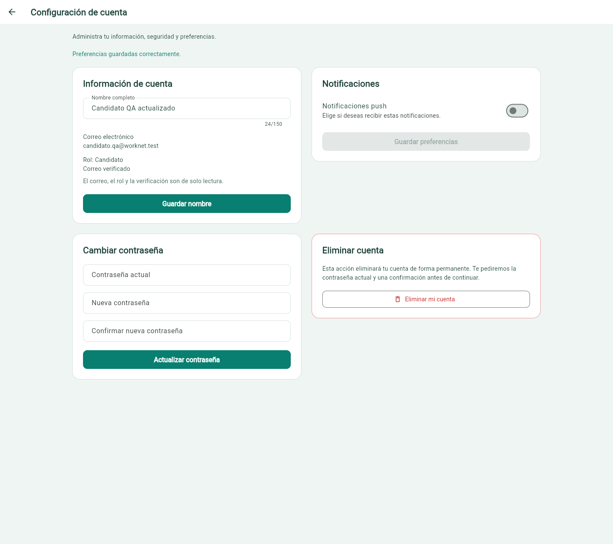

### Seguridad, validaciones y cambio confirmado

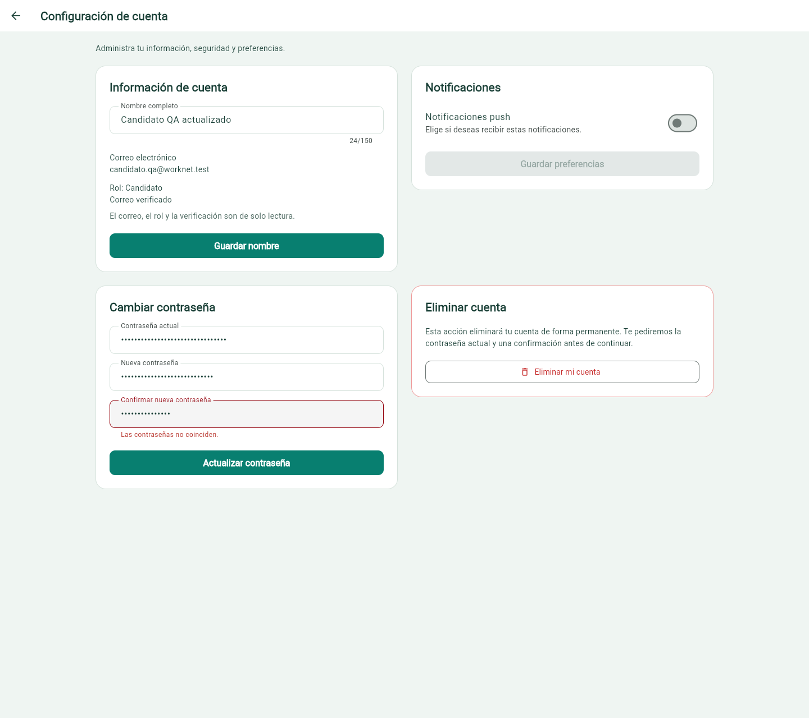

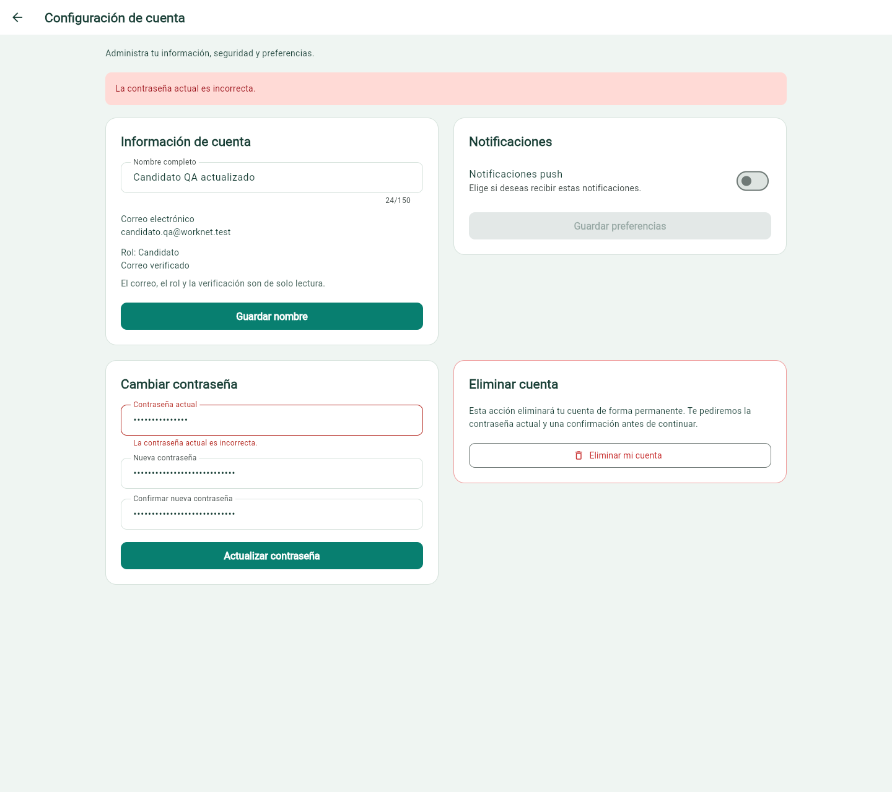


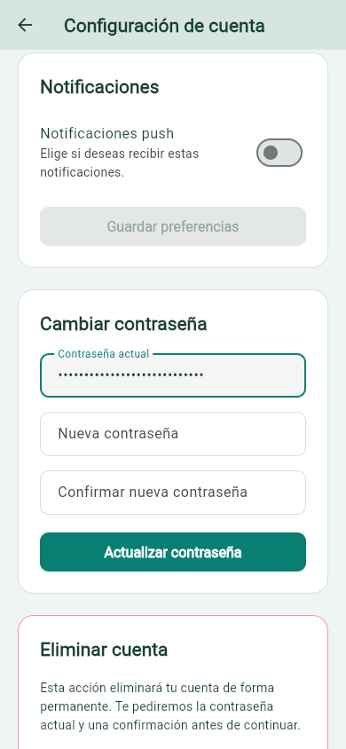

### Error recuperable y eliminación explícita

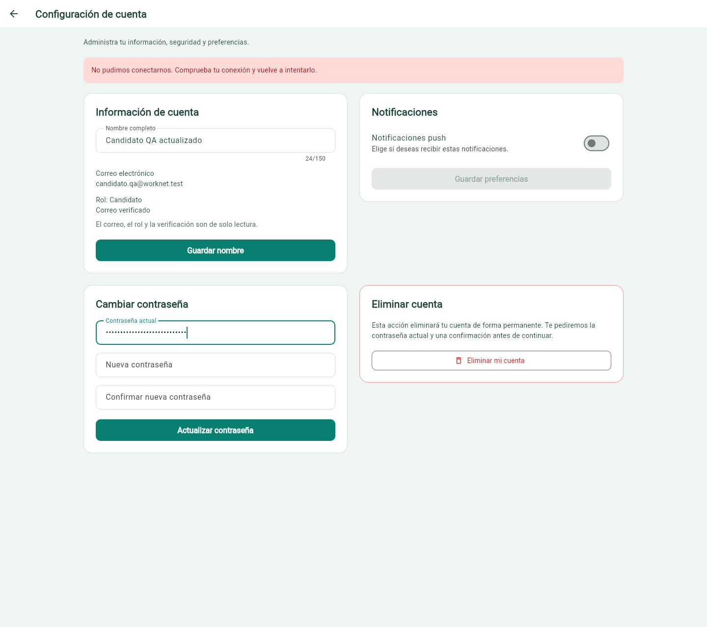

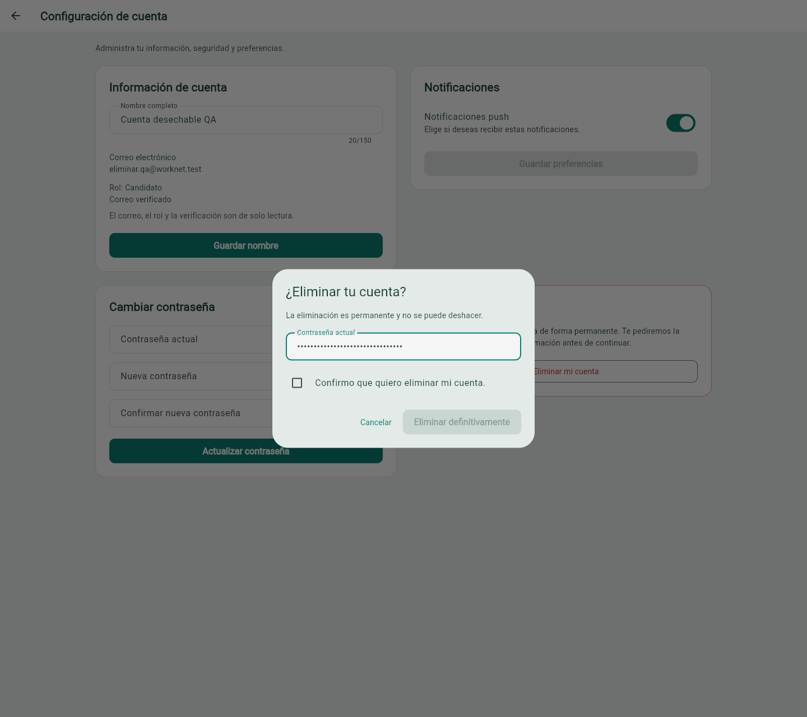

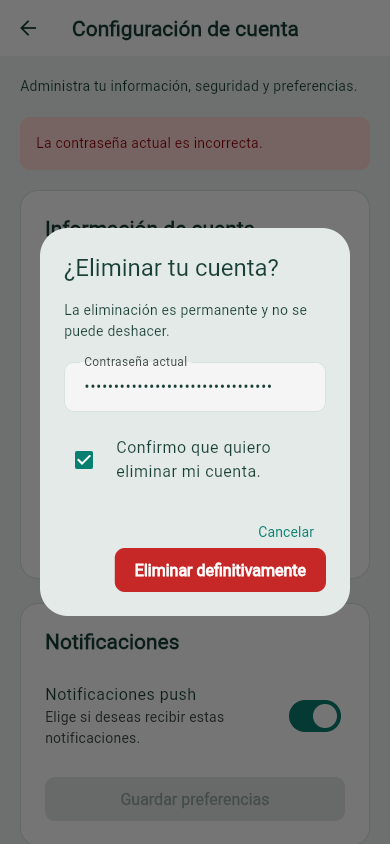

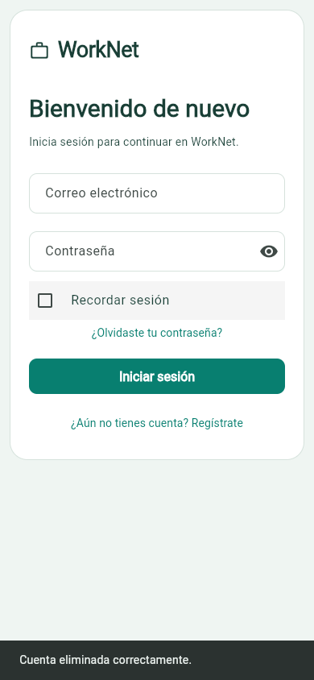

Son **12 capturas nuevas**. Las contraseñas están ocultas y no se incluyen tokens,
cabeceras de autorización ni enlaces firmados. La captura móvil de confirmación
conserva detrás el aviso del intento previo con contraseña incorrecta; corresponde
a la misma cuenta desechable y no a un fallo de la eliminación confirmada.

## Reproducir con una base aislada

Desde la raíz:

```powershell
python frontend/tool/qa_backend.py --port 8003 --frontend-origin http://localhost:55002
```

Desde otra terminal en `frontend`:

```powershell
flutter run -d chrome --web-port 55002 --dart-define=API_BASE_URL=http://127.0.0.1:8003/api/
```

Las credenciales aleatorias se guardan únicamente en
`frontend/.dart_tool/worknet_qa/latest.json`, ignorado por Git. Cada ejecución
crea otra base y otra cuenta desechable. No publicar ese archivo ni la base.

## Estado para revisión y pendientes

#43 y #46 tienen implementación, integración técnica y evidencia de QA disponibles
para revisión formal. #44 y #45 conservan su backend existente y ahora cuentan con
evidencia de consumo desde Flutter en #46. **Ninguna de las cuatro tareas cumple
todavía todos los criterios de cierre**, porque falta la revisión por otro integrante.
Las casillas de revisión formal y humana se conservan sin marcar; no se cierran tareas.

SMTP real, estados empresariales (#64/#68), destinos empresa/administrador,
módulos restantes del dashboard y revisión del orden registro/rol siguen pendientes
en sus historias. La comprobación visual fue web; no acredita validación nativa.
El logout ordinario continúa siendo local: Django no tiene endpoint de revocación
para ese cierre; el cambio de contraseña sí rota el token y la eliminación lo revoca.

El [PR #146](https://github.com/Danilo2334/Work_net/pull/146) permanece en borrador
y sin fusionar. No se declara una aprobación humana inexistente.
