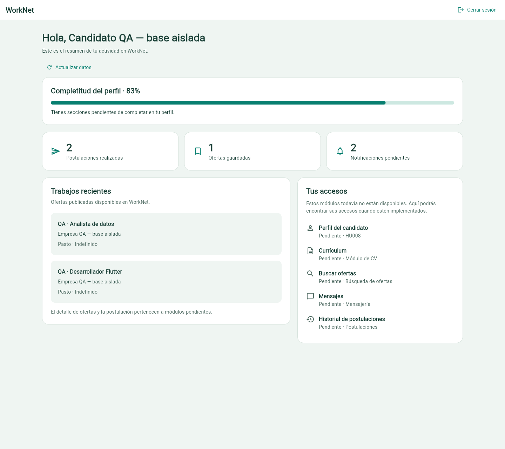
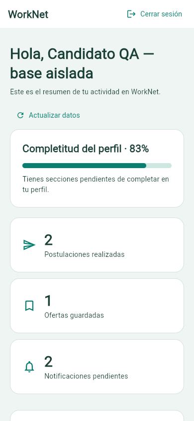
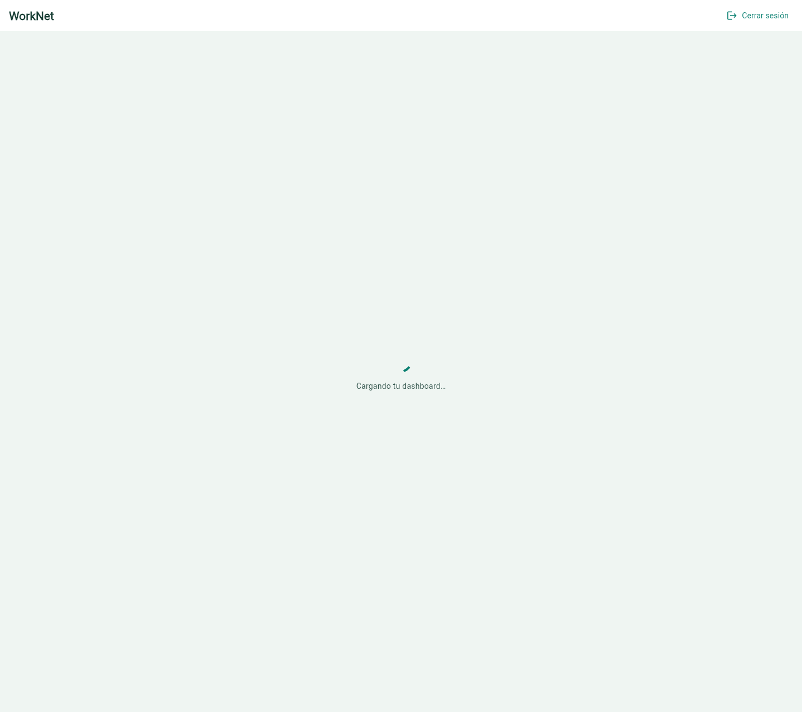
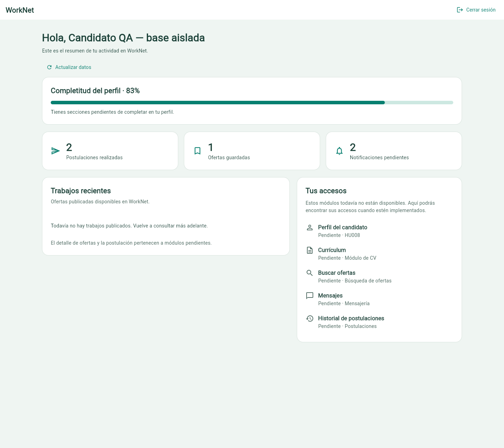
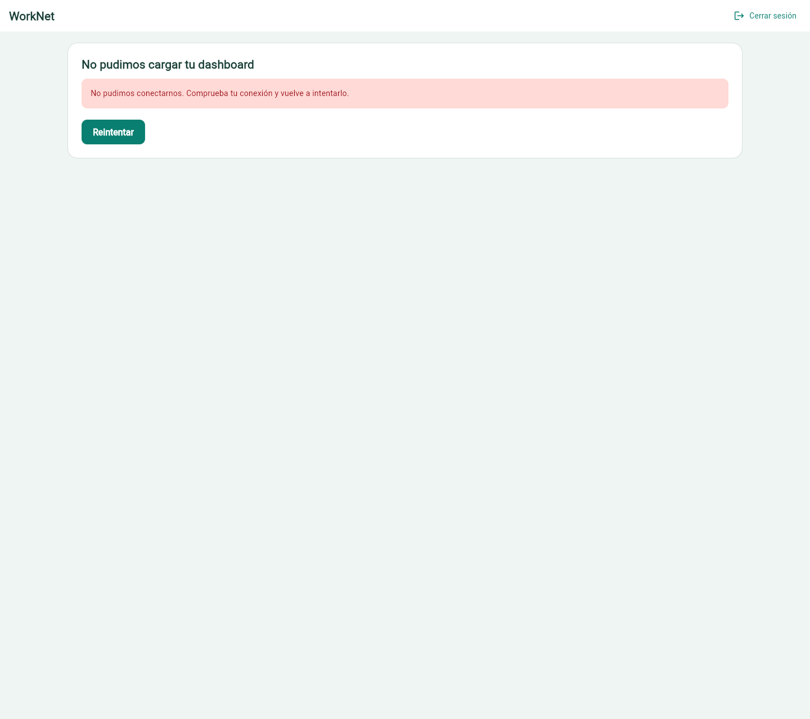

# HU005 — seguimiento actualizado

19/10/2026. El resumen usa métricas y ofertas reales. Se comprobó otra cuenta candidata en Chrome: guardar descripción y regresar actualiza la completitud de Django a 33%. El perfil está accesible. CV, búsqueda, mensajes, historial y detalle/postulación siguen pendientes de sus módulos; no hay botones de navegación vacíos que aparenten estar disponibles.

[Informe vigente, casos nuevos y capturas](../revision-sprint/README.md). Código Flutter `04e7e5c`, backend `f9e4dea`: análisis limpio, **77 pruebas Flutter y 103 Django aprobadas en esta fase**. Estos totales no se atribuyen al informe histórico de abajo. Falta la revisión por otro integrante. PR #146 en borrador.

Las capturas y resultados anteriores se conservan como evidencia de su fecha. Las referencias antiguas a selección previa del rol, logout solo local o destinos empresariales inexistentes quedan superadas por el seguimiento anterior.

## Informe histórico conservado

# HU005 — dashboard del candidato conectado a Django

Responsables: implementación e integración, francisco3788; QA, Danilo2334.
Tareas: #47, #49 y #50. Criterios leídos en la historia #6 y las tareas vigentes.

## Qué funciona

Un candidato autenticado consume `GET /api/dashboard/candidate/` con el token de
sesión. Se muestran completitud, postulaciones, ofertas guardadas, notificaciones
pendientes y trabajos recientes. Los valores proceden del JSON de Django; el código
Flutter no incorpora ofertas ni métricas de demostración ni sustituye valores ausentes
por números inventados. Una respuesta malformada muestra error.

Existen estados de carga, falta de ofertas publicadas, error de red/servidor y reintento.
Actualizar datos vuelve a consultar la API. Un 401 limpia la sesión. La vista es
adaptable y permite desplazamiento vertical normal en móvil.

## Cómo se probó

Análisis limpio, 40 pruebas Flutter y 70 del backend aprobadas. El navegador se
conectó a Django en 8002 desde Flutter en 55001, usando la SQLite creada por
`frontend/tool/qa_backend.py`. Usuarios, empresas y ofertas se identifican como QA.

| Dato | Filas de la base QA | JSON/resultado mostrado |
| --- | --- | --- |
| Perfil | 5 de 6 secciones | 83% |
| Postulaciones | 2 | 2 |
| Guardados | 1 | 1 |
| Notificaciones no leídas | 2 | 2 |
| Ofertas publicadas | 2 | 2 trabajos recientes |

Se contrastaron esos cinco valores con la respuesta de la API. El estado vacío se
obtuvo cerrando las ofertas en esa base aislada y actualizando el dashboard. Para
carga/error se aplicaron latencia y desconexión de red en Chrome; se restauró la
conexión y el reintento recuperó los datos. No se falsificaron las respuestas de Django.
Un token revocado en la base de QA produjo HTTP 401 y retorno al login.

## Capturas vigentes

## Qué falta

El acceso al perfil del candidato ya está habilitado y conectado en [HU008](../hu008/README.md),
incluido el recálculo del dashboard al regresar. Las capturas de esta página
conservan el estado de la entrega anterior del resumen.

Los accesos a CV, búsqueda, mensajes e historial de postulaciones
no tienen módulos implementados en esta entrega. Se muestran como pendientes, sin
botones de navegación vacíos. El detalle de ofertas y la postulación también requieren
sus pantallas y API de escritura. El resumen disponible de HU005 no sustituye esas APIs.

#49 queda disponible para revisión de la integración de datos; #47 y #50 conservan
pendientes los accesos funcionales y la revisión completa. No se cierra HU005 ni se
modifican criterios originales. [Informe conjunto de QA](../acceso-candidato/resultados-qa.json).
