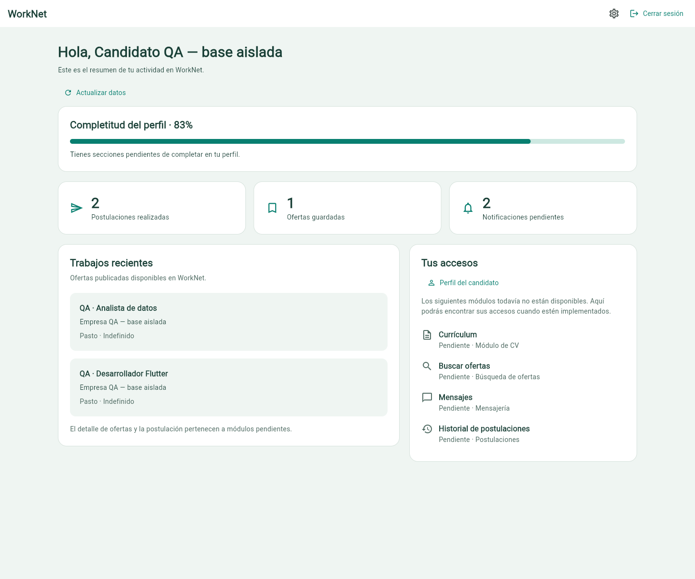
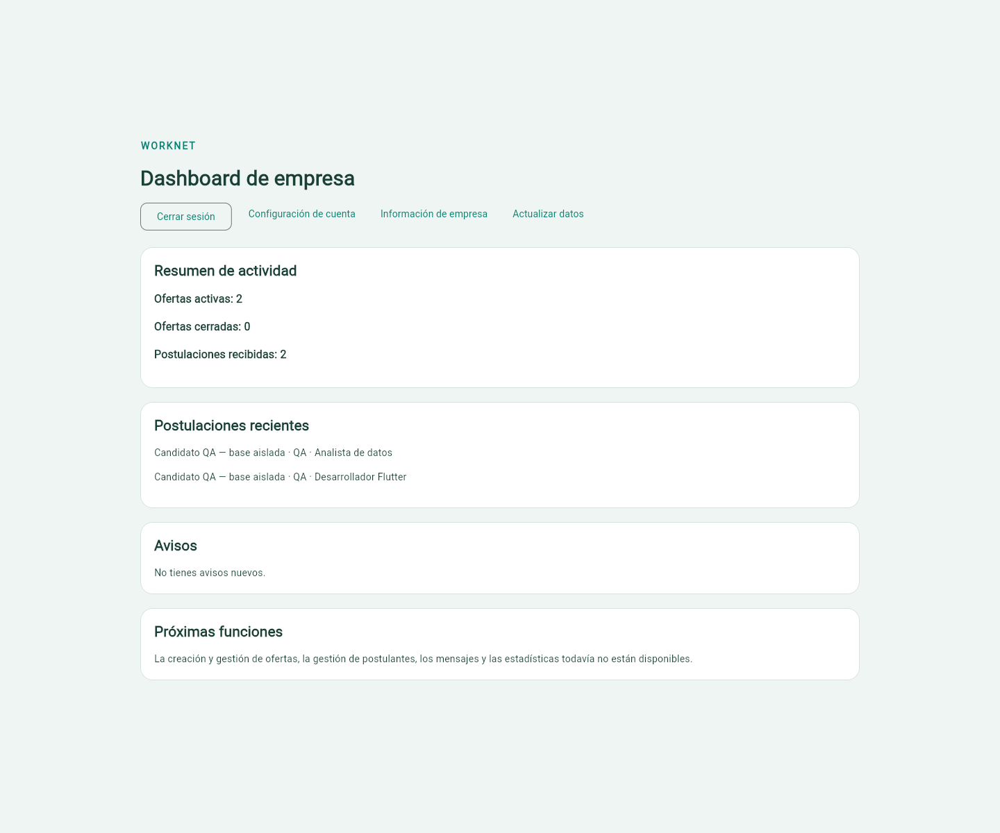
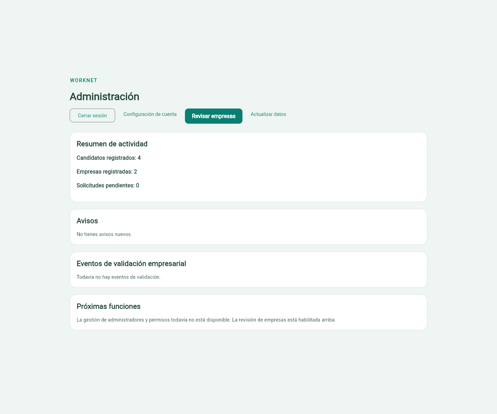

# Demostración aislada preparada para revisión

19/10/2026, America/Bogota. Demostración nueva, distinta de la SQLite previa de pruebas y de la instancia SMTP. **No acredita revisión humana**. Backend y QA: Danilo2334; documentación de interfaz/integración: francisco3788. PR #146 en borrador y sin fusionar.

## Abrir y revisar

Abrir `http://localhost:55006`. Django está en `127.0.0.1:8006`; la aplicación usa esa API real. La base habitual no se modifica. La instancia SMTP 8007/55007 se conserva y no se reenviaron correos reales durante esta preparación.

Las siete cuentas tienen una contraseña aleatoria de QA que se consulta **solo localmente** en `frontend/.dart_tool/worknet_qa/latest.json`. Las bases anteriores siguen en sus directorios privados; el puntero previo se conservó antes de renovar la demostración. No se publican contraseñas, tokens, correos de archivos ni rutas privadas con esos contenidos.

| Cuenta ficticia | Estado inicial y uso |
| --- | --- |
| candidato.qa@worknet.test | Perfil 83%, 2 postulaciones, 1 guardado, 2 avisos pendientes, 2 ofertas recientes |
| vacio.qa@worknet.test | Perfil básico 17%, métricas propias en cero |
| perfil.qa@worknet.test | Empezar CRUD/foto desde perfil vacío |
| empresa.qa@worknet.test | Aprobada; 2 ofertas activas, 0 cerradas, 2 postulaciones |
| nueva.empresa.qa@worknet.test | Pendiente sin solicitud enviada: completar datos y pedir validación |
| admin.qa@worknet.test | 4 candidatos, 2 empresas, 0 solicitudes completas pendientes |
| eliminar.qa@worknet.test | Desechable para contraseña/eliminación; usar al final |

Estos son valores iniciales de esta base, no constantes de Flutter. Cambian cuando los revisores registran cuentas, envían solicitudes o editan perfiles.

[Guion corto y reparto de revisión cruzada](../../REVISION.md) · [Tabla de las 42 tareas](../../REVISION_CIERRE.md) · [Criterios originales, código, pruebas y evidencia](criterios.md).

## Comprobaciones nuevas de preparación

Se ejecutaron `python manage.py check` (sin incidencias) y `python manage.py makemigrations --check --dry-run` (sin cambios). El arranque aplicó las migraciones a una nueva SQLite. Se comprobó que el código de producto coincide con el validado en `04e7e5c`/`f9e4dea`; por eso se reutilizan las suites ya publicadas de 77 Flutter y 103 Django sin atribuirlas a una ejecución nueva de esta preparación.

El navegador y la API confirmaron cinco accesos/destinos reales, sus datos iniciales, logout con token rechazado 401 y administración anónima 401. [Resultados sanitizados](demo-comprobada.json). No se editaron perfiles, no se enviaron solicitudes ni se eliminaron cuentas durante esta comprobación. Las sesiones temporales se cerraron, para conservar la base lista para la revisión.

| Caso | Tipo | Esperado | Obtenido |
| --- | --- | --- | --- |
| Acceso candidato.qa@worknet.test | Flutter + API | 200 | 200 |
| Consulta dashboard/candidate/ | API | 200 | 200 |
| Datos iniciales de candidato.qa@worknet.test | API real contra fixtures | {"completion": 83, "applications_count": 2, "saved_offers_count": 1, "pending_notifications_count": 2} | {"completion": 83, "applications_count": 2, "saved_offers_count": 1, "pending_notifications_count": 2} |
| Revocación de candidato.qa@worknet.test | Flutter + API | 401 | 401 |
| Acceso empresa.qa@worknet.test | Flutter + API | 200 | 200 |
| Consulta dashboard/company/ | API | 200 | 200 |
| Datos iniciales de empresa.qa@worknet.test | API real contra fixtures | {"active_offers": 2, "closed_offers": 0, "applications": 2} | {"active_offers": 2, "closed_offers": 0, "applications": 2} |
| Revocación de empresa.qa@worknet.test | Flutter + API | 401 | 401 |
| Acceso nueva.empresa.qa@worknet.test | Flutter + API | 200 | 200 |
| Consulta company/ | API | 200 | 200 |
| Datos iniciales de nueva.empresa.qa@worknet.test | API real contra fixtures | {"state": "pending", "submitted": false} | {"state": "pending", "submitted": false} |
| Revocación de nueva.empresa.qa@worknet.test | Flutter + API | 401 | 401 |
| Acceso admin.qa@worknet.test | Flutter + API | 200 | 200 |
| Consulta dashboard/admin/ | API | 200 | 200 |
| Datos iniciales de admin.qa@worknet.test | API real contra fixtures | {"candidates": 4, "companies": 2, "pending_companies": 0} | {"candidates": 4, "companies": 2, "pending_companies": 0} |
| Revocación de admin.qa@worknet.test | Flutter + API | 401 | 401 |
| Acceso vacio.qa@worknet.test | Flutter + API | 200 | 200 |
| Consulta dashboard/candidate/ | API | 200 | 200 |
| Datos iniciales de vacio.qa@worknet.test | API real contra fixtures | {"completion": 17, "applications_count": 0, "saved_offers_count": 0, "pending_notifications_count": 0} | {"completion": 17, "applications_count": 0, "saved_offers_count": 0, "pending_notifications_count": 0} |
| Revocación de vacio.qa@worknet.test | Flutter + API | 401 | 401 |
| Administración sin sesión | API | 401 | 401 |

## Candidato con actividad



Datos iniciales reales de QA y acceso al perfil; módulos futuros identificados. Captura de escritorio 1440×1200, datos ficticios.

## Empresa aprobada



Ofertas y postulaciones propias reales; la gestión futura continúa pendiente. Captura de escritorio 1440×1200, datos ficticios.

## Empresa antes de enviar información


Estado inicial y campos para solicitar revisión; aún no hay solicitud completa. Captura de escritorio 1440×1200, datos ficticios.

## Administración sin solicitudes completas pendientes



Conteos reales iniciales y entrada al listado de revisión. No acredita gestión de administradores/permisos. Captura de escritorio 1440×1200, datos ficticios.

## Repetir la preparación

Si la demostración ya está activa, usarla. Para otra base nueva, detener **solo el proceso de QA de esa demostración** desde su terminal y ejecutar desde la raíz:

```powershell
python frontend/tool/qa_backend.py --port 8006 --frontend-origin http://localhost:55006
```

Desde otra terminal en `frontend`, ejecutar Flutter como indica `docs/REVISION.md`. Cada arranque genera otro directorio de SQLite y correo a archivos; las credenciales nuevas quedan en el archivo privado. Evitar iniciar otro servidor sobre el puerto ocupado. Los mensajes a archivos son solo de demostración; el [correo real de registro y recuperación](../../../../backend/docs/evidencias/revision-sprint/SMTP.md) conserva su evidencia separada.

La revisión cruzada está pendiente de que Danilo y Francisco ejecuten los casos y registren su resultado. Esta preparación no cambia estados/asignaciones ni marca casillas de revisión. La pertenencia al Sprint 2 sigue sin confirmarse por falta de `read:project`.
